<div align="center">
 

Universidad Peruana de Ciencias Aplicadas  
Carrera de Ingeniería de Software  

**1ASI0729**  


**Desarrollo de Aplicaciones Open Source**  
NRC  
**7753**  
### **Informe del Trabajo Final**  
Docente  
**Bautista Ubill├║s, Efrain Ricardo**


  
Equipo  
**InnovaCorp**  
Proyecto  
**Reliant**

**Integrantes**

| C├│digo     | Apellidos y Nombres                  |
|:----------:|:-------------------------------------| 
| u20241b962 | Navarro Aldoradin, Carolina Celeste  |
| u20241f577 | Rivera Aguilar, Scarlet Josefina     |
| u202317807 | Fernandez Seer, Mario Alonso         |

**Periodo 202620**  


**Octubre, 2026**

</div>

<div style="page-break-after: always"></div>

# Registro de Versiones del Informe
| Versi├│n | Fecha | Autor | Descripci├│n de modificaci├│n |
|---------|-------|-------|-----------------------------|
| 1.0.1 | 2026-09-18 | Equipo InnovaCorp | Entrega AV1: capítulos I a IV (Startup Profile, Solution Profile, Requirements Elicitation & Analysis, Requirements Specification y Product Design) y sección 5.1 Software Configuration Management. |
| 2.0.0 | 2026-10-02 | Rivera Aguilar, Scarlet Josefina | Retiro de los dos integrantes que dejaron el equipo de los perfiles de integrantes; correcci├│n de la fila duplicada y de los datos de Fernandez Seer, Mario Alonso. |
| 2.0.0 | 2026-10-05 | Navarro Aldoradin, Carolina Celeste | Retiro de los integrantes que dejaron el equipo de la carátula y del Student Outcome; acciones del TB1 en el Student Outcome; corrección de las rutas de imágenes tras la reorganización de `assets/`. |
| 2.0.0 | 2026-10-05 | Navarro Aldoradin, Carolina Celeste | Capítulo III: User Stories US65 (navegación), US66 (cambio de idioma de la aplicación) y US67 (gestión de la sesión), Epic E13, Escenario 3 de US22 y Product Backlog priorizado con Story Points. |
| 2.0.0 | 2026-10-05 | Navarro Aldoradin, Carolina Celeste | Capítulo IV: tipo de gráfico de los elementos de reporte (`viewType` / `view_type`) en 4.7.1 y 4.8.1. |
| 2.0.0 | 2026-10-05 | Navarro Aldoradin, Carolina Celeste | Secci├│n 5.1: repositorios reales de la organizaci├│n, herramientas del Sprint 2 y 5.1.4 Software Deployment Configuration actualizado a Azure App Service con GitHub Actions. |
| 2.0.0 | 2026-10-05 | Navarro Aldoradin, Carolina Celeste | Secci├│n 5.2.2 Sprint 2 completa: Sprint Planning, LACX, Sprint Backlog, Development, Execution, Services Documentation y Software Deployment Evidence, y Team Collaboration Insights. |
| 2.0.0 | 2026-10-05 | Navarro Aldoradin, Carolina Celeste | Conclusiones y recomendaciones del Sprint 2, referencias bibliográficas de las tecnologías usadas y Anexo de Videos de Exposiciones. |
| 2.0.0 | 2026-10-05 | Navarro Aldoradin, Carolina Celeste | Capítulo I: Lean UX Canvas. Capítulo II: registro de la entrevista a Jhuol, análisis de entrevistas, fichas faltantes de User Persona, Journey Maps y Empathy Map, y tablero OPEN del Big Picture en filas. Capítulo III: Impact Map consolidado y Story Points alineados con el Product Backlog en Trello. |
| 2.0.0 | 2026-10-05 | Navarro Aldoradin, Carolina Celeste | Capítulo IV: Design-Level Event Storming (Candidate Context Discovery, Domain Message Flows y Bounded Context Canvases). |
| 2.0.0 | 2026-10-05 | Navarro Aldoradin, Carolina Celeste | Capítulo V: Sprint 1 (Landing Page v0.1.0), evidencia de la internacionalización del Landing Page en el Sprint 2, diseño de las entrevistas de validación y secciones de videos. |
| 2.0.0 | 2026-10-05 | Navarro Aldoradin, Carolina Celeste | Capítulo IV: User Flow Diagrams de la Web Application rehechos por objetivo de usuario, Single Page Application en el diagrama de contenedores y diagramas de componentes renderizados, incluido el de los bounded contexts de la Single Page Application. |
| 2.0.0 | 2026-10-05 | Navarro Aldoradin, Carolina Celeste | Capítulos III y V: capturas del Product Backlog y del Sprint Backlog 2 en Trello, detalles de los Sprint Planning 1 y 2, URL del Landing Page desplegado en GitHub Pages y Anexo de links importantes. |
| 2.0.0 | 2026-10-05 | Navarro Aldoradin, Carolina Celeste | Organización de `assets/`: códigos de diagramas en `assets/scripts` e imágenes en `assets/img`. |


# Project Report Collaboration Insights

El URL del repositorio para el Project Report en la organizaci├│n de github es el siguiente:
[https://github.com/upc-pre-202620-1asi0729-7753-innovacorp/reliant-report](https://github.com/upc-pre-202620-1asi0729-7753-innovacorp/reliant-report)

Para la entrega TB1, el informe se actualiz├│ siguiendo el mismo flujo de Git Flow que los dem├ís repositorios del equipo: cada secci├│n se trabaj├│ en una rama `feature/tb1-*` creada desde `develop`, con commits en formato Conventional Commits, y se integr├│ en `develop` mediante merge. Las secciones de TB1 comprenden las correcciones de los cap├¡tulos I a V, la especificaci├│n de las historias del Sprint 2 y la documentaci├│n completa del Sprint 2 en la secci├│n 5.2.2. Las contribuciones de cada integrante al repositorio pueden revisarse en Insights ÔåÆ Contributors.

<!-- TODO: captura de Insights  Contributors de reliant-report (assets/img/5.chapter-v/report-contributors.png) -->


# Contenido

- [Registro de Versiones del Informe](#registro-de-versiones-del-informe)
- [Project Report Collaboration Insights](#project-report-collaboration-insights)
- [Contenido](#contenido)
- [Student Outcome](#student-outcome)
- [Capítulo I: Introducción](#capítulo-i-introducción)
  - [1.1. Startup Profile](#11-startup-profile)
    - [1.1.1. Descripci├│n de la Startup](#111-descripci├│n-de-la-startup)
    - [1.1.2. Perfiles de integrantes del equipo](#112-perfiles-de-integrantes-del-equipo)
  - [1.2. Solution Profile](#12-solution-profile)
    - [1.2.1 Antecedentes y problemática](#121-antecedentes-y-problemática)
    - [1.2.2 Lean UX Process.](#122-lean-ux-process)
      - [1.2.2.1. Lean UX Problem Statements.](#1221-lean-ux-problem-statements)
      - [1.2.2.2. Lean UX Assumptions.](#1222-lean-ux-assumptions)
      - [1.2.2.3. Lean UX Hypothesis Statements.](#1223-lean-ux-hypothesis-statements)
      - [1.2.2.4. Lean UX Canvas.](#1224-lean-ux-canvas)
  - [1.3. Segmentos objetivo.](#13-segmentos-objetivo)
- [Capítulo II: Requirements Elicitation & Analysis](#capítulo-ii-requirements-elicitation--analysis)
  - [2.1. Competidores.](#21-competidores)
    - [2.1.1. Análisis competitivo.](#211-análisis-competitivo)
    - [2.1.2. Estrategias y tácticas frente a competidores.](#212-estrategias-y-tácticas-frente-a-competidores)
  - [2.2. Entrevistas.](#22-entrevistas)
    - [2.2.1. Dise├▒o de entrevistas.](#221-dise├▒o-de-entrevistas)
    - [2.2.2. Registro de entrevistas.](#222-registro-de-entrevistas)
    - [2.2.3. Análisis de entrevistas.](#223-análisis-de-entrevistas)
  - [2.3. Needfinding.](#23-needfinding)
    - [2.3.1. User Personas.](#231-user-personas)
    - [2.3.2. User Task Matrix.](#232-user-task-matrix)
    - [2.3.3. User Journey Mapping.](#233-user-journey-mapping)
    - [2.3.4. Empathy Mapping.](#234-empathy-mapping)
  - [2.4. Big Picture Event Storming.](#24-big-picture-event-storming)
  - [2.5. Ubiquitous Language.](#25-ubiquitous-language)
    - [2.5.1. Organizaciones y roles](#251-organizaciones-y-roles)
    - [2.5.2. Componentes y trazabilidad](#252-componentes-y-trazabilidad)
    - [2.5.3. Vida ├║til y desempe├▒o en campo](#253-vida-├║til-y-desempe├▒o-en-campo)
    - [2.5.4. Sistema HVOF y sus partes](#254-sistema-hvof-y-sus-partes)
    - [2.5.5. Proceso de rociado y monitoreo](#255-proceso-de-rociado-y-monitoreo)
    - [2.5.6. Fallas y diagn├│stico](#256-fallas-y-diagn├│stico)
    - [2.5.7. Alertas y evidencia de calidad](#257-alertas-y-evidencia-de-calidad)
    - [2.5.8. Control industrial y red de la celda](#258-control-industrial-y-red-de-la-celda)
    - [2.5.9. Tags, umbrales y l├│gica del PLC](#259-tags-umbrales-y-l├│gica-del-plc)
    - [2.5.10. Proceso HVOF y calidad del recubrimiento](#2510-proceso-hvof-y-calidad-del-recubrimiento)
    - [2.5.11. Contexto de los componentes mineros](#2511-contexto-de-los-componentes-mineros)
- [Capítulo III: Requirements Specification](#capítulo-iii-requirements-specification)
  - [3.1. User Stories](#31-user-stories)
  - [3.2. Impact Mapping.](#32-impact-mapping)
  - [3.3. Product Backlog](#33-product-backlog)
- [Capítulo IV: Product Design](#capítulo-iv-product-design)
  - [4.1. Style Guidelines.](#41-style-guidelines)
    - [4.1.1. General Style Guidelines.](#411-general-style-guidelines)
    - [4.1.2. Web Style Guidelines.](#412-web-style-guidelines)
  - [4.2. Information Architecture.](#42-information-architecture)
    - [4.2.1. Organization Systems.](#421-organization-systems)
    - [4.2.2. Labeling Systems.](#422-labeling-systems)
    - [4.2.3. SEO Tags and Meta Tags](#423-seo-tags-and-meta-tags)
    - [4.2.4. Searching Systems.](#424-searching-systems)
    - [4.2.5. Navigation Systems.](#425-navigation-systems)
  - [4.3. Landing Page UI Design.](#43-landing-page-ui-design)
    - [4.3.1. Landing Page Wireframe.](#431-landing-page-wireframe)
    - [4.3.2. Landing Page Mock-up.](#432-landing-page-mock-up)
  - [4.4. Web Applications UX/UI Design.](#44-web-applications-uxui-design)
    - [4.4.1. Web Applications Wireframes.](#441-web-applications-wireframes)
    - [4.4.2. Web Applications Wireflow Diagrams.](#442-web-applications-wireflow-diagrams)
    - [4.4.3. Web Applications Mock-ups.](#443-web-applications-mock-ups)
    - [4.4.4. Web Applications User Flow Diagrams.](#444-web-applications-user-flow-diagrams)
  - [4.5. Web Applications Prototyping.](#45-web-applications-prototyping)
  - [4.6. Domain-Driven Software Architecture.](#46-domain-driven-software-architecture)
    - [4.6.1. Design-Level Event Storming.](#461-design-level-event-storming)
      - [4.6.1.1. Candidate Context Discovery.](#4611-candidate-context-discovery)
      - [4.6.1.2. Domain Message Flows Modeling.](#4612-domain-message-flows-modeling)
      - [4.6.1.3. Bounded Context Canvases.](#4613-bounded-context-canvases)
    - [4.6.2. Software Architecture Context Diagram.](#462-software-architecture-context-diagram)
    - [4.6.3. Software Architecture Container Diagrams.](#463-software-architecture-container-diagrams)
    - [4.6.4. Software Architecture Components Diagrams.](#464-software-architecture-components-diagrams)
  - [4.7. Software Object-Oriented Design.](#47-software-object-oriented-design)
    - [4.7.1. Class Diagrams.](#471-class-diagrams)
  - [4.8. Database Design.](#48-database-design)
    - [4.8.1. Database Diagrams.](#481-database-diagrams)
- [Capítulo V: Product Implementation, Validation & Deployment](#capítulo-v-product-implementation-validation--deployment)
  - [5.1. Software Configuration Management.](#51-software-configuration-management)
    - [5.1.1. Software Development Environment Configuration.](#511-software-development-environment-configuration)
    - [5.1.2. Source Code Management.](#512-source-code-management)
    - [5.1.3. Source Code Style Guide & Conventions.](#513-source-code-style-guide--conventions)
    - [5.1.4. Software Deployment Configuration.](#514-software-deployment-configuration)
  - [5.2. Landing Page, Services & Applications Implementation.](#52-landing-page-services--applications-implementation)
    - [5.2.1. Sprint 1](#521-sprint-1)
      - [5.2.1.1. Sprint Planning 1.](#5211-sprint-planning-1)
      - [5.2.1.2. Aspect Leaders and Collaborators.](#5212-aspect-leaders-and-collaborators)
      - [5.2.1.3. Sprint Backlog 1.](#5213-sprint-backlog-1)
      - [5.2.1.4. Development Evidence for Sprint Review.](#5214-development-evidence-for-sprint-review)
      - [5.2.1.5. Execution Evidence for Sprint Review.](#5215-execution-evidence-for-sprint-review)
      - [5.2.1.6. Services Documentation Evidence for Sprint Review.](#5216-services-documentation-evidence-for-sprint-review)
      - [5.2.1.7. Software Deployment Evidence for Sprint Review.](#5217-software-deployment-evidence-for-sprint-review)
      - [5.2.1.8. Team Collaboration Insights during Sprint.](#5218-team-collaboration-insights-during-sprint)
    - [5.2.2. Sprint 2](#522-sprint-2)
      - [5.2.2.1. Sprint Planning 2.](#5221-sprint-planning-2)
      - [5.2.2.2. Aspect Leaders and Collaborators.](#5222-aspect-leaders-and-collaborators)
      - [5.2.2.3. Sprint Backlog 2.](#5223-sprint-backlog-2)
      - [5.2.2.4. Development Evidence for Sprint Review.](#5224-development-evidence-for-sprint-review)
      - [5.2.2.5. Execution Evidence for Sprint Review.](#5225-execution-evidence-for-sprint-review)
      - [5.2.2.6. Services Documentation Evidence for Sprint Review.](#5226-services-documentation-evidence-for-sprint-review)
      - [5.2.2.7. Software Deployment Evidence for Sprint Review.](#5227-software-deployment-evidence-for-sprint-review)
      - [5.2.2.8. Team Collaboration Insights during Sprint.](#5228-team-collaboration-insights-during-sprint)
  - [5.3. Validation Interviews.](#53-validation-interviews)
    - [5.3.1. Dise├▒o de Entrevistas.](#531-dise├▒o-de-entrevistas)
    - [5.3.2. Registro de Entrevistas.](#532-registro-de-entrevistas)
    - [5.3.3. Evaluaciones según heurísticas.](#533-evaluaciones-según-heurísticas)
  - [5.4. Video About-the-Product.](#54-video-about-the-product)
- [Conclusiones](#conclusiones)
  - [Conclusiones y recomendaciones.](#conclusiones-y-recomendaciones)
  - [Video About-the-Team.](#video-about-the-team)
- [Bibliografía](#bibliografía)
- [Anexos](#anexos)
  - [Anexo: Links importantes](#anexo-links-importantes)
  - [Anexo: Videos de Exposiciones](#anexo-videos-de-exposiciones)

# Student Outcome

El curso contribuye al cumplimiento del Student Outcome ABET: ABET ÔÇô EAC - Student Outcome 5 Criterio: La capacidad de funcionar efectivamente en un equipo cuyos miembros juntos proporcionan liderazgo, crean un entorno de colaboraci├│n e inclusivo, establecen objetivos, planifican tareas y cumplen objetivos. En el siguiente cuadro se describe las acciones realizadas y enunciados de conclusiones por parte del grupo, que permiten sustentar el haber alcanzado el logro del ABET ÔÇô EAC - Student Outcome 5.

| Criterio específico                                                                             | Acciones realizadas | Conclusiones |
|:-----------------------------------------------------------------------------------------------:|:-------------------:|:------------:|
| Trabaja en equipo para proporcionar liderazgo en forma conjunta | **AV1:**<br>**Mario Fernandez:** Planific├│, ejecut├│ y document├│ la entrevista al segmento Asset Owner. Elabor├│ wireframes que tradujeron hallazgos mineros en flujos y pantallas. Apoy├│ mockups, consistencia visual y evidencias UX/UI y del About the Team.<br>**Scarlet Rivera:** Particip├® en el desarrollo de la etapa de investigaci├│n de usuarios de InnovaCorp ÔÇô Reliant mediante el dise├▒o, registro y an├ílisis de entrevistas, as├¡ como la realizaci├│n de entrevistas personales. A trav├®s de este proceso, se recopilaron y analizaron las necesidades, experiencias y dificultades de los usuarios relacionados con la gesti├│n de procesos industriales, considerando los segmentos objetivo definidos para el proyecto. Los resultados obtenidos permitieron comprender la problem├ítica actual, identificar oportunidades de mejora y establecer una base para el dise├▒o de una soluci├│n que contribuya a la trazabilidad, seguridad y eficiencia de las operaciones industriales.<br>**Carolina Navarro:** Me encargu├® de realizar m├║ltiples tareas esenciales para alcanzar el ├®xito del trabajo, tales como la formulaci├│n de preguntas para las encuestas, el desarrollo de gr├íficos y m├║ltiples commits y push sobre el markdown README.<br><br>**TB1:**<br>**Carolina Navarro:** Lider├® los aspectos Shared & Navigation, IAM, Equipment, Traceability, Process Monitoring y Billing del Sprint 2. Desarroll├® la Frontend Web Application en Angular (16 features sobre cinco bounded contexts), prepar├® el fake API `reliant-platform-mock` con datos reales de proceso y desplegu├® ambos productos en Azure App Service con GitHub Actions, publicando los releases 1.0.0 y 1.0.1.<br>**Scarlet Rivera:** Lider├® el aspecto Landing Page Design del Sprint 2, a cargo de los wireframes y mock-ups de la Landing Page, y colabor├® en su internacionalizaci├│n.<br>**Mario Fernandez:** Lider├® el aspecto Landing Page i18n del Sprint 2, a cargo de la versi├│n en ingl├®s y espa├▒ol de la Landing Page y de su selector de idioma, y colabor├® en su dise├▒o.<!-- TODO: el repositorio reliant-website no registra commits de Landing Page Design; agregar la evidencia o ajustar este texto --> | Se concluye que el liderazgo compartido permiti├│ aprovechar las fortalezas de cada integrante, facilitando la coordinaci├│n, la toma de decisiones y el avance conjunto hacia los objetivos del proyecto. En el Sprint 2, la asignaci├│n de un l├¡der por aspecto permiti├│ que cada bounded context de la Web Application y cada frente de la Landing Page tuviera un responsable claro. |
| Crea un entorno colaborativo e inclusivo, establece metas, planifica tareas y cumple objetivos. | **AV1:**<br>**Mario Fernandez:** Considero que logr├® establecer metas pragm├íticas que contribuyeron al ├®xito del startup.<br>**Scarlet Rivera:** Particip├® en el dise├▒o y organizaci├│n de la experiencia de usuario de InnovaCorp ÔÇô Reliant mediante la elaboraci├│n de los Style Guidelines, la arquitectura de informaci├│n y el dise├▒o de las interfaces web. Para ello, desarroll├® las gu├¡as generales y web de estilo, los sistemas de organizaci├│n, etiquetado, b├║squeda y navegaci├│n, as├¡ como los SEO Tags y Meta Tags. Asimismo, elabor├® los wireframes, mockups y diagramas de flujo de la Landing Page y la Web Application, complementando el proceso con el prototipado de las funcionalidades. Estas actividades permitieron estructurar la informaci├│n, definir la organizaci├│n visual y establecer una experiencia de navegaci├│n coherente con las necesidades de los usuarios y los objetivos del proyecto.<br>**Carolina Navarro:** Me encargu├® de dirigir este equipo a trav├®s de diversas tribulaciones siempre manteniendo una direcci├│n firme y trato cordial con mis compa├▒eros y mediante estas habilidades blandas, pudimos formar un excelente equipo el cual logr├│ integrarse para dar como resultado este startup llamado InnovaCorp con el producto Reliant.<br><br>**TB1:**<br>**Carolina Navarro:** Prepar├® el Sprint Planning 2, defin├¡ el Sprint Goal y descompuse las 16 features en tasks. Mantuve el flujo de trabajo con Git Flow (una rama `feature/*` por feature), Conventional Commits y Semantic Versioning, y document├® el Sprint 2 en el informe.<br>**Scarlet Rivera:** Particip├® como colaboradora del aspecto Landing Page i18n, de acuerdo con la matriz de l├¡deres y colaboradores del Sprint 2.<br>**Mario Fernandez:** Particip├® como colaborador del aspecto Landing Page Design, de acuerdo con la matriz de l├¡deres y colaboradores del Sprint 2. | Se concluye que establecer metas claras, distribuir responsabilidades y mantener una comunicaci├│n colaborativa permiti├│ organizar el trabajo de manera efectiva y cumplir los objetivos planteados. En el Sprint 2, un Sprint Goal verificable y un flujo de ramas com├║n facilitaron integrar y desplegar la Web Application dentro del plazo. |


# Capítulo I: Introducción
## 1.1. Startup Profile
### 1.1.1. Descripci├│n de la Startup
**InnovaCorp** es una startup tecnológica peruana enfocada en resolver problemas de grandes organizaciones, especialmente del sector Minero e Industrial, de manera ágil e innovadora. Nace de la experiencia directa en planta, donde identificamos que procesos críticos de alta especialización siguen operando con información dispersa, registros manuales y diagnósticos que dependen del conocimiento tácito de pocas personas. Combinamos conocimiento de procesos industriales con desarrollo de software moderno para convertir datos que hoy se pierden en decisiones que evitan fallas y paradas no programadas.

*Misi├│n*
Nuestra misi├│n es brindar a las empresas del sector minero e industrial soluciones tecnol├│gicas que transformen los datos de sus procesos productivos en informaci├│n accionable, permiti├®ndoles anticipar fallas, garantizar la trazabilidad de sus operaciones y sostener con evidencia la calidad que sus clientes exigen. Buscamos que ninguna organizaci├│n dependa del conocimiento t├ícito ni de registros manuales para tomar decisiones cr├¡ticas sobre sus procesos.

*Visi├│n*
Ser la plataforma de referencia en Latinoam├®rica para el monitoreo y la trazabilidad de procesos industriales de alta especializaci├│n, reconocida por acercar la anal├¡tica de datos a operaciones que hist├│ricamente han quedado fuera de la transformaci├│n digital, y por convertir cada proceso ejecutado en conocimiento que mejora el siguiente.


### 1.1.2. Perfiles de integrantes del equipo
| Foto de participante                                                    | Nombres y apellidos                | C├│digo de estudiante  | Descripci├│n de carrera                                            | Principales conocimiento t├®cnicos y habilidades                                                                                                                                           |
|:------------------------------------------------------------------------|------------------------------------|-----------------------|-------------------------------------------------------------------|-------------------------------------------------------------------------------------------------------------------------------------------------------------------------------------------|
|   | Carolina Celeste Navarro Aldoradin | u20241b962            | Ingeniería de Software, Universidad Peruana de Ciencias Aplicadas | Cuento con conocimiento del lenguaje Java, C#, C++, Javascript, Python y Ladder. Asimismo, cuento con experiencia en proyectos de integración, monitoreo e IoT en entornos industriales.  |
|  | Scarlet Josefina Rivera Aguilar    | u20241f577            | Ingenier├¡a de Software, Universidad Peruana de Ciencias Aplicadas | Durante mi formaci├│n en Ingenier├¡a de Software, actualmente en quinto ciclo, he desarrollado conocimientos en distintos lenguajes de programaci├│n, organizaci├│n y planificaci├│n de proyectos. Asimismo, he participado en proyectos acad├®micos relacionados con el desarrollo de aplicaciones web, dise├▒o de interfaces y elaboraci├│n de prototipos. |
|  | Mario Alonso Fern├índez Seer | U202317807 | Ingenier├¡a de Software, Universidad Peruana de Ciencias Aplicadas | Cuento con conocimientos en C++, Python, JavaScript, desarrollo web y dise├▒o de bases de datos. Asimismo, poseo habilidades para el an├ílisis de requisito, la documentaci├│n de proyectos y la investigaci├│n de usuarios. En Reliant particip├® en el levantamiento y an├ílisis de informaci├│n del segmento Asset Owner. |


## 1.2. Solution Profile

### 1.2.1 Antecedentes y problemática
La minería constituye el principal motor exportador de la economía peruana. Según el Boletín Estadístico Minero del Ministerio de Energía y Minas, las exportaciones de productos mineros totalizaron US$ 62,848 millones durante 2025, un crecimiento de 27.2 % respecto al año anterior, y representaron alrededor del 67.5 % del valor total exportado por el país. Esta magnitud implica que cualquier interrupción en la cadena de operación minera tiene un impacto directo sobre la economía nacional.

Para sostener esa operaci├│n, las mineras dependen de componentes sometidos a desgaste abrasivo severo: ejes de bombas de lodo, rodillos, v├ílvulas e impulsores. Una de las tecnolog├¡as m├ís empleadas para extender la vida ├║til de estas piezas es el recubrimiento por proyecci├│n t├®rmica de alta velocidad (HVOF, High Velocity Oxygen Fuel), que deposita capas met├ílicas de alta densidad y resistencia al desgaste. En el Per├║, este servicio no lo ejecuta la minera directamente, sino empresas especializadas que operan como proveedores del sector.

La calidad del recubrimiento depende críticamente de los parámetros de proceso. Khan, Shah y Shamim (2019) establecieron que la calidad del recubrimiento HVOF depende en gran medida de las condiciones operativas seleccionadas durante la aplicación, y estudios posteriores confirman que variables como la tasa de alimentación de polvo, la distancia de proyección, la relación combustible-oxígeno y el flujo total de gases inciden directamente sobre propiedades clave como porosidad, dureza y resistencia al desgaste. Fabricantes de equipos advierten que estas variables deben tratarse como parámetros de proceso con valores y tolerancias formalmente definidos, ya que sin ese control la calidad del recubrimiento puede verse afectada de formas inesperadas y costosas.

Pese a ello, el monitoreo en tiempo real del proceso sigue siendo un desaf├¡o t├®cnico. Malamousi, Delibasis y Kamnis (2024) se├▒alan que la proyecci├│n t├®rmica es dif├¡cil de monitorear en tiempo real debido a las altas velocidades y temperaturas involucradas y al movimiento continuo de la pistola o de la pieza, y que los equipos de monitoreo est├íticos existentes no logran seguir la antorcha, lo que dificulta asegurar par├ímetros ├│ptimos de proceso. En paralelo, la literatura reciente sobre Industria 4.0 aplicada a proyecci├│n t├®rmica plantea la necesidad de implementar un control de proceso m├ís inteligente que integre datos de sensores con par├ímetros de m├íquina, caracter├¡sticas del material de aporte y m├®tricas de calidad posteriores a la deposici├│n, para cumplir requisitos de confiabilidad y repetibilidad.

En el contexto peruano, los proveedores de recuperaci├│n y sus clientes mineros enfrentan cuatro problemas concurrentes.

Primero, p├®rdida de trazabilidad del proceso. Los par├ímetros de operaci├│n se generan en el PLC de la m├íquina, pero se conservan en registros locales o en formatos no consultables. Cuando el cliente exige evidencia de que un lote fue recubierto dentro de tolerancias, la empresa carece de un respaldo estructurado que vincule la orden de fabricaci├│n (OF) y la orden de trabajo (WO) con las condiciones reales de la sesi├│n de rociado. Esta dependencia de registros dispersos es un problema documentado en la industria: los procesos basados en papel introducen riesgos de lectura err├│nea, registro inconsistente e informaci├│n fragmentada, que retrasan la detecci├│n y resoluci├│n de incidencias.

Segundo, diagn├│stico de fallas dependiente de conocimiento t├ícito. Cuando el equipo se detiene por una falla, como bloqueo del alimentador, sobrepresi├│n de tolva, paro por temporizador, la identificaci├│n de la causa ra├¡z depende de la experiencia de pocos t├®cnicos y de la revisi├│n manual de registros crudos. No existe un mecanismo que correlacione autom├íticamente la falla con el subsistema o parte del sistema HVOF responsable, lo que prolonga el tiempo de diagn├│stico y dificulta detectar patrones recurrentes.

Tercero, imposibilidad de an├ílisis retrospectivo contra el PCR. Las piezas recubiertas se entregan con una expectativa de vida ├║til formalizada en el Planned Component Replacement (PCR). Cuando una pieza retorna del campo antes de alcanzar ese objetivo, no es posible reconstruir con qu├® par├ímetros fue recubierta ni determinar si la falla prematura tuvo origen en el proceso de recubrimiento, en el material, o en las condiciones de operaci├│n en mina.

Cuarto, ausencia de una vista consolidada del desempe├▒o de los componentes recuperados. Una empresa minera trabaja con varios proveedores de recuperaci├│n y recibe de cada uno la evidencia en su propio formato. No dispone de un medio para comparar, con datos, qu├® proveedor entrega componentes que alcanzan su PCR con mayor frecuencia, ni para registrar de forma estructurada el retorno de campo de cada pieza. Como resultado, las decisiones de renovaci├│n o cambio de proveedor se sustentan en percepci├│n y no en evidencia, y el conocimiento sobre el desempe├▒o real de los componentes se dispersa entre hojas de c├ílculo y correos.

El costo de esta brecha de información es significativo. El reporte True Cost of Downtime de Siemens estima que las 500 mayores empresas del mundo pierden alrededor del 11 % de sus ingresos por paradas no planificadas, equivalente a USD 1.4 billones anuales, y la falla de componentes críticos representa el 45 % de los casos reportados de downtime. En el sector minero específicamente, estimaciones de la industria sitúan el costo promedio de una parada de equipo en torno a US$ 180,000 por incidente.

En síntesis, existe una desconexión entre los datos que la máquina HVOF ya genera y la capacidad de la organización para convertirlos en trazabilidad verificable, diagnóstico oportuno y aprendizaje sobre el desempeño en campo. Reliant se propone cerrar esa brecha mediante una plataforma que capture la telemetría del proceso, la vincule a la orden de trabajo y a la pieza del cliente, con el subsistema o parte del sistema HVOF implicado, y ofrezca al propietario del activo una vista consolidada del cumplimiento de PCR por proveedor, modelo y tipo de componente.

A continuación, se muestra un árbol de problemas que ordena visualmente las causas y efectos del problema mencionados anteriormente.

```mermaid
flowchart BT

classDef efectoFinal fill:#C62828,stroke:#8E0000,stroke-width:2px,color:#FFFFFF
classDef efectoDirecto fill:#EF9A9A,stroke:#C62828,stroke-width:1px,color:#000000
classDef central fill:#FFB300,stroke:#E65100,stroke-width:3px,color:#000000
classDef causaDirecta fill:#90CAF9,stroke:#1565C0,stroke-width:1px,color:#000000
classDef causaRaiz fill:#C8E6C9,stroke:#2E7D32,stroke-width:1px,color:#000000

PC["<b>PROBLEMA CENTRAL</b><br/><br/>Las empresas de servicio de recubrimiento HVOF<br/>no logran convertir los datos que genera el proceso<br/>en trazabilidad verificable, diagnostico oportuno<br/>ni aprendizaje sobre el desempeno en campo"]

CR1["La telemetria del PLC se guarda<br/>en archivos locales no consultables"]
CR2["No existe vinculo entre el dato de proceso<br/>y la OF / WO / cliente / modelo"]
CR3["El registro de la sesion de rociado<br/>se lleva de forma manual o en papel"]

CR4["No hay catalogo formal de reglas<br/>causa-efecto para las fallas"]
CR5["La falla no se correlaciona<br/>con el subsistema o parte del sistema HVOF responsable"]
CR6["El diagnostico exige revision manual<br/>de logs crudos del PLC"]

CR7["El PCR comprometido no se registra<br/>de forma digital ni consultable"]
CR8["El retorno de la pieza desde mina<br/>no se vincula a su sesion de rociado"]

CR9["Las recetas del controlador definen umbrales<br/>de seguridad, pero no la banda de calidad<br/>que exige el cliente"]
CR10["El PLC solo alarma al cruzar el umbral de parada;<br/>una desviacion dentro de ese margen<br/>pasa inadvertida"]
CR11["Cada proveedor entrega su evidencia<br/>en su propio formato"]
CR12["El retorno de campo se registra en hojas<br/>de calculo, sin vinculo con la pieza"]

CD1["<b>C1.</b> Perdida de trazabilidad<br/>del proceso de rociado"]
CD2["<b>C2.</b> Diagnostico de fallas dependiente<br/>del conocimiento tacito de pocas personas"]
CD3["<b>C3.</b> Imposibilidad de analisis retrospectivo<br/>del desempeno en campo contra el PCR"]
CD4["<b>C4.</b> Deteccion tardia de desviaciones<br/>durante la operacion"]
CD5["<b>C5.</b> Sin vista consolidada del desempeno<br/>de componentes por proveedor"]

ED1["<b>E1.</b> Imposible emitir evidencia documentada<br/>de calidad al cliente minero"]
ED2["<b>E2.</b> Tiempo de diagnostico prolongado<br/>ante cada parada del equipo"]
ED3["<b>E3.</b> Fallas recurrentes no detectadas<br/>ni atribuidas a un componente"]
ED4["<b>E4.</b> Piezas recubiertas fuera de tolerancia<br/>sin que se advierta a tiempo"]
ED5["<b>E5.</b> No se puede determinar el origen<br/>de una falla prematura en campo"]
ED6["<b>E6.</b> Decisiones de contrato con proveedores<br/>basadas en percepcion, no en datos"]

EF1["<b>EF1.</b> Paradas no planificadas<br/>y sobrecosto operativo"]
EF2["<b>EF2.</b> Componentes que fallan<br/>antes de alcanzar su PCR"]
EF3["<b>EF3.</b> Perdida de confianza y de contratos<br/>con clientes del sector minero"]
EF4["<b>EF4.</b> El conocimiento del proceso no se acumula:<br/>cada falla se resuelve desde cero"]

CR1 --> CD1
CR2 --> CD1
CR3 --> CD1

CR4 --> CD2
CR5 --> CD2
CR6 --> CD2

CR7 --> CD3
CR8 --> CD3

CR9 --> CD4
CR10 --> CD4

CR11 --> CD5
CR12 --> CD5

PC --> ED6
ED6 --> EF3
ED6 --> EF4

CD1 --> PC
CD2 --> PC
CD3 --> PC
CD4 --> PC
CD5 --> PC

%% Main problem

PC --> ED1
PC --> ED2
PC --> ED3
PC --> ED4
PC --> ED5

ED1 --> EF3
ED2 --> EF1
ED3 --> EF1
ED3 --> EF4
ED4 --> EF2
ED5 --> EF2
ED5 --> EF4
ED4 --> EF3

%% Styles

class PC central
class CD1,CD2,CD3,CD4,CD5 causaDirecta
class CR1,CR2,CR3,CR4,CR5,CR6,CR7,CR8,CR9,CR10,CR11,CR12 causaRaiz
class ED1,ED2,ED3,ED4,ED5,ED6 efectoDirecto
class EF1,EF2,EF3,EF4 efectoFinal
```

### 1.2.2 Lean UX Process.

El Lean UX Process permite a InnovaCorp validar de forma temprana las creencias que sustentan Reliant, evitando construir funcionalidad sobre supuestos no verificados. El proceso parte de un enunciado único del problema para todo el proyecto, del cual se derivan los assumptions organizados en cinco categorías, y de estos, específicamente de los feature assumptions, se formulan los hypothesis statements que el equipo someterá a validación durante los sprints. Se aplica la versión del template Brand new initiative, dado que Reliant no constituye la evolución de un producto existente sino una iniciativa nueva.

#### 1.2.2.1. Lean UX Problem Statements.

Siguiendo la indicaci├│n del enunciado, se elabora un ├║nico Problem Statement para todo el proyecto, considerando en ├®l ambos segmentos objetivo.

***The current state of*** *the industrial thermal spray coating market (HVOF) has focused mainly on delivering the coating as a physical service to mining and heavy-industry clients, on operator expertise as the primary mechanism for detecting process deviations, and on workflows where process parameters generated by the machine PLC remain in local logs that are never linked to the work order, the client component, or its expected service life.*

***What existing products/services fail to address is*** *the gap between the telemetry the HVOF equipment already produces and the organization's ability to turn it into verifiable traceability, timely fault diagnosis pointing to a specific HVOF subsystem or part involved, and retrospective learning about how coated components actually perform in the field against their Planned Component Replacement (PCR) target.*

***Our product/service will address this gap by*** *providing a web platform that ingests spray process telemetry in real time through a RESTful API, links every spray session to its manufacturing order (OF), work order (WO), client and component model, raises alerts when parameters leave the quality band defined in the recipe loaded for that component, even when the PLC has not triggered any alarm at its own warning or shutdown thresholds, applies a configurable cause-effect rule catalog to identify the suspect machine part, and records field service life to compare actual performance against the committed PCR.*

***Our initial focus will be*** specialized HVOF coating service providers (Recuperation Suppliers) operating in Peru that serve mining clients and are required to demonstrate process quality, and secondarily the mining companies themselves (Asset Owners), which receive the recovered components, know their actual performance in the field, and need a consolidated view of PCR compliance across all their coating suppliers.

***We'll know we are successful when we see*** *coating service providers issuing quality evidence generated by the platform for at least 80% of their delivered work orders, a reduction of at least 40% in the time required to determine the probable cause of an equipment stoppage, and at least 60% of returned components having their field service life recorded and compared against their PCR target within the platform.*


#### 1.2.2.2. Lean UX Assumptions.

A continuaci├│n se enumeran las creencias resultantes de la sesi├│n de discusi├│n del equipo, organizadas seg├║n los cinco tipos de assumptions establecidos en Lean UX. Estos enunciados constituyen creencias, no preguntas de discusi├│n.

**Business Assumptions**

1. Creemos que existe en el Per├║ un n├║mero suficiente de empresas de servicio especializado en recubrimiento HVOF y de empresas mineras que reciben componentes recuperados de m├║ltiples proveedores como para sostener un modelo de suscripci├│n B2B con dos planes.
2. Creemos que la presi├│n por trazabilidad proviene del cliente final (minera) y se transfiere contractualmente al proveedor de recubrimiento, lo que convierte la evidencia de proceso en un requisito comercial y no en una mejora opcional.
3. Creemos que los proveedores de recuperación están dispuestos a pagar una suscripción mensual por sistema HVOF monitoreado, y las mineras una suscripción por volumen de componentes bajo seguimiento, siempre que el costo sea marginal frente al de una parada no planificada o de una falla prematura en campo.
4. Creemos que Innovacorp puede construir y operar la plataforma con tecnologías open source (Spring Boot, Angular, PostgreSQL) sin incurrir en costos de licenciamiento que comprometan el margen.
5. Creemos que la integración con el equipo HVOF puede realizarse mediante un gateway que exponga la telemetría vía API REST, sin requerir modificar el PLC ni el software del fabricante del equipo.
6. Creemos que el conocimiento del dominio industrial que posee el equipo constituye una barrera de entrada frente a competidores de software gen├®rico de mantenimiento.
7. Creemos que las mineras pagarán por una vista consolidada del desempeño de sus componentes recuperados porque ningún proveedor individual puede ofrecerles la comparación entre proveedores.

**Business Outcome Assumptions**
1. Creemos que el ├®xito se evidenciar├í en la cantidad de ├│rdenes de trabajo cerradas en la plataforma con certificado de calidad emitido.
2. Creemos que el ├®xito se evidenciar├í en la reducci├│n del tiempo promedio entre la ocurrencia de una falla y la identificaci├│n de su causa probable.
3. Creemos que el ├®xito se evidenciar├í en la tasa de renovaci├│n de la suscripci├│n al t├®rmino del primer a├▒o.
4. Creemos que el ├®xito se evidenciar├í en el n├║mero de componentes retornados de campo cuyo desempe├▒o real fue registrado y contrastado contra su PCR.
5. Creemos que el ├®xito se evidenciar├í en la cantidad de sesiones de rociado registradas por mes y por sistema HVOF, como indicador de adopci├│n sostenida.
6. Creemos que el ├®xito se evidenciar├í en la reducci├│n del n├║mero de reclamos de clientes por fallas prematuras que no pudieron ser explicadas.
7. Creemos que el ├®xito se evidenciar├í en el n├║mero de organizaciones Asset Owner que consultan el reporte de cumplimiento de PCR por proveedor para sustentar una decisi├│n contractual.

**User Assumptions**
1. Creemos que el usuario principal del segmento de empresas de servicio es el Ingeniero de Calidad o Jefe de Procesos, responsable de que el recubrimiento cumpla las especificaciones acordadas con el cliente.
2. Creemos que el usuario principal del segmento Asset Owner es el Ingeniero de Confiabilidad o Planner de Mantenimiento de la minera, responsable de la vida ├║til de los componentes en operaci├│n, con el Analista de Compras como usuario secundario para la evaluaci├│n de proveedores.
3. Creemos que el operador de la cabina de rociado es un usuario secundario que interact├║a con la plataforma principalmente para iniciar y cerrar sesiones, y para atender alertas.
4. Creemos que los perfiles de ambos segmentos poseen alta competencia en el dominio industrial pero competencia media en herramientas de software, por lo que la curva de aprendizaje debe ser mínima.
5. Creemos que estos usuarios acceden a la plataforma principalmente desde computadores de escritorio en oficina o taller, y de forma secundaria desde dispositivos m├│viles para consultar alertas.
6. Creemos que el t├®cnico de mantenimiento no requiere que el sistema le indique qu├® hacer, sino d├│nde mirar: qu├® subsistema o parte del sistema HVOF responsable est├í implicado en la falla.

**User Outcome and Benefit Assumptions**
1. Creemos que el Ingeniero de Calidad busca poder respaldar ante su cliente que un lote fue recubierto dentro de tolerancias, sin depender de reconstruir informaci├│n desde registros dispersos.
2. Creemos que el Supervisor de Mantenimiento de m├íquina busca reducir el tiempo que dedica a determinar por qu├® se detuvo el sistema HVOF.
3. Creemos que ambos perfiles buscan anticipar fallas recurrentes antes de que impacten una ventana de producci├│n comprometida.
4. Creemos que el usuario obtiene valor al poder responder, frente a una falla prematura en campo, si el origen estuvo en el proceso de recubrimiento o fue ajeno a ├®l.
5. Creemos que el usuario valora que el conocimiento sobre fallas quede registrado en el sistema y no dependa de la permanencia de un especialista en la organizaci├│n.
6. Creemos que el operador obtiene valor al ser advertido de una desviación mientras la sesión está en curso, y no al finalizarla.
7. Creemos que el Ingeniero de Confiabilidad de la minera obtiene valor al registrar el retorno de campo de cada componente en un solo lugar y saber de inmediato si alcanz├│ su PCR.
8. Creemos que el Analista de Compras obtiene valor al comparar proveedores con datos de cumplimiento de PCR en lugar de con percepci├│n.

**Feature Assumptions**
1. Creemos que un endpoint REST de ingesta de telemetría que registre las lecturas de proceso durante la sesión de rociado permitirá conservar el dato que hoy se pierde.
2. Creemos que vincular cada sesión de rociado con su OF, WO, cliente y modelo de componente permitirá reconstruir la historia completa de cualquier pieza.
3. Creemos que definir recetas por sistema HVOF con setpoints y bandas de umbral (calidad, advertencia y parada), vinculadas a los tipos y modelos de componente a los que aplican, permitirá detectar desviaciones de calidad que el PLC no alarma y advertir cuando la receta cargada no corresponde al componente de la orden.
4. Creemos que un módulo de alertas en tiempo real notificará al responsable en el momento en que la desviación ocurre.
5. Creemos que un catálogo configurable de reglas causa-efecto que identifique el subsistema o parte del sistema HVOF sospechoso reducirá el tiempo de diagnóstico.
6. Creemos que la detección de patrones recurrentes de falla por subsistema o parte permitirá anticipar problemas antes de que provoquen una parada mayor.
7. Creemos que la generación exportable de certificados de calidad por orden de trabajo permitirá entregar evidencia documentada al cliente.
8. Creemos que el registro de vida útil en campo contrastado contra el PCR comprometido permitirá evaluar el desempeño real del recubrimiento a lo largo del tiempo.
9. Creemos que reportes de tasa de falla y cumplimiento de PCR agrupados por proveedor, cliente, modelo y tipo de componente revelarán patrones que hoy no son visibles para la organización.
10. Creemos que una vista consolidada de todos los componentes recuperados de una minera, sin importar qu├® proveedor los trabaj├│, eliminar├í el cruce manual de informaci├│n entre formatos distintos.
11. Creemos que plantillas de reporte personalizables con logo, layout, variables, tipos de vista y unidades, compartibles dentro de la organización, harán que los reportes se adopten en lugar de rehacerse en Excel.

### 1.2.2.3. Lean UX Hypothesis Statements.

Se formula un hypothesis statement por cada feature assumption enunciado en la secci├│n anterior, siguiendo el template establecido.

---
**Hypothesis Statement 01. Ingesta de telemetría de proceso**

**We believe we will achieve** an increase in the number of spray sessions with complete process records stored in the platform  
**If** Quality Engineers at Recuperation Suppliers and Reliability Engineers at Asset Owners  
**Attain** a permanent, queryable record of the conditions under which every spray session was executed  
**With** a RESTful telemetry ingestion endpoint that registers process readings throughout the spray session.

---
**Hypothesis Statement 02. Vinculaci├│n de la sesi├│n con OF, WO, cliente y modelo**

**We believe we will achieve** an increase in the percentage of work orders that can be fully traced from client to process conditions  
**If** Quality Engineers at HVOF coating service providers  
**Attain** the ability to reconstruct the complete history of any coated component on demand  
**With** the linking of every spray session to its manufacturing order, work order, client and component model.
---
**Hypothesis Statement 03. Recetas y bandas de umbral**

**We believe we will achieve** a reduction in components coated outside the quality band without detection and in sessions run with the wrong recipe  
**If** Quality Engineers and spray booth Operators  
**Attain** automatic identification of out-of-tolerance conditions without depending on continuous manual supervision  
**With** per-system recipes that define setpoints and threshold bands linked to the applicable component types and models, with automatic band classification of every reading and recipe-mismatch warnings.
---
**Hypothesis Statement 04. Alertas en tiempo real**

**We believe we will achieve** a reduction in the average time between a process deviation and the response of the responsible person  
**If** spray booth Operators and Maintenance Supervisors  
**Attain** awareness of a deviation while the session is still running rather than after it ends  
**With** a real-time alerting module that notifies the responsible user when a deviation or fault is detected.
---
**Hypothesis Statement 05. Diagn├│stico asistido por reglas causa-efecto**

**We believe we will achieve** a reduction of at least 40% in the time required to determine the probable cause of an equipment stoppage  
**If** Maintenance Supervisors and maintenance technicians  
**Attain** a diagnosis that points to the specific HVOF subsystem or part involved instead of a raw fault code  
**With** a configurable cause-effect rule catalog that correlates the fault with a suspect subsystem or part.
---
**Hypothesis Statement 06. Detecci├│n de patrones recurrentes de falla**

**We believe we will** achieve a reduction in unplanned stoppages during committed production windows    
**If** Maintenance Supervisors at Recuperation Suppliers  
**Attain** early visibility of HVOF parts that are failing repeatedly  
**With** automatic detection of recurring fault patterns grouped by subsystem, part and HVOF system.
---
**Hypothesis Statement 07. Certificados de calidad por orden de trabajo**

**We believe we will achieve** quality evidence generated by the platform for at least 80% of delivered work orders  
**If** Quality Engineers at HVOF coating service providers  
**Attain** the ability to hand their mining clients documented proof that the batch was coated within tolerance  
**With** exportable quality certificate generation per work order.
---
**Hypothesis Statement 08. Registro de vida ├║til contra PCR**

**We believe we will achieve** field service life recorded and compared against PCR for at least 60% of returned components  
**If** Reliability Engineers at Asset Owners and Quality Engineers at Recuperation Suppliers.  
**Attain** the ability to determine whether a premature field failure originated in the coating process or elsewhere  
**With** field service life recording contrasted against the committed Planned Component Replacement target.
--- 

**Hypothesis Statement 09. Reportes de tasa de falla por cliente y modelo**

**We believe we will achieve** an increase in the number of process improvement decisions supported by historical evidence  
**If** Reliability Engineers and Procurement Analysts at Asset Owners, and Quality Engineers at Recuperation Suppliers  
**Attain** visibility of failure patterns that are not observable from individual work orders  
**With** failure rate and PCR compliance reports grouped by supplier, client, machine model and component type.
---

**Hypothesis Statement 10. Vista consolidada multi-proveedor**

**We believe we will achieve** adoption of the Asset Owner plan by mining companies
**If** Reliability Engineers and Procurement Analysts at Asset Owners
**Attain** a single view of every recovered component in operation, regardless of which supplier recovered it
**With** a consolidated component view linked to each supplier's quality certificate and field-return record.
---

**Hypothesis Statement 11. Plantillas de reporte personalizables**

**We believe we will achieve** an increase in reports generated and shared from the platform instead of rebuilt in spreadsheets
**If** Quality Engineers and Reliability Engineers
**Attain** reports that carry their organization's branding and show only the variables, views and units they need
**With** customizable report templates that can be shared within the organization.

### 1.2.2.4. Lean UX Canvas.
A continuación, se presenta el Lean UX Canvas (versión 2 de Jeff Gothelf) elaborado por el equipo. Este artefacto consolida el problema de negocio, los resultados esperados, los usuarios, los beneficios, las soluciones propuestas y las hipótesis del proyecto Reliant. Asimismo, los apartados 7 y 8 establecen las prioridades de aprendizaje y el trabajo mínimo necesario para validar los supuestos durante el primer ciclo de experimentación.

## 1. Business Problem
Las organizaciones que operan procesos de recubrimiento t├®rmico HVOF generan informaci├│n relevante durante cada sesi├│n de rociado mediante el PLC del equipo. Sin embargo, estos datos permanecen frecuentemente en registros locales, archivos aislados o formatos manuales que no se encuentran vinculados con la orden de fabricaci├│n (OF), la orden de trabajo (WO), el componente, la receta utilizada ni su desempe├▒o posterior en campo.
Esta situaci├│n limita la trazabilidad del proceso, dificulta demostrar que un componente fue recubierto dentro de las condiciones establecidas y obliga a reconstruir manualmente la informaci├│n cuando ocurre una falla o un reclamo. Asimismo, el diagn├│stico de fallas depende en gran medida del conocimiento t├ícito de t├®cnicos experimentados y de la revisi├│n manual de registros del controlador.
En consecuencia, el problema de negocio identificado es que las organizaciones que operan procesos HVOF no logran transformar los datos generados durante el proceso en trazabilidad verificable, diagn├│stico oportuno y conocimiento reutilizable que contribuya a mejorar futuras operaciones.
  
## 2. Business Outcomes
Los resultados de negocio que se esperan alcanzar mediante Reliant son los siguientes:

- Incrementar el porcentaje de ├│rdenes de trabajo cuyo proceso puede reconstruirse completamente desde la recepci├│n del componente hasta las condiciones reales de su sesi├│n de rociado.
- Lograr que al menos el 80 % de las ├│rdenes de trabajo entregadas cuenten con evidencia de calidad generada desde la plataforma.
- Reducir al menos en un 40 % el tiempo requerido para determinar la causa probable de una parada del sistema HVOF.
- Lograr que al menos el 60 % de los componentes retornados tengan su vida ├║til registrada y comparada con su Planned Component Replacement (PCR).
- Incrementar la cantidad de sesiones de rociado registradas por sistema HVOF como indicador de adopci├│n sostenida.
- Reducir la dependencia del conocimiento tácito mediante el registro estructurado de fallas, causas y acciones correctivas.
- Favorecer la continuidad del uso de la plataforma mediante la renovaci├│n de suscripciones y el uso recurrente de reportes y certificados.
## 3. Users
Reliant est├í dirigido principalmente a organizaciones que operan procesos de recubrimiento t├®rmico HVOF.
Segmento principal: empresas de servicio especializado en recubrimiento HVOF
Son organizaciones que realizan procesos de recuperaci├│n de componentes para terceros y necesitan demostrar que el recubrimiento fue ejecutado dentro de las condiciones acordadas con sus clientes. Sus principales usuarios son:
- Ingeniero de Calidad o Jefe de Procesos.
- Supervisor de Mantenimiento.
- Supervisor de Operaciones.
- Operador HVOF.
- T├®cnico de mantenimiento.
Segmento secundario: plantas industriales con línea de recubrimiento HVOF in-house
Son organizaciones que utilizan equipos HVOF como parte de sus procesos internos de mantenimiento y cuya principal necesidad es asegurar la disponibilidad y confiabilidad del equipo. Sus principales usuarios son:
Jefe o Supervisor de Mantenimiento.
- Ingeniero de Confiabilidad.
- T├®cnico de mantenimiento.
- Planner de mantenimiento.

En ambos segmentos, los usuarios poseen un alto conocimiento del entorno industrial, pero presentan una competencia digital media. Por ello, requieren una plataforma de baja complejidad de uso y con una curva de aprendizaje reducida.
## 4. User Outcomes and Benefits
Los principales resultados y beneficios esperados por los usuarios son los siguientes:

- Ingeniero de Calidad: disponer de evidencia verificable de que un componente fue recubierto dentro de las condiciones establecidas, sin tener que reconstruir la informaci├│n desde registros dispersos.
- Supervisor de Mantenimiento: reducir el tiempo necesario para identificar el subsistema o la parte del sistema HVOF posiblemente responsable de una falla.
- Operador HVOF: recibir alertas durante la ejecución de una sesión cuando un parámetro se desvía de la banda definida por la receta.
- Ingeniero de Confiabilidad: relacionar el desempe├▒o real del componente en campo con su historial de recuperaci├│n y con el PCR establecido.
- Organizaci├│n: conservar el conocimiento generado durante cada falla, evitando que dependa exclusivamente de la experiencia de determinados especialistas.
## 5. Solutions
A partir de los problemas y necesidades identificados, se proponen las siguientes soluciones:

- Capturar automáticamente la telemetría generada por los controladores del sistema HVOF mediante una API REST.
- Vincular cada sesi├│n de rociado con la OF, WO, cliente, componente, modelo, sistema HVOF y receta utilizada.
- Definir recetas con valores nominales y bandas de advertencia y parada.
- Clasificar automáticamente las lecturas según las bandas establecidas en la receta.
- Generar alertas en tiempo real ante desviaciones de parámetros o fallas críticas.
- Proporcionar diagn├│stico asistido mediante reglas causa-efecto para identificar el subsistema o la parte posiblemente responsable.
- Detectar patrones recurrentes de falla.
- Generar certificados de calidad y reportes de sesiones.
- Registrar la vida ├║til alcanzada por los componentes y compararla con su PCR.
- Consultar hist├│ricos de sesiones, fallas y desempe├▒o de componentes.
- Crear plantillas de reportes personalizables seg├║n las necesidades de cada organizaci├│n.
 
## 6. Hypotheses
Las principales hip├│tesis que sustentan la propuesta de Reliant son las siguientes:

- H1. Trazabilidad del proceso. Creemos que aumentará el porcentaje de órdenes completamente trazables si los Ingenieros de Calidad pueden reconstruir el historial de cada componente mediante la vinculación de la sesión de rociado con su OF, WO, cliente y modelo.
- H2. Control de desviaciones. Creemos que disminuirán los componentes recubiertos fuera de las condiciones esperadas si los operadores reciben alertas cuando las lecturas abandonan las bandas definidas por la receta durante la sesión.
- H3. Diagnóstico de fallas. Creemos que el tiempo requerido para determinar la causa probable de una parada se reducirá al menos en un 40 % si los Supervisores de Mantenimiento reciben una sugerencia del subsistema o parte posiblemente involucrada mediante reglas causa-efecto.
- H4. Evidencia de calidad. Creemos que al menos el 80 % de las órdenes entregadas podrán contar con evidencia de calidad generada por la plataforma si los datos del proceso se almacenan y relacionan automáticamente con la orden correspondiente.
- H5. Seguimiento contra PCR. Creemos que al menos el 60 % de los componentes retornados podrán registrar su vida útil y contrastarla con su PCR si el historial del componente se encuentra centralizado en la plataforma.
- H6. Gestión del conocimiento. Creemos que se reducirá la dependencia del conocimiento tácito si las fallas, causas confirmadas y acciones correctivas permanecen registradas y disponibles para futuros casos similares.

## 7. What Is the Most Important Thing We Need to Learn First?
La principal incertidumbre que el equipo debe validar es si la falta de trazabilidad, la dificultad para reconstruir informaci├│n hist├│rica y la dependencia del conocimiento de especialistas representan problemas suficientemente relevantes para justificar la adopci├│n de Reliant dentro del flujo de trabajo de las organizaciones que operan HVOF.

Durante el primer ciclo de validaci├│n se debe comprobar principalmente:

- Si los usuarios necesitan recuperar información de sesiones anteriores ante reclamos, auditorías o fallas.
- Si la b├║squeda y reconstrucci├│n manual de esta informaci├│n representa actualmente un esfuerzo significativo.
- Si el diagn├│stico de fallas depende de pocos especialistas y de la revisi├│n manual de registros.
- Si los usuarios consideran ├║til recibir alertas durante la ejecuci├│n de la sesi├│n.
- Si la vinculación entre telemetría, OF, WO y componente genera un valor suficiente frente al proceso actual.
- Si la integraci├│n con los controladores existentes puede realizarse sin modificar directamente el PLC.

## 8. What Is the Least Amount of Work We Need to Do to Learn the Next Most Important Thing?
Para validar las hip├│tesis de mayor riesgo no es necesario desarrollar todas las funcionalidades de Reliant. El equipo puede implementar inicialmente un MVP que permita:

- Registrar un componente y una orden de trabajo.
- Asociar una sesi├│n de rociado con su OF y WO.
- Recibir datos hist├│ricos, reales o simulados del controlador.
- Visualizar los principales parámetros del proceso.
- Comparar las lecturas con las bandas definidas en una receta.
- Generar una alerta básica ante una desviación.
- Consultar el historial de una sesi├│n vinculada al componente.
- Simular un caso de falla e indicar el subsistema o parte posiblemente responsable.
- Generar una evidencia básica del proceso registrado.

Este MVP deberá ser presentado a representantes de los segmentos definidos con el propósito de observar si pueden comprender el flujo, encontrar la información requerida y determinar si la solución aporta valor frente al proceso actual.


Los resultados obtenidos permitirán validar o rechazar las principales hipótesis antes de continuar con funcionalidades de mayor complejidad, como análisis históricos avanzados, detección de patrones recurrentes, seguimiento detallado del PCR y personalización completa de reportes.
## 1.3. Segmentos objetivo.

Reliant se dirige a organizaciones que **operan** un proceso de recubrimiento t├®rmico HVOF, no a quienes consumen sus resultados. Esta distinci├│n es determinante: las empresas mineras son las que exigen la garant├¡a de vida ├║til y las que sufren el costo de una falla prematura, pero no operan equipos HVOF ni ser├¡an las usuarias directas de la plataforma. Act├║an como la fuente de presi├│n contractual que motiva la adquisici├│n del producto, no como segmento de usuario. En consecuencia, se han definido dos segmentos objetivo diferenciados por el **tipo de operaci├│n** que realizan y no por su tama├▒o, ya que es el tipo de operaci├│nÔÇöservicio a terceros frente a operaci├│n interna, el que genera necesidades y motivaciones de compra distintas.


### Contexto de mercado

La minería constituye el principal motor exportador de la economía peruana. Según el Boletín Estadístico Minero del Ministerio de Energía y Minas, las exportaciones de productos mineros totalizaron **US$ 62,848 millones durante 2025**, un crecimiento de **27.2 %** respecto al año anterior, y representaron alrededor del **67.5 %** del valor total exportado por el país (MINEM, 2026). A octubre de 2025 existían en el Perú **19,151 titulares mineros** con derechos sobre **55,783 concesiones** (CooperAcción, 2025), lo que dimensiona la escala de la actividad que demanda servicios de mantenimiento y recuperación de componentes.

El ecosistema de proveedores que atiende a este sector tiene además una trayectoria de crecimiento proyectada. De acuerdo con estimaciones de la Sociedad Nacional de Industrias, el aporte de los proveedores mineros al PBI nacional se sitúa actualmente entre **3.5 % y 3.8 %**, y podría alcanzar hasta el **12 % para 2030** si se ejecuta la cartera de proyectos mineros estimada en **US$ 52,000 millones** (Energiminas, 2025).

El costo del problema que Reliant atiende tambi├®n est├í documentado. El reporte *True Cost of Downtime* de Siemens estima que las 500 mayores empresas del mundo pierden alrededor del **11 % de sus ingresos** por paradas no planificadas, y la falla de componentes cr├¡ticos representa el **45 %** de los casos reportados de downtime. En el sector minero espec├¡ficamente, estimaciones de la industria sit├║an el costo promedio de una parada de equipo en torno a **US$ 180,000 por incidente** (Innovapptive, 2024).

---

### Segmento 1: Recuperation Supplier ÔÇö Empresas de servicio especializado en recubrimiento HVOF

**Descripci├│n**

Empresas que recuperan componentes de terceros mediante recubrimiento t├®rmico HVOF, operando uno o m├ís sistemas HVOF y atendiendo simult├íneamente a varios clientes industriales, principalmente del sector minero. Su negocio depende de la capacidad de demostrar que el recubrimiento se ejecut├│ dentro de la especificaci├│n acordada, ya que el cliente vincula la vida ├║til esperada de la pieza (PCR) a la calidad del proceso. En el mercado peruano este segmento es reducido y altamente especializado: pocos actores, contratos de alto valor y fuerte dependencia de la reputaci├│n t├®cnica.

**Características demográficas y organizacionales**

| Variable | Descripci├│n |
|---|---|
| Tipo de organización | Empresa de servicios industriales / metalmecánica especializada, o división de recuperación de componentes de un distribuidor de maquinaria pesada |
| Tama├▒o | Mediana y gran empresa; entre 50 y 500 colaboradores en la unidad de recuperaci├│n |
| Ubicación | Lima Metropolitana y Callao (zonas industriales), con presencia comercial en regiones mineras (Arequipa, Cajamarca, Áncash, Junín) |
| Sector econ├│mico | Servicios de mantenimiento y recuperaci├│n de componentes industriales |
| Clientes principales | Empresas mineras de gran y mediana miner├¡a, oil & gas, generaci├│n el├®ctrica |
| Antigüedad | Organizaciones consolidadas, típicamente con más de 10 años de operación |
| Nivel de digitalizaci├│n | Medio; cuentan con ERP administrativo, pero los datos de proceso permanecen en el controlador del sistema HVOF, en registros locales o en papel |
| Plan de suscripci├│n | **Operator**, por sistema HVOF monitoreado |

**Perfil del usuario dentro de la organizaci├│n**

| Variable | Descripci├│n |
|---|---|
| Rol principal | Ingeniero de Calidad e Investigaci├│n (define recetas y PCR, emite certificados) |
| Roles secundarios | Supervisor de operación (órdenes de recuperación, cierre y entrega), Supervisor de mantenimiento de máquina (sistema HVOF, subsistemas, tags, diagnóstico de fallas), Operador HVOF (sesiones de rociado, alertas) |
| Edad | 28 a 50 a├▒os |
| Formaci├│n | Ingenier├¡a Mec├ínica, Metal├║rgica, Industrial o de Materiales; personal t├®cnico con formaci├│n en institutos tecnol├│gicos |
| Competencia en el dominio | Alta |
| Competencia digital | Media; usuario habitual de hojas de cálculo y ERP, no de herramientas analíticas |
| Dispositivo de preferencia | Computador de escritorio o laptop en oficina y taller; m├│vil para consulta de alertas |
| Idioma de trabajo | Espa├▒ol, con manejo de terminolog├¡a t├®cnica en ingl├®s |

**Motivaci├│n de compra**

Este segmento adquiere Reliant porque **sin trazabilidad no puede sostener la garantía que sus clientes le exigen** y porque **cada parada del sistema HVOF se diagnostica desde cero**. La presión es comercial y operativa a la vez: la incapacidad de entregar evidencia documentada del proceso compromete la renovación de contratos con clientes mineros que auditan a sus proveedores, y el diagnóstico dependiente de pocos especialistas prolonga cada parada.

---

### Segmento 2: Asset Owner ÔÇö Empresas mineras propietarias de los componentes recuperados

**Descripci├│n**

Empresas mineras que env├¡an a recuperar componentes cr├¡ticos de su flota (front rods, cylinder blocks, ejes, impulsores) a uno o m├ís proveedores de recubrimiento y los reincorporan a la operaci├│n con una expectativa de vida ├║til formalizada en el PCR. Hoy reciben de cada proveedor la evidencia en su propio formato, registran el retorno de campo en hojas de c├ílculo y eval├║an a los proveedores por percepci├│n. Su inter├®s en la plataforma no es operar el proceso HVOF, sino disponer de una **vista consolidada del desempe├▒o de sus componentes recuperados, sin importar qu├® proveedor los trabaj├│**, y contrastar ese desempe├▒o contra el PCR comprometido. En el Per├║ este segmento est├í formado por operaciones de gran y mediana miner├¡a como Cerro Verde, Chinalco o Las Bambas, que concentran el volumen de componentes recuperados del pa├¡s.

**Características demográficas y organizacionales**

| Variable | Descripci├│n |
|---|---|
| Tipo de organización | Empresa minera de gran o mediana minería, con área de mantenimiento y confiabilidad propia |
| Tamaño | Gran empresa; más de 1,000 colaboradores |
| Ubicación | Regiones mineras del Perú (Arequipa, Junín, Apurímac, Áncash, Cajamarca, Moquegua) con oficinas corporativas en Lima |
| Sector económico | Minería metálica |
| Relación con el proceso | Cliente del servicio de recuperación; trabaja con dos o más proveedores en paralelo |
| Nivel de digitalizaci├│n | Alto; cuentan con SAP PM o CMMS para gesti├│n de mantenimiento, sin integraci├│n con la evidencia de proceso que entrega el proveedor |
| Plan de suscripci├│n | **Asset Owner**, por volumen de componentes bajo seguimiento |

**Perfil del usuario dentro de la organizaci├│n**

| Variable | Descripci├│n |
|---|---|
| Rol principal | Ingeniero de Confiabilidad / Planner de Mantenimiento (registra el retorno de campo, consulta certificados y cumplimiento de PCR) |
| Roles secundarios | Analista de compras o contratos (eval├║a y compara proveedores), Jefe de Mantenimiento |
| Edad | 30 a 55 a├▒os |
| Formación | Ingeniería Mecánica, Industrial o de Minas; especialización en confiabilidad o gestión de activos |
| Competencia en el dominio del spray | Baja a media; conocen el componente y su desempe├▒o, no el proceso de recubrimiento |
| Competencia digital | Alta; usuarios habituales de SAP PM, CMMS y herramientas de análisis |
| Dispositivo de preferencia | Computador de escritorio en oficina de mantenimiento o corporativa; m├│vil o tablet en campo |
| Idioma de trabajo | Espa├▒ol, con manejo de terminolog├¡a t├®cnica en ingl├®s |

**Motivaci├│n de compra**

Este segmento adquiere Reliant porque **una falla prematura de un componente recuperado cuesta más que cualquier suscripción** y porque **ningún proveedor individual puede ofrecerle la comparación entre proveedores**. La presión es económica y contractual: necesita sustentar con datos la renovación o el cambio de un proveedor, saber si una falla prematura tuvo origen en el recubrimiento, y eliminar el cruce manual de evidencias en formatos distintos.

---

### Síntesis comparativa

| Criterio | Segmento 1: Recuperation Supplier | Segmento 2: Asset Owner |
|---|---|---|
| Rol en la cadena | Ejecuta la recuperaci├│n | Recibe y opera el componente recuperado |
| Qui├®n decide la compra | Gerencia General / Gerencia de Operaciones del proveedor | Gerencia de Mantenimiento / Confiabilidad de la minera |
| Dolor principal | P├®rdida de contratos por falta de evidencia de calidad; paradas del sistema HVOF diagnosticadas desde cero | Fallas prematuras sin explicaci├│n; evaluaci├│n de proveedores por percepci├│n |
| Usuario primario | Ingeniero de Calidad e Investigaci├│n | Ingeniero de Confiabilidad / Planner |
| Prioridad de features | Recetas y bandas de umbral, trazabilidad OF/WO, diagn├│stico por subsistema y parte, certificados de calidad | Vista consolidada multi-proveedor, retorno de campo contra PCR, cumplimiento de PCR por proveedor, consulta de certificados |
| Plan y unidad de cobro | Operator, por sistema HVOF monitoreado | Asset Owner, por componentes bajo seguimiento |
| Presencia en Perú | Nicho concentrado, pocos actores | Gran y mediana minería, alto volumen de componentes |
| Rol en la estrategia | Segmento de entrada: genera los datos | Segmento de consolidaci├│n: genera la demanda de evidencia |

Ambos segmentos comparten la cadena de trazabilidad de la plataforma: la sesión de rociado que registra el proveedor es la misma que sustenta el certificado que consulta la minera, y el retorno de campo que registra la minera es el que permite al proveedor explicar una falla prematura. Esta dependencia mutua es la que sostiene el modelo de dos planes y justifica el orden de entrada al mercado: primero el Recuperation Supplier, cuyo dolor es más agudo y cuya adopción alimenta de datos la plataforma, y sobre esa base el Asset Owner, para quien el valor crece con cada proveedor incorporado.
# Capítulo II: Requirements Elicitation & Analysis
## 2.1. Competidores.

El dominio del monitoreo de procesos de recubrimiento t├®rmico presenta una particularidad competitiva relevante: **no existe actualmente un producto de software SaaS que cubra de extremo a extremo la trazabilidad del proceso HVOF vinculada a la orden de trabajo y al desempe├▒o en campo del componente**. La oferta existente se concentra en dos extremos del espectro. Por un lado, fabricantes de sens├│rica industrial especializada que resuelven la medici├│n del proceso con hardware propietario de alto costo, sin capa de gesti├│n ni trazabilidad documental. Por otro, plataformas gen├®ricas de MES, QMS y CMMS que resuelven la trazabilidad y la gesti├│n de mantenimiento, pero desconocen por completo el dominio del thermal spray y no interpretan sus par├ímetros ni sus modos de falla.

Reliant se ubica deliberadamente en el espacio intermedio. Por ello, el an├ílisis considera dos competidores directos ÔÇöempresas que ofrecen monitoreo espec├¡fico de procesos de thermal spray, y un competidor indirecto, plataforma de trazabilidad industrial gen├®rica con oferta parcialmente similarÔÇö, conforme a lo establecido en el enunciado del proyecto.

| # | Competidor | Tipo | Origen | Naturaleza de la oferta |
|---|---|---|---|---|
| C1 | **Tecnar Automation** (Accuraspray 4.0 / DPV evolution) | Directo | Canadá | Sensórica en línea para monitoreo de pluma y partículas en vuelo |
| C2 | **Oerlikon Metco** (sistemas de control de proceso) | Directo | Suiza | Fabricante de equipos HVOF con software de control y hojas de parámetros |
| C3 | **DELMIAWorks** (Dassault Syst├¿mes) | Indirecto | Francia / EE. UU. | MES/QMS con trazabilidad de manufactura gen├®rica |

### 2.1.1. Análisis competitivo.

#### Competitive Analysis Landscape

**┬┐Por qu├® llevar a cabo este an├ílisis?**

> Determinar si existe en el mercado una soluci├│n que resuelva simult├íneamente la trazabilidad del proceso HVOF vinculada a la orden de trabajo, el diagn├│stico de fallas orientado al subsistema o parte del sistema HVOF responsable, el contraste del desempe├▒o en campo contra el PCR y la comparaci├│n entre proveedores de recuperaci├│n desde el lado del propietario del activo; e identificar en qu├® medida las alternativas actuales resultan accesibles para empresas de recubrimiento peruanas de tama├▒o mediano y para sus clientes mineros. El objetivo es validar que existe un espacio no atendido y establecer sobre qu├® dimensiones Reliant puede sostener una ventaja competitiva defendible.

| | **InnovaCorp ÔÇö Reliant** | **C1. Tecnar Automation** | **C2. Oerlikon Metco** | **C3. DELMIAWorks** |
|---|---|---|---|---|
| **PERFIL** | | | | |
| Overview | Startup peruana que ofrece una plataforma web SaaS para monitoreo, trazabilidad y diagn├│stico de procesos HVOF, que conecta al proveedor de recuperaci├│n con el propietario del activo. Construida sobre tecnolog├¡as open source y desplegada en cloud. | Fabricante canadiense de sensores en l├¡nea para procesos de proyecci├│n t├®rmica. Su producto Accuraspray 4.0 mide temperatura, velocidad, dimensi├│n y estabilidad de la pluma de rociado. | Fabricante suizo l├¡der mundial de equipos y consumibles para thermal spray. Provee pistolas, polvos y sistemas de control de proceso propietarios asociados a sus equipos. | Divisi├│n de Dassault Syst├¿mes que ofrece un MES/ERP con m├│dulos de gesti├│n de calidad y trazabilidad de manufactura para industria discreta. |
| Ventaja competitiva / ┬┐Qu├® valor ofrece a los clientes? | Conecta el dato de proceso con la orden de trabajo, el cliente y el desempe├▒o real de la pieza en campo, y es la ├║nica que sirve a ambos lados de la relaci├│n: el proveedor demuestra calidad y la minera compara proveedores con datos. Conocimiento profundo del dominio HVOF en contexto minero peruano. Costo de entrada bajo, sin hardware propietario y agn├│stica al fabricante del equipo y del controlador. | Precisi├│n metrol├│gica certificada y calibraci├│n trazable a NIST. Es el est├índar de facto para caracterizaci├│n de pluma en investigaci├│n y desarrollo de par├ímetros. | Integraci├│n nativa con su propio equipo. Respaldo de marca global y soporte t├®cnico especializado en toda la cadena (equipo, consumible, par├ímetro). | Cobertura funcional muy amplia: trazabilidad de lote, control de calidad, planificaci├│n y ejecuci├│n de manufactura en una sola plataforma. |
| **PERFIL DE MARKETING** | | | | |
| Mercado objetivo | Proveedores de recuperaci├│n de componentes mediante HVOF (Recuperation Suppliers) y empresas mineras propietarias de los componentes recuperados (Asset Owners), en Per├║ y Latinoam├®rica. | Talleres de thermal spray, centros de investigaci├│n y fabricantes aeroespaciales a nivel global. | Compradores de equipos HVOF a nivel global; industria aeroespacial, energ├¡a, automotriz y petr├│leo y gas. | Manufactura discreta de mediano y gran tama├▒o a nivel global; automotriz, pl├ísticos, dispositivos m├®dicos. |
| Estrategias de marketing | Venta consultiva directa al proveedor, apoyada en conocimiento de dominio y casos reales de diagn├│stico de fallas; venta al propietario del activo apoyada en el cumplimiento de PCR por proveedor. Presencia en ferias del sector minero y de proveedores mineros. Landing Page con secci├│n y call-to-action por segmento. | Marketing t├®cnico basado en publicaciones cient├¡ficas, presencia en conferencias internacionales de thermal spray y red de distribuidores por regi├│n. | Marketing de ecosistema: el software se posiciona como complemento del equipo. Fuerte inversi├│n en contenido t├®cnico y capacitaci├│n. | Marketing de plataforma empresarial: casos de ├®xito, webinars, red de partners e integradores. |
| **PERFIL DE PRODUCTO** | | | | |
| Productos y servicios | Plataforma web SaaS con Landing Page, Web Application y RESTful API. Ingesta de telemetría, recetas con bandas de umbral, alertas, diagnóstico asistido por subsistema y parte, certificados de calidad, análisis PCR, vista consolidada multi-proveedor para el propietario del activo y plantillas de reporte personalizables y compartibles. | Sensores de hardware (Accuraspray 4.0, DPV evolution, Shotmeter) con software de visualización asociado. | Equipos HVOF, consumibles, hojas de parámetros y sistemas de control de proceso. Servicios de ingeniería. | Suite MES/ERP modular con trazabilidad, QMS y APQP. Se despliega on-premise o en cloud. |
| Precios y costos | Dos planes de suscripción mensual: Operator, por sistema HVOF monitoreado, para proveedores; y Asset Owner, por volumen de componentes bajo seguimiento, para mineras. Sin costo de hardware propietario. Orientado a ser marginal frente al costo de una parada o de una falla prematura en campo. | Inversión de capital elevada por sensor, más mantenimiento y calibración periódica. Barrera de entrada alta para empresas medianas. | Costo elevado, generalmente asociado a la compra o actualización del equipo completo. | Licenciamiento empresarial de costo alto, con proyecto de implementación e integración prolongado. |
| Canales de distribuci├│n (Web y/o M├│vil) | Web responsive (Landing Page + Web Application), accesible desde escritorio y m├│vil. Distribuci├│n 100 % digital. | Venta directa y distribuidores. El software opera localmente junto al sensor; sin experiencia web multiusuario. | Venta directa y red global de representantes. Software vinculado al equipo, sin acceso web abierto. | Venta directa y partners de implementaci├│n. Interfaz web y cliente de escritorio. |

### 2.1.2. Estrategias y tácticas frente a competidores.

A partir del análisis anterior, InnovaCorp establece cinco estrategias con sus tácticas asociadas, orientadas a aprovechar las debilidades identificadas en los competidores y a mitigar las amenazas sobre la propia posición.

- **Estrategia 1. Especializaci├│n de dominio frente a plataformas gen├®ricas**
  Frente a la amplitud funcional de DELMIAWorks y otras plataformas MES/QMS, Reliant compite por profundidad y no por cobertura. La ventaja no consiste en tener m├ís m├│dulos, sino en que el sistema entiende qu├® significa un feedrate en cero, una sobrepresi├│n de tolva o una receta cargada que no corresponde al componente.
  **T├ícticas**: incorporar en el producto un cat├ílogo de reglas causa-efecto construido a partir de fallas reales documentadas en operaci├│n; modelar el sistema HVOF por subsistemas y partes para que el diagn├│stico se├▒ale d├│nde mirar; emplear en toda la interfaz el ubiquitous language del dominio (OF, WO, PCR, receta, sesi├│n de rociado) en lugar de terminolog├¡a gen├®rica de manufactura; y sustentar la propuesta comercial mostrando un diagn├│stico concreto que una plataforma gen├®rica no podr├¡a producir.

- **Estrategia 2. Costo de entrada bajo frente a soluciones intensivas en hardware**
  Frente a Tecnar y Oerlikon Metco, cuyas soluciones exigen inversión de capital significativa, Reliant compite por accesibilidad, aprovechando la telemetría que el controlador del sistema HVOF ya genera.
  **Tácticas**: adoptar un modelo de suscripción mensual por sistema HVOF monitoreado, sin inversión inicial en hardware; ofrecer un periodo de prueba operando sobre datos históricos del propio cliente; e integrarse mediante un gateway con API REST que no requiere modificar el PLC ni el software del fabricante del equipo.

- **Estrategia 3. Neutralidad frente al fabricante del equipo y del controlador**
  Frente a Oerlikon Metco, cuyo software está vinculado a su propio parque de equipos, Reliant compite por independencia: los talleres de recuperación suelen operar sistemas de distintas marcas y generaciones, con controladores de distintos fabricantes.
  **Tácticas**: modelar cada sistema HVOF con sus subsistemas, partes y controladores de forma agnóstica a la marca; importar el catálogo de tags del controlador y proponer automáticamente su mapeo a subsistemas y parámetros, con confirmación del supervisor; normalizar los tipos de dato de Allen-Bradley, Siemens, Schneider, Mitsubishi, Delta y Omron a un modelo canónico; definir recetas con bandas de umbral por sistema en lugar de asumir un modelo único; y posicionar comercialmente la neutralidad como argumento frente a talleres con parque mixto.

- **Estrategia 4. Cierre del ciclo hacia el desempe├▒o en campo**
  Ning├║n competidor identificado conecta el proceso de recubrimiento con lo que ocurre despu├®s con la pieza. Esta es la dimensi├│n donde Reliant no tiene competencia directa y donde concentra su diferenciaci├│n.
  **Tácticas**: hacer del análisis PCR el eje del discurso comercial y del Landing Page; permitir que el propietario del activo registre el retorno de campo y que el sistema lo contraste automáticamente contra el PCR; construir reportes de cumplimiento de PCR por proveedor, cliente, modelo y tipo de componente que ningún otro actor puede ofrecer; y desarrollar casos documentados en los que la plataforma permita explicar el origen de una falla prematura en campo a partir de la sesión de rociado original.

- **Estrategia 5. Plataforma de dos segmentos con efecto de red**
  Ning├║n competidor atiende al comprador del servicio. Reliant convierte a la minera en usuario pagante mediante una vista consolidada que ning├║n proveedor individual puede ofrecer, y usa esa demanda para acelerar la adopci├│n del lado proveedor.
  **T├ícticas**: ofrecer el plan Asset Owner con vista consolidada de componentes recuperados sin importar qu├® proveedor los trabaj├│; vincular autom├íticamente al cliente registrado por un proveedor con la organizaci├│n Asset Owner cuando esta se suscribe con el mismo RUC; entregar a la minera plantillas de reporte con su propia marca para que la evidencia circule internamente en su formato; y posicionar ante las mineras la exigencia de reportar por Reliant como est├índar para todos sus proveedores de recuperaci├│n.

**Mitigaci├│n de amenazas identificadas**

Ante la falta de trayectoria de la startup, la t├íctica consiste en apoyarse en evidencia t├®cnica verificable, casos reales de diagn├│stico, en lugar de en referencias comerciales inexistentes. Ante la sensibilidad de las empresas respecto de sus par├ímetros de proceso, se incorporar├ín desde el inicio t├®rminos y condiciones expl├¡citos sobre titularidad y confidencialidad de los datos, expuestos en el footer del Landing Page y de la aplicaci├│n, y una regla de visibilidad por la cual el propietario del activo accede al certificado y al cumplimiento por banda, nunca a los valores crudos de telemetr├¡a del proveedor. Ante la resistencia cultural al registro digital, el dise├▒o priorizar├í una curva de aprendizaje m├¡nima, la detecci├│n autom├ítica de pasadas de rociado desde los tags de estado para reducir la intervenci├│n del operador, y flujos con menos pasos que el registro manual actual.


## 2.2. Entrevistas
Esta secci├│n presenta el proceso de investigaci├│n primaria realizado con representantes de los dos segmentos objetivo definidos en la secci├│n 1.3: Recuperation Supplier y Asset Owner. Las entrevistas constituyen la fuente de informaci├│n a partir de la cual se construyen los User Personas, el User Task Matrix, los User Journey Maps y los Empathy Maps del proceso de Needfinding (secci├│n 2.3), y permiten contrastar los assumptions e hypothesis statements formulados en el Lean UX Process (secci├│n 1.2.2) con el comportamiento real de los segmentos.

### 2.2.1. Dise├▒o de entrevistas.


### Objetivos del dise├▒o
El diseño de las entrevistas persigue dos propósitos simultáneos. El primero es recolectar la información objetiva y subjetiva necesaria para construir arquetipos verosímiles de cada segmento: características demográficas, personalidad, habilidades, marcas e influencias, dispositivos y canales digitales de preferencia, objetivos, frustraciones y trayectoria profesional. El segundo es comprender el estado actual del proceso de recuperación de componentes desde la perspectiva de cada segmento, sin condicionar las respuestas con la solución propuesta, a fin de validar o refutar las hipótesis de mayor riesgo identificadas en el Lean UX Canvas.


### Buenas prácticas aplicadas

| Práctica | Aplicación en el diseño |
|---|---|
| Formato semiestructurado | Se defini├│ un conjunto fijo de preguntas principales para garantizar comparabilidad entre entrevistados, con preguntas complementarias que permiten profundizar en hallazgos no anticipados. |
| Preguntas abiertas y no inductivas | Ninguna pregunta sugiere la respuesta esperada ni menciona la soluci├│n. Los t├®rminos "software", "plataforma" y "sistema" se evitan hasta el bloque de cierre. |
| Preguntas sobre episodios reales | Se privilegia la f├│rmula "cu├®nteme la ├║ltima vez queÔǪ" sobre preguntas hipot├®ticas del tipo "┬┐usar├¡a ustedÔǪ?", dado que las declaraciones sobre conducta futura tienen bajo valor predictivo. |
| Orden de los bloques | El perfil personal se aborda primero, en tono conversacional, para establecer confianza antes de tratar temas operativos que pueden resultar sensibles (fallas, reclamos de clientes, auditorías). |
| Captura del lenguaje del dominio | El entrevistador anota los t├®rminos propios que utiliza el entrevistado (nombres de documentos, c├│digos, siglas, fallas), los cuales alimentan el Ubiquitous Language de la secci├│n 2.5. |
| Consentimiento informado | Al inicio de cada sesi├│n se informa al entrevistado sobre la grabaci├│n en video y su uso acad├®mico, y se solicita su consentimiento expl├¡cito. |
| Duraci├│n | Entre 20 y 25 minutos por entrevista, editadas posteriormente a segmentos de 3 a 5 minutos para el video consolidado de evidencia. |


### Informaci├│n a recolectar para la construcci├│n de arquetipos

De acuerdo con lo requerido para la elaboraci├│n de User Personas, cada entrevista recolecta la siguiente informaci├│n, com├║n a ambos segmentos:

| Categoría | Información principal | Información complementaria |
|---|---|---|
| Demogr├ífica | Nombre, edad, g├®nero, distrito de residencia | R├®gimen de trabajo (en el caso de personal de mina), modalidad de traslado |
| Familiar | Estado civil, personas con quienes vive | Familia a su cargo, impacto del horario laboral en la vida personal |
| Profesional | Formación, cargo actual, antigüedad, línea de reporte | Trayectoria hasta el puesto, certificaciones posteriores |
| Personalidad y habilidades | Estilo de trabajo (planificaci├│n vs. resoluci├│n sobre la marcha, individual vs. en equipo) | Fortalezas y dificultades en el desempe├▒o del rol |
| Tecnología | Dispositivos de trabajo, navegador, lugar de acceso (oficina o planta) | Herramientas de software de uso cotidiano, percepción sobre ellas |
| Canales digitales | Medio de comunicaci├│n habitual con el equipo | Medio preferido para asuntos urgentes |
| Marcas e influencias | Fuentes de actualizaci├│n profesional | Marcas, proveedores o referentes del sector que considera confiables |
| Objetivos y frustraciones | Aspectos más satisfactorios del trabajo | Aspectos más frustrantes del trabajo |


### Estructura de la entrevista

La guía se organiza en tres bloques. El Bloque A es común a ambos segmentos y recolecta el perfil del entrevistado. El Bloque B contiene las preguntas específicas de cada segmento sobre su proceso actual y sus problemas. El Bloque C cierra la entrevista abriendo la conversación hacia necesidades no cubiertas y toma de decisiones.


### Bloque A ÔÇö Perfil del entrevistado (ambos segmentos, 5 minutos)

| # | Dato requerido | Pregunta principal | Pregunta complementaria |
|---|---|---|---|
| A1 | Nombre, edad, g├®nero | ┬┐Podr├¡a presentarse? | ÔÇö |
| A2 | Distrito, traslado | ┬┐D├│nde vive y c├│mo llega al trabajo? | En el caso de personal de mina: ┬┐qu├® r├®gimen tiene? |
| A3 | Estado civil, familia | ┬┐Con qui├®n vive? | ┬┐Tiene familia a su cargo? |
| A4 | Formaci├│n, background | ┬┐Qu├® estudi├│? | ┬┐C├│mo lleg├│ a su puesto actual? |
| A5 | Ocupaci├│n, cargo | ┬┐Cu├íl es su cargo? | ┬┐Hace cu├ínto lo ocupa? ┬┐A qui├®n reporta? |
| A6 | Personalidad | ¿Es más de planificar o de resolver sobre la marcha? | ¿Trabaja mejor solo o en equipo? |
| A7 | Habilidades | ┬┐Qu├® es lo que mejor sabe hacer en su trabajo? | ┬┐Qu├® le cuesta m├ís? |
| A8 | Dispositivos, browser | ┬┐Desde qu├® dispositivo trabaja? | ┬┐Qu├® navegador usa? ┬┐Desde oficina o planta? |
| A9 | Canales digitales | ┬┐Por qu├® medio se comunica con su equipo? | ┬┐Y en urgencias? |
| A10 | Marcas e influencias | ┬┐C├│mo se mantiene actualizado? | ┬┐Qu├® marcas o referentes del sector respeta? |
| A11 | Objetivos, frustraciones | ┬┐Qu├® le gusta m├ís de su trabajo? | ┬┐Qu├® le frustra? |


### Bloque B1 ÔÇö Segmento Recuperation Supplier (15 minutos)

Perfiles entrevistados: operador HVOF, supervisor de operación, supervisor de mantenimiento de máquina, ingeniero de investigación y calidad.

| # | Pregunta principal | Preguntas complementarias | Prop├│sito |
|---|---|---|---|
| B1.1 | Cu├®nteme qu├® pasa desde que llega una pieza del cliente hasta que sale recuperada. | ┬┐C├│mo la identifican en el taller? ┬┐Qu├® documento la acompa├▒a? | Comprender el journey actual (As-Is) y el sistema de identificaci├│n de piezas |
| B1.2 | Durante una corrida de rociado, ┬┐qu├® informaci├│n queda guardada y d├│nde? | ┬┐Qui├®n la revisa despu├®s? ┬┐Alguna vez busc├│ una corrida antigua? | Validar el assumption sobre p├®rdida de trazabilidad del proceso |
| B1.3 | ┬┐Qu├® le pide el cliente cuando le entregan el trabajo? | ┬┐Certificado, informe? ┬┐Le han hecho auditor├¡a? | Validar H-07: aceptaci├│n de evidencia documentada por el cliente |
| B1.4 | Cu├®nteme la ├║ltima vez que un cliente cuestion├│ la calidad de algo entregado. | ┬┐Qu├® tuvo que reunir? ┬┐Cu├ínto demor├│? ┬┐Tuvo consecuencias? | Cuantificar el impacto de la falta de evidencia |
| B1.5 | ┬┐Existe un compromiso sobre cu├ínto debe durar la pieza recuperada? | ┬┐C├│mo lo llaman? ┬┐Qui├®n lo define? | Confirmar el t├®rmino PCR en el lenguaje del entrevistado |
| B1.6 | Cu├®nteme la ├║ltima vez que la m├íquina se detuvo sin esperarlo. | ┬┐C├│mo hallaron la causa? ┬┐Qu├® parte fall├│? ┬┐Cu├ínto demor├│? | Validar H-05: tiempo de diagn├│stico y atribuci├│n a parte de m├íquina |
| B1.7 | ¿Hay fallas que se repiten? | ¿Cómo lo saben? ¿Está anotado en algún lado? | Validar H-06: detección de patrones recurrentes |
| B1.8 | Cuando una pieza suya falla en el cliente, ┬┐c├│mo se enteran? | ┬┐Pueden saber si fue el recubrimiento? ┬┐Qu├® les faltar├¡a? | Validar H-08: an├ílisis retrospectivo contra PCR |


### Bloque B2 ÔÇö Segmento Asset Owner (15 minutos)

Perfiles entrevistados: ingeniero de confiabilidad, planner de mantenimiento, supervisor de mantenimiento, analista de contratos y compras.

| # | Pregunta principal | Preguntas complementarias | Prop├│sito |
|---|---|---|---|
| B2.1 | Cu├®nteme c├│mo funciona la recuperaci├│n de componentes en su operaci├│n. | ┬┐Qu├® piezas? ┬┐Con cu├íntos proveedores trabajan? | Comprender el contexto y confirmar el escenario multi-proveedor |
| B2.2 | ┬┐Manejan una expectativa de cu├ínto debe durar un componente recuperado? | ┬┐C├│mo lo llaman? ┬┐C├│mo le hacen seguimiento? | Confirmar el t├®rmino PCR y su seguimiento actual |
| B2.3 | Cu├®nteme la ├║ltima vez que un componente recuperado fall├│ antes de lo previsto. | ┬┐Qu├® pas├│ en la operaci├│n? ┬┐Cu├ínto cost├│? ┬┐Supieron por qu├®? | Cuantificar el impacto de la falla prematura; validar H-08 |
| B2.4 | ┬┐Qu├® le entrega el proveedor junto con la pieza? | ┬┐Qui├®n lo revisa? ┬┐D├│nde se guarda? ┬┐Le sirvi├│ alguna vez despu├®s? | Validar H-07 desde el lado del cliente |
| B2.5 | ┬┐C├│mo eval├║an a un proveedor de recuperaci├│n? | ┬┐Con qu├® datos? ┬┐Han cambiado de proveedor? ┬┐Por qu├®? | Validar H-09: evaluaci├│n de proveedores con datos |
| B2.6 | ¿Dónde registran la información de los componentes recuperados? | ¿SAP, CMMS, Excel? ¿Está todo en un solo lugar? | Identificar sistemas actuales y competencia indirecta |
| B2.7 | Si quisiera comparar qu├® proveedor entrega piezas que duran m├ís, ┬┐c├│mo lo har├¡a hoy? | ┬┐Lo ha intentado? ┬┐Cu├ínto le tom├│? | Sustentar el valor de la vista consolidada (plan Asset Owner) |
| B2.8 | ┬┐Auditan a sus proveedores? | ┬┐Qu├® revisan? ┬┐Qu├® les piden que demuestren? | Identificar los requisitos de evidencia que se trasladan al proveedor |


### Bloque C ÔÇö Cierre (ambos segmentos, 3 minutos)

| # | Pregunta principal | Pregunta complementaria | Prop├│sito |
|---|---|---|---|
| C1 | De todo esto, ┬┐qu├® es lo que m├ís tiempo o dolor de cabeza le genera? | ┬┐Por qu├® eso? | Priorizar pain points para el Empathy Map |
| C2 | ┬┐Qu├® informaci├│n le gustar├¡a tener y hoy no tiene? | ┬┐Qu├® har├¡a con ella? | Identificar necesidades no anticipadas |
| C3 | ┬┐Qui├®n decidir├¡a en su empresa adoptar una nueva herramienta? | ┬┐Qu├® tendr├¡a que demostrarle? | Identificar al decisor de compra para cada segmento |
| C4 | ┬┐Algo que no le pregunt├® y deber├¡a saber? | ÔÇö | Cierre abierto |

### 2.2.2. Registro de entrevistas.


| Segmento: RecuperationSupplier | Entrevista #1 |
|:--:|:--:|
| Nombres y Apellidos | Cristian Rimac |
| Edad | 29 a├▒os |
| Distrito | San Miguel |
| Ocupacion | Ingeniero de Proyectos |
| Timing inicio | 00:00 minutos |
| Duracion | 16:13 minutos |
| URL | https://acortar.link/WwyN4w |
| Screenshot |  |


| Segmento: RecuperationSupplier | Entrevista #2 |
|:--:|:--:|
| Nombres y Apellidos | Aron Ramirez |
| Edad | 30 a├▒os |
| Distrito | Surquillo |
| Ocupacion | Especialista en investigaci├│n de desarrollo |
| Timing inicio | 16:13 minutos |
| Duracion | 8:49 minutos |
| URL | https://acortar.link/WwyN4w |
| Screenshot |  |


| Segmento: RecuperationSupplier | Entrevista #3 |
|:--:|:--:|
| Nombres y Apellidos | Belisa Paredes |
| Edad | 46 a├▒os |
| Distrito | Surquillo |
| Ocupacion | Supervisora |
| Timing inicio | 25:02 minutos |
| Duracion | 16:59 minutos |
| URL | https://acortar.link/WwyN4w |
| Screenshot |  |


| Segmento: AssetOwner | Entrevista #1 |
|:--:|:--:|
| Nombres y Apellidos | Rivaldo Mu├▒oz |
| Edad | 25 a├▒os |
| Distrito | Lima |
| Ocupaci├│n | Supervisor de equipos y componentes |
| Timing inicio | 42:02 minutos |
| Duraci├│n | 08:22 minutos |
| URL | https://acortar.link/WwyN4w |
| Screenshot |  |


| Segmento: AssetOwner | Entrevista #2 |
|:--:|:--:|
| Nombres y Apellidos | Wilson Bardales |
| Edad | 65 a├▒os |
| Distrito | Lima |
| Ocupacion | Gerente de procesos |
| Timing inicio | 50:23 minutos |
| Duracion | 9:05 minutos |
| URL | https://acortar.link/WwyN4w |
| Screenshot |  |


| Segmento: AssetOwner | Entrevista #3 |
|:--:|:--:|
| Nombres y Apellidos | Valeria Aranguri |
| Edad | 21 a├▒os |
| Distrito | Surco |
| Ocupacion | Asistente de construcci├│n y proyectos con experiencia en operaciones mineras |
| Timing inicio | 59:29 minutos |
| Duracion | 13:40 minutos |
| URL | https://acortar.link/WwyN4w |
| Screenshot |  |


### 2.2.3. Análisis de entrevistas

El análisis se realizó agrupando la información disponible de las entrevistas de los dos segmentos objetivo de InnovaCorp según las etapas del proceso de recuperación de componentes industriales. Se consideraron la recepción e identificación de las piezas, el registro de los procesos de recuperación, la documentación de calidad, la gestión de fallas y el seguimiento del desempeño de los componentes.
Los hallazgos se organizaron por segmento para identificar necesidades operativas, dificultades y oportunidades de mejora. Asimismo, se contrastaron con los assumptions del Lean UX Process (secci├│n 1.2.2.2), diferenciando los aspectos respaldados por la informaci├│n disponible de aquellos que requieren una validaci├│n adicional.


**Segmento 1: Recuperation Supplier**

| Etapa | Hallazgos | Entrevistas que lo mencionan |
|---|---|---|
| Recepci├│n e identificaci├│n | La identificaci├│n y localizaci├│n de los componentes forman parte del proceso operativo. La informaci├│n disponible se├▒ala dificultades relacionadas con la trazabilidad de las piezas y la consulta de registros. | Cristian Rimac, Aron Ramirez |
| Registro de la corrida | Se identifican dificultades en la organizaci├│n de los registros del proceso de recuperaci├│n y en la consulta de informaci├│n hist├│rica. | Cristian Rimac, Aron Ramirez |
| Evidencia para el cliente | La documentaci├│n y la evidencia de calidad son relevantes para respaldar los trabajos de recuperaci├│n y atender consultas o reclamos del cliente. | Aron Ramirez, seg├║n el resumen disponible |
| Fallas del equipo | El análisis considera la necesidad de organizar la información de las fallas y facilitar la consulta de antecedentes para investigar problemas recurrentes. | Aron Ramirez, según el resumen disponible |
| Desempe├▒o en campo | El seguimiento de los componentes recuperados requiere relacionar la informaci├│n del proceso con los antecedentes de las piezas y las incidencias reportadas despu├®s de su entrega. | Aron Ramirez, seg├║n el resumen disponible |


**Segmento 2: Asset Owner**

| Etapa | Hallazgos | Entrevistas que lo mencionan |
|---|---|---|
| Impacto de las fallas | Las fallas de los equipos y componentes son relevantes para la operaci├│n y para la planificaci├│n del mantenimiento. | Valeria Aranguri, seg├║n el resumen disponible |
| Seguimiento de componentes | El seguimiento de los componentes y la disponibilidad de informaci├│n t├®cnica son aspectos importantes para gestionar los activos y coordinar el mantenimiento. | Wilson Bardales, Valeria Aranguri |
| Evaluaci├│n de proveedores | La evaluaci├│n de los proveedores y la disponibilidad de antecedentes del servicio son relevantes para apoyar las decisiones de gesti├│n de activos. | Wilson Bardales, Valeria Aranguri, seg├║n la informaci├│n disponible |
| Fallas prematuras | La investigaci├│n de fallas y el seguimiento del desempe├▒o de los componentes recuperados son relevantes para comprender su comportamiento durante la operaci├│n. | Wilson Bardales, seg├║n el resumen disponible |
| Necesidades de informaci├│n | Se identific├│ la importancia de contar con informaci├│n organizada y accesible para facilitar el seguimiento de componentes, la gesti├│n de activos y la toma de decisiones. | Wilson Bardales, Valeria Aranguri |

<!-- TODO: incorporar los hallazgos de la entrevista a Jhuol cuando se registre su resumen -->


**Contraste con los assumptions**

| Assumption (sección 1.2.2.2) | Resultado del análisis |
|---|---|
| Los parámetros de proceso se pierden o no son consultables (Feature Assumption 1). | Parcialmente respaldado: los resúmenes disponibles mencionan dificultades para organizar y consultar registros históricos. Se requiere revisar las entrevistas completas para determinar el alcance del problema. |
| Vincular cada sesión con su OF, WO y componente permite reconstruir la historia de la pieza (Feature Assumption 2). | Pendiente de validación completa: las dificultades de trazabilidad justifican evaluar la relación entre componentes, órdenes de trabajo y registros de recuperación, pero la información disponible no demuestra por sí sola que esta relación resuelva todos los problemas. |
| La presi├│n por trazabilidad proviene del cliente minero (Business Assumption 2). | Respaldado parcialmente: la documentaci├│n y la evidencia de calidad aparecen como necesidades relevantes para el segmento Recuperation Supplier. Se necesita revisar los testimonios completos para precisar las exigencias de los clientes. |
| Las fallas recurrentes no se detectan ni se atribuyen a una parte (Feature Assumption 6). | Pendiente de validación: se requiere evidencia específica sobre la frecuencia de las fallas, su registro y los procedimientos utilizados para identificar sus causas. |
| El registro de vida ├║til contra el PCR permite evaluar el desempe├▒o real (Feature Assumption 8). | Relevante para investigar: el seguimiento del desempe├▒o de los componentes y el an├ílisis de fallas prematuras aparecen como temas de inter├®s. La evidencia disponible no permite confirmar completamente el supuesto. |
| La minera necesita una vista consolidada de sus componentes, sin importar el proveedor (Feature Assumption 10). | Respaldado como necesidad general de informaci├│n organizada: se identifica la importancia del seguimiento de componentes y de los antecedentes para tomar decisiones. La necesidad de una vista consolidada multi-proveedor debe validarse con las entrevistas completas. |


**Conclusiones del análisis**

1. La trazabilidad y la organizaci├│n de la informaci├│n son aspectos relevantes para el proceso de recuperaci├│n de componentes. Por ello, resulta pertinente evaluar en el Product Backlog el registro vinculado de componentes, ├│rdenes de recuperaci├│n y sesiones de rociado (Epics E03, E04 y E05), contrastando su prioridad con la evidencia completa de las entrevistas.

2. La documentaci├│n de calidad y la disponibilidad de antecedentes son importantes para respaldar los trabajos realizados y facilitar la atenci├│n de consultas o reclamos. Esto justifica evaluar las funcionalidades relacionadas con los certificados de calidad y los reportes de sesi├│n (Epic E08).

3. El seguimiento de los componentes y el análisis de las fallas prematuras representan oportunidades de mejora para ambos segmentos. Conviene evaluar el registro del retorno de campo, su relación con el PCR y la consulta de los antecedentes del proceso de recuperación (Epic E09).

4. El segmento Asset Owner necesita informaci├│n organizada para realizar el seguimiento de los componentes, gestionar los activos y tomar decisiones. Por ello, una vista consolidada de la informaci├│n de los componentes y sus proveedores constituye una propuesta que debe validarse con los usuarios del segmento.

## 2.3. Needfinding.

A partir del análisis de las entrevistas de la sección 2.2 se construyeron tres User Personas. El segmento Recuperation Supplier está representado por dos personas, porque en el proveedor coexisten dos usuarios primarios con objetivos distintos y que rara vez coinciden en la misma persona: quien responde por la calidad del recubrimiento ante el cliente y quien responde por la disponibilidad del sistema HVOF. El segmento Asset Owner está representado por una persona de la empresa minera. Los roles secundarios de cada segmento (operador HVOF, supervisor de operación, analista de compras) se reflejan en las tareas que estas tres personas comparten o delegan.

### 2.3.1. User Personas.

Las fichas se elaboraron en UXPressia con la información recolectada en el Bloque A de las entrevistas (perfil demográfico, dispositivos, canales, marcas e influencias) y con los objetivos y frustraciones expresados en los Bloques B y C.

#### Ficha de User Persona 1 ÔÇö Segmento Recuperation Supplier: Rosa Miranda Alegria, Ingeniera de Calidad e Investigaci├│n

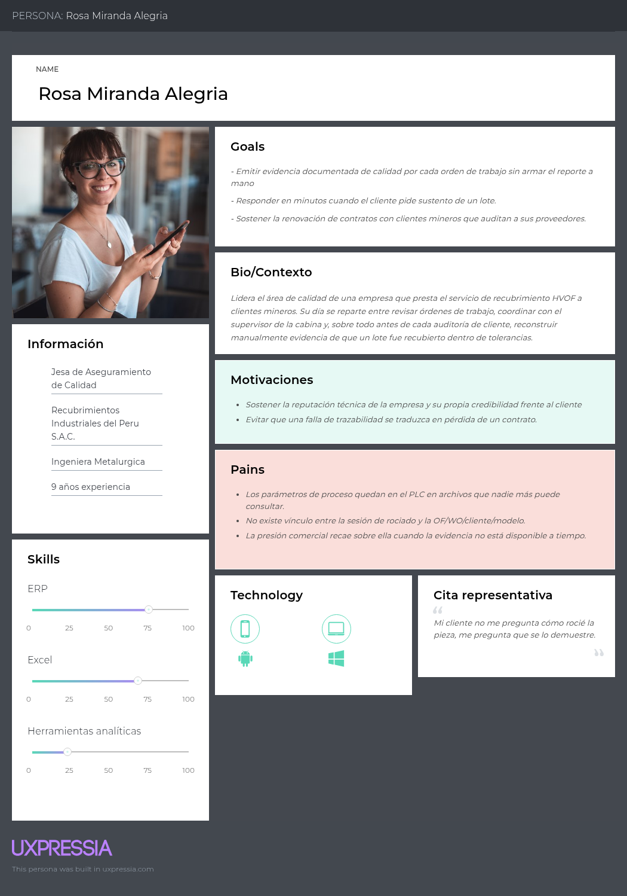

| Campo | Contenido de la ficha |
|---|---|
| Nombre / edad | Rosa Miranda Alegria, 36 a├▒os |
| Cargo / empresa | Ingeniera de Calidad e Investigaci├│n en un proveedor de recuperaci├│n de componentes mediante HVOF (Lima ÔÇô Callao) |
| Formación | Ingeniería de Materiales; 9 años en procesos de recubrimiento |
| Cita | "Cuando el cliente pregunta con qu├® par├ímetros se roci├│ su pieza, la respuesta no puede tardar tres d├¡as." |
| Objetivos | Demostrar con datos que cada lote fue recubierto dentro de la especificaci├│n; definir y controlar las recetas por tipo de componente; explicar el origen de una falla prematura en campo |
| Frustraciones | Registros dispersos entre PLC, papel y memoria del personal; desviaciones que el PLC no alarma porque solo actúa en los límites de parada; reportes rehechos en Excel para cada cliente |
| Motivaciones | Renovaci├│n de contratos con clientes mineros; reputaci├│n t├®cnica del taller |
| Tecnología | Laptop en oficina y taller, Excel avanzado, ERP administrativo; móvil para alertas; Chrome |
| Canales | Correo corporativo, WhatsApp con supervisores, reuniones semanales de calidad |
| Marcas e influencias | Oerlikon Metco, Praxair, ASM Thermal Spray Society, normas ISO 9001 y AS9100 |

#### Ficha de User Persona 2 ÔÇö Segmento Recuperation Supplier: Jorge Salinas Paredes, Supervisor de Mantenimiento de m├íquina

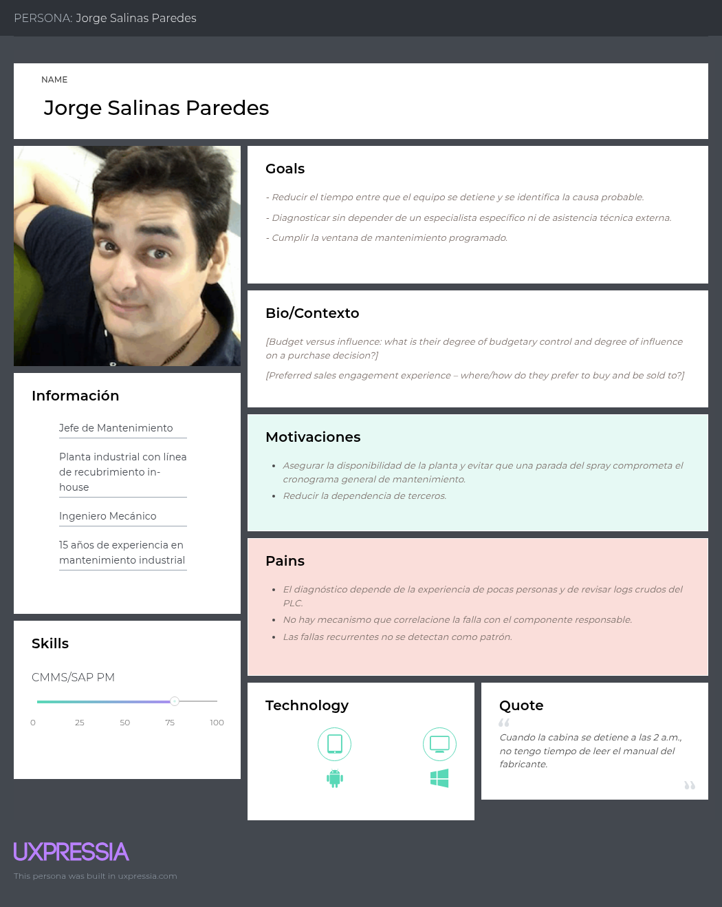

| Campo | Contenido de la ficha |
|---|---|
| Nombre / edad | Jorge Salinas Paredes, 44 a├▒os |
| Cargo / empresa | Supervisor de Mantenimiento de máquina del mismo proveedor de recuperación; responsable de la disponibilidad de los sistemas HVOF |
| Formaci├│n | T├®cnico electromec├ínico (instituto tecnol├│gico); 15 a├▒os en mantenimiento industrial, 6 en sistemas de proyecci├│n t├®rmica |
| Cita | "El PLC me dice que hubo una falla, no me dice qu├® parte revisar." |
| Objetivos | Reducir el tiempo entre la parada del sistema HVOF y la identificaci├│n de la causa; saber qu├® subsistema y qu├® parte intervenir antes de ir a la m├íquina; anticipar fallas recurrentes |
| Frustraciones | C├│digos de falla del PLC sin correlaci├│n con la parte responsable; diagn├│stico dependiente de dos t├®cnicos senior; bit├ícora en papel que nadie consulta |
| Motivaciones | Cumplir la ventana de producci├│n comprometida; que el conocimiento del equipo no se vaya con las personas |
| Tecnología | PC de escritorio en taller, RSLogix / Studio 5000 para revisar el PLC, hojas de cálculo básicas; móvil para alertas; Edge |
| Canales | Radio y WhatsApp en planta, correo para reportes, contacto directo con el fabricante del equipo |
| Marcas e influencias | Allen-Bradley (Rockwell), Siemens, Oerlikon Metco, foros de mantenimiento industrial |

#### Ficha de User Persona 3 ÔÇö Segmento Asset Owner: Luc├¡a Torres Quispe, Ingeniera de Confiabilidad

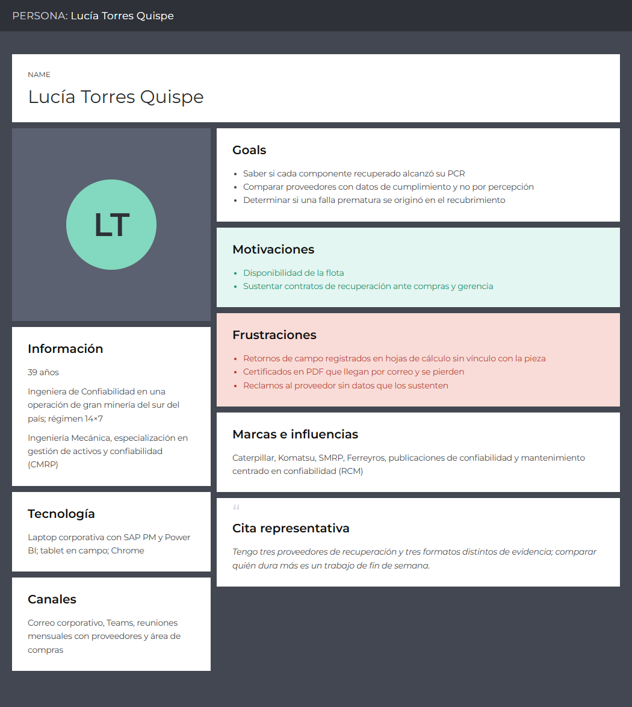

| Campo | Contenido de la ficha |
|---|---|
| Nombre / edad | Lucía Torres Quispe, 39 años |
| Cargo / empresa | Ingeniera de Confiabilidad en una operaci├│n de gran miner├¡a del sur del pa├¡s; r├®gimen 14├ù7 |
| Formación | Ingeniería Mecánica, especialización en gestión de activos y confiabilidad (CMRP) |
| Cita | "Tengo tres proveedores de recuperaci├│n y tres formatos distintos de evidencia; comparar qui├®n dura m├ís es un trabajo de fin de semana." |
| Objetivos | Saber si cada componente recuperado alcanz├│ su PCR; comparar proveedores con datos de cumplimiento y no por percepci├│n; determinar si una falla prematura se origin├│ en el recubrimiento |
| Frustraciones | Retornos de campo registrados en hojas de cálculo sin vínculo con la pieza; certificados en PDF que llegan por correo y se pierden; reclamos al proveedor sin datos que los sustenten |
| Motivaciones | Disponibilidad de la flota; sustentar contratos de recuperaci├│n ante compras y gerencia |
| Tecnología | Laptop corporativa con SAP PM y Power BI; tablet en campo; Chrome |
| Canales | Correo corporativo, Teams, reuniones mensuales con proveedores y área de compras |
| Marcas e influencias | Caterpillar, Komatsu, SMRP, Ferreyros, publicaciones de confiabilidad y mantenimiento centrado en confiabilidad (RCM) |

### 2.3.2. User Task Matrix.

La matriz consolida las tareas que realizan los User Personas para cumplir sus objetivos, con independencia de la existencia de Reliant. Se califica la frecuencia y la importancia de cada tarea para cada persona.

| Tarea | Rosa ÔÇö Frec. | Rosa ÔÇö Imp. | Jorge ÔÇö Frec. | Jorge ÔÇö Imp. | Luc├¡a ÔÇö Frec. | Luc├¡a ÔÇö Imp. |
|---|---|---|---|---|---|---|
| Definir los parámetros y tolerancias (receta) con que debe recubrirse cada tipo de componente | Media | Alta | Baja | Media | N/A | N/A |
| Verificar que los parámetros de proceso se mantengan dentro de especificación durante la corrida | Alta | Alta | Media | Alta | N/A | N/A |
| Registrar a qu├® pieza, cliente y orden corresponde cada sesi├│n ejecutada | Alta | Alta | Baja | Media | N/A | N/A |
| Sustentar ante el cliente que un lote fue recubierto dentro de tolerancias | Alta | Alta | N/A | N/A | N/A | N/A |
| Determinar la causa de una parada o falla del sistema HVOF | Baja | Media | Alta | Alta | N/A | N/A |
| Decidir qu├® subsistema o parte de la m├íquina requiere intervenci├│n o repuesto | Baja | Media | Alta | Alta | N/A | N/A |
| Anticipar fallas recurrentes del sistema HVOF | Media | Media | Alta | Alta | N/A | N/A |
| Registrar el retorno de campo de un componente y las horas que trabaj├│ | Baja | Media | N/A | N/A | Alta | Alta |
| Verificar si un componente recuperado alcanz├│ su PCR | Media | Alta | N/A | N/A | Alta | Alta |
| Revisar la evidencia de calidad entregada por el proveedor | N/A | N/A | N/A | N/A | Media | Alta |
| Comparar el desempe├▒o de los proveedores de recuperaci├│n | N/A | N/A | N/A | N/A | Media | Alta |
| Explicar el origen de una falla prematura en campo | Media | Alta | Baja | Media | Alta | Alta |
| Reportar m├®tricas de calidad, disponibilidad o confiabilidad a la gerencia | Media | Alta | Media | Alta | Alta | Alta |
| Transferir el conocimiento del proceso o del equipo entre personas | Media | Media | Media | Alta | Baja | Media |

**Tareas con mayor frecuencia e importancia.** Para Rosa, sustentar ante el cliente que un lote fue recubierto dentro de tolerancias y registrar la correspondencia entre sesi├│n, pieza, cliente y orden: ambas son diarias y determinan la continuidad del contrato. Para Jorge, determinar la causa de una parada y decidir qu├® subsistema o parte atender, porque de ellas depende la disponibilidad del sistema HVOF. Para Luc├¡a, registrar el retorno de campo y verificar el cumplimiento del PCR, que alimentan directamente la evaluaci├│n de proveedores y el reporte a gerencia.

**Coincidencias.** Las tres personas comparten como tarea de alta importancia explicar el origen de una falla prematura y reportar m├®tricas a la gerencia. Rosa y Luc├¡a coinciden adem├ís en verificar el cumplimiento del PCR: la misma pieza es evaluada por quien la recubri├│ y por quien la opera, pero hoy con informaci├│n que no se cruza. Esta coincidencia es la que sostiene el modelo de dos segmentos sobre una ├║nica cadena de trazabilidad.

**Diferencias.** Rosa y Jorge actúan sobre el proceso y el equipo dentro del taller; Lucía actúa sobre el componente una vez que vuelve a operar en mina y nunca sobre el sistema HVOF. Dentro del proveedor, Rosa documenta y sustenta ante un tercero, mientras que Jorge diagnostica y decide sobre el propio equipo. Estas diferencias determinan que las tres personas necesiten vistas distintas de la misma información: la receta y el certificado para Rosa, el subsistema y la parte sospechosa para Jorge, y el cumplimiento de PCR por proveedor para Lucía.

### 2.3.3. User Journey Mapping.

Los Journey Maps describen la experiencia actual (as-is) de cada persona en la tarea de mayor peso identificada en la matriz, sin considerar la existencia de Reliant. Se elaboraron en UXPressia; se presenta su contenido y la captura correspondiente.

#### Journey Map 1 ÔÇö Rosa Miranda: sustentar ante el cliente minero que un lote fue recubierto dentro de tolerancias


| Fase | Acciones | Pensamientos | Emociones | Puntos de dolor |
|---|---|---|---|---|
| Solicitud del cliente | Recibe el pedido de sustento y ubica la OF/WO | "Espero que esta vez el registro est├® completo" | Neutral, con algo de incertidumbre | No sabe de antemano si el dato existe o est├í completo |
| B├║squeda de evidencia | Revisa archivos del PLC y bit├ícoras en papel, consulta al supervisor de operaci├│n | "┬┐D├│nde qued├│ el registro de esa fecha exacta y con qu├® receta se corri├│?" | Tensi├│n creciente | Informaci├│n dispersa entre PLC, papel y memoria del personal; la receta usada no qued├│ registrada |
| Reconstrucci├│n manual | Arma el reporte cruzando fuentes y lo adapta al formato que exige el cliente | "Esto me toma horas que no tengo, y cada cliente pide un formato distinto" | Frustraci├│n | Alto esfuerzo manual, riesgo de error al cruzar datos, reporte rehecho en Excel |
| Entrega | Envía el reporte, a veces fuera de plazo | "Espero que esto no afecte la renovación del contrato" | Ansiedad | Retraso percibido por el cliente como falta de control de proceso |

#### Journey Map 2 ÔÇö Jorge Salinas: diagnosticar una parada no programada del sistema HVOF

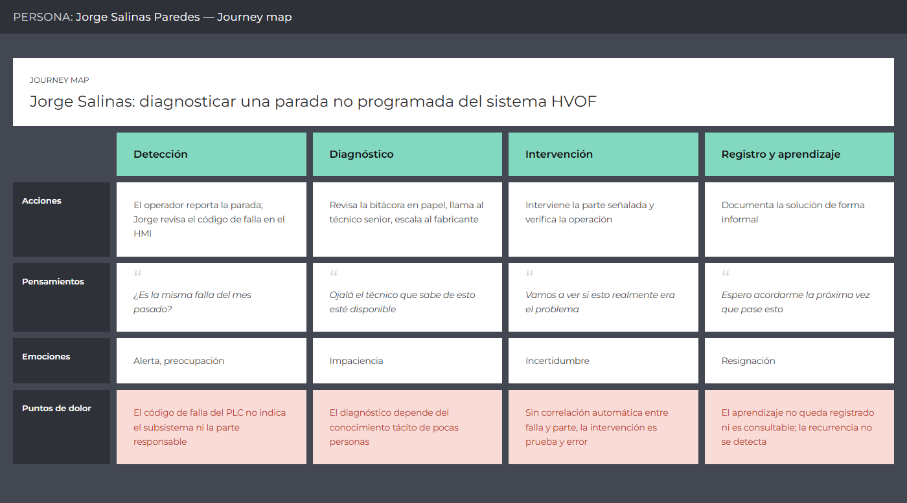

| Fase | Acciones | Pensamientos | Emociones | Puntos de dolor |
|---|---|---|---|---|
| Detecci├│n | El operador reporta la parada; Jorge revisa el c├│digo de falla en el HMI | "┬┐Es la misma falla del mes pasado?" | Alerta, preocupaci├│n | El c├│digo de falla del PLC no indica el subsistema ni la parte responsable |
| Diagn├│stico | Revisa la bit├ícora en papel, llama al t├®cnico senior, escala al fabricante | "Ojal├í el t├®cnico que sabe de esto est├® disponible" | Impaciencia | El diagn├│stico depende del conocimiento t├ícito de pocas personas |
| Intervención | Interviene la parte señalada y verifica la operación | "Vamos a ver si esto realmente era el problema" | Incertidumbre | Sin correlación automática entre falla y parte, la intervención es prueba y error |
| Registro y aprendizaje | Documenta la soluci├│n de forma informal | "Espero acordarme la pr├│xima vez que pase esto" | Resignaci├│n | El aprendizaje no queda registrado ni es consultable; la recurrencia no se detecta |

#### Journey Map 3 ÔÇö Luc├¡a Torres: evaluar un componente recuperado que fall├│ antes de su PCR

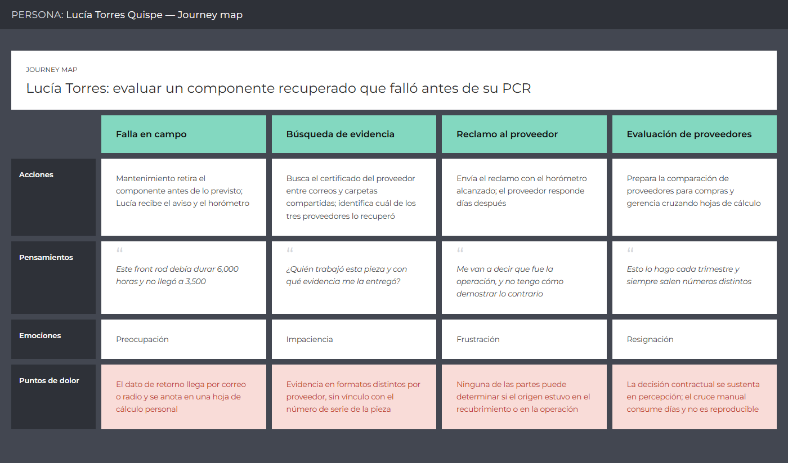

| Fase | Acciones | Pensamientos | Emociones | Puntos de dolor |
|---|---|---|---|---|
| Falla en campo | Mantenimiento retira el componente antes de lo previsto; Lucía recibe el aviso y el horómetro | "Este front rod debía durar 6,000 horas y no llegó a 3,500" | Preocupación | El dato de retorno llega por correo o radio y se anota en una hoja de cálculo personal |
| B├║squeda de evidencia | Busca el certificado del proveedor entre correos y carpetas compartidas; identifica cu├íl de los tres proveedores lo recuper├│ | "┬┐Qui├®n trabaj├│ esta pieza y con qu├® evidencia me la entreg├│?" | Impaciencia | Evidencia en formatos distintos por proveedor, sin v├¡nculo con el n├║mero de serie de la pieza |
| Reclamo al proveedor | Env├¡a el reclamo con el hor├│metro alcanzado; el proveedor responde d├¡as despu├®s | "Me van a decir que fue la operaci├│n, y no tengo c├│mo demostrar lo contrario" | Frustraci├│n | Ninguna de las partes puede determinar si el origen estuvo en el recubrimiento o en la operaci├│n |
| Evaluación de proveedores | Prepara la comparación de proveedores para compras y gerencia cruzando hojas de cálculo | "Esto lo hago cada trimestre y siempre salen números distintos" | Resignación | La decisión contractual se sustenta en percepción; el cruce manual consume días y no es reproducible |

### 2.3.4. Empathy Mapping.

Los Empathy Maps sintetizan lo que cada persona dice, piensa, hace y siente en relaci├│n con el problema, a partir de las citas y observaciones recogidas en las entrevistas. Se elaboraron en UXPressia; se presenta la captura y el contenido de cada cuadrante.

#### Empathy Map ÔÇö Rosa Miranda (Recuperation Supplier)

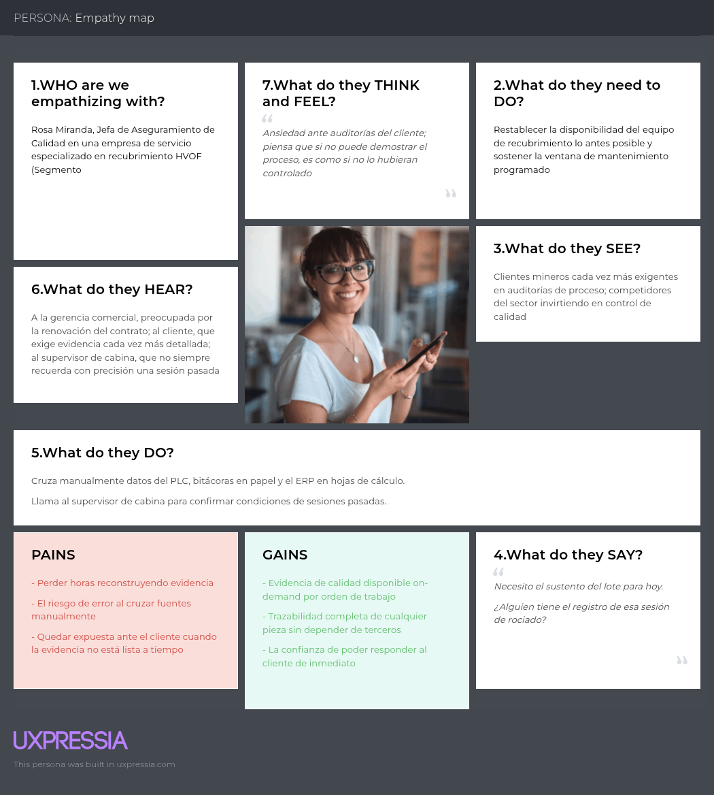

| Cuadrante | Contenido |
|---|---|
| Dice | "El cliente me pide evidencia y yo tengo que armarla a mano." ┬À "El PLC no alarma hasta que ya es tarde." |
| Piensa | Que cada reclamo sin respuesta rápida pone en riesgo el contrato; que la receta correcta depende de que el operador la cargue bien |
| Hace | Cruza archivos del PLC con bitácoras en papel; define parámetros por tipo de pieza en hojas de cálculo; rehace reportes por cliente |
| Siente | Presi├│n comercial, frustraci├│n por el tiempo perdido, inseguridad al firmar un certificado sin todos los datos |
| Dolores | Trazabilidad reconstruida a mano; desviaciones de calidad no detectadas; formatos de reporte distintos por cliente |
| Ganancias | Evidencia generada desde el dato de proceso; alerta cuando la lectura sale de la banda de calidad; reportes con la estructura que exige cada cliente |

#### Empathy Map ÔÇö Jorge Salinas (Recuperation Supplier)

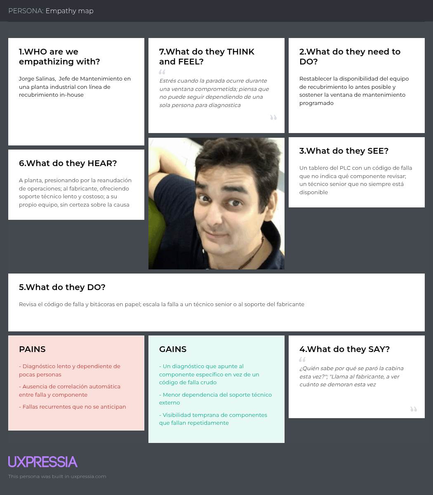

| Cuadrante | Contenido |
|---|---|
| Dice | "El c├│digo de falla no me dice qu├® revisar." ┬À "Si el t├®cnico que sabe est├í de vacaciones, la m├íquina espera." |
| Piensa | Que la misma falla ya ocurri├│ antes pero nadie lo anot├│; que el fabricante cobra por diagn├│sticos que ├®l podr├¡a hacer con la informaci├│n correcta |
| Hace | Revisa el HMI y el PLC, llama al t├®cnico senior, prueba y error sobre la m├íquina, anota la soluci├│n en un cuaderno |
| Siente | Impaciencia por la ventana de producci├│n, resignaci├│n ante la falta de registro, orgullo cuando resuelve sin ayuda externa |
| Dolores | Diagn├│stico dependiente de pocas personas; sin correlaci├│n fallaÔÇôparte; recurrencias invisibles |
| Ganancias | Caso de falla abierto con síntomas y parte sospechosa; conocimiento registrado y consultable; aviso antes de una parada mayor |

#### Empathy Map ÔÇö Luc├¡a Torres (Asset Owner)

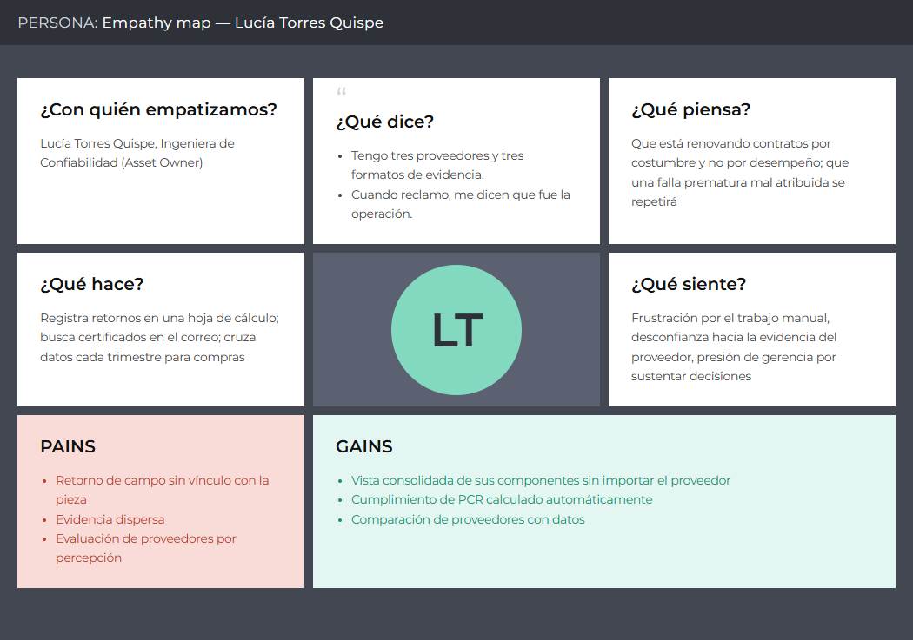

| Cuadrante | Contenido |
|---|---|
| Dice | "Tengo tres proveedores y tres formatos de evidencia." ┬À "Cuando reclamo, me dicen que fue la operaci├│n." |
| Piensa | Que está renovando contratos por costumbre y no por desempeño; que una falla prematura mal atribuida se repetirá |
| Hace | Registra retornos en una hoja de cálculo; busca certificados en el correo; cruza datos cada trimestre para compras |
| Siente | Frustraci├│n por el trabajo manual, desconfianza hacia la evidencia del proveedor, presi├│n de gerencia por sustentar decisiones |
| Dolores | Retorno de campo sin vínculo con la pieza; evidencia dispersa; evaluación de proveedores por percepción |
| Ganancias | Vista consolidada de sus componentes sin importar el proveedor; cumplimiento de PCR calculado automáticamente; comparación de proveedores con datos |

## 2.4. Big Picture Event Storming.

En esta secci├│n se introduce y resume el proceso realizado por nuestro equipo, presentando las evidencias y explicaciones de las etapas del Big Picture Event Storming. En una sesi├│n colaborativa, nuestro equipo se enfoc├│ en entender el dominio del negocio en general, plasmando los eventos significativos y sus relaciones. Es una primera aproximaci├│n visual de alto nivel que explora el landscape del negocio, identificando procesos clave y exponiendo potenciales problemas u oportunidades del proceso de recuperaci├│n de componentes mediante recubrimiento HVOF, desde la recepci├│n de la pieza del cliente hasta la evaluaci├│n de su desempe├▒o en campo. La sesi├│n sigui├│ la gu├¡a paso a paso del Event Storming Journal (Bourgau, 2022) y fue documentada con diagramas Mermaid, alternativa permitida por el enunciado del proyecto para Diagram-as-Code. Se conserv├│ la convenci├│n de colores del m├®todo: naranja para Domain Events, amarillo para Actors, azul para External Systems y rosado para Problems (hotspots).

### Paso 1. Preparaci├│n del tablero

Dado que la sesi├│n se realiz├│ de forma remota, la "sala" fue un tablero compartido. El equipo prepar├│ con anticipaci├│n:

- El espacio de diseño dividido en tres zonas, siguiendo la guía: *Open* (generación libre), *Explore* (ordenamiento y enriquecimiento) y *Close* (resultados).
- La agenda visual con los nueve pasos de la guía.
- La leyenda de colores.
- Un Domain Event inicial preparado por la facilitadora (*SpraySessionStarted*), siguiendo el truco de Alberto Brandolini de "encender" la sesi├│n con un evento ya colocado en el centro del tablero.

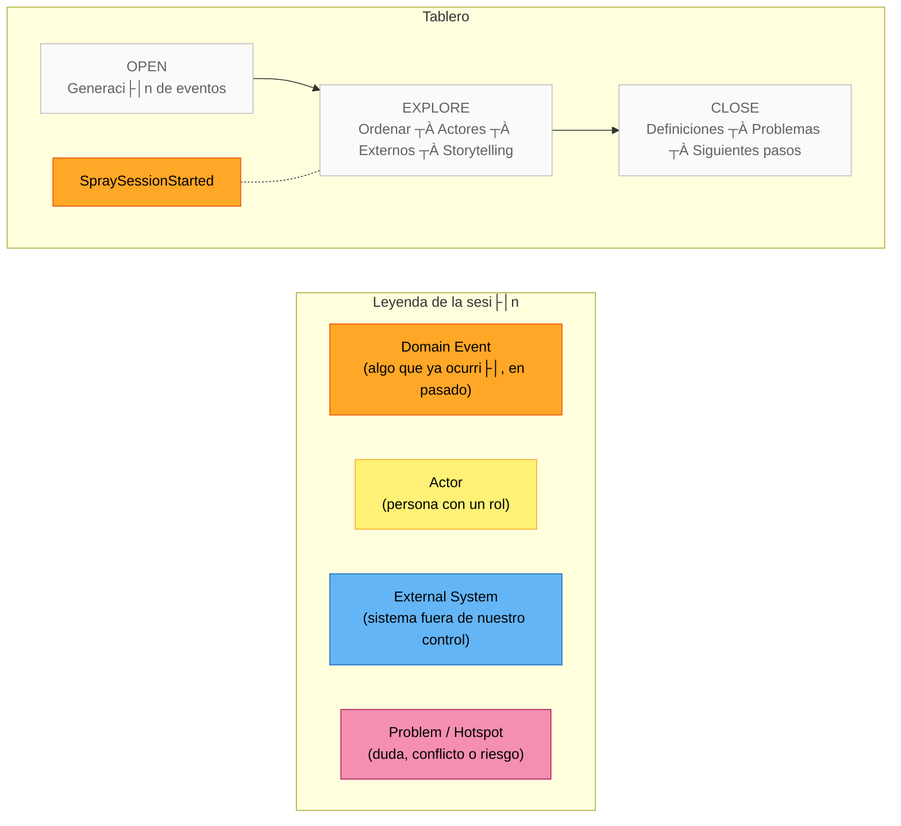

### Paso 2. Energizante

La sesi├│n inici├│ con una din├ímica breve de cinco minutos en la que cada integrante describi├│, en una frase y sin usar t├®rminos t├®cnicos, qu├® pasa con una pieza minera desde que se desgasta hasta que vuelve a operar. El ejercicio sirvi├│ para nivelar el vocabulario entre los integrantes con experiencia en planta y los que no la ten├¡an, y para dejar claro desde el inicio que el tablero se llenar├¡a con hechos del negocio y no con funciones de software.

### Paso 3. Briefing y agenda

La facilitadora (Carolina) present├│ el objetivo, el alcance y los casos de uso de la sesi├│n:

| Elemento | Definici├│n acordada |
|---|---|
| Objetivo | Entender de extremo a extremo c├│mo un componente pasa por el proceso de recuperaci├│n HVOF y c├│mo se conoce su resultado en campo |
| Alcance | Desde la recepci├│n del componente del cliente hasta el registro de su retorno de campo y la evaluaci├│n contra el PCR. Incluye la operaci├│n del sistema HVOF y el diagn├│stico de sus fallas. Excluye la gesti├│n de mantenimiento correctivo/preventivo del sistema HVOF |
| Casos de uso gu├¡a | (1) Recuperar un front rod de un cliente minero y entregarlo con evidencia de calidad. (2) Diagnosticar por qu├® el sistema HVOF se detuvo durante una corrida. (3) Determinar si una pieza que fall├│ en mina antes de su PCR fue mal recubierta |
| Convenciones | Eventos en ingl├®s, en pasado, en PascalCase. Un evento por post-it. Se permite duplicar; se depura al ordenar |

### Paso 4. Generaci├│n de Domain Events

Durante veinticinco minutos cada integrante coloc├│, de forma individual y sin discutir, todos los eventos que recordaba del dominio. La tasa de generaci├│n decay├│ hacia el minuto veinte, se├▒al de pasar al siguiente paso. Se obtuvieron setenta y nueve post-its, incluidos duplicados y eventos que despu├®s se reformularon. El tablero, tal como qued├│ antes de ordenar:

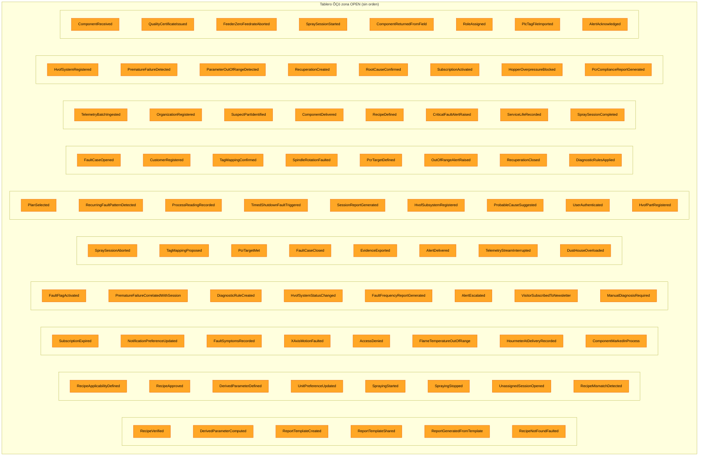

Durante la depuraci├│n se tomaron dos decisiones que quedaron registradas para el paso siguiente:

- Los eventos de falla espec├¡ficos del PLC (*FeederZeroFeedrateAborted*, *HopperOverpressureBlocked*, *SpindleRotationFaulted*, *XAxisMotionFaulted*, *TimedShutdownFaultTriggered*, *DustHouseOverloaded*, *RecipeNotFoundFaulted*) se agruparon bajo un evento gen├®rico *FaultFlagActivated* con el tipo de falla como atributo. Esto evita que el tablero tenga un post-it por cada uno de los m├ís de treinta tags de falla del PLC y refleja c├│mo lo procesa el sistema: el tag mapeado como indicador de falla se activa, y eso abre el caso.
- *FlameTemperatureOutOfRange* se absorbi├│ en *ParameterOutOfRangeDetected*, por la misma raz├│n. Este evento lleva como atributo la banda alcanzada (advertencia o parada), ya que la receta define bandas de umbral y no un ├║nico rango.

### Paso 5. Ordenamiento cronol├│gico

Aqu├¡ comenz├│ la discusi├│n. El equipo orden├│ los eventos de izquierda a derecha y, al hacerlo, aparecieron dos flujos concurrentes que se representaron como carriles: mientras la sesi├│n de rociado registra lecturas, en paralelo pueden abrirse casos de falla y generarse alertas. Tambi├®n aparecieron dos flujos alternativos: la sesi├│n puede terminar completada o abortada, y puede abrirse sin orden asignada cuando el PLC reporta rociado activo sin que el operador haya iniciado una sesi├│n.

```mermaid
flowchart LR
    classDef evento fill:#FFA726,stroke:#E65100,color:#000
    classDef fase fill:#FAFAFA,stroke:#BDBDBD,color:#616161

    subgraph F0["0. Configuraci├│n"]
        direction TB
        OrganizationRegistered:::evento --> PlanSelected:::evento --> SubscriptionActivated:::evento --> RoleAssigned:::evento --> UnitPreferenceUpdated:::evento
        HvofSystemRegistered:::evento --> HvofSubsystemRegistered:::evento --> HvofPartRegistered:::evento --> PlcTagFileImported:::evento --> TagMappingProposed:::evento --> TagMappingConfirmed:::evento
        TagMappingConfirmed --> RecipeDefined:::evento --> RecipeApplicabilityDefined:::evento --> RecipeApproved:::evento
        TagMappingConfirmed --> DerivedParameterDefined:::evento
        CustomerRegistered:::evento --> PcrTargetDefined:::evento
        DiagnosticRuleCreated:::evento
        ReportTemplateCreated:::evento --> ReportTemplateShared:::evento
    end

    subgraph F1["1. Recepci├│n"]
        direction TB
        ComponentReceived:::evento --> RecuperationCreated:::evento --> ComponentMarkedInProcess:::evento
    end

    subgraph F2["2. Corrida de rociado"]
        direction TB
        SpraySessionStarted:::evento --> RecipeVerified:::evento --> TelemetryBatchIngested:::evento --> ProcessReadingRecorded:::evento
        ProcessReadingRecorded --> DerivedParameterComputed:::evento
        ProcessReadingRecorded --> SprayingStarted:::evento --> SprayingStopped:::evento
        SprayingStopped --> SpraySessionCompleted:::evento
        SprayingStopped --> SpraySessionAborted:::evento
        UnassignedSessionOpened:::evento -. requiere vincular orden .-> SpraySessionStarted
    end

    subgraph F2B["2b. Carril concurrente ÔÇö Desviaciones y fallas"]
        direction TB
        ParameterOutOfRangeDetected:::evento --> OutOfRangeAlertRaised:::evento --> AlertDelivered:::evento --> AlertAcknowledged:::evento
        RecipeMismatchDetected:::evento --> CriticalFaultAlertRaised:::evento
        FaultFlagActivated:::evento --> FaultCaseOpened:::evento --> FaultSymptomsRecorded:::evento --> DiagnosticRulesApplied:::evento
        DiagnosticRulesApplied --> ProbableCauseSuggested:::evento --> SuspectPartIdentified:::evento --> CriticalFaultAlertRaised
        DiagnosticRulesApplied --> ManualDiagnosisRequired:::evento
        SuspectPartIdentified --> RootCauseConfirmed:::evento --> FaultCaseClosed:::evento
        ManualDiagnosisRequired --> RootCauseConfirmed
        FaultCaseClosed --> RecurringFaultPatternDetected:::evento
        TelemetryStreamInterrupted:::evento
    end

    subgraph F3["3. Cierre y entrega"]
        direction TB
        RecuperationClosed:::evento --> HourmeterAtDeliveryRecorded:::evento --> QualityCertificateIssued:::evento --> ComponentDelivered:::evento
        SessionReportGenerated:::evento
    end

    subgraph F4["4. Campo y PCR"]
        direction TB
        ComponentReturnedFromField:::evento --> ServiceLifeRecorded:::evento
        ServiceLifeRecorded --> PcrTargetMet:::evento
        ServiceLifeRecorded --> PrematureFailureDetected:::evento --> PrematureFailureCorrelatedWithSession:::evento
    end

    subgraph F5["5. Reportes"]
        direction TB
        ReportGeneratedFromTemplate:::evento
        EvidenceExported:::evento
        FaultFrequencyReportGenerated:::evento
        PcrComplianceReportGenerated:::evento
    end

    F0 --> F1 --> F2 --> F3 --> F4 --> F5
    ProcessReadingRecorded -. dispara .-> ParameterOutOfRangeDetected
    DerivedParameterComputed -. dispara .-> ParameterOutOfRangeDetected
    ProcessReadingRecorded -. dispara .-> FaultFlagActivated
    RecipeVerified -. si no aplica .-> RecipeMismatchDetected
    SpraySessionCompleted --> RecuperationClosed
    SpraySessionAborted -. requiere nueva corrida .-> SpraySessionStarted
```

Al ordenar, el equipo hizo explícitas cinco cosas que estaban implícitas:

- *HourmeterAtDeliveryRecorded* no exist├¡a en la generaci├│n inicial de todos; apareci├│ cuando se pregunt├│ "┬┐contra qu├® se compara el hor├│metro de retorno?". Sin ese dato, *ServiceLifeRecorded* no puede calcular horas logradas.
- *ManualDiagnosisRequired* apareci├│ al preguntar "┬┐y si ninguna regla coincide?". Es el flujo alternativo de *DiagnosticRulesApplied*.
- *SpraySessionAborted* no cierra la orden: obliga a una nueva corrida. Por eso la flecha punteada regresa a *SpraySessionStarted*.
- *SprayingStarted* y *SprayingStopped* dividen la sesi├│n en pasadas. La sesi├│n la abre el operador porque el PLC no conoce la OF/WO, pero el rociado efectivo lo detecta el tag de estado de rociado activo.
- *RecipeVerified* ocurre entre el inicio de la sesi├│n y la primera lectura: el sistema compara la receta cargada en el controlador con el tipo y modelo del componente de la orden. Si no corresponde, se dispara *RecipeMismatchDetected*.

### Paso 6. Actores y sistemas externos

Con la historia ya ordenada, el equipo identific├│ qui├®n dispara cada cadena de eventos (post-its amarillos) y qu├® sistemas fuera de la plataforma participan (post-its azules). Siguiendo la gu├¡a, se coloc├│ un actor al inicio de cada cadena y no en cada evento.

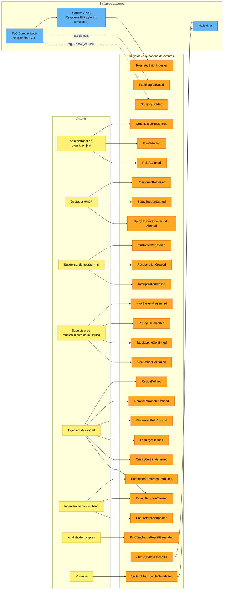

Tres decisiones surgieron en este paso:

- El **PLC** y el **gateway** se modelaron como dos sistemas externos distintos. El PLC es la fuente del dato; el gateway es quien lo lee vía EtherNet/IP y lo envía a la plataforma por REST. Para la demostración del curso, el gateway será un simulador que expone el mismo contrato, de modo que la plataforma no distingue si el origen es hardware real o simulado.
- El **ingeniero de confiabilidad** de la minera (Asset Owner) es quien dispara *ComponentReturnedFromField*, no el proveedor. Es el único que sabe cuántas horas trabajó la pieza en mina. Esta observación fue la que consolidó a la minera como segundo segmento pagante.
- El **PLC** dispara *SprayingStarted* a trav├®s del tag de estado de rociado activo, y no el operador. Esto define que la sesi├│n la abre una persona, pero las pasadas de rociado dentro de ella las detecta la m├íquina.

### Paso 7. Storytelling

Un integrante narró la historia completa recorriendo el tablero de izquierda a derecha, usando el caso de uso guía del front rod. La audiencia interrumpió cuando algo no cuadraba. Las incoherencias que no se pudieron resolver en la sesión se estacionaron como post-its rosados (hotspots).

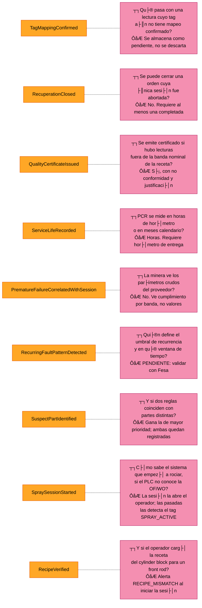

Ocho de los nueve hotspots se resolvieron en la sesi├│n y sus decisiones se trasladaron directamente a los criterios de aceptaci├│n de las User Stories (US11, US18, US35, US40, US41, US26, US57 y US56 respectivamente). El hotspot P6 qued├│ pendiente de validaci├│n con el supervisor de mantenimiento durante las entrevistas de la secci├│n 2.2.

Durante la narraci├│n se capturaron tambi├®n las primeras definiciones del lenguaje ubicuo, que se desarrollan en la secci├│n 2.5:

| T├®rmino | Definici├│n capturada en la sesi├│n |
|---|---|
| Component | Pieza del cliente que se recupera (front rod, cylinder block). No confundir con las partes del sistema HVOF |
| HVOF Subsystem / HVOF Part | Subsistema del sistema HVOF (alimentador de polvo, consola de gases, chiller, manipulaci├│n, colector de polvo) y parte f├¡sica dentro de ├®l (hopper, disco dosificador, boquilla, spindle) |
| Recuperation | Orden de recuperaci├│n identificada por OF y WO; es el trabajo sobre un componente |
| Recipe | Conjunto de setpoints y bandas de umbral cargado en el controlador, aplicable a uno o más tipos y modelos de componente |
| Spray Session | Una corrida de rociado sobre un componente en un sistema HVOF. Una orden puede tener varias |
| Spray Pass | Intervalo de rociado efectivo dentro de una sesi├│n, detectado desde el tag de estado del PLC |
| PCR Target | Horas de operaci├│n esperadas para el componente recuperado (Planned Component Replacement) |
| Fault Case | Caso abierto cuando un tag de falla se activa; se diagnostica, se confirma y se cierra |
| Suspect Part | Parte del sistema HVOF que las reglas se├▒alan como probable responsable de la falla |

### Paso 8. Reverse storytelling

Como fase opcional, el equipo tom├│ el evento de mayor valor de negocio, *PrematureFailureDetected*, y recorri├│ la historia hacia atr├ís preguntando repetidamente "┬┐qu├® tuvo que ocurrir antes para que esto pasara?". El ejercicio confirm├│ la cadena de trazabilidad completa y revel├│ un evento que faltaba.


El evento descubierto, *CustomerLinkedToAssetOwnerOrganization*, resuelve una pregunta que nadie había hecho: ¿cómo puede un ingeniero de confiabilidad de la minera registrar el retorno de una pieza si la minera fue registrada como *Customer* por Fesa y no tiene cuenta propia? La respuesta es que cuando una organización Asset Owner se suscribe con el mismo RUC que un cliente ya registrado por un proveedor, ambos registros se vinculan. Este evento dio origen al segundo escenario de la US13.

### Paso 9. Cierre

Al terminar la sesión el equipo evaluó los resultados contra los tres criterios que propone la guía:

**Entendimiento compartido del dominio.** Los integrantes sin experiencia en planta pudieron narrar la historia completa del front rod sin ayuda al final de la sesión. La distinción entre *Component* (pieza del cliente) y *HVOF Part* (parte física de un subsistema del sistema HVOF), que había generado confusión en reuniones previas, quedó resuelta.

**Problemas identificados.** Nueve hotspots, ocho resueltos en sesi├│n y uno pendiente de validaci├│n externa. Las decisiones tomadas se convirtieron en criterios de aceptaci├│n, lo que evit├│ que las ambig├╝edades llegaran a la implementaci├│n.

**Primeras definiciones del lenguaje ubicuo.** Nueve t├®rminos capturados, que constituyen el punto de partida del glosario de la secci├│n 2.5.

**Trazabilidad hacia las User Stories.** Los eventos ordenados en el Paso 5 se distribuyen en las ├®picas del Cap├¡tulo III de la siguiente forma:

| Fase del tablero | Eventos | Épica | User Stories |
|---|---|---|---|
| 0. Configuraci├│n | OrganizationRegistered, RoleAssigned, PlanSelected, SubscriptionActivated, UnitPreferenceUpdated | E01, E02 | US01ÔÇôUS06, US58 |
| 0. Configuraci├│n | HvofSystemRegistered, HvofSubsystemRegistered, HvofPartRegistered, PlcTagFileImported ÔǪ TagMappingConfirmed, RecipeDefined ÔǪ RecipeApproved, DerivedParameterDefined, DiagnosticRuleCreated | E03, E06 | US07ÔÇôUS12, US53ÔÇôUS55, US28 |
| 0. Configuraci├│n | CustomerRegistered, PcrTargetDefined | E04 | US13, US16 |
| 0. Configuraci├│n | ReportTemplateCreated, ReportTemplateShared | E08 | US59ÔÇôUS61, US63 |
| 1. Recepci├│n | ComponentReceived, RecuperationCreated | E04 | US14, US15 |
| 2. Corrida | SpraySessionStarted, RecipeVerified, SprayingStarted/Stopped, UnassignedSessionOpened, DerivedParameterComputed  SpraySessionCompleted/Aborted | E05 | US19US24, US55US57 |
| 2b. Desviaciones | ParameterOutOfRangeDetected, RecipeMismatchDetected, OutOfRangeAlertRaised, AlertDelivered | E05, E07 | US21, US31ÔÇôUS34, US56 |
| 2b. Fallas | FaultFlagActivated  RecurringFaultPatternDetected | E06 | US25US30 |
| 3. Cierre y entrega | RecuperationClosed, QualityCertificateIssued, ComponentDelivered | E04, E08 | US17, US18, US35, US36 |
| 4. Campo y PCR | ComponentReturnedFromField  PrematureFailureCorrelatedWithSession | E09 | US39US43 |
| 5. Reportes | ReportGeneratedFromTemplate, EvidenceExported, FaultFrequencyReportGenerated, PcrComplianceReportGenerated | E08, E09 | US37, US38, US42, US62, US64 |
| Externos | AlertDelivered (EMAIL), VisitorSubscribedToNewsletter | E11, E10 | US49, US51, US52 |

**Siguientes pasos acordados.** (1) Validar el hotspot P6 en las entrevistas con supervisores de mantenimiento. (2) Llevar el tablero ordenado al Design-Level Event Storming para identificar Commands, Aggregates, Policies y Read Models por bounded context. (3) Completar el glosario de lenguaje ubicuo. Responsable de los siguientes pasos: la facilitadora de la sesi├│n.


## 2.5. Ubiquitous Language.

El siguiente glosario re├║ne los t├®rminos del dominio de recuperaci├│n de componentes mediante recubrimiento HVOF, tal como los utilizan los especialistas de las empresas de servicio y los responsables de mantenimiento y confiabilidad de las mineras. Su prop├│sito es que todos los integrantes del equipo y los stakeholders se refieran a cada concepto con una sola palabra y un solo significado, y que ese mismo vocabulario se refleje en las User Stories, los diagramas y el c├│digo. Se excluyen deliberadamente t├®rminos de ingenier├¡a de software; solo se incluyen conceptos del negocio.

Los t├®rminos se presentan en ingl├®s, con su equivalente en espa├▒ol entre par├®ntesis cuando difiere, y agrupados por ├írea del dominio. Las primeras definiciones fueron capturadas durante el Big Picture Event Storming (secci├│n 2.4) y refinadas a partir de las entrevistas con los segmentos objetivo.

Las definiciones de proceso y recubrimiento se basan en el glosario de proyecci├│n t├®rmica de Gordon England (s.f.), en la gu├¡a de par├ímetros de proceso de Oerlikon Metco (2025) y en la literatura sobre control de calidad HVOF (Khan et al., 2019; Mauer, 2022). Los t├®rminos de control industrial y comunicaci├│n con el PLC se toman de la documentaci├│n de Rockwell Automation (2019, 2025) y de ODVA (2015, 2020). Los conceptos de alarma y gesti├│n de alarmas siguen la norma ANSI/ISA-18.2 (International Society of Automation, 2016). Los t├®rminos de reemplazo planificado de componentes se basan en la documentaci├│n de gesti├│n de equipos mineros de Caterpillar (2017) y en la literatura de gesti├│n de activos (AMS, 2025). Los t├®rminos propios de la operaci├│n del proveedor (OF, WO, segmento, operaci├│n, nomenclatura de tags) provienen del conocimiento directo de planta del equipo y de las entrevistas de needfinding (secci├│n 2.2).

### 2.5.1. Organizaciones y roles

| T├®rmino | Definici├│n |
|---|---|
| **Recuperation Supplier** (Proveedor de recuperación) | Empresa que ofrece el servicio de recuperación de componentes mediante recubrimiento HVOF a terceros. Opera una o más celdas HVOF y atiende a varios clientes. Es el primer segmento objetivo. |
| **Asset Owner** (Propietario de activos) | Empresa, típicamente minera, dueña de los componentes que se envían a recuperar. Recibe la pieza recuperada, la pone en operación y conoce su desempeño real en campo. Es el segundo segmento objetivo. |
| **Organization** (Organizaci├│n) | Empresa registrada en la plataforma, ya sea como Recuperation Supplier o como Asset Owner. Cada organizaci├│n tiene sus propios usuarios, celdas, componentes y suscripci├│n. |
| **Customer** (Cliente) | Empresa a la que un Recuperation Supplier le presta el servicio. Un Customer puede existir sin tener cuenta en la plataforma; cuando la misma empresa se registra como Asset Owner, ambos registros se vinculan por RUC. |
| **HVOF Operator** (Operador HVOF) | T├®cnico que opera el sistema HVOF: inicia y finaliza las corridas, monta la pieza y atiende las alertas durante la operaci├│n. |
| **Operation Supervisor** (Supervisor de operaci├│n) | Responsable del flujo de trabajo del taller: registra clientes y ├│rdenes de recuperaci├│n, cierra las ├│rdenes y valida los reportes de sesi├│n. |
| **Machine Maintenance Supervisor** (Supervisor de mantenimiento de máquina) | Responsable de la disponibilidad del sistema HVOF: registra la celda y sus partes, carga y confirma el mapeo de tags del PLC, y confirma la causa raíz de los casos de falla. |
| **Quality Engineer** (Ingeniero de calidad) | Responsable de que el recubrimiento cumpla la especificaci├│n: define rangos nominales, PCR objetivo y reglas de diagn├│stico, y emite los certificados de calidad. |
| **Reliability Engineer** (Ingeniero de confiabilidad) | Especialista del Asset Owner que da seguimiento a la vida ├║til de los componentes en operaci├│n y registra su retorno de campo. |
| **Procurement Analyst** (Analista de compras) | Responsable del Asset Owner que eval├║a el desempe├▒o de los proveedores de recuperaci├│n para sustentar decisiones contractuales. |
| **Plan** | Modalidad de suscripción a la plataforma. El plan **Operator** está dirigido a Recuperation Suppliers y se cobra por celda monitoreada; el plan **Asset Owner** está dirigido a propietarios de activos y se cobra por volumen de componentes bajo seguimiento. |
| **Subscription** (Suscripci├│n) | V├¡nculo vigente entre una organizaci├│n y un plan, con fecha de inicio y fin. Determina qu├® capacidades de la plataforma est├ín habilitadas. |

### 2.5.2. Componentes y trazabilidad

| T├®rmino | Definici├│n |
|---|---|
| **Component** (Componente / Pieza) | Pieza física del cliente que se somete al proceso de recuperación: front rod, cylinder block, rod assembly, rear cylinder. Se identifica por número de serie y part number. **No debe confundirse con HVOF Cell Part.** |
| **Component Type** (Tipo de componente) | Clasificación funcional del componente según su forma y aplicación (por ejemplo, front rod o cylinder block). Junto con el modelo de máquina, define el PCR objetivo. |
| **Machine Model** (Modelo de máquina) | Modelo del equipo minero al que pertenece el componente (por ejemplo, Caterpillar 797F o 793D). Un mismo tipo de componente tiene distinto PCR según el modelo. |
| **Part Number** | C├│digo del fabricante que identifica el dise├▒o del componente. Dos componentes con el mismo part number son intercambiables. |
| **Serial Number** (Número de serie) | Identificador único de una unidad física de componente. Dos componentes con el mismo part number tienen distinto número de serie. |
| **Recuperation** (Recuperación / Orden de recuperación) | Trabajo de recubrimiento realizado sobre un componente, identificado por su OF y su WO. Registra el horómetro de ingreso, el peso, el lote de polvo y las sesiones de rociado ejecutadas. Una recuperación puede requerir más de una sesión. |
| **Manufacturing Order ÔÇö OF** (Orden de fabricaci├│n) | Identificador que el proveedor asigna al trabajo en su sistema de planta. Es el c├│digo con el que la pieza circula por el taller. |
| **Work Order ÔÇö WO** (Orden de trabajo) | Identificador del servicio acordado con el cliente. Es el c├│digo con el que el cliente reconoce el trabajo. Una recuperaci├│n tiene exactamente una OF y una WO. |
| **Hourmeter** (Hor├│metro) | Contador de horas de operaci├│n acumuladas de un componente. Se registra al ingreso al taller y al momento de la entrega, y sirve como referencia para calcular la vida ├║til lograda en campo. |
| **Powder Lot** (Lote de polvo) | Identificación del material de aporte utilizado en el recubrimiento: proveedor, número de lote y composición química. Se vincula a la recuperación para trazabilidad del material. |
| **Delivery** (Entrega) | Momento en que el componente recuperado sale del taller hacia el cliente. Marca el inicio de su periodo de operaci├│n en campo. |

### 2.5.3. Vida ├║til y desempe├▒o en campo

| T├®rmino | Definici├│n |
|---|---|
| **PCR ÔÇö Planned Component Replacement** (Reemplazo planificado de componentes) | Pr├íctica de las mineras de reemplazar componentes cr├¡ticos en un momento planificado, antes de que fallen, seg├║n una vida ├║til esperada. |
| **PCR Target** (PCR objetivo) | Cantidad de horas de operación que un componente recuperado debería alcanzar antes de su siguiente reemplazo planificado. Se define por tipo de componente y modelo de máquina. Es el estándar contra el cual se evalúa el desempeño real. |
| **Field Return** (Retorno de campo) | Momento en que un componente que estaba en operaci├│n en la mina regresa al proveedor, ya sea porque alcanz├│ su PCR o porque fall├│ antes. Lo registra el Asset Owner, que es quien conoce el hor├│metro real. |
| **Service Life** (Vida ├║til lograda) | Horas de operaci├│n efectivamente alcanzadas por un componente recuperado, calculadas como la diferencia entre el hor├│metro al retorno y el hor├│metro a la entrega. |
| **PCR Met** (PCR alcanzado) | Condici├│n en la que la vida ├║til lograda es igual o superior al PCR objetivo. Indica que el recubrimiento cumpli├│ su prop├│sito. |
| **Premature Failure** (Falla prematura) | Condición en la que un componente retorna de campo con una vida útil lograda inferior al PCR objetivo. Es el evento de mayor valor analítico del dominio, porque obliga a revisar si el origen estuvo en el proceso de recubrimiento. |
| **PCR Compliance Rate** (Tasa de cumplimiento de PCR) | Proporción de componentes que alcanzaron su PCR sobre el total de componentes retornados en un periodo. Puede calcularse por proveedor, por modelo de máquina o por tipo de componente. |
| **Supplier Performance** (Desempe├▒o de proveedor) | Evaluaci├│n que hace el Asset Owner de un Recuperation Supplier en funci├│n de la tasa de cumplimiento de PCR de los componentes que este recuper├│. |

### 2.5.4. Sistema HVOF y sus partes

| T├®rmino | Definici├│n |
|---|---|
| **HVOF ÔÇö High Velocity Oxygen Fuel** | Proceso de proyecci├│n t├®rmica en el que un polvo met├ílico es fundido y proyectado a alta velocidad mediante la combusti├│n de ox├¡geno y combustible, para depositar una capa protectora sobre la superficie de un componente. |
| **Thermal Spray** (Proyecci├│n t├®rmica) | Familia de procesos de recubrimiento a la que pertenece HVOF. En este dominio se usa como sin├│nimo del proceso de recuperaci├│n. |
| **HVOF System** (Sistema HVOF) | Unidad completa de equipo que ejecuta el proceso: pistola, alimentador, sistema de gases, manipulador de ejes, colector de polvo y PLC de control. Es el activo que el Recuperation Supplier opera y que la plataforma monitorea. |
| **HVOF Subsystem / HVOF Part** (Subsistema o parte del sistema) | Subsistema del sistema HVOF (feeder, consola de gases, chiller, ejesÔǪ) y parte f├¡sica dentro de ├®l, que puede ser origen de una falla: feeder, hopper, spindle, ejes, dust collector, nozzle, unidad de enfriamiento. **No debe confundirse con Component**, que es la pieza del cliente. |
| **Powder Feeder** (Alimentador de polvo) | Parte que dosifica el polvo metálico hacia la pistola a una tasa controlada. Su falla más frecuente es la detención por feedrate cero. |
| **Hopper** (Tolva) | Dep├│sito de polvo que alimenta al feeder. Una sobrepresi├│n en la tolva indica bloqueo aguas abajo. |
| **Spindle** (Husillo) | Eje rotatorio que hace girar el componente durante el rociado para lograr un recubrimiento uniforme. |
| **X Axis / Z Axis** (Ejes X / Z) | Ejes del manipulador que desplazan la pistola a lo largo y en profundidad respecto al componente. |
| **Dust Collector / Dust House** (Colector de polvo) | Sistema de extracci├│n que captura el polvo no adherido. Su sobrecarga afecta la calidad del recubrimiento. |
| **Nozzle** (Boquilla) | Extremo de la pistola por donde sale el chorro de partículas. Es una parte de desgaste. |
| **Equipment Status** (Estado de la celda) | Condici├│n operativa de la celda: activa, en mantenimiento o fuera de servicio. Solo una celda activa puede iniciar sesiones de rociado. |

### 2.5.5. Proceso de rociado y monitoreo

| T├®rmino | Definici├│n |
|---|---|
| **Spray Session** (Sesi├│n de rociado / Corrida) | Ejecuci├│n continua del proceso de rociado sobre un componente en una celda, con inicio y fin definidos. Pertenece a una recuperaci├│n y es operada por un operador HVOF. Termina completada o abortada. |
| **Process Parameter** (Parámetro de proceso) | Magnitud física que caracteriza el proceso y cuyo valor determina la calidad del recubrimiento: presión de oxígeno, presión de combustible, presión de gas portador, temperatura de llama, feedrate, presión de tolva, velocidad del spindle, posición de ejes. |
| **Nominal Range** (Rango nominal) | Intervalo de valores mínimo y máximo dentro del cual un parámetro de proceso se considera correcto para una celda determinada. Lo define el ingeniero de calidad. |
| **Process Reading** (Lectura de proceso) | Valor de un parámetro en un instante determinado durante una sesión de rociado, con su marca de tiempo y su unidad. |
| **Telemetry** (Telemetría) | Flujo de lecturas de proceso que llega automáticamente desde el PLC de la celda a la plataforma durante una sesión. |
| **Deviation** (Desviación) | Lectura de proceso cuyo valor está fuera del rango nominal de su parámetro. Genera una alerta al operador. |
| **PLC ÔÇö Programmable Logic Controller** (Controlador l├│gico programable) | Controlador industrial de la celda HVOF que gobierna el proceso y expone en tiempo real los valores de los par├ímetros y los indicadores de falla. |
| **PLC Tag** | Variable nombrada dentro del PLC que contiene un valor del proceso o un indicador de estado o falla. Cada celda tiene su propio conjunto de tags con nombres definidos por el integrador. |
| **Tag Mapping** (Mapeo de tags) | Asociación entre un tag del PLC y la parte de la celda y el parámetro de proceso que representa. La plataforma lo propone automáticamente a partir del nombre del tag y el supervisor lo confirma. |
| **Fault Flag** (Indicador de falla) | Tag del PLC de tipo booleano que se activa cuando ocurre una condici├│n de falla en una parte de la celda. Su activaci├│n abre un caso de falla. |
| **Gateway** | Dispositivo o software que lee los tags del PLC y los envía a la plataforma. En operación real es un equipo conectado a la red industrial; en la demostración, un simulador que expone el mismo contrato. |

### 2.5.6. Fallas y diagn├│stico

| T├®rmino | Definici├│n |
|---|---|
| **Fault Case** (Caso de falla) | Registro que se abre automáticamente cuando un indicador de falla se activa durante una sesión. Agrupa los síntomas, la causa probable sugerida, la parte sospechosa y la causa raíz confirmada. Pasa por los estados abierto, diagnosticado, confirmado y cerrado. |
| **Fault Type** (Tipo de falla) | Clasificaci├│n de la falla seg├║n el indicador que la origin├│: detenci├│n del feeder por feedrate cero, sobrepresi├│n de tolva, falla de rotaci├│n del spindle, falla de movimiento de eje, paro por temporizador, parada de emergencia, entre otros. |
| **Symptom** (Síntoma) | Valor de un parámetro de proceso registrado en el momento en que ocurrió la falla. El conjunto de síntomas es la evidencia sobre la que se aplican las reglas de diagnóstico. |
| **Diagnostic Rule** (Regla de diagnóstico / Regla causa-efecto) | Relación definida por el ingeniero de calidad entre un tipo de falla, una condición sobre un parámetro, una causa probable y una parte sospechosa. Es conocimiento experto formalizado. |
| **Probable Cause** (Causa probable) | Explicación de la falla sugerida por la regla de diagnóstico que coincidió con los síntomas. No es definitiva hasta que el supervisor la confirme. |
| **Suspect Part** (Parte sospechosa) | Parte de la celda que la regla de diagn├│stico se├▒ala como probable origen de la falla. Es lo que le indica a mantenimiento qu├® revisar. |
| **Root Cause** (Causa raíz) | Causa real de la falla, confirmada por el supervisor de mantenimiento tras la revisión física. Puede coincidir o no con la causa probable sugerida. |
| **Corrective Action** (Acción correctiva) | Intervención realizada sobre la celda para resolver la causa raíz. Se registra al confirmar el caso. |
| **Recurring Fault Pattern** (Patr├│n de falla recurrente) | Condici├│n en la que una misma parte acumula casos de falla del mismo tipo por encima de un umbral dentro de un periodo. Anticipa un problema mayor. |

### 2.5.7. Alertas y evidencia de calidad

| T├®rmino | Definici├│n |
|---|---|
| **Alert** (Alerta) | Aviso dirigido a un usuario cuando ocurre una desviación, una falla crítica, un patrón recurrente o una falla prematura. Se entrega en la plataforma y, opcionalmente, por correo electrónico. |
| **Severity** (Severidad) | Nivel de importancia de una alerta: informativa, advertencia o cr├¡tica. Determina a qui├®n se dirige y si escala en caso de no atenderse. |
| **Alert Rule** (Regla de alerta) | Configuraci├│n que define, para una organizaci├│n, qu├® tipos de evento generan alertas, con qu├® severidad y por qu├® canal. |
| **Acknowledgement** (Atención de alerta) | Acción de un usuario que marca una alerta como revisada. Una alerta crítica no atendida en el tiempo configurado escala al administrador. |
| **Quality Certificate** (Certificado de calidad) | Documento emitido por el ingeniero de calidad al cerrar una recuperación, que resume el cumplimiento de cada parámetro de proceso respecto a su rango nominal durante las sesiones ejecutadas. Es la evidencia que el proveedor entrega al cliente. |
| **Parameter Compliance** (Cumplimiento por parámetro) | Indicación, dentro del certificado, de si las lecturas de un parámetro se mantuvieron dentro del rango nominal durante toda la recuperación. |
| **Non-conformity** (No conformidad) | Condición del certificado cuando uno o más parámetros presentaron desviaciones. Requiere una justificación del ingeniero de calidad para poder emitirse. |
| **Session Report** (Reporte de sesión) | Resumen de una sesión de rociado: total de lecturas, desviaciones por parámetro y casos de falla ocurridos. |
| **Evidence Export** (Exportación de evidencia) | Conjunto de sesiones y certificados de un periodo, exportado para presentarse en una auditoría del cliente. |

### 2.5.8. Control industrial y red de la celda

| T├®rmino | Definici├│n |
|---|---|
| **Allen-Bradley** | Marca de automatizaci├│n industrial de Rockwell Automation. Es el fabricante del PLC que controla la celda HVOF. |
| **CompactLogix** | Familia de PLCs de Allen-Bradley utilizada en la celda. Expone sus tags en red mediante EtherNet/IP y organiza la l├│gica en programas y rutinas. |
| **EtherNet/IP** | Protocolo industrial abierto (basado en CIP) sobre Ethernet que permite leer y escribir tags del PLC desde un equipo externo. Es el medio por el que el gateway obtiene la telemetría. |
| **CIP ÔÇö Common Industrial Protocol** | Protocolo de aplicaci├│n sobre el que funciona EtherNet/IP. Define c├│mo se identifican y consultan los tags. |
| **HMI ÔÇö Human Machine Interface** (Interfaz hombre-m├íquina) | Pantalla t├íctil de la celda desde la que el operador ve valores de proceso, alarmas y arranca o detiene la m├íquina. Es la ├║nica fuente de informaci├│n del operador cuando no existe la plataforma. |
| **Industrial Network Segment** (Segmento de red industrial) | Red aislada de la celda donde conviven el PLC, la HMI, los variadores y los módulos de comunicación. Tiene su propio rango de direcciones IP y no está expuesta a la red corporativa. |
| **IP Address of the PLC** (Direcci├│n IP del PLC) | Direcci├│n ├║nica del PLC dentro del segmento industrial. Es el dato de configuraci├│n que necesita el gateway para conectarse. |
| **Slot** | Posici├│n del m├│dulo procesador dentro del chasis del PLC. Junto con la IP, identifica el destino de la conexi├│n. |
| **Communication Module / Anybus** (M├│dulo de comunicaci├│n) | Dispositivo que traduce entre protocolos industriales distintos dentro del segmento (por ejemplo, entre el PLC y un equipo que no habla EtherNet/IP). |
| **VFD ÔÇö Variable Frequency Drive** (Variador de frecuencia) | Equipo que controla la velocidad de un motor. En la celda gobierna el spindle y los ejes; sus fallas se reportan al PLC como indicadores propios (por ejemplo, falla de velocidad del spindle). |
| **Gateway** (Puerta de enlace) | Equipo conectado al segmento industrial que lee los tags del PLC vía EtherNet/IP y los envía a la plataforma por red corporativa. En Fesa es un Raspberry Pi; en la demostración, un simulador con el mismo contrato. |
| **Polling Interval** (Intervalo de muestreo) | Frecuencia con la que el gateway lee los tags del PLC. En operación real es de 500 milisegundos; define la resolución temporal de la telemetría. |
| **Link Flapping** | P├®rdida y recuperaci├│n intermitente del enlace de red entre el gateway y el PLC, generalmente por cableado defectuoso. Produce interrupciones en la telemetr├¡a. |

### 2.5.9. Tags, umbrales y l├│gica del PLC

| T├®rmino | Definici├│n |
|---|---|
| **Tag** | Variable nombrada del PLC. Un PLC de celda HVOF puede tener más de diez mil tags; la plataforma solo monitorea el subconjunto relevante para el proceso y las fallas (alrededor de doscientos). |
| **Controller Tag / Program Tag** | Ámbito del tag dentro del PLC. Los controller tags son globales; los program tags pertenecen a un programa específico y se identifican con el prefijo del programa. |
| **Tag Path** (Ruta del tag) | Nombre completo con el que se accede a un tag, incluyendo su estructura (por ejemplo, `Mach_FLT.TimedShutdownFlt` o `Spindle.VFD.HSDFlt`). Es lo que la plataforma mapea a una parte y un parámetro. |
| **UDT ÔÇö User Defined Type** (Tipo definido por el usuario) | Estructura de datos creada por el integrador que agrupa varios tags bajo un mismo nombre (por ejemplo, `Mach_FLT` agrupa todos los indicadores de falla de la m├íquina). El nombre del UDT suele indicar el subsistema, y por eso sirve para el mapeo autom├ítico. |
| **Tag Kind** (Tipo de tag) | Clasificación que hace la plataforma al mapear: lectura analógica (valor continuo de un parámetro), indicador de falla (booleano que abre un caso) o estado (booleano informativo, como *Running* o *Ready*). |
| **Setpoint ÔÇö SP** (Consigna) | Valor objetivo de un par├ímetro que el operador o la receta fija en el PLC. |
| **Process Value ÔÇö PV** (Valor de proceso) | Valor real medido del par├ímetro. La diferencia entre PV y SP indica qu├® tan bien controlado est├í el proceso. |
| **Warning Threshold ÔÇö HW / LW** (Umbral de advertencia alto / bajo) | L├¡mite del PLC a partir del cual se genera una alarma en la HMI sin detener el proceso. |
| **Shutdown Threshold ÔÇö HSD / LSD** (Umbral de parada alto / bajo) | L├¡mite del PLC a partir del cual la m├íquina se detiene autom├íticamente por seguridad. Un tag como `HSDFlt` indica que el valor super├│ el umbral alto de parada. |
| **Threshold Bands** (Bandas de umbral) | Relación entre los tres niveles de control: el rango nominal de la plataforma es el más estrecho (calidad), los umbrales de advertencia son intermedios (operación) y los de parada son los más amplios (seguridad). Una lectura puede estar fuera del rango nominal sin que el PLC haya generado alarma alguna. |
| **Alarm** (Alarma) | Aviso generado por el PLC en la HMI cuando un parámetro cruza un umbral de advertencia. No detiene la máquina. **No debe confundirse con Alert**, que es el aviso generado por la plataforma. |
| **Fault** (Falla) | Condici├│n detectada por el PLC que impide continuar la operaci├│n. Se representa con un tag booleano de tipo indicador de falla. |
| **Timed Shutdown Fault** (Paro por temporizador) | Falla que el PLC declara cuando una condición anormal persiste más allá de un tiempo límite. Es la clase de falla más frecuente en la celda y suele tener como causa raíz un problema del feeder. |
| **Motion Fault** (Falla de movimiento) | Falla reportada por el control de un eje cuando este no alcanza la posici├│n o velocidad comandada. |
| **Interlock** (Enclavamiento) | Condici├│n de seguridad que debe cumplirse para permitir una acci├│n (por ejemplo, puerta cerrada para permitir ignici├│n). Su incumplimiento bloquea el proceso. |
| **Permissive** (Permisivo) | Conjunto de condiciones que deben ser verdaderas para que el PLC autorice arrancar o continuar el proceso. |
| **E-Stop ÔÇö Emergency Stop** (Parada de emergencia) | Bot├│n f├¡sico que corta la operaci├│n de forma inmediata. Su activaci├│n se registra como falla de m├íxima severidad. |
| **Fault Reset** (Reinicio de falla) | Acci├│n del operador en la HMI para borrar una falla una vez resuelta su causa. Marca el fin del episodio de falla en el PLC. |
| **Machine State** (Estado de máquina) | Condición operativa reportada por el PLC: *Idle*, *Ready*, *Running*, *Faulted*. La plataforma la usa para saber si una sesión puede iniciar. |
| **Scan Cycle** (Ciclo de escaneo) | Tiempo que tarda el PLC en ejecutar toda su lógica y actualizar sus tags. Es el límite inferior de resolución de cualquier lectura. |

### 2.5.10. Proceso HVOF y calidad del recubrimiento

| T├®rmino | Definici├│n |
|---|---|
| **Metalizado** (t├®rmino coloquial) | Nombre con el que en el Per├║ se conoce al recubrimiento por proyecci├│n t├®rmica en general. Los clientes suelen pedir "metalizar" una pieza cuando se refieren al servicio HVOF. |
| **Combustion Chamber** (Cámara de combustión) | Parte de la pistola donde se queman oxígeno y combustible para generar el chorro de gases a alta velocidad. |
| **Fuel** (Combustible) | Gas o líquido que se quema con oxígeno en la pistola (según el equipo, queroseno, propano o hidrógeno). Su presión es uno de los parámetros críticos del proceso. |
| **Oxygen** (Oxígeno) | Comburente del proceso. La relación oxígeno-combustible determina la temperatura y velocidad del chorro. |
| **Carrier Gas** (Gas portador) | Gas inerte, normalmente nitr├│geno, que transporta el polvo desde el feeder hasta la pistola. Su presi├│n afecta la estabilidad de la alimentaci├│n. |
| **Powder** (Polvo) | Material de aporte en forma de partículas finas que se funde y proyecta. En aplicaciones mineras predominan los carburos de tungsteno con cobalto o cromo. **No debe confundirse con Dust**, que es el residuo no adherido. |
| **Feedrate** (Tasa de alimentaci├│n) | Cantidad de polvo por unidad de tiempo que el feeder entrega a la pistola. Un feedrate cero durante la corrida indica bloqueo o vaciado del feeder. |
| **Ignition** (Ignici├│n) | Encendido de la llama en la pistola al inicio de la corrida. Su falla impide comenzar el rociado. |
| **Flame** (Llama) | Chorro de gases en combustión que funde y acelera el polvo. Su temperatura es un parámetro de control. |
| **Spray Distance / Standoff** (Distancia de rociado) | Distancia entre la salida de la pistola y la superficie del componente. Afecta la temperatura y velocidad con que las partículas impactan. |
| **Traverse Speed** (Velocidad de traslaci├│n) | Velocidad con la que la pistola se desplaza a lo largo del componente durante la corrida. Determina el espesor por pasada. |
| **Rotation Speed / RPM** (Velocidad de rotaci├│n) | Velocidad a la que el spindle hace girar el componente. Junto con la traslaci├│n, define la uniformidad del recubrimiento. |
| **Pass** (Pasada) | Recorrido completo de la pistola a lo largo del componente. Un recubrimiento se construye con m├║ltiples pasadas. |
| **Coating** (Recubrimiento) | Capa de material depositada sobre el componente. Es el producto final del proceso. |
| **Coating Thickness** (Espesor de recubrimiento) | Grosor de la capa depositada, medido despu├®s del rociado. Es la principal caracter├¡stica de aceptaci├│n del cliente. |
| **Porosity** (Porosidad) | Proporción de vacíos dentro del recubrimiento. Un recubrimiento HVOF de calidad tiene porosidad muy baja. |
| **Bond Strength** (Adherencia) | Resistencia de la unión entre el recubrimiento y el componente. Depende de la preparación superficial y de los parámetros de proceso. |
| **Surface Preparation / Grit Blasting** (Preparación superficial / Arenado) | Limpieza y rugosidad de la superficie del componente antes del rociado, mediante proyección de partículas abrasivas. Es condición para una buena adherencia. |
| **Masking** (Enmascarado) | Protecci├│n de las zonas del componente que no deben recibir recubrimiento. |
| **Finishing / Grinding** (Acabado / Rectificado) | Mecanizado posterior al rociado para llevar el componente a la dimensión final. No forma parte de la sesión de rociado pero sí de la recuperación. |
| **Rework** (Reproceso) | Repetici├│n del rociado sobre un componente cuyo recubrimiento no cumpli├│ la especificaci├│n. Requiere una nueva sesi├│n dentro de la misma recuperaci├│n. |
| **Dust** (Residuo de polvo) | Partículas de polvo que no se adhirieron al componente y son capturadas por el colector. **No debe confundirse con Powder**. |
| **Deposition Efficiency** (Eficiencia de deposici├│n) | Proporci├│n del polvo alimentado que efectivamente queda adherido al componente. Un valor bajo indica desperdicio de material. |
| **Recipe / Parameter Set** (Receta) | Conjunto de setpoints definidos para un tipo de componente y un tipo de polvo. Es el origen de los rangos nominales que la plataforma monitorea. |

### 2.5.11. Contexto de los componentes mineros

| T├®rmino | Definici├│n |
|---|---|
| **Mining Truck** (Camión minero) | Vehículo de acarreo de gran tonelaje (por ejemplo, Caterpillar 797F, 793D o 785C) al que pertenecen la mayoría de componentes recuperados. |
| **Suspension Cylinder / Strut** (Cilindro de suspensión) | Conjunto hidráulico que absorbe la carga del camión. Sus partes internas (front rod, rear cylinder, rod assembly) sufren desgaste abrasivo y son las que se recubren. |
| **Front Rod** (Vástago delantero) | Vástago del cilindro de suspensión delantero. Es el componente que con mayor frecuencia se envía a recuperar. |
| **Cylinder Block** (Bloque de cilindro) | Cuerpo del cilindro de suspensi├│n. Se recubre en su superficie interna. |
| **Wear** (Desgaste) | P├®rdida de material de la superficie del componente por fricci├│n o abrasi├│n durante la operaci├│n. Es la raz├│n por la que se requiere el recubrimiento. |
| **Segment** (Segmento de negocio) | Línea de negocio del proveedor a la que pertenece el trabajo (por ejemplo, minería o construcción). Se registra en la recuperación. |
| **Operation** (Operación) | Taller o línea de servicio del proveedor que ejecuta el trabajo. Se registra en la recuperación. |
| **Mine Site** (Unidad minera) | Ubicaci├│n operativa del Asset Owner donde trabaja el componente. Un mismo cliente puede tener varias unidades con condiciones de desgaste distintas. |
| **Fleet** (Flota) | Conjunto de equipos del mismo modelo que opera una unidad minera. La tasa de falla prematura suele analizarse por flota. |
| **Planned Shutdown** (Parada de planta programada) | Periodo en el que la mina detiene una línea de producción para mantenimiento. Es la ventana en la que se concentran los reemplazos planificados de componentes. |

# Capítulo III: Requirements Specification
## 3.1. User Stories

**Total:** 13 Epics, 66 User Stories y 23 Technical Stories.

A continuación se presenta el conjunto de Epics, User Stories y Technical Stories identificados a partir del análisis de entrevistas de Needfinding, el Big Picture Event Storming (sección 2.4) y los Hypothesis Statements del Lean UX Process, para los segmentos objetivo Recuperation Supplier y Asset Owner de la plataforma Reliant, desarrollada por InnovaCorp.

Las Epics E01 a E09 corresponden a los ocho bounded contexts del dominio: IAM, Billing, Equipment, Traceability, Process Monitoring, Fault Diagnosis, Notifications y Reporting, apoyados por un Shared Kernel transversal. La Epic E10 agrupa las User Stories del sitio web estático (rol visitante); la Epic E11 cubre la integración con servicios de terceros (Mailchimp para correo y newsletter, y el cliente de telemetría conectado al controlador del sistema HVOF); y la Epic E12 agrupa las Technical Stories del RESTful API (rol developer).

Las historias se agrupan por Epic y conservan el identificador con el que se crearon en el Product Backlog, por lo que dentro de una Epic pueden aparecer identificadores no consecutivos: las historias US53 a US64 y TS19 a TS23 se incorporaron tras el refinamiento del modelo de dominio (subsistemas y partes del sistema HVOF, recetas con bandas de umbral, parámetros derivados, pasadas de rociado, unidades preferidas y plantillas de reporte personalizables). Las historias US65 a US67 y la Epic E13 se incorporaron en el Sprint 2 para cubrir la navegación, el cambio de idioma y la gestión de la sesión de la Web Application, y el Escenario 3 de US22 describe la actualización automática de las lecturas en vivo. La historia US09 (rangos nominales por equipo) fue absorbida por US54, dado que los límites de proceso pasaron a definirse por receta y no por máquina.

Los Criterios de Aceptaci├│n se redactan en formato Gherkin (Given-When-Then), en tiempo presente y tercera persona, sin referencia a detalles de interfaz de usuario. Cada User Story incluye al menos dos escenarios: el flujo principal y un flujo alternativo o de excepci├│n. Las Technical Stories especifican el recurso, el verbo HTTP y la URL en ingl├®s, siguiendo el estilo arquitect├│nico RESTful con versionado bajo el prefijo `/api/v1` y respuestas basadas en c├│digos de estado HTTP est├índar.

| Epic / Story ID | Título | Descripción | Criterios de Aceptación | Relacionado con (Epic ID) |
|---|---|---|---|---|
| **E01** | **Identidad y acceso (IAM)** | ├ëpica que agrupa las historias de identidad, acceso y preferencias de usuario. | ÔÇö | ÔÇö |
| US01 | Registro de organización | Como administrador de una organización, deseo registrar mi organización indicando su tipo (Recuperation Supplier o Asset Owner), para habilitar el acceso de mi equipo a la plataforma. | *Escenario 1:* **Given** que el administrador ingresa razón social, RUC válido y tipo de organización, **When** solicita el registro, **Then** el sistema crea la organización en estado activo y la cuenta de administrador asociada. **And** el sistema registra la fecha de creación y la zona horaria de la organización.<br><br>*Escenario 2:* **Given** que ya existe una organización registrada con el mismo RUC, **When** solicita el registro, **Then** el sistema rechaza la solicitud e informa que el RUC ya está registrado. | E01 |
| US02 | Inicio de sesión | Como usuario registrado, deseo iniciar sesión con mis credenciales, para acceder a las funciones que corresponden a mi rol. | *Escenario 1:* **Given** que el usuario tiene una cuenta activa, **When** ingresa correo y contraseña correctos, **Then** el sistema autentica al usuario y habilita las funciones de su rol. **And** el sistema registra la fecha y hora del acceso.<br><br>*Escenario 2:* **Given** que el usuario ingresa credenciales incorrectas, **When** intenta iniciar sesión, **Then** el sistema rechaza el acceso sin indicar cuál de los dos datos es incorrecto. | E01 |
| US67 | Gesti├│n de la sesi├│n del usuario | Como usuario registrado, deseo ver con qu├® cuenta estoy conectado y cerrar mi sesi├│n, para proteger el acceso a la informaci├│n de mi organizaci├│n cuando dejo de usar la plataforma. | *Escenario 1:* **Given** que el usuario inici├│ sesi├│n, **When** abre el men├║ de su cuenta, **Then** el sistema muestra su nombre, su correo, el tipo de su organizaci├│n y la opci├│n de cerrar sesi├│n.<br><br>*Escenario 2:* **Given** que el usuario inici├│ sesi├│n, **When** cierra sesi├│n, **Then** el sistema elimina la sesi├│n almacenada y lo dirige a la vista de inicio de sesi├│n.<br><br>*Escenario 3:* **Given** que no existe una sesi├│n activa, **When** el usuario intenta acceder a una ruta protegida, **Then** el sistema lo dirige a la vista de inicio de sesi├│n.<br><br>*Escenario 4:* **Given** que el usuario inici├│ sesi├│n, **When** recarga la p├ígina, **Then** el sistema conserva su sesi├│n hasta que la cierre. | E01 |
| US03 | Asignaci├│n de roles | Como administrador de organizaci├│n, deseo asignar roles a los usuarios de mi organizaci├│n, para que cada uno acceda solo a las funciones que le corresponden. | *Escenario 1:* **Given** que existe un usuario perteneciente a la organizaci├│n del administrador, **When** el administrador le asigna un rol, **Then** el sistema actualiza los permisos del usuario seg├║n el rol asignado. **And** el sistema conserva el registro de qui├®n realiz├│ la asignaci├│n.<br><br>*Escenario 2:* **Given** que el usuario pertenece a otra organizaci├│n, **When** el administrador intenta asignarle un rol, **Then** el sistema rechaza la operaci├│n. | E01 |
| US04 | Restricci├│n de acceso por rol | Como administrador de organizaci├│n, deseo que las funciones de la plataforma se restrinjan seg├║n el rol del usuario, para proteger la informaci├│n de la organizaci├│n. | *Escenario 1:* **Given** que un usuario no posee el rol requerido para una funci├│n, **When** intenta ejecutarla, **Then** el sistema deniega la operaci├│n e informa que no cuenta con permisos.<br><br>*Escenario 2:* **Given** que un usuario pertenece a una organizaci├│n, **When** consulta informaci├│n, **Then** el sistema solo retorna datos pertenecientes a su organizaci├│n o compartidos con ella. | E01 |
| US58 | Configuración de unidades de medida preferidas | Como usuario de la plataforma, deseo configurar las unidades en que se me presentan los parámetros de proceso (por ejemplo psi o bar, °C o °F, g/min o lb/h), para leer la información en las unidades a las que estoy acostumbrado sin alterar el dato almacenado. | *Escenario 1:* **Given** que el usuario selecciona una unidad para una magnitud (presión, temperatura, caudal, velocidad), **When** consulta lecturas, recetas o reportes, **Then** el sistema convierte los valores a la unidad preferida e indica la unidad presentada. **And** el dato almacenado permanece en la unidad canónica registrada en la ingesta.<br><br>*Escenario 2:* **Given** que el usuario no ha configurado preferencias, **When** consulta información, **Then** el sistema presenta los valores en las unidades por defecto de su organización.<br><br>*Escenario 3:* **Given** que el usuario selecciona una unidad que no corresponde a la magnitud, **When** intenta guardar la preferencia, **Then** el sistema rechaza la operación e indica las unidades válidas para esa magnitud. | E01 |
| **E02** | **Facturaci├│n y suscripciones (Billing)** | ├ëpica que agrupa las historias de planes y suscripciones de ambos segmentos. | ÔÇö | ÔÇö |
| US05 | Selección de plan | Como administrador de organización, deseo seleccionar el plan correspondiente a mi tipo de organización (Operator, por sistema HVOF monitoreado, o Asset Owner, por componentes en seguimiento), para activar las capacidades de la plataforma. | *Escenario 1:* **Given** que la organización está registrada y sin suscripción activa, **When** el administrador selecciona un plan compatible con su tipo de organización, **Then** el sistema crea la suscripción en estado activo con su fecha de inicio y fin. **And** el sistema habilita las funciones y los límites incluidos en el plan.<br><br>*Escenario 2:* **Given** que el administrador selecciona un plan no compatible con el tipo de su organización, **When** confirma la selección, **Then** el sistema rechaza la operación e indica los planes disponibles para su tipo. | E02 |
| US06 | Consulta y vigencia de suscripción | Como administrador de organización, deseo consultar el estado y la vigencia de mi suscripción, para anticipar su renovación. | *Escenario 1:* **Given** que la organización tiene una suscripción activa, **When** el administrador consulta su suscripción, **Then** el sistema retorna el plan, la fecha de vencimiento y los límites contratados (sistemas HVOF o componentes).<br><br>*Escenario 2:* **Given** que la suscripción ha vencido, **When** un usuario intenta registrar nuevas sesiones o componentes, **Then** el sistema restringe las operaciones de escritura y mantiene disponible la consulta de información histórica. | E02 |
| **E03** | **Gesti├│n de sistemas HVOF, controladores y recetas (Equipment)** | ├ëpica que agrupa las historias de sistemas HVOF, subsistemas, partes, controladores, cat├ílogo de tags, recetas y par├ímetros derivados. | ÔÇö | ÔÇö |
| US07 | Registro de sistema HVOF y sus controladores | Como supervisor de mantenimiento de máquina, deseo registrar un sistema HVOF con su código, fabricante y modelo, y los controladores (PLC) que lo gobiernan con su marca, modelo y dirección IP, para que las sesiones y fallas se asocien a un equipo identificado. | *Escenario 1:* **Given** que el supervisor ingresa código único, fabricante y modelo del sistema, **When** registra el sistema HVOF, **Then** el sistema lo crea en estado activo asociado a su organización.<br><br>*Escenario 2:* **Given** que existe un sistema HVOF registrado, **When** el supervisor agrega un controlador indicando marca (por ejemplo Allen-Bradley), modelo y dirección IPv4 válida, **Then** el sistema asocia el controlador al sistema HVOF y lo deja disponible para importar su catálogo de tags.<br><br>*Escenario 3:* **Given** que ya existe un sistema con el mismo código en la organización o la dirección IP no es una IPv4 válida, **When** intenta registrarlo, **Then** el sistema rechaza la operación e informa el motivo. | E03 |
| US08 | Registro de subsistemas del sistema HVOF | Como supervisor de mantenimiento de máquina, deseo registrar los subsistemas que componen un sistema HVOF (alimentador de polvo, manipulador de pistola, colector de polvo, distribuidor de gases, entre otros) con el alias que usa el controlador (FDR, GM, DH, GD), para que las fallas se atribuyan al subsistema correcto. | *Escenario 1:* **Given** que existe un sistema HVOF registrado, **When** el supervisor agrega un subsistema indicando tipo, alias del controlador y descripción, **Then** el sistema asocia el subsistema al sistema HVOF. **And** el sistema permite consultar los subsistemas por tipo o por alias.<br><br>*Escenario 2:* **Given** que se intenta agregar un subsistema con un tipo no reconocido, **When** se registra, **Then** el sistema rechaza la operación e indica los tipos válidos.<br><br>*Escenario 3:* **Given** que ya existe un subsistema con el mismo alias en el sistema HVOF, **When** se registra, **Then** el sistema rechaza la operación e informa el duplicado. | E03 |
| US53 | Registro de partes de un subsistema | Como supervisor de mantenimiento de máquina, deseo registrar las partes físicas de cada subsistema (motor del alimentador, tolva, spindle, ejes, filtros, entre otras) con su número de serie, fabricante y fecha de instalación, para que el diagnóstico pueda señalar una parte específica y el conteo de fallas se reinicie cuando se reemplace. | *Escenario 1:* **Given** que existe un subsistema registrado, **When** el supervisor agrega una parte indicando nombre, tipo, número de serie, fabricante y fecha de instalación, **Then** el sistema asocia la parte al subsistema. **And** el sistema permite consultar las partes del subsistema por tipo.<br><br>*Escenario 2:* **Given** que una parte fue reemplazada, **When** el supervisor registra el reemplazo con la nueva parte y su fecha de instalación, **Then** el sistema marca la parte anterior como retirada, conserva su historial de fallas y asocia la nueva parte al subsistema.<br><br>*Escenario 3:* **Given** que se intenta registrar una parte con número de serie ya existente en la organización, **When** se registra, **Then** el sistema rechaza la operación e informa el duplicado. | E03 |
| US10 | Importaci├│n del cat├ílogo de tags del controlador | Como supervisor de mantenimiento de m├íquina, deseo importar el archivo de tags exportado del controlador (CSV o JSON) al cat├ílogo de tags del controlador, para que el sistema normalice los tipos de dato del fabricante y proponga a qu├® subsistema, par├ímetro o rol de estado corresponde cada tag. | *Escenario 1:* **Given** que el archivo cumple el formato esperado, **When** se procesa el archivo, **Then** el sistema crea el cat├ílogo con el ├írbol de tags del controlador, conservando el tipo de dato del fabricante y su tipo can├│nico normalizado (booleano, entero, real, cadena). **And** para cada tag cuyo nombre incluye un alias de subsistema reconocido (por ejemplo FDR o GM) propone el subsistema correspondiente y lo clasifica como lectura anal├│gica.<br><br>*Escenario 2:* **Given** que el archivo contiene un tag cuyo nombre termina en un sufijo de falla (por ejemplo Flt o Fault), **When** se procesa el archivo, **Then** el sistema lo clasifica como indicador de falla y propone el subsistema seg├║n el alias que lo precede.<br><br>*Escenario 3:* **Given** que el archivo contiene un tag cuyo nombre indica un estado de m├íquina (por ejemplo SprayActive o RecipeNumber), **When** se procesa el archivo, **Then** el sistema lo clasifica como tag de estado y propone el rol correspondiente (rociado activo, n├║mero de receta).<br><br>*Escenario 4:* **Given** que el archivo contiene un tipo de dato del fabricante no reconocido o no cumple el formato esperado, **When** se intenta cargar, **Then** el sistema asigna tipo can├│nico desconocido al tag y lo marca como pendiente, o rechaza el archivo indicando el motivo si el formato es inv├ílido. | E03 |
| US11 | Confirmaci├│n de mapeo de tags | Como supervisor de mantenimiento de m├íquina, deseo confirmar o corregir el mapeo propuesto para cada tag (subsistema, parte, par├ímetro o rol de estado y tipo de tag), para asegurar que las lecturas y fallas se atribuyan correctamente. | *Escenario 1:* **Given** que existe una propuesta de mapeo pendiente para un tag, **When** el supervisor la confirma, **Then** el sistema asocia el tag al subsistema, la parte, el par├ímetro o rol de estado y el tipo de tag propuestos.<br><br>*Escenario 2:* **Given** que el supervisor modifica el subsistema, la parte, el par├ímetro o el rol propuestos, **When** guarda la correcci├│n, **Then** el sistema almacena el mapeo corregido y descarta la propuesta original. **And** el sistema registra qui├®n realiz├│ la correcci├│n.<br><br>*Escenario 3:* **Given** que un tag no tiene mapeo confirmado, **When** se recibe una lectura de ese tag, **Then** el sistema la almacena sin asociarla a un par├ímetro y la marca como pendiente de mapeo, sin descartarla. | E03 |
| US54 | Definici├│n de recetas con bandas de umbral y componentes aplicables | Como ingeniero de calidad, deseo definir recetas de rociado por sistema HVOF con el valor nominal y las bandas de umbral (advertencia y parada, inferior y superior) de cada par├ímetro, indicando a qu├® tipos de componente, modelos de m├íquina y posiciones aplican, para que cada lectura se eval├║e contra la especificaci├│n de la pieza que se recubre y no solo contra los l├¡mites de parada de la m├íquina. | *Escenario 1:* **Given** que existe un sistema HVOF con par├ímetros mapeados, **When** el ingeniero define una receta con nombre, n├║mero de receta del controlador y, por cada par├ímetro, valor nominal, l├¡mites de advertencia inferior y superior, l├¡mites de parada inferior y superior y unidad, **Then** el sistema almacena la receta en estado borrador asociada al sistema HVOF.<br><br>*Escenario 2:* **Given** que los l├¡mites de un par├ímetro no cumplen el orden parada inferior < advertencia inferior < nominal < advertencia superior < parada superior, **When** intenta guardar la receta, **Then** el sistema rechaza la operaci├│n e identifica el par├ímetro inconsistente.<br><br>*Escenario 3:* **Given** que la receta tiene al menos una aplicabilidad (tipo de componente, modelo de m├íquina y posici├│n), **When** el ingeniero la aprueba, **Then** el sistema la deja vigente y disponible para las sesiones de ├│rdenes cuyo componente coincide con su aplicabilidad. **And** el sistema conserva las versiones anteriores de la receta con su fecha de vigencia. | E03 |
| US55 | Definición de parámetros derivados | Como ingeniero de calidad, deseo definir parámetros derivados mediante una fórmula sobre los tags mapeados del controlador (por ejemplo relación combustible-oxígeno o flujo total de gases), para monitorear variables que el controlador no expone directamente. | *Escenario 1:* **Given** que existen tags mapeados como lectura analógica, **When** el ingeniero define nombre, unidad y expresión que referencia dichos tags, **Then** el sistema valida la expresión y almacena el parámetro derivado asociado al sistema HVOF. **And** al recibir lecturas de los tags referenciados durante una sesión, el sistema calcula el valor y lo registra como lectura derivada evaluable contra la receta.<br><br>*Escenario 2:* **Given** que la expresión referencia un tag inexistente o tiene sintaxis inválida, **When** intenta guardar el parámetro derivado, **Then** el sistema rechaza la operación e indica el error de la expresión.<br><br>*Escenario 3:* **Given** que en un intervalo de muestreo falta la lectura de alguno de los tags referenciados, **When** se evalúa la expresión, **Then** el sistema omite el cálculo para ese instante sin detener la ingesta. | E03 |
| US12 | Cambio de estado de sistema HVOF | Como supervisor de mantenimiento de máquina, deseo cambiar el estado de un sistema HVOF (activo, en mantenimiento, fuera de servicio), para impedir que se inicien sesiones en un equipo no disponible. | *Escenario 1:* **Given** que el sistema HVOF no tiene una sesión de rociado activa, **When** el supervisor cambia su estado, **Then** el sistema actualiza el estado y registra la fecha del cambio.<br><br>*Escenario 2:* **Given** que el sistema HVOF tiene una sesión de rociado activa, **When** el supervisor intenta ponerlo en mantenimiento o fuera de servicio, **Then** el sistema rechaza el cambio hasta que la sesión finalice. | E03 |
| **E04** | **Trazabilidad de componentes y ├│rdenes de recuperaci├│n (Traceability)** | ├ëpica que agrupa las historias de clientes, componentes, ├│rdenes de recuperaci├│n (OF/WO) y PCR. | ÔÇö | ÔÇö |
| US13 | Registro de cliente | Como supervisor de operación, deseo registrar los clientes de mi organización con su razón social, RUC y sede, para vincular cada componente a su propietario. | *Escenario 1:* **Given** que el supervisor ingresa razón social, RUC válido y sede, **When** registra el cliente, **Then** el sistema crea el cliente asociado a la organización.<br><br>*Escenario 2:* **Given** que existe una organización Asset Owner registrada con el mismo RUC, **When** se registra el cliente, **Then** el sistema vincula el cliente con dicha organización para habilitar el acceso a su información compartida. | E04 |
| US14 | Registro de componente recibido | Como operador HVOF, deseo registrar un componente recibido con su número de serie, part number, tipo, modelo de máquina, posición y cliente, para identificarlo durante todo el proceso y seleccionar la receta que le corresponde. | *Escenario 1:* **Given** que el operador ingresa los datos del componente y selecciona un cliente existente, **When** registra el componente, **Then** el sistema lo crea en estado recibido con la fecha de ingreso.<br><br>*Escenario 2:* **Given** que ya existe un componente con el mismo número de serie para el mismo cliente, **When** intenta registrarlo, **Then** el sistema rechaza la operación e informa el duplicado. | E04 |
| US15 | Registro de orden de recuperación | Como supervisor de operación, deseo registrar la orden de recuperación con su OF y WO, horómetro de ingreso, peso y lote de polvo, para trazar el trabajo realizado sobre el componente. | *Escenario 1:* **Given** que existe un componente en estado recibido, **When** el supervisor registra la orden con OF, WO y datos de ingreso, **Then** el sistema crea la orden vinculada al componente y al cliente. **And** el sistema cambia el estado del componente a en proceso.<br><br>*Escenario 2:* **Given** que ya existe una orden con la misma OF o la misma WO, **When** intenta registrarla, **Then** el sistema rechaza la operación e informa cuál identificador está duplicado. | E04 |
| US16 | Definición de PCR objetivo | Como ingeniero de calidad, deseo definir el PCR objetivo en horas por tipo y modelo de componente, para contar con el estándar contra el cual se evaluará el desempeño en campo. | *Escenario 1:* **Given** que existe un tipo y modelo de componente, **When** el ingeniero define el PCR objetivo, **Then** el sistema almacena el valor como vigente para ese tipo y modelo.<br><br>*Escenario 2:* **Given** que ya existe un PCR vigente, **When** el ingeniero lo modifica, **Then** el sistema conserva el valor anterior con su fecha de vigencia y aplica el nuevo solo a componentes registrados a partir de ese momento. | E04 |
| US17 | Consulta de historial de componente | Como ingeniero de calidad, deseo consultar el historial completo de un componente por su n├║mero de serie, OF o WO, para responder ante un cuestionamiento del cliente. | *Escenario 1:* **Given** que el componente tiene ├│rdenes y sesiones registradas, **When** el ingeniero lo consulta por cualquiera de sus identificadores, **Then** el sistema retorna las ├│rdenes, sesiones, recetas aplicadas, casos de falla y certificados asociados en orden cronol├│gico.<br><br>*Escenario 2:* **Given** que el identificador consultado no existe, **When** se realiza la consulta, **Then** el sistema informa que no se encontr├│ el componente. | E04 |
| US18 | Cierre y entrega de orden | Como supervisor de operaci├│n, deseo cerrar la orden de recuperaci├│n y marcar el componente como entregado, para habilitar la emisi├│n del certificado y el seguimiento en campo. | *Escenario 1:* **Given** que la orden tiene al menos una sesi├│n completada y ninguna activa, **When** el supervisor cierra la orden, **Then** el sistema cambia el estado de la orden a cerrada y el del componente a entregado. **And** el sistema registra la fecha de entrega y el hor├│metro de salida.<br><br>*Escenario 2:* **Given** que la orden tiene una sesi├│n de rociado activa o solo sesiones abortadas, **When** intenta cerrarla, **Then** el sistema rechaza el cierre e informa el motivo. | E04 |
| **E05** | **Monitoreo de proceso en tiempo real (Process Monitoring)** | ├ëpica que agrupa las historias de sesiones de rociado, pasadas, ingesta de lecturas y evaluaci├│n por bandas de umbral. | ÔÇö | ÔÇö |
| US19 | Inicio de sesión de rociado | Como operador HVOF, deseo iniciar una sesión de rociado seleccionando el sistema HVOF, la orden de recuperación y la receta aplicable al componente, para que las lecturas del proceso se asocien al componente correcto y se evalúen contra su especificación. | *Escenario 1:* **Given** que el sistema HVOF está activo, la orden está en proceso y existe una receta vigente aplicable al componente, **When** el operador inicia la sesión, **Then** el sistema crea la sesión en estado iniciada con fecha y hora, vinculada al sistema HVOF, la orden, la receta y el operador.<br><br>*Escenario 2:* **Given** que el sistema HVOF está en mantenimiento o fuera de servicio, **When** el operador intenta iniciar una sesión, **Then** el sistema rechaza la operación e informa el estado del equipo.<br><br>*Escenario 3:* **Given** que el sistema HVOF ya tiene una sesión activa, **When** el operador intenta iniciar otra, **Then** el sistema rechaza la operación. | E05 |
| US20 | Ingesta automática de lecturas | Como supervisor de operación, deseo que las lecturas del proceso lleguen automáticamente desde el cliente de telemetría conectado al controlador durante la sesión, para no depender de registros manuales. | *Escenario 1:* **Given** que existe una sesión activa, **When** el cliente de telemetría envía un lote de lecturas con marca de tiempo del controlador, tag y valor, **Then** el sistema almacena cada lectura asociada a la sesión y al parámetro mapeado del tag.<br><br>*Escenario 2:* **Given** que la sesión indicada está completada o abortada, **When** el cliente de telemetría envía un lote, **Then** el sistema rechaza el lote e informa el estado de la sesión.<br><br>*Escenario 3:* **Given** que no se reciben lecturas durante un intervalo mayor al intervalo de muestreo configurado, **When** transcurre dicho intervalo, **Then** el sistema marca la telemetría de la sesión como interrumpida. | E05 |
| US57 | Detección de pasadas de rociado y sesiones no asignadas | Como operador HVOF, deseo que el sistema detecte automáticamente el inicio y fin de cada pasada de rociado a partir del tag de estado del controlador, y que conserve en una sesión no asignada las lecturas que lleguen sin una sesión abierta, para no perder telemetría cuando la sesión no se abrió a tiempo. | *Escenario 1:* **Given** que existe una sesión activa y un tag mapeado con el rol rociado activo, **When** el tag cambia a activo y luego a inactivo, **Then** el sistema abre una pasada con la hora de inicio y la cierra con la hora de fin y el número de lecturas registradas.<br><br>*Escenario 2:* **Given** que el sistema HVOF no tiene una sesión activa, **When** llegan lecturas del controlador, **Then** el sistema abre una sesión en estado no asignada, asocia las lecturas a ella y notifica al supervisor de operación.<br><br>*Escenario 3:* **Given** que existe una sesión no asignada, **When** el supervisor la asigna a una orden de recuperación y una receta, **Then** el sistema cambia la sesión a asignada, conserva sus lecturas y pasadas y las reevalúa contra la receta. | E05 |
| US56 | Advertencia por receta no correspondiente al componente | Como supervisor de operación, deseo que el sistema advierta cuando la receta cargada en el controlador no corresponde al componente de la orden en curso, para evitar recubrir una pieza con los parámetros de otra. | *Escenario 1:* **Given** que la sesión está iniciada y el controlador tiene un tag mapeado con el rol número de receta, **When** se recibe una lectura cuyo número de receta no coincide con ninguna receta aplicable al componente de la orden, **Then** el sistema registra la discrepancia en la sesión y genera una alerta de advertencia dirigida al operador y al supervisor de operación.<br><br>*Escenario 2:* **Given** que el número de receta recibido coincide con la receta seleccionada, **When** se recibe la lectura, **Then** el sistema marca la receta de la sesión como verificada.<br><br>*Escenario 3:* **Given** que el controlador no tiene un tag mapeado con el rol número de receta, **When** se inicia la sesión, **Then** el sistema utiliza la receta seleccionada por el operador y señala que la verificación automática no está disponible. | E05 |
| US21 | Clasificación de lecturas por banda de umbral | Como ingeniero de calidad, deseo que el sistema clasifique cada lectura según la banda de la receta vigente de la sesión (nominal, advertencia o parada, inferior o superior), para detectar desviaciones que el controlador no alarma porque solo actúa en los límites de parada. | *Escenario 1:* **Given** que la sesión tiene una receta asociada, **When** se registra una lectura fuera del rango nominal pero dentro de los límites de parada, **Then** el sistema marca la lectura con la banda de advertencia correspondiente y registra la desviación.<br><br>*Escenario 2:* **Given** que la sesión tiene una receta asociada, **When** se registra una lectura fuera de los límites de parada, **Then** el sistema marca la lectura con la banda de parada correspondiente y registra la desviación como crítica.<br><br>*Escenario 3:* **Given** que el parámetro de la lectura no está definido en la receta, **When** se registra la lectura, **Then** el sistema la almacena sin evaluar y la señala como parámetro sin límites definidos. | E05 |
| US22 | Visualización de lecturas en vivo | Como operador HVOF, deseo ver los valores actuales de los parámetros durante la sesión, para reaccionar ante una desviación mientras la corrida está en curso. | *Escenario 1:* **Given** que existe una sesión activa con lecturas recibidas, **When** el operador consulta la sesión, **Then** el sistema retorna el último valor de cada parámetro, incluidos los derivados, con su banda respecto a la receta y en las unidades preferidas del usuario.<br><br>*Escenario 2:* **Given** que un parámetro se encuentra en banda de advertencia o parada, **When** el operador consulta la sesión, **Then** el sistema distingue dicho parámetro de los que están en banda nominal.<br><br>*Escenario 3:* **Given** que la sesión está activa y el operador mantiene abierta la vista de la sesión, **When** llegan nuevas lecturas, **Then** el sistema actualiza los valores de cada parámetro sin que el operador recargue la vista. **And** muestra el total de lecturas por banda y la hora de la última actualización. | E05 |
| US23 | Finalizaci├│n o aborto de sesi├│n | Como operador HVOF, deseo completar o abortar una sesi├│n indicando el motivo, para dejar constancia del resultado de la corrida. | *Escenario 1:* **Given** que existe una sesi├│n activa, **When** el operador la completa, **Then** el sistema cambia el estado a completada y registra la hora de fin y el n├║mero de pasadas.<br><br>*Escenario 2:* **Given** que existe una sesi├│n activa, **When** el operador la aborta indicando un motivo, **Then** el sistema cambia el estado a abortada, registra el motivo y notifica al supervisor de operaci├│n. | E05 |
| US24 | Historial de sesiones por sistema HVOF | Como supervisor de operación, deseo consultar el historial de sesiones de un sistema HVOF filtrando por fecha y orden de recuperación, para revisar corridas pasadas. | *Escenario 1:* **Given** que existen sesiones registradas para el sistema HVOF, **When** el supervisor consulta con un rango de fechas, **Then** el sistema retorna las sesiones del periodo con su estado, orden asociada, receta aplicada y cantidad de desviaciones por banda.<br><br>*Escenario 2:* **Given** que no existen sesiones en el periodo consultado, **When** se realiza la consulta, **Then** el sistema retorna una colección vacía. | E05 |
| **E06** | **Diagn├│stico de fallas (Fault Diagnosis)** | ├ëpica que agrupa las historias de casos de falla, reglas causa-efecto y patrones recurrentes. | ÔÇö | ÔÇö |
| US25 | Apertura automática de caso de falla | Como supervisor de mantenimiento de máquina, deseo que el sistema abra un caso de falla cuando un tag clasificado como indicador de falla se active durante una sesión, para no depender de que el operador lo reporte. | *Escenario 1:* **Given** que un tag mapeado como indicador de falla cambia a activo durante una sesión, **When** se recibe la lectura, **Then** el sistema abre un caso de falla vinculado a la sesión, el sistema HVOF y el subsistema y la parte asociados al tag. **And** el sistema registra los valores de los parámetros en el momento de la falla como síntomas.<br><br>*Escenario 2:* **Given** que ya existe un caso abierto para la misma falla en la misma sesión, **When** el tag vuelve a activarse, **Then** el sistema agrega la ocurrencia al caso existente sin abrir uno nuevo. | E06 |
| US26 | Diagnóstico asistido por reglas causa-efecto | Como supervisor de mantenimiento de máquina, deseo que el sistema aplique el catálogo de reglas causa-efecto al caso de falla abierto, para obtener una causa probable y el subsistema o parte sospechosa. | *Escenario 1:* **Given** que existe un caso abierto y al menos una regla coincide con sus síntomas, **When** el sistema aplica el catálogo, **Then** el caso queda en estado diagnosticado con la causa probable y la parte sospechosa de la regla de mayor prioridad, y las demás coincidencias quedan registradas.<br><br>*Escenario 2:* **Given** que ninguna regla coincide con los síntomas, **When** el sistema aplica el catálogo, **Then** el caso permanece abierto sin sugerencia y se informa que requiere diagnóstico manual. | E06 |
| US27 | Confirmación de causa raíz | Como supervisor de mantenimiento de máquina, deseo confirmar o corregir la causa raíz y registrar la acción correctiva de un caso de falla, para que el conocimiento quede documentado en el sistema. | *Escenario 1:* **Given** que existe un caso diagnosticado, **When** el supervisor confirma la causa sugerida y registra la acción correctiva, **Then** el sistema cambia el caso a confirmado y registra al usuario responsable.<br><br>*Escenario 2:* **Given** que el supervisor determina una causa distinta a la sugerida, **When** registra la causa raíz real, **Then** el sistema almacena ambas, la sugerida y la confirmada, para retroalimentar el catálogo de reglas.<br><br>*Escenario 3:* **Given** que el caso está confirmado, **When** el supervisor lo cierra, **Then** el sistema cambia el estado a cerrado y registra la fecha de cierre. | E06 |
| US28 | Gestión del catálogo de reglas | Como ingeniero de calidad, deseo crear, editar y desactivar reglas causa-efecto indicando el tag o parámetro disparador, la condición, la causa probable y el subsistema o parte sospechosa, para adaptar el diagnóstico a cada sistema HVOF. | *Escenario 1:* **Given** que el ingeniero define una regla con todos sus campos y su prioridad, **When** la guarda, **Then** el sistema la almacena activa y la considera en los siguientes diagnósticos.<br><br>*Escenario 2:* **Given** que una regla está en uso en casos históricos, **When** el ingeniero la desactiva, **Then** el sistema deja de aplicarla a nuevos casos sin alterar los casos ya diagnosticados. | E06 |
| US29 | Detección de patrón recurrente | Como supervisor de mantenimiento de máquina, deseo que el sistema identifique cuando una misma parte acumula fallas del mismo tipo dentro de un periodo, para anticipar un problema mayor. | *Escenario 1:* **Given** que una parte acumula un número de casos del mismo tipo igual o superior al umbral configurado dentro del periodo, **When** se abre el caso que alcanza el umbral, **Then** el sistema marca el patrón como recurrente y registra el evento.<br><br>*Escenario 2:* **Given** que la parte fue reemplazada, **When** se registra el reemplazo, **Then** el sistema reinicia el conteo de ocurrencias para la nueva parte. | E06 |
| US30 | Consulta de casos de falla | Como supervisor de mantenimiento de máquina, deseo consultar los casos de falla filtrando por sistema HVOF, subsistema, parte, tipo y estado, para dar seguimiento a los pendientes. | *Escenario 1:* **Given** que existen casos registrados, **When** el supervisor consulta con uno o más filtros, **Then** el sistema retorna los casos que cumplen los criterios ordenados por fecha de detección.<br><br>*Escenario 2:* **Given** que el supervisor consulta un caso específico, **When** accede al detalle, **Then** el sistema retorna sus síntomas, la causa sugerida, la confirmada y la sesión de origen. | E06 |
| **E07** | **Alertas y notificaciones (Notifications)** | ├ëpica que agrupa las historias de alertas, preferencias de notificaci├│n y atenci├│n de alertas. | ÔÇö | ÔÇö |
| US31 | Alerta por desviación de parámetro | Como operador HVOF, deseo recibir una alerta en la plataforma cuando un parámetro salga de la banda nominal de la receta, con severidad distinta si alcanza la banda de advertencia o la de parada, para actuar mientras la corrida está en curso. | *Escenario 1:* **Given** que se registra una lectura en banda de advertencia en una sesión activa, **When** el sistema procesa el evento, **Then** el sistema genera una alerta de severidad advertencia dirigida al operador de la sesión.<br><br>*Escenario 2:* **Given** que se registra una lectura en banda de parada, **When** el sistema procesa el evento, **Then** el sistema genera una alerta de severidad crítica dirigida al operador y al supervisor de operación.<br><br>*Escenario 3:* **Given** que el mismo parámetro permanece en la misma banda, **When** se registran nuevas lecturas, **Then** el sistema no genera alertas adicionales hasta que el parámetro regrese a la banda nominal o cambie de banda. | E07 |
| US32 | Alerta por falla crítica o patrón recurrente | Como supervisor de mantenimiento de máquina, deseo recibir una alerta cuando se abra un caso de falla crítica o se detecte un patrón recurrente, para intervenir oportunamente. | *Escenario 1:* **Given** que se abre un caso de falla de tipo crítico, **When** el sistema procesa el evento, **Then** el sistema genera una alerta de severidad crítica dirigida a los usuarios con rol de supervisor de mantenimiento de la organización.<br><br>*Escenario 2:* **Given** que se detecta un patrón recurrente, **When** el sistema procesa el evento, **Then** la alerta incluye el subsistema, la parte afectada y el número de ocurrencias en el periodo. | E07 |
| US33 | Preferencias de notificaci├│n | Como usuario de la plataforma, deseo configurar qu├® tipos de alerta recibo y por qu├® canal, para recibir ├║nicamente lo relevante para mi rol. | *Escenario 1:* **Given** que el usuario habilita un tipo de alerta y un canal, **When** se genera una alerta de ese tipo, **Then** el sistema la entrega por el canal habilitado.<br><br>*Escenario 2:* **Given** que el usuario deshabilita un tipo de alerta, **When** se genera una alerta de ese tipo, **Then** el sistema la registra pero no la entrega a ese usuario. | E07 |
| US34 | Atención de alertas | Como usuario de la plataforma, deseo marcar una alerta como atendida, para distinguir las pendientes de las ya revisadas. | *Escenario 1:* **Given** que existe una alerta en estado generada, **When** el usuario la marca como atendida, **Then** el sistema registra el usuario y la hora de atención.<br><br>*Escenario 2:* **Given** que una alerta crítica no ha sido atendida en el tiempo configurado, **When** vence dicho tiempo, **Then** el sistema la escala a los usuarios con rol de administrador. | E07 |
| **E08** | **Evidencia de calidad, plantillas y reportes (Reporting)** | ├ëpica que agrupa las historias de certificados de calidad, plantillas de reporte personalizables y reportes generados. | ÔÇö | ÔÇö |
| US35 | Emisión de certificado de calidad | Como ingeniero de calidad, deseo emitir el certificado de calidad de una orden de recuperación a partir de las sesiones registradas y la receta aplicada, para entregar al cliente evidencia documentada de que la pieza fue recubierta dentro de la especificación. | *Escenario 1:* **Given** que la orden está cerrada y todas las lecturas de sus sesiones se mantuvieron en la banda nominal de la receta, **When** el ingeniero emite el certificado, **Then** el sistema genera el documento con los datos del componente, la OF, la WO, la receta aplicada y el resumen de cumplimiento por parámetro (porcentaje de lecturas en banda nominal), en estado emitido.<br><br>*Escenario 2:* **Given** que alguna sesión presenta lecturas en banda de advertencia o de parada, **When** el ingeniero emite el certificado, **Then** el documento señala los parámetros con desviación y la banda alcanzada, y el ingeniero debe registrar una justificación antes de emitirlo.<br><br>*Escenario 3:* **Given** que la orden no tiene sesiones completadas, **When** se intenta emitir el certificado, **Then** el sistema rechaza la operación e informa el motivo. | E08 |
| US36 | Reporte de sesión | Como supervisor de operación, deseo generar el reporte de una sesión con el resumen de lecturas por banda, pasadas, desviaciones y fallas, para revisar el resultado de la corrida. | *Escenario 1:* **Given** que la sesión está completada o abortada, **When** el supervisor genera el reporte, **Then** el sistema retorna el total de lecturas, la distribución por banda de cada parámetro, las pasadas registradas y los casos de falla abiertos durante la sesión.<br><br>*Escenario 2:* **Given** que la sesión está activa, **When** se intenta generar el reporte, **Then** el sistema informa que el reporte solo está disponible para sesiones finalizadas. | E08 |
| US37 | Exportación de evidencia para auditoría | Como ingeniero de calidad, deseo exportar el historial de sesiones y certificados de un periodo en formato CSV o PDF, para presentarlo durante una auditoría del cliente. | *Escenario 1:* **Given** que existen sesiones y certificados en el periodo, **When** el ingeniero solicita la exportación, **Then** el sistema genera el archivo con los identificadores de componente, OF, WO, receta y el resumen de cada sesión.<br><br>*Escenario 2:* **Given** que el periodo no contiene registros, **When** se solicita la exportación, **Then** el sistema informa que no hay información para exportar. | E08 |
| US38 | Reporte de frecuencia de fallas | Como supervisor de mantenimiento de máquina, deseo consultar la frecuencia de fallas por sistema HVOF, subsistema y parte en un periodo, para priorizar las intervenciones. | *Escenario 1:* **Given** que existen casos de falla en el periodo, **When** el supervisor consulta el reporte, **Then** el sistema retorna el número de casos por tipo, subsistema y parte, ordenados de mayor a menor.<br><br>*Escenario 2:* **Given** que el supervisor selecciona una parte del reporte, **When** accede al detalle, **Then** el sistema retorna los casos que la involucran. | E08 |
| US59 | Creación de plantilla de reporte mediante formulario | Como ingeniero de calidad, deseo crear una plantilla de reporte mediante un formulario, indicando el tipo de reporte, sus secciones, las variables de cada sección, el tipo de vista (tabla, gráfico o indicador) y la unidad, para que los reportes de mi organización tengan la estructura que exige el cliente. | *Escenario 1:* **Given** que el ingeniero selecciona un tipo de reporte (sesión, certificado de calidad, frecuencia de fallas o cumplimiento PCR), **When** agrega secciones con título, variables disponibles para ese tipo, tipo de vista y unidad, **Then** el sistema guarda la plantilla en estado borrador asociada a su organización y al usuario propietario.<br><br>*Escenario 2:* **Given** que el ingeniero agrega una variable que no está disponible para el tipo de reporte, **When** guarda la sección, **Then** el sistema rechaza la operación e indica las variables válidas.<br><br>*Escenario 3:* **Given** que la plantilla no tiene secciones, **When** el ingeniero intenta publicarla, **Then** el sistema rechaza la operación e informa que se requiere al menos una sección. | E08 |
| US60 | Personalización de identidad visual y layout de la plantilla | Como ingeniero de calidad, deseo personalizar el logo, los colores, la tipografía y la orientación de página de una plantilla, para que el reporte refleje la identidad de mi organización. | *Escenario 1:* **Given** que existe una plantilla de la organización, **When** el ingeniero carga un logo en formato PNG o SVG y define color primario, color secundario, tipografía y orientación, **Then** el sistema almacena la configuración y la aplica a todos los reportes generados con esa plantilla.<br><br>*Escenario 2:* **Given** que el archivo del logo no es PNG ni SVG o supera el tamaño máximo permitido, **When** intenta cargarlo, **Then** el sistema rechaza el archivo e indica el motivo. | E08 |
| US61 | Compartición de plantillas | Como ingeniero de calidad, deseo compartir una plantilla con toda mi organización o con usuarios específicos, para que otros generen reportes con la misma estructura sin duplicarla. | *Escenario 1:* **Given** que existe una plantilla privada del ingeniero, **When** cambia su visibilidad a organización, **Then** todos los usuarios de la organización pueden usarla para generar reportes y solo el propietario puede editarla.<br><br>*Escenario 2:* **Given** que el ingeniero comparte la plantilla con usuarios específicos, **When** un usuario incluido consulta las plantillas disponibles, **Then** el sistema la incluye en su lista, y no la incluye para los usuarios no compartidos.<br><br>*Escenario 3:* **Given** que un usuario de otra organización conoce el identificador de la plantilla, **When** intenta acceder a ella, **Then** el sistema deniega el acceso. | E08 |
| US62 | Generaci├│n y descarga de reportes desde plantilla | Como supervisor de operaci├│n, deseo generar un reporte a partir de una plantilla indicando su objeto (sesi├│n, orden de recuperaci├│n, sistema HVOF o periodo) y descargarlo en PDF o CSV, para entregarlo al cliente o a la gerencia. | *Escenario 1:* **Given** que existe una plantilla publicada y el objeto indicado tiene datos, **When** el supervisor solicita generar el reporte, **Then** el sistema crea el reporte generado con fecha, plantilla, usuario y los datos vigentes al momento de la generaci├│n, y lo deja disponible para descarga en PDF.<br><br>*Escenario 2:* **Given** que el supervisor solicita el formato CSV, **When** descarga el reporte, **Then** el sistema entrega las variables tabulares de las secciones de tipo tabla.<br><br>*Escenario 3:* **Given** que el objeto indicado no tiene datos (sesi├│n activa o periodo sin registros), **When** se solicita generar el reporte, **Then** el sistema informa que no hay informaci├│n para el reporte. | E08 |
| US63 | Plantilla predeterminada por tipo de reporte | Como ingeniero de calidad, deseo marcar una plantilla como predeterminada para cada tipo de reporte de mi organizaci├│n, para que los reportes se generen con ella cuando no se indique otra. | *Escenario 1:* **Given** que existen varias plantillas del mismo tipo en la organizaci├│n, **When** el ingeniero marca una como predeterminada, **Then** el sistema retira la marca de la anterior y usa la nueva en las generaciones que no indiquen plantilla.<br><br>*Escenario 2:* **Given** que la organizaci├│n no tiene plantilla predeterminada para un tipo, **When** se genera un reporte sin indicar plantilla, **Then** el sistema utiliza la plantilla base provista por la plataforma. | E08 |
| US64 | Diseño de plantilla mediante editor visual drag & drop | Como ingeniero de calidad, deseo diseñar la plantilla arrastrando y soltando secciones y widgets sobre un lienzo con vista previa, para ajustar la disposición del reporte sin editar los campos uno por uno. | *Escenario 1:* **Given** que la plantilla está en edición, **When** el ingeniero arrastra un widget al lienzo, **Then** el sistema lo agrega a la sección de destino con su posición y actualiza la vista previa.<br><br>*Escenario 2:* **Given** que la plantilla tiene varias secciones, **When** el ingeniero las reordena arrastrándolas, **Then** el sistema conserva el nuevo orden al guardar y lo refleja en los reportes generados.<br><br>*Escenario 3:* **Given** que el widget arrastrado usa una variable no disponible para el tipo de reporte, **When** el ingeniero intenta soltarlo, **Then** el sistema no permite la operación e informa el motivo. | E08 |
| **E09** | **Desempe├▒o en campo y evaluaci├│n de proveedores (Traceability / Reporting)** | ├ëpica que agrupa las historias del segmento Asset Owner: retorno de campo, cumplimiento de PCR y evaluaci├│n de proveedores. | ÔÇö | ÔÇö |
| US39 | Vista consolidada de componentes recuperados | Como analista de compras, deseo consultar en una sola vista todos los componentes recuperados de mi organización con su proveedor, estado y fecha de entrega, para eliminar el cruce manual de información. | *Escenario 1:* **Given** que existen componentes entregados por uno o más proveedores, **When** el analista consulta el listado, **Then** el sistema retorna cada componente con su proveedor, modelo, fecha de entrega y estado en campo.<br><br>*Escenario 2:* **Given** que el analista aplica filtros por proveedor, tipo o modelo, **When** ejecuta la consulta, **Then** el sistema retorna únicamente los componentes que cumplen los criterios. | E09 |
| US40 | Registro de retorno de campo | Como ingeniero de confiabilidad, deseo registrar el retorno de un componente indicando el horómetro alcanzado y el motivo, para que el sistema evalúe si alcanzó su PCR. | *Escenario 1:* **Given** que el componente está en estado entregado y tiene PCR objetivo definido, **When** el ingeniero registra el retorno con horómetro y motivo, **Then** el sistema calcula las horas logradas y determina si el PCR fue alcanzado.<br><br>*Escenario 2:* **Given** que las horas logradas son menores al PCR objetivo, **When** se registra el retorno, **Then** el sistema marca el componente como falla prematura y notifica al proveedor que lo recuperó.<br><br>*Escenario 3:* **Given** que el componente no tiene PCR objetivo definido, **When** se registra el retorno, **Then** el sistema almacena las horas logradas y señala que no es posible evaluar el cumplimiento. | E09 |
| US41 | Consulta de certificado por el cliente | Como ingeniero de confiabilidad, deseo consultar el certificado de calidad de un componente entregado por mi proveedor, para verificar que fue recubierto dentro de tolerancia. | *Escenario 1:* **Given** que el componente pertenece a la organización del ingeniero y tiene certificado emitido, **When** el ingeniero lo consulta, **Then** el sistema retorna el certificado con el resumen de cumplimiento por parámetro, sin exponer los valores crudos de telemetría ni la receta del proveedor.<br><br>*Escenario 2:* **Given** que el componente aún no tiene certificado emitido, **When** se realiza la consulta, **Then** el sistema informa que el certificado está pendiente de emisión. | E09 |
| US42 | Cumplimiento de PCR por proveedor | Como ingeniero de confiabilidad, deseo consultar la tasa de cumplimiento de PCR agrupada por proveedor, modelo de máquina y tipo de componente, para sustentar la renovación o cambio de contratos con datos. | *Escenario 1:* **Given** que existen componentes retornados de dos o más proveedores en el periodo, **When** el ingeniero consulta el reporte agrupado por proveedor, **Then** el sistema retorna, por proveedor, el total de componentes, los que alcanzaron el PCR y la tasa de cumplimiento, ordenados de mayor a menor.<br><br>*Escenario 2:* **Given** que el ingeniero cambia la agrupación a modelo o tipo, **When** ejecuta la consulta, **Then** el sistema recalcula los indicadores según la agrupación seleccionada. | E09 |
| US43 | Correlaci├│n de falla prematura con sesi├│n de origen | Como ingeniero de calidad, deseo que al registrarse una falla prematura el sistema me presente la sesi├│n de rociado original del componente, para determinar si el origen estuvo en el recubrimiento. | *Escenario 1:* **Given** que un cliente registra una falla prematura de un componente recuperado por mi organizaci├│n, **When** el sistema procesa el evento, **Then** el sistema notifica al ingeniero de calidad y vincula la falla con la orden y las sesiones de origen.<br><br>*Escenario 2:* **Given** que el ingeniero accede a la falla, **When** consulta el detalle, **Then** el sistema retorna la receta aplicada, las lecturas fuera de banda nominal y los casos de falla ocurridos durante las sesiones de ese componente. | E09 |
| **E10** | **Landing Page (visitante)** | ├ëpica que agrupa las historias del sitio web est├ítico dirigido al visitante. | ÔÇö | ÔÇö |
| US44 | Conocer la propuesta de valor | Como visitante, deseo conocer el problema que resuelve Reliant y sus beneficios desde la página principal, para decidir si la solución es relevante para mi organización. | *Escenario 1:* **Given** que el visitante accede al Landing Page, **When** visualiza la sección principal, **Then** el sistema presenta la propuesta de valor, los segmentos atendidos y un medio de contacto.<br><br>*Escenario 2:* **Given** que el visitante avanza por la página, **When** llega a la sección de producto, **Then** el sistema presenta el video About the Product incrustado. | E10 |
| US45 | Información para Recuperation Supplier | Como visitante del segmento Recuperation Supplier, deseo acceder a la información específica para empresas que operan procesos HVOF, para identificar si la propuesta responde a mis necesidades. | *Escenario 1:* **Given** que el visitante navega el Landing Page, **When** accede a la sección dirigida a proveedores de recuperación, **Then** el sistema presenta los beneficios de trazabilidad, diagnóstico y certificación para ese segmento.<br><br>*Escenario 2:* **Given** que el visitante lee la sección, **When** llega al final, **Then** el sistema presenta un call-to-action propio del segmento. | E10 |
| US46 | Información para Asset Owner | Como visitante del segmento Asset Owner, deseo acceder a la información específica para empresas propietarias de activos, para identificar si la propuesta responde a mis necesidades. | *Escenario 1:* **Given** que el visitante navega el Landing Page, **When** accede a la sección dirigida a propietarios de activos, **Then** el sistema presenta los beneficios de vista consolidada, cumplimiento PCR y evaluación de proveedores.<br><br>*Escenario 2:* **Given** que el visitante lee la sección, **When** llega al final, **Then** el sistema presenta un call-to-action propio del segmento. | E10 |
| US47 | Registro desde call-to-action segmentado | Como visitante, deseo iniciar el registro desde el call-to-action de mi segmento, para llegar directamente a la vista de registro correspondiente en la Web Application. | *Escenario 1:* **Given** que el visitante selecciona el call-to-action de Recuperation Supplier, **When** confirma la acci├│n, **Then** el sistema lo redirige a la vista de registro de la Web Application con el tipo de organizaci├│n preseleccionado.<br><br>*Escenario 2:* **Given** que el visitante selecciona el call-to-action de Asset Owner, **When** confirma la acci├│n, **Then** el sistema lo redirige a la vista de registro de la Web Application con el tipo Asset Owner preseleccionado. | E10 |
| US48 | Cambio de idioma | Como visitante, deseo cambiar el idioma del Landing Page entre ingl├®s y espa├▒ol, para leer el contenido en el idioma de mi preferencia. | *Escenario 1:* **Given** que el visitante accede al Landing Page, **When** no ha seleccionado idioma, **Then** el sistema presenta el contenido en ingl├®s.<br><br>*Escenario 2:* **Given** que el visitante selecciona espa├▒ol, **When** cambia el idioma, **Then** el sistema presenta todo el contenido en espa├▒ol y conserva la selecci├│n durante la navegaci├│n. | E10 |
| US49 | Suscripción al newsletter | Como visitante, deseo suscribirme al newsletter de InnovaCorp con mi correo electrónico, para recibir novedades sobre Reliant y el sector. | *Escenario 1:* **Given** que el visitante ingresa un correo electrónico válido en el formulario de suscripción, **When** confirma la suscripción, **Then** el sistema registra el correo en la audiencia de Mailchimp y confirma la suscripción.<br><br>*Escenario 2:* **Given** que el correo ya está suscrito, **When** confirma la suscripción, **Then** el sistema informa que el correo ya se encuentra registrado sin duplicarlo. | E10 |
| US50 | Acceso a T├®rminos y Condiciones | Como visitante, deseo acceder a los T├®rminos y Condiciones del servicio desde el pie de p├ígina, para conocer las reglas de uso y el tratamiento de la informaci├│n antes de registrarme. | *Escenario 1:* **Given** que el visitante se encuentra en cualquier secci├│n del Landing Page, **When** selecciona el enlace de T├®rminos y Condiciones del pie de p├ígina, **Then** el sistema presenta el documento completo en el idioma seleccionado.<br><br>*Escenario 2:* **Given** que el usuario se encuentra en la Web Application, **When** selecciona el enlace del pie de p├ígina, **Then** el sistema presenta el mismo documento. | E10 |
| **E13** | **Navegaci├│n y experiencia com├║n de la Web Application (Shared)** | ├ëpica que agrupa las historias de navegaci├│n, idioma y elementos comunes de la Web Application. | ÔÇö | ÔÇö |
| US65 | Navegación por la aplicación | Como usuario de la plataforma, deseo navegar entre las secciones de la Web Application desde una barra de navegación común, para llegar a las funciones de mi rol sin perderme. | *Escenario 1:* **Given** que el usuario inició sesión, **When** accede a la aplicación, **Then** el sistema muestra la barra de navegación solo con las opciones que corresponden al tipo de su organización y a su rol.<br><br>*Escenario 2:* **Given** que el usuario está en cualquier vista, **When** selecciona una opción de la barra de navegación, **Then** el sistema presenta la vista correspondiente **And** actualiza el título de la página.<br><br>*Escenario 3:* **Given** que el usuario ingresa una ruta que no existe, **When** la aplicación la procesa, **Then** el sistema muestra una vista de recurso no encontrado con la opción de volver al inicio. | E13 |
| US66 | Cambio de idioma de la aplicaci├│n | Como usuario de la plataforma, deseo cambiar el idioma de la Web Application entre espa├▒ol e ingl├®s, para trabajar en el idioma de mi preferencia. | *Escenario 1:* **Given** que el usuario accede a la aplicaci├│n, **When** no ha seleccionado idioma, **Then** el sistema presenta la interfaz en espa├▒ol.<br><br>*Escenario 2:* **Given** que el usuario est├í en cualquier vista, **When** selecciona otro idioma en el selector, **Then** el sistema presenta de inmediato todas las etiquetas, mensajes y opciones en el idioma elegido sin recargar la p├ígina **And** conserva el idioma mientras el usuario navega.<br><br>*Escenario 3:* **Given** que un texto no tiene traducci├│n en el idioma elegido, **When** el sistema presenta la vista, **Then** muestra ese texto en ingl├®s. | E13 |
| **E11** | **Integraci├│n con servicios externos (Mailchimp / cliente de telemetr├¡a)** | ├ëpica que agrupa las historias de integraci├│n con Mailchimp y con el cliente de telemetr├¡a conectado al controlador del sistema HVOF. | ÔÇö | ÔÇö |
| US51 | Entrega de alertas por correo electr├│nico | Como supervisor de mantenimiento de m├íquina, deseo recibir por correo electr├│nico las alertas cr├¡ticas mediante el servicio externo Mailchimp, para enterarme sin estar frente a la plataforma. | *Escenario 1:* **Given** que el usuario tiene habilitado el canal de correo para alertas cr├¡ticas, **When** se genera una alerta cr├¡tica, **Then** el sistema env├¡a el correo a trav├®s de Mailchimp con el sistema HVOF, el subsistema, la parte y la hora de la falla.<br><br>*Escenario 2:* **Given** que el servicio de Mailchimp no est├í disponible, **When** se intenta el env├¡o, **Then** el sistema registra el intento fallido y conserva la alerta disponible en la plataforma. | E11 |
| US52 | Recepción de telemetría desde el cliente del controlador | Como supervisor de operación, deseo que la plataforma reciba la telemetría desde un cliente externo (gateway o simulador) conectado al controlador del sistema HVOF, para que el registro del proceso no dependa de intervención humana. | *Escenario 1:* **Given** que el cliente de telemetría está autenticado con las credenciales de la organización, **When** envía lotes de lecturas a intervalos regulares, **Then** el sistema los acepta y los asocia a la sesión activa del sistema HVOF, o a una sesión no asignada si no existe una activa.<br><br>*Escenario 2:* **Given** que el cliente de telemetría envía lecturas de un tag sin mapeo confirmado, **When** se recibe el lote, **Then** el sistema las almacena como pendientes de mapeo y no las descarta. | E11 |
| **E12** | **Technical Stories ÔÇö RESTful API (rol Developer)** | ├ëpica que agrupa las historias t├®cnicas de los Web Services consumidos por la Web Application y el cliente de telemetr├¡a. | ÔÇö | ÔÇö |
| TS01 | Registro de organización y administrador | Como developer, deseo consumir el endpoint POST /api/v1/authentication/sign-up, para registrar una organización y su usuario administrador desde la Web Application. | *Escenario 1:* **Given** un cuerpo de petición con razón social, RUC, tipo de organización, correo y contraseña válidos, **When** se envía una petición POST a /api/v1/authentication/sign-up, **Then** el servicio responde con estado 201, el recurso de la organización creada y el header Location. **And** el cuerpo de la respuesta no incluye la contraseña ni su hash.<br><br>*Escenario 2:* **Given** un RUC o correo ya registrado, **When** se envía la petición, **Then** el servicio responde con estado 409 e indica el campo en conflicto.<br><br>*Escenario 3:* **Given** un cuerpo con campos inválidos o faltantes, **When** se envía la petición, **Then** el servicio responde con estado 400 y el detalle de los campos inválidos. | E12 |
| TS02 | Autenticación de usuario | Como developer, deseo consumir el endpoint POST /api/v1/authentication/sign-in, para obtener el token de acceso que autoriza las demás peticiones. | *Escenario 1:* **Given** credenciales válidas en el cuerpo de la petición, **When** se envía una petición POST a /api/v1/authentication/sign-in, **Then** el servicio responde con estado 200, el token JWT, su vigencia y los roles del usuario.<br><br>*Escenario 2:* **Given** credenciales inválidas, **When** se envía la petición, **Then** el servicio responde con estado 401 sin indicar cuál dato es incorrecto.<br><br>*Escenario 3:* **Given** una petición a cualquier endpoint protegido sin header Authorization válido, **When** se envía la petición, **Then** el servicio responde con estado 401. | E12 |
| TS03 | Registro de sistema HVOF | Como developer, deseo consumir el endpoint POST /api/v1/hvof-systems, para registrar un sistema HVOF con su código, fabricante y modelo. | *Escenario 1:* **Given** un cuerpo con código, fabricante y modelo válidos, **When** se envía una petición POST a /api/v1/hvof-systems, **Then** el servicio responde con estado 201, el recurso creado y el header Location con /api/v1/hvof-systems/{systemId}.<br><br>*Escenario 2:* **Given** un código de sistema ya existente en la organización, **When** se envía la petición, **Then** el servicio responde con estado 409. | E12 |
| TS04 | Registro de controlador del sistema HVOF | Como developer, deseo consumir el endpoint POST /api/v1/hvof-systems/{systemId}/controllers, para registrar un controlador (PLC) con su marca, modelo y dirección IP. | *Escenario 1:* **Given** un systemId existente y un cuerpo con marca, modelo, dirección IPv4 y puerto válidos, **When** se envía una petición POST a /api/v1/hvof-systems/{systemId}/controllers, **Then** el servicio responde con estado 201 y el recurso del controlador con /api/v1/controllers/{controllerId} en el header Location.<br><br>*Escenario 2:* **Given** una dirección IP que no cumple el formato IPv4, **When** se envía la petición, **Then** el servicio responde con estado 400 e identifica el campo inválido.<br><br>*Escenario 3:* **Given** un systemId inexistente, **When** se envía la petición, **Then** el servicio responde con estado 404. | E12 |
| TS05 | Importación del catálogo de tags del controlador | Como developer, deseo consumir el endpoint POST /api/v1/controllers/{controllerId}/tag-catalog/imports, para cargar el archivo de tags y obtener el catálogo normalizado con las propuestas de mapeo. | *Escenario 1:* **Given** un controllerId existente y un archivo CSV o JSON válido enviado como multipart/form-data, **When** se envía una petición POST a /api/v1/controllers/{controllerId}/tag-catalog/imports, **Then** el servicio responde con estado 201 y el catálogo con sus nodos (nombre, tipo de dato del fabricante, tipo canónico) y las propuestas de mapeo con subsistema sugerido, parámetro o rol sugerido y tipo de tag.<br><br>*Escenario 2:* **Given** un archivo con formato no soportado, **When** se envía la petición, **Then** el servicio responde con estado 415.<br><br>*Escenario 3:* **Given** un archivo sin tags reconocibles, **When** se envía la petición, **Then** el servicio responde con estado 201 y una colección de propuestas sin sugerencia, marcadas como pendientes. | E12 |
| TS06 | Confirmación de mapeo de tag | Como developer, deseo consumir el endpoint PUT /api/v1/controllers/{controllerId}/tag-mappings/{tagId}, para confirmar o corregir el mapeo de un tag. | *Escenario 1:* **Given** un tagId con propuesta pendiente y un cuerpo con subsistema, parte opcional, parámetro o rol de estado y tipo de tag, **When** se envía una petición PUT a /api/v1/controllers/{controllerId}/tag-mappings/{tagId}, **Then** el servicio responde con estado 200 y el mapeo confirmado.<br><br>*Escenario 2:* **Given** un subsistema, parámetro o rol fuera de los valores permitidos, **When** se envía la petición, **Then** el servicio responde con estado 400 y los valores válidos. | E12 |
| TS07 | Registro de componente | Como developer, deseo consumir el endpoint POST /api/v1/components, para registrar un componente recibido del cliente. | *Escenario 1:* **Given** un cuerpo con número de serie, part number, tipo, modelo de máquina, posición y customerId válidos, **When** se envía una petición POST a /api/v1/components, **Then** el servicio responde con estado 201, el recurso creado y el header Location con /api/v1/components/{componentId}.<br><br>*Escenario 2:* **Given** un customerId inexistente, **When** se envía la petición, **Then** el servicio responde con estado 404 e indica que el cliente no existe. | E12 |
| TS08 | Registro de orden de recuperación | Como developer, deseo consumir el endpoint POST /api/v1/recuperations, para crear la orden de recuperación con su OF y WO vinculada a un componente. | *Escenario 1:* **Given** un cuerpo con componentId, OF, WO, horómetro de ingreso, peso y lote de polvo válidos, **When** se envía una petición POST a /api/v1/recuperations, **Then** el servicio responde con estado 201 y el recurso creado.<br><br>*Escenario 2:* **Given** una OF o WO ya registrada, **When** se envía la petición, **Then** el servicio responde con estado 409 e indica el identificador duplicado. | E12 |
| TS09 | Inicio de sesión de rociado | Como developer, deseo consumir el endpoint POST /api/v1/spray-sessions, para iniciar una sesión vinculada a un sistema HVOF, una orden de recuperación y una receta. | *Escenario 1:* **Given** un cuerpo con hvofSystemId, recuperationId, recipeId y operatorId válidos, el sistema activo y sin sesión en curso, **When** se envía una petición POST a /api/v1/spray-sessions, **Then** el servicio responde con estado 201 y el recurso de la sesión en estado STARTED.<br><br>*Escenario 2:* **Given** un recipeId cuya receta no es aplicable al componente de la orden, **When** se envía la petición, **Then** el servicio responde con estado 422 e indica las recetas aplicables.<br><br>*Escenario 3:* **Given** un sistema en estado distinto de ACTIVE o con sesión en curso, **When** se envía la petición, **Then** el servicio responde con estado 409 e indica el motivo. | E12 |
| TS10 | Ingesta de lecturas de telemetría | Como developer, deseo consumir el endpoint POST /api/v1/spray-sessions/{sessionId}/readings, para enviar lotes de lecturas del controlador a una sesión. | *Escenario 1:* **Given** un sessionId con sesión activa y un cuerpo con una colección de lecturas con plcTimestamp, tagPath y value, **When** se envía una petición POST a /api/v1/spray-sessions/{sessionId}/readings, **Then** el servicio responde con estado 202 y el número de lecturas aceptadas, su distribución por banda, las derivadas calculadas y las pendientes de mapeo.<br><br>*Escenario 2:* **Given** un sessionId cuya sesión está completada o abortada, **When** se envía la petición, **Then** el servicio responde con estado 409 e indica el estado actual de la sesión.<br><br>*Escenario 3:* **Given** un lote con más lecturas que el máximo configurado, **When** se envía la petición, **Then** el servicio responde con estado 413. | E12 |
| TS11 | Consulta de lecturas de una sesión | Como developer, deseo consumir el endpoint GET /api/v1/spray-sessions/{sessionId}/readings, para obtener las lecturas de una sesión y mostrarlas en la vista de monitoreo. | *Escenario 1:* **Given** un sessionId existente, **When** se envía una petición GET a /api/v1/spray-sessions/{sessionId}/readings?parameter={parameter}&from={from}&to={to}, **Then** el servicio responde con estado 200 y la colección de lecturas ordenadas por marca de tiempo, indicando en cada una su banda respecto a la receta y si es derivada.<br><br>*Escenario 2:* **Given** un sessionId inexistente, **When** se envía la petición, **Then** el servicio responde con estado 404. | E12 |
| TS12 | Consulta de casos de falla | Como developer, deseo consumir el endpoint GET /api/v1/fault-cases, para listar los casos de falla con filtros de sistema HVOF, subsistema, parte, tipo y estado. | *Escenario 1:* **Given** parámetros de consulta opcionales hvofSystemId, subsystemId, partId, faultType y status, **When** se envía una petición GET a /api/v1/fault-cases, **Then** el servicio responde con estado 200 y la colección de casos que cumplen los filtros, con causa sugerida y parte sospechosa.<br><br>*Escenario 2:* **Given** un valor de status fuera de los permitidos, **When** se envía la petición, **Then** el servicio responde con estado 400. | E12 |
| TS13 | Confirmación de causa raíz | Como developer, deseo consumir el endpoint PATCH /api/v1/fault-cases/{faultCaseId}/root-cause, para registrar la causa raíz confirmada y la acción correctiva. | *Escenario 1:* **Given** un faultCaseId en estado DIAGNOSED u OPEN y un cuerpo con causa raíz y acción correctiva, **When** se envía una petición PATCH a /api/v1/fault-cases/{faultCaseId}/root-cause, **Then** el servicio responde con estado 200 y el caso en estado CONFIRMED.<br><br>*Escenario 2:* **Given** un faultCaseId en estado CLOSED, **When** se envía la petición, **Then** el servicio responde con estado 409. | E12 |
| TS14 | Emisión de certificado de calidad | Como developer, deseo consumir el endpoint POST /api/v1/recuperations/{recuperationId}/quality-certificate, para emitir el certificado de una orden cerrada. | *Escenario 1:* **Given** un recuperationId con orden cerrada y sesiones completadas, **When** se envía una petición POST a /api/v1/recuperations/{recuperationId}/quality-certificate, **Then** el servicio responde con estado 201 y el recurso del certificado con la receta aplicada y su resumen de cumplimiento por parámetro.<br><br>*Escenario 2:* **Given** una orden sin sesiones completadas, **When** se envía la petición, **Then** el servicio responde con estado 409 e indica el motivo.<br><br>*Escenario 3:* **Given** una petición GET al mismo recurso con header Accept application/pdf, **When** se envía la petición, **Then** el servicio responde con estado 200 y el certificado en formato PDF. | E12 |
| TS15 | Registro de retorno de campo | Como developer, deseo consumir el endpoint POST /api/v1/components/{componentId}/field-returns, para registrar el retorno de un componente y su evaluación contra el PCR. | *Escenario 1:* **Given** un componentId en estado DELIVERED y un cuerpo con horómetro de retorno y motivo, **When** se envía una petición POST a /api/v1/components/{componentId}/field-returns, **Then** el servicio responde con estado 201 e incluye las horas logradas, el PCR objetivo y el indicador de cumplimiento.<br><br>*Escenario 2:* **Given** un componentId en estado distinto de DELIVERED, **When** se envía la petición, **Then** el servicio responde con estado 409. | E12 |
| TS16 | Reporte de cumplimiento PCR | Como developer, deseo consumir el endpoint GET /api/v1/reports/pcr-compliance, para obtener la tasa de cumplimiento agrupada por proveedor, modelo o tipo de componente. | *Escenario 1:* **Given** los parámetros de consulta groupBy, from y to, **When** se envía una petición GET a /api/v1/reports/pcr-compliance?groupBy={groupBy}&from={from}&to={to}, **Then** el servicio responde con estado 200 y, por cada grupo, el total de componentes, los que alcanzaron el PCR, las fallas prematuras y la tasa de cumplimiento.<br><br>*Escenario 2:* **Given** un valor de groupBy no permitido o un rango de fechas inválido, **When** se envía la petición, **Then** el servicio responde con estado 400. | E12 |
| TS17 | Consulta de alertas del usuario | Como developer, deseo consumir el endpoint GET /api/v1/alerts, para obtener las alertas dirigidas al usuario autenticado y su estado. | *Escenario 1:* **Given** un token válido y el parámetro opcional status, **When** se envía una petición GET a /api/v1/alerts, **Then** el servicio responde con estado 200 y la colección de alertas del usuario ordenadas por fecha, con tipo, severidad y estado.<br><br>*Escenario 2:* **Given** una petición PATCH a /api/v1/alerts/{alertId}/acknowledge, **When** se envía la petición, **Then** el servicio responde con estado 200 y la alerta en estado ACKNOWLEDGED con la hora de atención. | E12 |
| TS18 | Suscripción al newsletter vía Mailchimp | Como developer, deseo consumir el endpoint POST /api/v1/newsletter/subscriptions, para registrar un correo en la audiencia de Mailchimp desde el Landing Page. | *Escenario 1:* **Given** un cuerpo con un correo electrónico válido, **When** se envía una petición POST a /api/v1/newsletter/subscriptions, **Then** el servicio registra el correo en Mailchimp y responde con estado 201.<br><br>*Escenario 2:* **Given** un correo con formato inválido, **When** se envía la petición, **Then** el servicio responde con estado 400.<br><br>*Escenario 3:* **Given** que Mailchimp no está disponible, **When** se envía la petición, **Then** el servicio responde con estado 503 e indica que la suscripción no pudo completarse. | E12 |
| TS19 | Gestión de recetas del sistema HVOF | Como developer, deseo consumir los endpoints POST /api/v1/hvof-systems/{systemId}/recipes y PUT /api/v1/recipes/{recipeId}, para crear y actualizar recetas con sus parámetros, bandas de umbral y aplicabilidad. | *Escenario 1:* **Given** un systemId existente y un cuerpo con nombre, número de receta, colección de parámetros con nominal, límites de advertencia y parada y unidad, y colección de aplicabilidades, **When** se envía una petición POST a /api/v1/hvof-systems/{systemId}/recipes, **Then** el servicio responde con estado 201, el recurso de la receta en estado DRAFT y el header Location con /api/v1/recipes/{recipeId}.<br><br>*Escenario 2:* **Given** un parámetro cuyos límites no cumplen el orden parada inferior < advertencia inferior < nominal < advertencia superior < parada superior, **When** se envía la petición POST o PUT, **Then** el servicio responde con estado 400 e identifica el parámetro inválido.<br><br>*Escenario 3:* **Given** un recipeId en estado APPROVED, **When** se envía una petición PUT a /api/v1/recipes/{recipeId} con cambios en sus parámetros, **Then** el servicio responde con estado 201 y una nueva versión de la receta, conservando la anterior. | E12 |
| TS20 | Definición de parámetros derivados | Como developer, deseo consumir el endpoint POST /api/v1/hvof-systems/{systemId}/derived-parameters, para registrar un parámetro derivado con su expresión sobre los tags mapeados. | *Escenario 1:* **Given** un systemId existente y un cuerpo con nombre, unidad y expresión que referencia tags mapeados, **When** se envía una petición POST a /api/v1/hvof-systems/{systemId}/derived-parameters, **Then** el servicio valida la expresión, responde con estado 201 y el recurso creado.<br><br>*Escenario 2:* **Given** una expresión con sintaxis inválida o que referencia un tag no mapeado, **When** se envía la petición, **Then** el servicio responde con estado 400 y el detalle del error de la expresión. | E12 |
| TS21 | Preferencias de unidades del usuario | Como developer, deseo consumir el endpoint PUT /api/v1/users/{userId}/unit-preferences, para almacenar las unidades preferidas por magnitud del usuario autenticado. | *Escenario 1:* **Given** un userId igual al del usuario autenticado y un cuerpo con pares magnitud-unidad válidos, **When** se envía una petición PUT a /api/v1/users/{userId}/unit-preferences, **Then** el servicio responde con estado 200 y la colección de preferencias vigentes.<br><br>*Escenario 2:* **Given** una unidad que no corresponde a la magnitud indicada, **When** se envía la petición, **Then** el servicio responde con estado 400 e indica las unidades válidas.<br><br>*Escenario 3:* **Given** un userId distinto del usuario autenticado, **When** se envía la petición, **Then** el servicio responde con estado 403. | E12 |
| TS22 | Gestión de plantillas de reporte | Como developer, deseo consumir los endpoints POST /api/v1/report-templates, PUT /api/v1/report-templates/{templateId}/sections, POST /api/v1/report-templates/{templateId}/logo y POST /api/v1/report-templates/{templateId}/shares, para crear, estructurar, personalizar y compartir plantillas. | *Escenario 1:* **Given** un cuerpo con nombre, tipo de reporte y visibilidad, **When** se envía una petición POST a /api/v1/report-templates, **Then** el servicio responde con estado 201, el recurso de la plantilla en estado DRAFT y el header Location con /api/v1/report-templates/{templateId}.<br><br>*Escenario 2:* **Given** un templateId propio y una colección de secciones con título, variables, tipo de vista y unidad, **When** se envía una petición PUT a /api/v1/report-templates/{templateId}/sections, **Then** el servicio responde con estado 200 y la plantilla actualizada, o con estado 400 si alguna variable no está disponible para el tipo de reporte.<br><br>*Escenario 3:* **Given** un archivo PNG o SVG dentro del tamaño permitido enviado como multipart/form-data, **When** se envía una petición POST a /api/v1/report-templates/{templateId}/logo, **Then** el servicio responde con estado 200 y la configuración de identidad visual actualizada, o con estado 415 si el formato no es admitido.<br><br>*Escenario 4:* **Given** un cuerpo con visibilidad ORGANIZATION o una colección de userIds de la misma organización, **When** se envía una petición POST a /api/v1/report-templates/{templateId}/shares, **Then** el servicio responde con estado 200 y la lista de usuarios con acceso, o con estado 403 si el solicitante no es el propietario. | E12 |
| TS23 | Generación y descarga de reportes | Como developer, deseo consumir los endpoints POST /api/v1/reports y GET /api/v1/reports/{reportId}, para generar un reporte a partir de una plantilla y descargarlo en el formato solicitado. | *Escenario 1:* **Given** un cuerpo con templateId accesible para el usuario, tipo de objeto y objectId (sesión, orden, sistema HVOF o periodo), **When** se envía una petición POST a /api/v1/reports, **Then** el servicio responde con estado 201, el recurso del reporte generado con fecha, plantilla y usuario, y el header Location con /api/v1/reports/{reportId}.<br><br>*Escenario 2:* **Given** un reportId existente, **When** se envía una petición GET a /api/v1/reports/{reportId}?format=pdf o ?format=csv, **Then** el servicio responde con estado 200 y el archivo en el formato solicitado con el header Content-Disposition.<br><br>*Escenario 3:* **Given** un templateId que no está compartido con el usuario o un objectId sin datos, **When** se envía la petición POST, **Then** el servicio responde con estado 403 o 422 respectivamente, indicando el motivo. | E12 |

## 3.2. Impact Mapping.


El Impact Map de Reliant conecta los objetivos de negocio de InnovaCorp con los User Personas de la secci├│n 2.3.1, los cambios de comportamiento que se espera provocar en ellos (impacts), los entregables del producto que provocan esos cambios (deliverables) y las User Stories de la secci├│n 3.1 que los materializan. El artefacto se elabor├│ en UXPressia a partir de las fichas de User Persona creadas previamente en la misma herramienta; a continuaci├│n se presenta su contenido, una representaci├│n en Mermaid por cada Business Goal para su lectura dentro del informe y la captura del mapa completo.

Los Business Goals cumplen los criterios SMART: son espec├¡ficos, medibles, alcanzables con el alcance del producto, relevantes para el modelo de suscripci├│n de dos segmentos (plan Operator y plan Asset Owner) y acotados en el tiempo. Los Actors corresponden a los tres User Personas: **Rosa Miranda**, Ingeniera de Calidad e Investigaci├│n de un Recuperation Supplier; **Jorge Salinas**, Supervisor de Mantenimiento de m├íquina del mismo segmento; y **Luc├¡a Torres**, Ingeniera de Confiabilidad de una empresa minera (Asset Owner). Cuando el comportamiento esperado corresponde a un rol secundario del segmento (operador HVOF, supervisor de operaci├│n, analista de compras, visitante del Landing Page), se indica junto al persona que lo representa. Las m├®tricas de los goals se derivan de los Business Outcome Assumptions y de los Hypothesis Statements de la secci├│n 1.2.2.

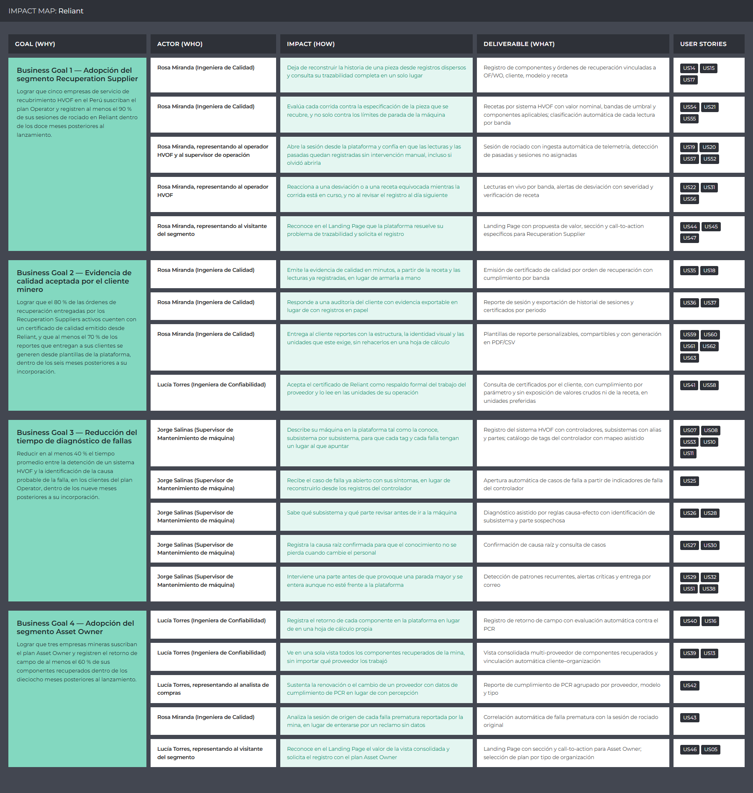

### Business Goal 1 ÔÇö Adopci├│n del segmento Recuperation Supplier

> **Lograr que cinco empresas de servicio de recubrimiento HVOF en el Per├║ suscriban el plan Operator y registren al menos el 90 % de sus sesiones de rociado en Reliant dentro de los doce meses posteriores al lanzamiento.**

| Actor | Impact | Deliverable | User Stories |
|---|---|---|---|
| Rosa Miranda (Ingeniera de Calidad) | Deja de reconstruir la historia de una pieza desde registros dispersos y consulta su trazabilidad completa en un solo lugar | Registro de componentes y órdenes de recuperación vinculadas a OF/WO, cliente, modelo y receta | Como operador HVOF, deseo registrar un componente recibido con su número de serie, part number, tipo, modelo de máquina, posición y cliente, para identificarlo durante todo el proceso y seleccionar la receta que le corresponde (US14). Como supervisor de operación, deseo registrar la orden de recuperación con su OF y WO, horómetro de ingreso, peso y lote de polvo, para trazar el trabajo realizado sobre el componente (US15). Como ingeniero de calidad, deseo consultar el historial completo de un componente por su número de serie, OF o WO, para responder ante un cuestionamiento del cliente (US17). |
| Rosa Miranda (Ingeniera de Calidad) | Eval├║a cada corrida contra la especificaci├│n de la pieza que se recubre, y no solo contra los l├¡mites de parada de la m├íquina | Recetas por sistema HVOF con valor nominal, bandas de umbral y componentes aplicables; clasificaci├│n autom├ítica de cada lectura por banda | Como ingeniero de calidad, deseo definir recetas de rociado por sistema HVOF con el valor nominal y las bandas de umbral de cada par├ímetro, indicando a qu├® tipos de componente, modelos de m├íquina y posiciones aplican, para que cada lectura se eval├║e contra la especificaci├│n de la pieza que se recubre (US54). Como ingeniero de calidad, deseo que el sistema clasifique cada lectura seg├║n la banda de la receta vigente de la sesi├│n, para detectar desviaciones que el controlador no alarma porque solo act├║a en los l├¡mites de parada (US21). Como ingeniero de calidad, deseo definir par├ímetros derivados mediante una f├│rmula sobre los tags mapeados del controlador, para monitorear variables que el controlador no expone directamente (US55). |
| Rosa Miranda, representando al operador HVOF y al supervisor de operación | Abre la sesión desde la plataforma y confía en que las lecturas y las pasadas quedan registradas sin intervención manual, incluso si olvidó abrirla | Sesión de rociado con ingesta automática de telemetría, detección de pasadas y sesiones no asignadas | Como operador HVOF, deseo iniciar una sesión de rociado seleccionando el sistema HVOF, la orden de recuperación y la receta aplicable al componente, para que las lecturas del proceso se asocien al componente correcto (US19). Como supervisor de operación, deseo que las lecturas del proceso lleguen automáticamente desde el cliente de telemetría conectado al controlador durante la sesión, para no depender de registros manuales (US20). Como operador HVOF, deseo que el sistema detecte automáticamente el inicio y fin de cada pasada de rociado y conserve en una sesión no asignada las lecturas que lleguen sin una sesión abierta, para no perder telemetría (US57). Como supervisor de operación, deseo que la plataforma reciba la telemetría desde un cliente externo conectado al controlador del sistema HVOF, para que el registro del proceso no dependa de intervención humana (US52). |
| Rosa Miranda, representando al operador HVOF | Reacciona a una desviación o a una receta equivocada mientras la corrida está en curso, y no al revisar el registro al día siguiente | Lecturas en vivo por banda, alertas de desviación con severidad y verificación de receta | Como operador HVOF, deseo ver los valores actuales de los parámetros durante la sesión, para reaccionar ante una desviación mientras la corrida está en curso (US22). Como operador HVOF, deseo recibir una alerta en la plataforma cuando un parámetro salga de la banda nominal de la receta, con severidad distinta si alcanza la banda de advertencia o la de parada, para actuar mientras la corrida está en curso (US31). Como supervisor de operación, deseo que el sistema advierta cuando la receta cargada en el controlador no corresponde al componente de la orden en curso, para evitar recubrir una pieza con los parámetros de otra (US56). |
| Rosa Miranda, representando al visitante del segmento | Reconoce en el Landing Page que la plataforma resuelve su problema de trazabilidad y solicita el registro | Landing Page con propuesta de valor, sección y call-to-action específicos para Recuperation Supplier | Como visitante, deseo conocer el problema que resuelve Reliant y sus beneficios desde la página principal, para decidir si la solución es relevante para mi organización (US44). Como visitante del segmento Recuperation Supplier, deseo acceder a la información específica para empresas que operan procesos HVOF, para identificar si la propuesta responde a mis necesidades (US45). Como visitante, deseo iniciar el registro desde el call-to-action de mi segmento, para llegar directamente a la vista de registro correspondiente en la Web Application (US47). |

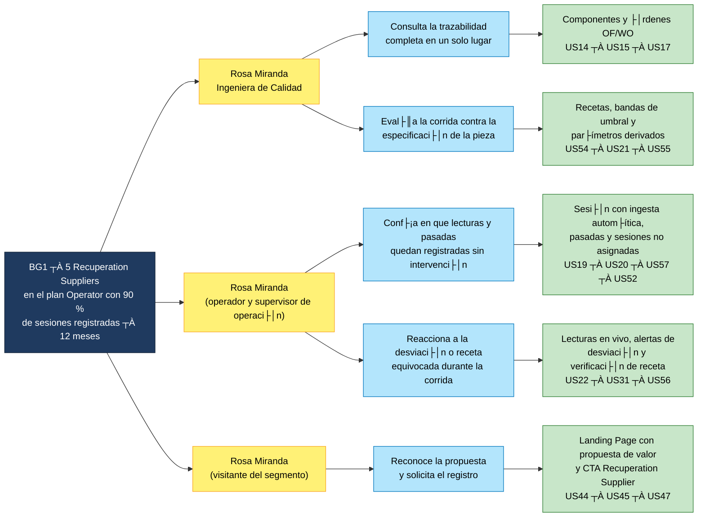

### Business Goal 2 ÔÇö Evidencia de calidad aceptada por el cliente minero

> **Lograr que el 80 % de las ├│rdenes de recuperaci├│n entregadas por los Recuperation Suppliers activos cuenten con un certificado de calidad emitido desde Reliant, y que al menos el 70 % de los reportes que entregan a sus clientes se generen desde plantillas de la plataforma, dentro de los seis meses posteriores a su incorporaci├│n.**

| Actor | Impact | Deliverable | User Stories |
|---|---|---|---|
| Rosa Miranda (Ingeniera de Calidad) | Emite la evidencia de calidad en minutos, a partir de la receta y las lecturas ya registradas, en lugar de armarla a mano | Emisi├│n de certificado de calidad por orden de recuperaci├│n con cumplimiento por banda | Como ingeniero de calidad, deseo emitir el certificado de calidad de una orden de recuperaci├│n a partir de las sesiones registradas y la receta aplicada, para entregar al cliente evidencia documentada de que la pieza fue recubierta dentro de la especificaci├│n (US35). Como supervisor de operaci├│n, deseo cerrar la orden de recuperaci├│n y marcar el componente como entregado, para habilitar la emisi├│n del certificado y el seguimiento en campo (US18). |
| Rosa Miranda (Ingeniera de Calidad) | Responde a una auditoría del cliente con evidencia exportable en lugar de con registros en papel | Reporte de sesión y exportación de historial de sesiones y certificados por periodo | Como supervisor de operación, deseo generar el reporte de una sesión con el resumen de lecturas por banda, pasadas, desviaciones y fallas, para revisar el resultado de la corrida (US36). Como ingeniero de calidad, deseo exportar el historial de sesiones y certificados de un periodo en formato CSV o PDF, para presentarlo durante una auditoría del cliente (US37). |
| Rosa Miranda (Ingeniera de Calidad) | Entrega al cliente reportes con la estructura, la identidad visual y las unidades que este exige, sin rehacerlos en una hoja de cálculo | Plantillas de reporte personalizables, compartibles y con generación en PDF/CSV | Como ingeniero de calidad, deseo crear una plantilla de reporte mediante un formulario, indicando el tipo de reporte, sus secciones, variables, tipo de vista y unidad, para que los reportes de mi organización tengan la estructura que exige el cliente (US59). Como ingeniero de calidad, deseo personalizar el logo, los colores, la tipografía y la orientación de página de una plantilla, para que el reporte refleje la identidad de mi organización (US60). Como ingeniero de calidad, deseo compartir una plantilla con toda mi organización o con usuarios específicos, para que otros generen reportes con la misma estructura sin duplicarla (US61). Como supervisor de operación, deseo generar un reporte a partir de una plantilla y descargarlo en PDF o CSV, para entregarlo al cliente o a la gerencia (US62). Como ingeniero de calidad, deseo marcar una plantilla como predeterminada para cada tipo de reporte, para que los reportes se generen con ella cuando no se indique otra (US63). |
| Lucía Torres (Ingeniera de Confiabilidad) | Acepta el certificado de Reliant como respaldo formal del trabajo del proveedor y lo lee en las unidades de su operación | Consulta de certificados por el cliente, con cumplimiento por parámetro y sin exposición de valores crudos ni de la receta, en unidades preferidas | Como ingeniero de confiabilidad, deseo consultar el certificado de calidad de un componente entregado por mi proveedor, para verificar que fue recubierto dentro de tolerancia (US41). Como usuario de la plataforma, deseo configurar las unidades en que se me presentan los parámetros de proceso, para leer la información en las unidades a las que estoy acostumbrado sin alterar el dato almacenado (US58). |

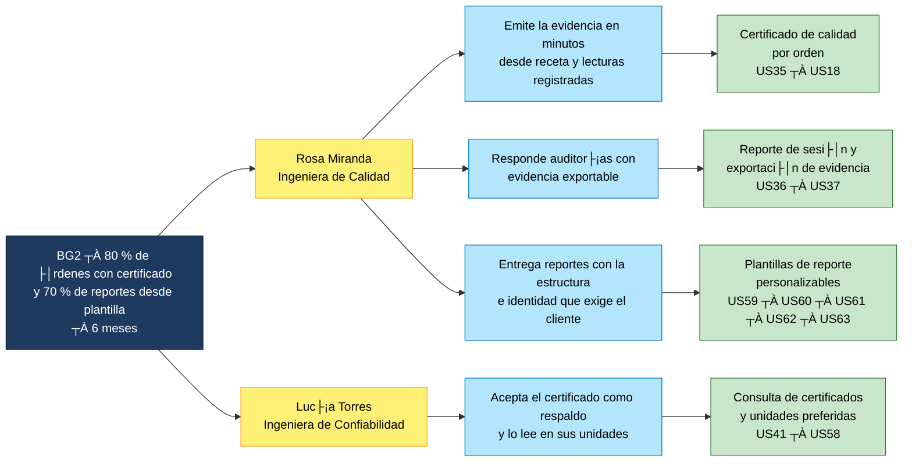

### Business Goal 3 ÔÇö Reducci├│n del tiempo de diagn├│stico de fallas

> **Reducir en al menos 40 % el tiempo promedio entre la detenci├│n de un sistema HVOF y la identificaci├│n de la causa probable de la falla, en los clientes del plan Operator, dentro de los nueve meses posteriores a su incorporaci├│n.**

| Actor | Impact | Deliverable | User Stories |
|---|---|---|---|
| Jorge Salinas (Supervisor de Mantenimiento de m├íquina) | Describe su m├íquina en la plataforma tal como la conoce, subsistema por subsistema, para que cada tag y cada falla tengan un lugar al que apuntar | Registro del sistema HVOF con controladores, subsistemas con alias y partes; cat├ílogo de tags del controlador con mapeo asistido | Como supervisor de mantenimiento de m├íquina, deseo registrar un sistema HVOF con su c├│digo, fabricante y modelo, y los controladores que lo gobiernan, para que las sesiones y fallas se asocien a un equipo identificado (US07). Como supervisor de mantenimiento de m├íquina, deseo registrar los subsistemas que componen un sistema HVOF con el alias que usa el controlador, para que las fallas se atribuyan al subsistema correcto (US08). Como supervisor de mantenimiento de m├íquina, deseo registrar las partes f├¡sicas de cada subsistema con su n├║mero de serie, fabricante y fecha de instalaci├│n, para que el diagn├│stico pueda se├▒alar una parte espec├¡fica (US53). Como supervisor de mantenimiento de m├íquina, deseo importar el archivo de tags exportado del controlador al cat├ílogo de tags, para que el sistema normalice los tipos de dato y proponga a qu├® subsistema, par├ímetro o rol corresponde cada tag (US10). Como supervisor de mantenimiento de m├íquina, deseo confirmar o corregir el mapeo propuesto para cada tag, para asegurar que las lecturas y fallas se atribuyan correctamente (US11). |
| Jorge Salinas (Supervisor de Mantenimiento de máquina) | Recibe el caso de falla ya abierto con sus síntomas, en lugar de reconstruirlo desde los registros del controlador | Apertura automática de casos de falla a partir de indicadores de falla del controlador | Como supervisor de mantenimiento de máquina, deseo que el sistema abra un caso de falla cuando un tag clasificado como indicador de falla se active durante una sesión, para no depender de que el operador lo reporte (US25). |
| Jorge Salinas (Supervisor de Mantenimiento de m├íquina) | Sabe qu├® subsistema y qu├® parte revisar antes de ir a la m├íquina | Diagn├│stico asistido por reglas causa-efecto con identificaci├│n de subsistema y parte sospechosa | Como supervisor de mantenimiento de m├íquina, deseo que el sistema aplique el cat├ílogo de reglas causa-efecto al caso de falla abierto, para obtener una causa probable y el subsistema o parte sospechosa (US26). Como ingeniero de calidad, deseo crear, editar y desactivar reglas causa-efecto indicando el tag o par├ímetro disparador, la condici├│n, la causa probable y el subsistema o parte sospechosa, para adaptar el diagn├│stico a cada sistema HVOF (US28). |
| Jorge Salinas (Supervisor de Mantenimiento de máquina) | Registra la causa raíz confirmada para que el conocimiento no se pierda cuando cambie el personal | Confirmación de causa raíz y consulta de casos | Como supervisor de mantenimiento de máquina, deseo confirmar o corregir la causa raíz y registrar la acción correctiva de un caso de falla, para que el conocimiento quede documentado en el sistema (US27). Como supervisor de mantenimiento de máquina, deseo consultar los casos de falla filtrando por sistema HVOF, subsistema, parte, tipo y estado, para dar seguimiento a los pendientes (US30). |
| Jorge Salinas (Supervisor de Mantenimiento de m├íquina) | Interviene una parte antes de que provoque una parada mayor y se entera aunque no est├® frente a la plataforma | Detecci├│n de patrones recurrentes, alertas cr├¡ticas y entrega por correo | Como supervisor de mantenimiento de m├íquina, deseo que el sistema identifique cuando una misma parte acumula fallas del mismo tipo dentro de un periodo, para anticipar un problema mayor (US29). Como supervisor de mantenimiento de m├íquina, deseo recibir una alerta cuando se abra un caso de falla cr├¡tica o se detecte un patr├│n recurrente, para intervenir oportunamente (US32). Como supervisor de mantenimiento de m├íquina, deseo recibir por correo electr├│nico las alertas cr├¡ticas mediante el servicio externo Mailchimp, para enterarme sin estar frente a la plataforma (US51). Como supervisor de mantenimiento de m├íquina, deseo consultar la frecuencia de fallas por sistema HVOF, subsistema y parte en un periodo, para priorizar las intervenciones (US38). |

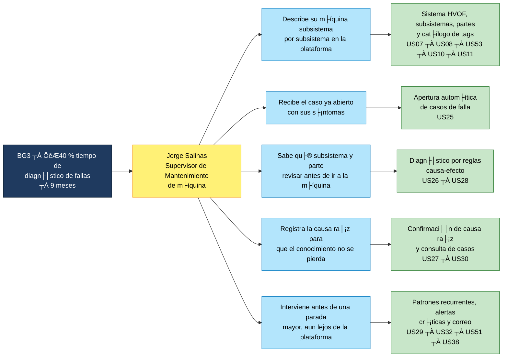

### Business Goal 4 ÔÇö Adopci├│n del segmento Asset Owner

> **Lograr que tres empresas mineras suscriban el plan Asset Owner y registren el retorno de campo de al menos el 60 % de sus componentes recuperados dentro de los dieciocho meses posteriores al lanzamiento.**

| Actor | Impact | Deliverable | User Stories |
|---|---|---|---|
| Lucía Torres (Ingeniera de Confiabilidad) | Registra el retorno de cada componente en la plataforma en lugar de en una hoja de cálculo propia | Registro de retorno de campo con evaluación automática contra el PCR | Como ingeniero de confiabilidad, deseo registrar el retorno de un componente indicando el horómetro alcanzado y el motivo, para que el sistema evalúe si alcanzó su PCR (US40). Como ingeniero de calidad, deseo definir el PCR objetivo en horas por tipo y modelo de componente, para contar con el estándar contra el cual se evaluará el desempeño en campo (US16). |
| Luc├¡a Torres (Ingeniera de Confiabilidad) | Ve en una sola vista todos los componentes recuperados de la mina, sin importar qu├® proveedor los trabaj├│ | Vista consolidada multi-proveedor de componentes recuperados y vinculaci├│n autom├ítica clienteÔÇôorganizaci├│n | Como analista de compras, deseo consultar en una sola vista todos los componentes recuperados de mi organizaci├│n con su proveedor, estado y fecha de entrega, para eliminar el cruce manual de informaci├│n (US39). Como supervisor de operaci├│n, deseo registrar los clientes de mi organizaci├│n con su raz├│n social, RUC y sede, para vincular cada componente a su propietario (US13). |
| Lucía Torres, representando al analista de compras | Sustenta la renovación o el cambio de un proveedor con datos de cumplimiento de PCR en lugar de con percepción | Reporte de cumplimiento de PCR agrupado por proveedor, modelo y tipo | Como ingeniero de confiabilidad, deseo consultar la tasa de cumplimiento de PCR agrupada por proveedor, modelo de máquina y tipo de componente, para sustentar la renovación o cambio de contratos con datos (US42). |
| Rosa Miranda (Ingeniera de Calidad) | Analiza la sesión de origen de cada falla prematura reportada por la mina, en lugar de enterarse por un reclamo sin datos | Correlación automática de falla prematura con la sesión de rociado original | Como ingeniero de calidad, deseo que al registrarse una falla prematura el sistema me presente la sesión de rociado original del componente, para determinar si el origen estuvo en el recubrimiento (US43). |
| Lucía Torres, representando al visitante del segmento | Reconoce en el Landing Page el valor de la vista consolidada y solicita el registro con el plan Asset Owner | Landing Page con sección y call-to-action para Asset Owner; selección de plan por tipo de organización | Como visitante del segmento Asset Owner, deseo acceder a la información específica para empresas propietarias de activos, para identificar si la propuesta responde a mis necesidades (US46). Como administrador de organización, deseo seleccionar el plan correspondiente a mi tipo de organización, para activar las capacidades de la plataforma (US05). |

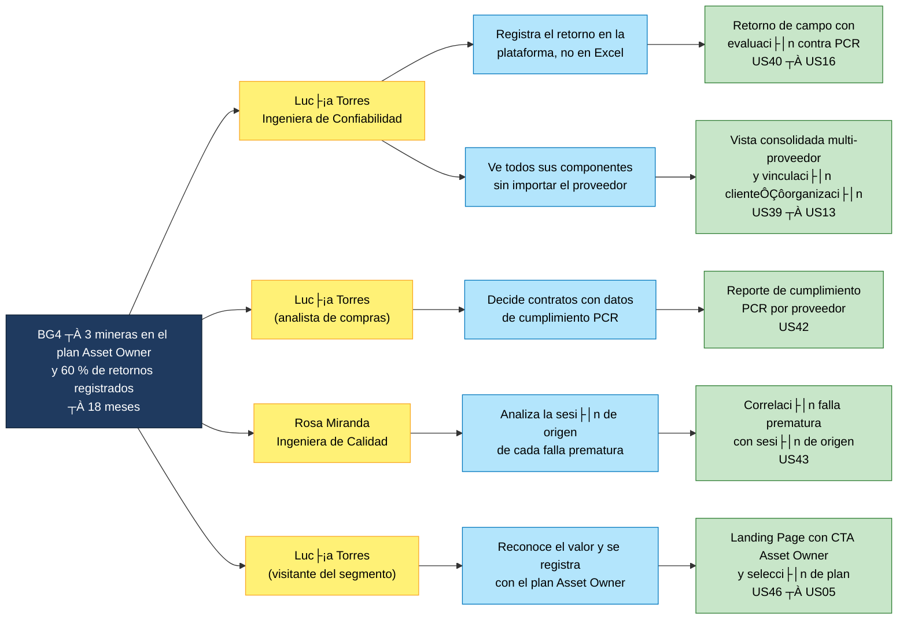

### Síntesis

Los cuatro Business Goals se refuerzan entre s├¡. BG1 y BG4 miden la adopci├│n de cada segmento pagante; BG2 y BG3 miden el valor que cada segmento obtiene una vez adoptada la plataforma y son, a la vez, los mecanismos que sostienen la renovaci├│n de las suscripciones. El mapa hace visible adem├ís la dependencia entre segmentos: los deliverables de BG4 (vista consolidada, cumplimiento de PCR, correlaci├│n de fallas prematuras) solo producen impacto cuando los Recuperation Suppliers ya registran sesiones y emiten certificados (BG1 y BG2), lo que explica el orden del Product Backlog de la secci├│n 3.3. Las historias no referenciadas en los mapas (autenticaci├│n, roles, vigencia de suscripci├│n, cambio de estado del sistema HVOF, cierre de sesi├│n e historial de sesiones, preferencias y atenci├│n de alertas, cambio de idioma, newsletter, t├®rminos y condiciones, editor drag & drop y las Technical Stories) son habilitadoras de los deliverables anteriores y no provocan por s├¡ mismas un cambio de comportamiento en los actores.

## 3.3. Product Backlog

El Product Backlog de Reliant ordena todas las User Stories y Technical Stories de la sección 3.1 según su prioridad para el negocio. El orden responde a la estrategia de entrada al mercado descrita en 1.3: primero las historias del Landing Page (Sprint 1), luego las que permiten a un Recuperation Supplier registrar su organización, su equipamiento, sus recetas y sus órdenes de recuperación y ejecutar una sesión de rociado de extremo a extremo (Sprint 2), y a continuación las Technical Stories del RESTful API, la ingesta automática de telemetría, las alertas, el diagnóstico de fallas, la evidencia de calidad y las funciones del segmento Asset Owner.

La estimación se expresa en Story Points sobre la escala de Fibonacci (1, 2, 3, 5, 8), considerando la complejidad, el esfuerzo y la incertidumbre de cada historia relativa a las demás. Las historias incorporadas desde la versión AV1 conservan la estimación acordada por el equipo en ese entregable.

El Product Backlog se gestiona en Trello, con una lista por Sprint y una etiqueta por Epic: [https://trello.com/b/aDFKmtGp/reliant-product-backlog](https://trello.com/b/aDFKmtGp/reliant-product-backlog). Cada tarjeta indica sus Story Points entre par├®ntesis.

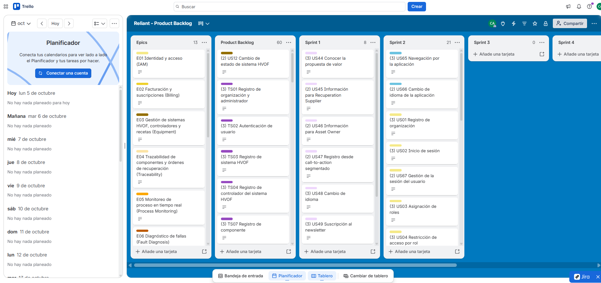

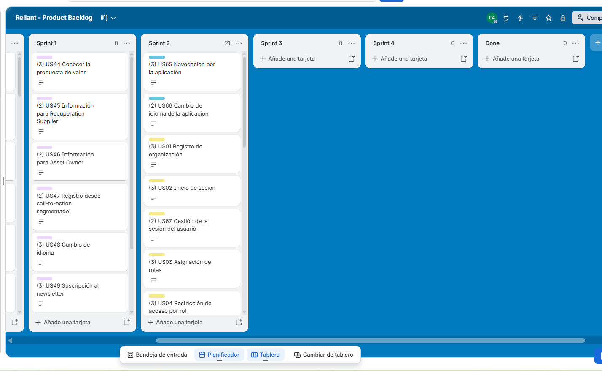

| # Orden | User Story Id | Título | Descripción | Story Points (1 / 2 / 3 / 5 / 8) |
|---|---|---|---|---|
| 1 | US44 | Conocer la propuesta de valor | Como visitante, deseo conocer el problema que resuelve Reliant y sus beneficios desde la página principal, para decidir si la solución es relevante para mi organización. | 3 |
| 2 | US45 | Información para Recuperation Supplier | Como visitante del segmento Recuperation Supplier, deseo acceder a la información específica para empresas que operan procesos HVOF, para identificar si la propuesta responde a mis necesidades. | 2 |
| 3 | US46 | Información para Asset Owner | Como visitante del segmento Asset Owner, deseo acceder a la información específica para empresas propietarias de activos, para identificar si la propuesta responde a mis necesidades. | 2 |
| 4 | US47 | Registro desde call-to-action segmentado | Como visitante, deseo iniciar el registro desde el call-to-action de mi segmento, para llegar directamente a la vista de registro correspondiente en la Web Application. | 2 |
| 5 | US48 | Cambio de idioma | Como visitante, deseo cambiar el idioma del Landing Page entre ingl├®s y espa├▒ol, para leer el contenido en el idioma de mi preferencia. | 3 |
| 6 | US49 | Suscripci├│n al newsletter | Como visitante, deseo suscribirme al newsletter de InnovaCorp con mi correo electr├│nico, para recibir novedades sobre Reliant y el sector. | 3 |
| 7 | US50 | Acceso a T├®rminos y Condiciones | Como visitante, deseo acceder a los T├®rminos y Condiciones del servicio desde el pie de p├ígina, para conocer las reglas de uso y el tratamiento de la informaci├│n antes de registrarme. | 1 |
| 8 | US65 | Navegaci├│n por la aplicaci├│n | Como usuario de la plataforma, deseo navegar entre las secciones de la Web Application desde una barra de navegaci├│n com├║n, para llegar a las funciones de mi rol sin perderme. | 3 |
| 9 | US66 | Cambio de idioma de la aplicaci├│n | Como usuario de la plataforma, deseo cambiar el idioma de la Web Application entre espa├▒ol e ingl├®s, para trabajar en el idioma de mi preferencia. | 2 |
| 10 | US01 | Registro de organizaci├│n | Como administrador de una organizaci├│n, deseo registrar mi organizaci├│n indicando su tipo (Recuperation Supplier o Asset Owner), para habilitar el acceso de mi equipo a la plataforma. | 3 |
| 11 | US02 | Inicio de sesi├│n | Como usuario registrado, deseo iniciar sesi├│n con mis credenciales, para acceder a las funciones que corresponden a mi rol. | 3 |
| 12 | US67 | Gesti├│n de la sesi├│n del usuario | Como usuario registrado, deseo ver con qu├® cuenta estoy conectado y cerrar mi sesi├│n, para proteger el acceso a la informaci├│n de mi organizaci├│n cuando dejo de usar la plataforma. | 2 |
| 13 | US03 | Asignaci├│n de roles | Como administrador de organizaci├│n, deseo asignar roles a los usuarios de mi organizaci├│n, para que cada uno acceda solo a las funciones que le corresponden. | 3 |
| 14 | US04 | Restricci├│n de acceso por rol | Como administrador de organizaci├│n, deseo que las funciones de la plataforma se restrinjan seg├║n el rol del usuario, para proteger la informaci├│n de la organizaci├│n. | 3 |
| 15 | US05 | Selecci├│n de plan | Como administrador de organizaci├│n, deseo seleccionar el plan correspondiente a mi tipo de organizaci├│n (Operator, por sistema HVOF monitoreado, o Asset Owner, por componentes en seguimiento), para activar las capacidades de la plataforma. | 3 |
| 16 | US06 | Consulta y vigencia de suscripci├│n | Como administrador de organizaci├│n, deseo consultar el estado y la vigencia de mi suscripci├│n, para anticipar su renovaci├│n. | 2 |
| 17 | US13 | Registro de cliente | Como supervisor de operaci├│n, deseo registrar los clientes de mi organizaci├│n con su raz├│n social, RUC y sede, para vincular cada componente a su propietario. | 2 |
| 18 | US14 | Registro de componente recibido | Como operador HVOF, deseo registrar un componente recibido con su número de serie, part number, tipo, modelo de máquina, posición y cliente, para identificarlo durante todo el proceso y seleccionar la receta que le corresponde. | 3 |
| 19 | US15 | Registro de orden de recuperaci├│n | Como supervisor de operaci├│n, deseo registrar la orden de recuperaci├│n con su OF y WO, hor├│metro de ingreso, peso y lote de polvo, para trazar el trabajo realizado sobre el componente. | 5 |
| 20 | US07 | Registro de sistema HVOF y sus controladores | Como supervisor de mantenimiento de máquina, deseo registrar un sistema HVOF con su código, fabricante y modelo, y los controladores (PLC) que lo gobiernan con su marca, modelo y dirección IP, para que las sesiones y fallas se asocien a un equipo identificado. | 3 |
| 21 | US12 | Cambio de estado de sistema HVOF | Como supervisor de mantenimiento de máquina, deseo cambiar el estado de un sistema HVOF (activo, en mantenimiento, fuera de servicio), para impedir que se inicien sesiones en un equipo no disponible. | 2 |
| 22 | US08 | Registro de subsistemas del sistema HVOF | Como supervisor de mantenimiento de máquina, deseo registrar los subsistemas que componen un sistema HVOF (alimentador de polvo, manipulador de pistola, colector de polvo, distribuidor de gases, entre otros) con el alias que usa el controlador (FDR, GM, DH, GD), para que las fallas se atribuyan al subsistema correcto. | 3 |
| 23 | US53 | Registro de partes de un subsistema | Como supervisor de mantenimiento de máquina, deseo registrar las partes físicas de cada subsistema (motor del alimentador, tolva, spindle, ejes, filtros, entre otras) con su número de serie, fabricante y fecha de instalación, para que el diagnóstico pueda señalar una parte específica y el conteo de fallas se reinicie cuando se reemplace. | 3 |
| 24 | US54 | Definici├│n de recetas con bandas de umbral y componentes aplicables | Como ingeniero de calidad, deseo definir recetas de rociado por sistema HVOF con el valor nominal y las bandas de umbral (advertencia y parada, inferior y superior) de cada par├ímetro, indicando a qu├® tipos de componente, modelos de m├íquina y posiciones aplican, para que cada lectura se eval├║e contra la especificaci├│n de la pieza que se recubre y no solo contra los l├¡mites de parada de la m├íquina. | 8 |
| 25 | US19 | Inicio de sesi├│n de rociado | Como operador HVOF, deseo iniciar una sesi├│n de rociado seleccionando el sistema HVOF, la orden de recuperaci├│n y la receta aplicable al componente, para que las lecturas del proceso se asocien al componente correcto y se eval├║en contra su especificaci├│n. | 3 |
| 26 | US21 | Clasificación de lecturas por banda de umbral | Como ingeniero de calidad, deseo que el sistema clasifique cada lectura según la banda de la receta vigente de la sesión (nominal, advertencia o parada, inferior o superior), para detectar desviaciones que el controlador no alarma porque solo actúa en los límites de parada. | 5 |
| 27 | US22 | Visualización de lecturas en vivo | Como operador HVOF, deseo ver los valores actuales de los parámetros durante la sesión, para reaccionar ante una desviación mientras la corrida está en curso. | 5 |
| 28 | US23 | Finalizaci├│n o aborto de sesi├│n | Como operador HVOF, deseo completar o abortar una sesi├│n indicando el motivo, para dejar constancia del resultado de la corrida. | 2 |
| 29 | US24 | Historial de sesiones por sistema HVOF | Como supervisor de operaci├│n, deseo consultar el historial de sesiones de un sistema HVOF filtrando por fecha y orden de recuperaci├│n, para revisar corridas pasadas. | 3 |
| 30 | TS01 | Registro de organizaci├│n y administrador | Como developer, deseo consumir el endpoint POST /api/v1/authentication/sign-up, para registrar una organizaci├│n y su usuario administrador desde la Web Application. | 3 |
| 31 | TS02 | Autenticación de usuario | Como developer, deseo consumir el endpoint POST /api/v1/authentication/sign-in, para obtener el token de acceso que autoriza las demás peticiones. | 3 |
| 32 | TS03 | Registro de sistema HVOF | Como developer, deseo consumir el endpoint POST /api/v1/hvof-systems, para registrar un sistema HVOF con su c├│digo, fabricante y modelo. | 3 |
| 33 | TS04 | Registro de controlador del sistema HVOF | Como developer, deseo consumir el endpoint POST /api/v1/hvof-systems/{systemId}/controllers, para registrar un controlador (PLC) con su marca, modelo y direcci├│n IP. | 3 |
| 34 | TS07 | Registro de componente | Como developer, deseo consumir el endpoint POST /api/v1/components, para registrar un componente recibido del cliente. | 3 |
| 35 | TS08 | Registro de orden de recuperaci├│n | Como developer, deseo consumir el endpoint POST /api/v1/recuperations, para crear la orden de recuperaci├│n con su OF y WO vinculada a un componente. | 3 |
| 36 | TS09 | Inicio de sesi├│n de rociado | Como developer, deseo consumir el endpoint POST /api/v1/spray-sessions, para iniciar una sesi├│n vinculada a un sistema HVOF, una orden de recuperaci├│n y una receta. | 3 |
| 37 | TS10 | Ingesta de lecturas de telemetría | Como developer, deseo consumir el endpoint POST /api/v1/spray-sessions/{sessionId}/readings, para enviar lotes de lecturas del controlador a una sesión. | 8 |
| 38 | TS11 | Consulta de lecturas de una sesi├│n | Como developer, deseo consumir el endpoint GET /api/v1/spray-sessions/{sessionId}/readings, para obtener las lecturas de una sesi├│n y mostrarlas en la vista de monitoreo. | 3 |
| 39 | TS19 | Gestión de recetas del sistema HVOF | Como developer, deseo consumir los endpoints POST /api/v1/hvof-systems/{systemId}/recipes y PUT /api/v1/recipes/{recipeId}, para crear y actualizar recetas con sus parámetros, bandas de umbral y aplicabilidad. | 5 |
| 40 | US10 | Importaci├│n del cat├ílogo de tags del controlador | Como supervisor de mantenimiento de m├íquina, deseo importar el archivo de tags exportado del controlador (CSV o JSON) al cat├ílogo de tags del controlador, para que el sistema normalice los tipos de dato del fabricante y proponga a qu├® subsistema, par├ímetro o rol de estado corresponde cada tag. | 8 |
| 41 | US11 | Confirmación de mapeo de tags | Como supervisor de mantenimiento de máquina, deseo confirmar o corregir el mapeo propuesto para cada tag (subsistema, parte, parámetro o rol de estado y tipo de tag), para asegurar que las lecturas y fallas se atribuyan correctamente. | 5 |
| 42 | TS05 | Importación del catálogo de tags del controlador | Como developer, deseo consumir el endpoint POST /api/v1/controllers/{controllerId}/tag-catalog/imports, para cargar el archivo de tags y obtener el catálogo normalizado con las propuestas de mapeo. | 8 |
| 43 | TS06 | Confirmaci├│n de mapeo de tag | Como developer, deseo consumir el endpoint PUT /api/v1/controllers/{controllerId}/tag-mappings/{tagId}, para confirmar o corregir el mapeo de un tag. | 3 |
| 44 | US20 | Ingesta automática de lecturas | Como supervisor de operación, deseo que las lecturas del proceso lleguen automáticamente desde el cliente de telemetría conectado al controlador durante la sesión, para no depender de registros manuales. | 8 |
| 45 | US52 | Recepción de telemetría desde el cliente del controlador | Como supervisor de operación, deseo que la plataforma reciba la telemetría desde un cliente externo (gateway o simulador) conectado al controlador del sistema HVOF, para que el registro del proceso no dependa de intervención humana. | 5 |
| 46 | US57 | Detección de pasadas de rociado y sesiones no asignadas | Como operador HVOF, deseo que el sistema detecte automáticamente el inicio y fin de cada pasada de rociado a partir del tag de estado del controlador, y que conserve en una sesión no asignada las lecturas que lleguen sin una sesión abierta, para no perder telemetría cuando la sesión no se abrió a tiempo. | 8 |
| 47 | US56 | Advertencia por receta no correspondiente al componente | Como supervisor de operación, deseo que el sistema advierta cuando la receta cargada en el controlador no corresponde al componente de la orden en curso, para evitar recubrir una pieza con los parámetros de otra. | 3 |
| 48 | US55 | Definición de parámetros derivados | Como ingeniero de calidad, deseo definir parámetros derivados mediante una fórmula sobre los tags mapeados del controlador (por ejemplo relación combustible-oxígeno o flujo total de gases), para monitorear variables que el controlador no expone directamente. | 5 |
| 49 | TS20 | Definición de parámetros derivados | Como developer, deseo consumir el endpoint POST /api/v1/hvof-systems/{systemId}/derived-parameters, para registrar un parámetro derivado con su expresión sobre los tags mapeados. | 3 |
| 50 | US31 | Alerta por desviación de parámetro | Como operador HVOF, deseo recibir una alerta en la plataforma cuando un parámetro salga de la banda nominal de la receta, con severidad distinta si alcanza la banda de advertencia o la de parada, para actuar mientras la corrida está en curso. | 5 |
| 51 | US32 | Alerta por falla crítica o patrón recurrente | Como supervisor de mantenimiento de máquina, deseo recibir una alerta cuando se abra un caso de falla crítica o se detecte un patrón recurrente, para intervenir oportunamente. | 3 |
| 52 | US34 | Atenci├│n de alertas | Como usuario de la plataforma, deseo marcar una alerta como atendida, para distinguir las pendientes de las ya revisadas. | 2 |
| 53 | TS17 | Consulta de alertas del usuario | Como developer, deseo consumir el endpoint GET /api/v1/alerts, para obtener las alertas dirigidas al usuario autenticado y su estado. | 3 |
| 54 | US33 | Preferencias de notificaci├│n | Como usuario de la plataforma, deseo configurar qu├® tipos de alerta recibo y por qu├® canal, para recibir ├║nicamente lo relevante para mi rol. | 3 |
| 55 | US51 | Entrega de alertas por correo electrónico | Como supervisor de mantenimiento de máquina, deseo recibir por correo electrónico las alertas críticas mediante el servicio externo Mailchimp, para enterarme sin estar frente a la plataforma. | 5 |
| 56 | US16 | Definición de PCR objetivo | Como ingeniero de calidad, deseo definir el PCR objetivo en horas por tipo y modelo de componente, para contar con el estándar contra el cual se evaluará el desempeño en campo. | 3 |
| 57 | US17 | Consulta de historial de componente | Como ingeniero de calidad, deseo consultar el historial completo de un componente por su n├║mero de serie, OF o WO, para responder ante un cuestionamiento del cliente. | 5 |
| 58 | US18 | Cierre y entrega de orden | Como supervisor de operaci├│n, deseo cerrar la orden de recuperaci├│n y marcar el componente como entregado, para habilitar la emisi├│n del certificado y el seguimiento en campo. | 3 |
| 59 | US25 | Apertura automática de caso de falla | Como supervisor de mantenimiento de máquina, deseo que el sistema abra un caso de falla cuando un tag clasificado como indicador de falla se active durante una sesión, para no depender de que el operador lo reporte. | 8 |
| 60 | US26 | Diagnóstico asistido por reglas causa-efecto | Como supervisor de mantenimiento de máquina, deseo que el sistema aplique el catálogo de reglas causa-efecto al caso de falla abierto, para obtener una causa probable y el subsistema o parte sospechosa. | 8 |
| 61 | US27 | Confirmación de causa raíz | Como supervisor de mantenimiento de máquina, deseo confirmar o corregir la causa raíz y registrar la acción correctiva de un caso de falla, para que el conocimiento quede documentado en el sistema. | 3 |
| 62 | US28 | Gestión del catálogo de reglas | Como ingeniero de calidad, deseo crear, editar y desactivar reglas causa-efecto indicando el tag o parámetro disparador, la condición, la causa probable y el subsistema o parte sospechosa, para adaptar el diagnóstico a cada sistema HVOF. | 5 |
| 63 | TS12 | Consulta de casos de falla | Como developer, deseo consumir el endpoint GET /api/v1/fault-cases, para listar los casos de falla con filtros de sistema HVOF, subsistema, parte, tipo y estado. | 3 |
| 64 | TS13 | Confirmación de causa raíz | Como developer, deseo consumir el endpoint PATCH /api/v1/fault-cases/{faultCaseId}/root-cause, para registrar la causa raíz confirmada y la acción correctiva. | 2 |
| 65 | US29 | Detección de patrón recurrente | Como supervisor de mantenimiento de máquina, deseo que el sistema identifique cuando una misma parte acumula fallas del mismo tipo dentro de un periodo, para anticipar un problema mayor. | 5 |
| 66 | US30 | Consulta de casos de falla | Como supervisor de mantenimiento de máquina, deseo consultar los casos de falla filtrando por sistema HVOF, subsistema, parte, tipo y estado, para dar seguimiento a los pendientes. | 3 |
| 67 | US35 | Emisi├│n de certificado de calidad | Como ingeniero de calidad, deseo emitir el certificado de calidad de una orden de recuperaci├│n a partir de las sesiones registradas y la receta aplicada, para entregar al cliente evidencia documentada de que la pieza fue recubierta dentro de la especificaci├│n. | 8 |
| 68 | TS14 | Emisi├│n de certificado de calidad | Como developer, deseo consumir el endpoint POST /api/v1/recuperations/{recuperationId}/quality-certificate, para emitir el certificado de una orden cerrada. | 5 |
| 69 | US36 | Reporte de sesi├│n | Como supervisor de operaci├│n, deseo generar el reporte de una sesi├│n con el resumen de lecturas por banda, pasadas, desviaciones y fallas, para revisar el resultado de la corrida. | 3 |
| 70 | US37 | Exportación de evidencia para auditoría | Como ingeniero de calidad, deseo exportar el historial de sesiones y certificados de un periodo en formato CSV o PDF, para presentarlo durante una auditoría del cliente. | 5 |
| 71 | US38 | Reporte de frecuencia de fallas | Como supervisor de mantenimiento de máquina, deseo consultar la frecuencia de fallas por sistema HVOF, subsistema y parte en un periodo, para priorizar las intervenciones. | 3 |
| 72 | US40 | Registro de retorno de campo | Como ingeniero de confiabilidad, deseo registrar el retorno de un componente indicando el hor├│metro alcanzado y el motivo, para que el sistema eval├║e si alcanz├│ su PCR. | 5 |
| 73 | TS15 | Registro de retorno de campo | Como developer, deseo consumir el endpoint POST /api/v1/components/{componentId}/field-returns, para registrar el retorno de un componente y su evaluaci├│n contra el PCR. | 3 |
| 74 | US41 | Consulta de certificado por el cliente | Como ingeniero de confiabilidad, deseo consultar el certificado de calidad de un componente entregado por mi proveedor, para verificar que fue recubierto dentro de tolerancia. | 3 |
| 75 | US39 | Vista consolidada de componentes recuperados | Como analista de compras, deseo consultar en una sola vista todos los componentes recuperados de mi organizaci├│n con su proveedor, estado y fecha de entrega, para eliminar el cruce manual de informaci├│n. | 5 |
| 76 | US42 | Cumplimiento de PCR por proveedor | Como ingeniero de confiabilidad, deseo consultar la tasa de cumplimiento de PCR agrupada por proveedor, modelo de máquina y tipo de componente, para sustentar la renovación o cambio de contratos con datos. | 8 |
| 77 | TS16 | Reporte de cumplimiento PCR | Como developer, deseo consumir el endpoint GET /api/v1/reports/pcr-compliance, para obtener la tasa de cumplimiento agrupada por proveedor, modelo o tipo de componente. | 5 |
| 78 | US43 | Correlaci├│n de falla prematura con sesi├│n de origen | Como ingeniero de calidad, deseo que al registrarse una falla prematura el sistema me presente la sesi├│n de rociado original del componente, para determinar si el origen estuvo en el recubrimiento. | 5 |
| 79 | US58 | Configuración de unidades de medida preferidas | Como usuario de la plataforma, deseo configurar las unidades en que se me presentan los parámetros de proceso (por ejemplo psi o bar, °C o °F, g/min o lb/h), para leer la información en las unidades a las que estoy acostumbrado sin alterar el dato almacenado. | 3 |
| 80 | TS21 | Preferencias de unidades del usuario | Como developer, deseo consumir el endpoint PUT /api/v1/users/{userId}/unit-preferences, para almacenar las unidades preferidas por magnitud del usuario autenticado. | 2 |
| 81 | US59 | Creación de plantilla de reporte mediante formulario | Como ingeniero de calidad, deseo crear una plantilla de reporte mediante un formulario, indicando el tipo de reporte, sus secciones, las variables de cada sección, el tipo de vista (tabla, gráfico o indicador) y la unidad, para que los reportes de mi organización tengan la estructura que exige el cliente. | 5 |
| 82 | US60 | Personalización de identidad visual y layout de la plantilla | Como ingeniero de calidad, deseo personalizar el logo, los colores, la tipografía y la orientación de página de una plantilla, para que el reporte refleje la identidad de mi organización. | 5 |
| 83 | US61 | Compartición de plantillas | Como ingeniero de calidad, deseo compartir una plantilla con toda mi organización o con usuarios específicos, para que otros generen reportes con la misma estructura sin duplicarla. | 3 |
| 84 | US62 | Generaci├│n y descarga de reportes desde plantilla | Como supervisor de operaci├│n, deseo generar un reporte a partir de una plantilla indicando su objeto (sesi├│n, orden de recuperaci├│n, sistema HVOF o periodo) y descargarlo en PDF o CSV, para entregarlo al cliente o a la gerencia. | 8 |
| 85 | US63 | Plantilla predeterminada por tipo de reporte | Como ingeniero de calidad, deseo marcar una plantilla como predeterminada para cada tipo de reporte de mi organizaci├│n, para que los reportes se generen con ella cuando no se indique otra. | 2 |
| 86 | US64 | Dise├▒o de plantilla mediante editor visual drag & drop | Como ingeniero de calidad, deseo dise├▒ar la plantilla arrastrando y soltando secciones y widgets sobre un lienzo con vista previa, para ajustar la disposici├│n del reporte sin editar los campos uno por uno. | 8 |
| 87 | TS22 | Gesti├│n de plantillas de reporte | Como developer, deseo consumir los endpoints POST /api/v1/report-templates, PUT /api/v1/report-templates/{templateId}/sections, POST /api/v1/report-templates/{templateId}/logo y POST /api/v1/report-templates/{templateId}/shares, para crear, estructurar, personalizar y compartir plantillas. | 5 |
| 88 | TS23 | Generaci├│n y descarga de reportes | Como developer, deseo consumir los endpoints POST /api/v1/reports y GET /api/v1/reports/{reportId}, para generar un reporte a partir de una plantilla y descargarlo en el formato solicitado. | 5 |
| 89 | TS18 | Suscripción al newsletter vía Mailchimp | Como developer, deseo consumir el endpoint POST /api/v1/newsletter/subscriptions, para registrar un correo en la audiencia de Mailchimp desde el Landing Page. | 3 |

# Capítulo IV: Product Design
Este capítulo abarca los aspectos relacionados con el diseño de la solución, incluyendo el estilo visual, los diagramas C4, los diagramas de clases y los modelos de bases de datos.

## 4.1. Style Guidelines.
Durante el desarrollo de Relient, es fundamental establecer lineamientos visuales que garanticen la coherencia y uniformidad de las interfaces del producto. La falta de consistencia en el uso de colores, tipografías, componentes y estilos de interacción puede dificultar la comprensión de la información y afectar la experiencia de los usuarios. En este contexto, las Style Guidelines definen los criterios visuales y funcionales que orientan el diseño de la Landing Page y la Web Application de Relient. Estas directrices se adaptan a las necesidades de los usuarios involucrados en la gestión y el monitoreo de procesos, equipos, componentes y recursos de los sectores industrial y minero. Asimismo, buscan garantizar una interfaz clara, organizada y consistente, que facilite la navegación, la consulta de información, el seguimiento de alertas y la gestión eficiente de los distintos módulos de la plataforma.

### 4.1.1. General Style Guidelines
Las General Style Guidelines establecen las normas visuales que orientan el diseño de las interfaces de Relient. Estas directrices definen los criterios de identidad visual, tipografía, colores, espaciado y tono de comunicación, con el propósito de mantener la consistencia entre la Landing Page y la Web Application, facilitar la comprensión de la información y garantizar una experiencia de usuario clara y organizada.

**Branding**

**Brand Overview:**
Relient es una plataforma digital orientada a la gesti├│n y el monitoreo de procesos, equipos, componentes y recursos de los sectores industrial y minero. Su propuesta busca facilitar el acceso a la informaci├│n operativa, el seguimiento de alertas y la gesti├│n de los distintos m├│dulos de la plataforma mediante interfaces claras y organizadas. La identidad visual se fundamenta en los conceptos de innovaci├│n, control y eficiencia, priorizando una presentaci├│n ordenada de los datos y una interacci├│n intuitiva que permita a los usuarios realizar sus actividades de manera eficiente.

- **Misi├│n:** Facilitar la gesti├│n y el monitoreo de procesos, equipos, componentes y recursos industriales y mineros mediante una plataforma digital que permita consultar informaci├│n, realizar seguimiento de alertas y gestionar las operaciones de manera clara y eficiente.
- **Visi├│n:** Consolidarse como una plataforma de referencia para la gesti├│n y el monitoreo de recursos en los sectores industrial y minero, promoviendo la eficiencia operativa mediante una experiencia digital organizada, confiable y accesible.


**Brand Name:**
El nombre Relient representa la identidad de una soluci├│n digital orientada a la gesti├│n y el monitoreo de procesos en los sectores industrial y minero. Su identidad busca transmitir confianza, control y eficiencia, atributos fundamentales para una plataforma que facilita la consulta de informaci├│n operativa y el seguimiento de equipos, componentes y recursos. Estos conceptos se reflejan en una propuesta visual organizada y funcional, dise├▒ada para mantener una presentaci├│n coherente en las diferentes interfaces del producto.


**Colores:**
La selección de colores constituye un elemento fundamental para establecer la identidad visual de Relient y facilitar la identificación de los componentes de la interfaz. La paleta cromática utiliza el marrón oscuro en textos y elementos principales, mientras que el crema claro y el blanco se emplean en fondos y espacios visuales para mantener una presentación limpia y equilibrada. Asimismo, el naranja se utiliza para destacar botones, acciones principales y elementos relevantes, permitiendo establecer una jerarquía visual que facilite la identificación de las opciones disponibles y la interacción con los diferentes módulos de la plataforma.

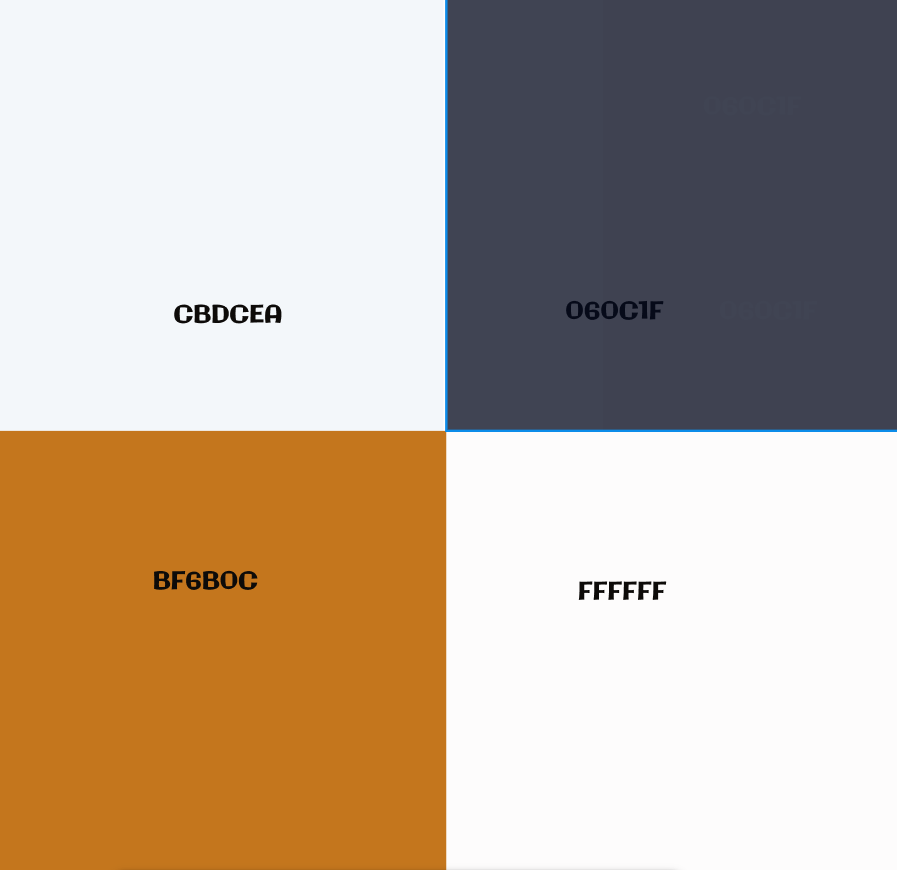
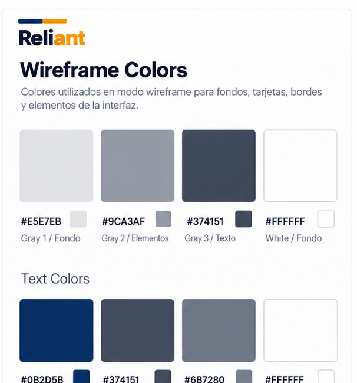
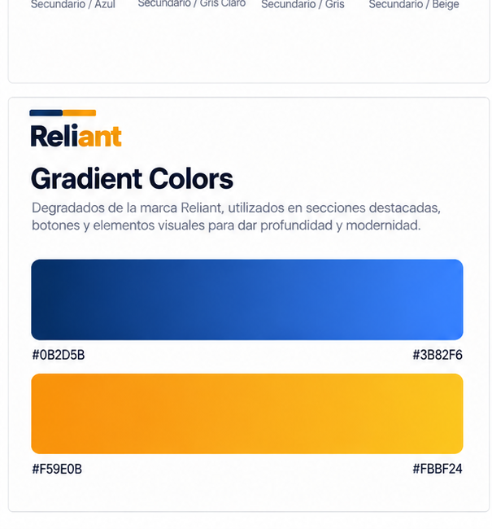

**Tipografía:**
La tipografía cumple un papel importante en la legibilidad de los contenidos y en la jerarquización de la información presentada en las interfaces de Relient. Para el proyecto, se han seleccionado las fuentes Balsamiq Sans, Goblin One y Kaushan Script, cada una con una función específica dentro de la identidad visual. Balsamiq Sans se utiliza en textos generales, etiquetas y componentes informativos, favoreciendo la lectura del contenido. Goblin One se emplea en títulos y elementos destacados, mientras que Kaushan Script se reserva para elementos decorativos o distintivos de la identidad visual. Esta combinación permite diferenciar los niveles de información y mantener una presentación coherente tanto en la Landing Page como en la Web Application.

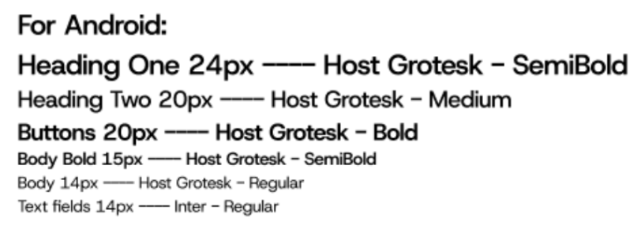

**Spacing:**
El sistema de espaciado de Relient establece criterios para distribuir los elementos de la interfaz de manera ordenada y evitar la saturación visual. Se consideran separaciones consistentes entre títulos, textos, botones, formularios, tablas y componentes de navegación, con el objetivo de mejorar la legibilidad y facilitar la identificación de la información. La configuración de estos espacios se realiza mediante las herramientas de diseño de Figma, teniendo en cuenta la disposición de los componentes y las necesidades de las diferentes vistas de la plataforma.

**Tone of Voice:**
El tono de comunicaci├│n de Relient es profesional, claro, directo y orientado a la eficiencia operativa. Debido a que la plataforma est├í enfocada en la gesti├│n y el monitoreo de procesos industriales y mineros, los mensajes deben transmitir confianza, control y confiabilidad. Para ello, se prioriza el uso de expresiones comprensibles y precisas, evitando t├®rminos excesivamente t├®cnicos cuando no sean necesarios. Asimismo, las etiquetas, alertas y notificaciones deben informar de manera clara sobre las acciones disponibles y los estados de los registros, equipos y componentes, facilitando la interpretaci├│n de la informaci├│n y la toma de decisiones.

### 4.1.2. Web Style Guidelines
El diseño web de Relient se basa en la claridad, la organización y la eficiencia en la gestión de procesos y recursos de los sectores industrial y minero. Las interfaces de la Landing Page y la Web Application se estructuran en secciones y módulos que facilitan la navegación, la consulta de información y el acceso a las funcionalidades disponibles. La Landing Page presenta las principales características de la plataforma e incorpora opciones de ingreso y registro, mientras que la Web Application organiza las funciones de gestión mediante una barra superior y un menú lateral que permite acceder a los módulos de Usuarios, Equipos, Componentes, Señales, Alertas, Reportes e Inventario.

- **Imágenes:**
En el dise├▒o web de Relient, las im├ígenes y los recursos gr├íficos se utilizan de manera estrat├®gica para reforzar la identidad visual del producto y facilitar la comprensi├│n de sus funcionalidades. En la Landing Page, estos elementos permiten presentar la propuesta de valor de la plataforma y contextualizar su aplicaci├│n en los sectores industrial y minero. En la Web Application, se prioriza la presentaci├│n de informaci├│n operativa mediante indicadores, estados y elementos visuales relacionados con los equipos, componentes y alertas. Se busca evitar el uso excesivo de im├ígenes decorativas que puedan distraer al usuario de las tareas principales, manteniendo una interfaz organizada y funcional.

- **Botones:**
Los botones de Relient siguen los criterios establecidos en las General Style Guidelines, utilizando una jerarquía visual que permite distinguir las acciones principales de las secundarias. El color naranja (#E2942E) se emplea para destacar acciones relevantes, como ingresar a la plataforma, registrar información, guardar cambios o iniciar una operación. Asimismo, los botones presentan estados visuales de interacción, como hover y focus, que proporcionan retroalimentación al usuario. Su ubicación y diseño buscan facilitar la identificación de las acciones disponibles y mantener una interacción coherente en los diferentes módulos de la plataforma.

- **Pantallas Emergentes:**
Las pantallas emergentes de Relient se utilizan para presentar mensajes de confirmación, advertencias e información relevante durante la interacción con la plataforma. Estos elementos permiten confirmar acciones importantes, especialmente aquellas relacionadas con la modificación o eliminación de registros de usuarios, equipos, componentes e información de inventario. Su contenido debe ser claro y directo, indicando la acción que se realizará y sus posibles consecuencias cuando corresponda. De esta manera, se busca reducir errores durante la gestión de la información y proporcionar al usuario mayor claridad antes de completar operaciones relevantes.

- **Formularios:**
Los formularios de Relient están diseñados para facilitar el registro y la actualización de información dentro de los distintos módulos de la Web Application. Cada campo cuenta con etiquetas visibles, una distribución ordenada y espacios adecuados que favorecen la lectura y la identificación de los datos requeridos. Asimismo, los mensajes de validación permiten informar al usuario cuando existen campos incompletos o datos incorrectos, orientándolo para corregir los errores antes de continuar con el proceso.

- **Tarjetas y componentes de informaci├│n:**
Las tarjetas se utilizan para presentar indicadores, estados de equipos, alertas y otros datos relevantes de manera organizada. Cada componente mantiene una estructura visual consistente que facilita la identificaci├│n y comparaci├│n de la informaci├│n. Esta organizaci├│n permite distribuir los registros y los indicadores en secciones diferenciadas, favoreciendo la consulta de datos y el seguimiento de la informaci├│n operativa.

- **Dise├▒o adaptable:**
Las interfaces web de Relient consideran la adaptación de sus componentes a diferentes tamaños de pantalla. En equipos de escritorio, la Web Application utiliza una estructura que combina una barra superior, un menú lateral y áreas de contenido destinadas a la gestión de registros e indicadores. En pantallas de menor tamaño, la distribución de los elementos debe ajustarse para conservar la legibilidad, evitar desbordamientos horizontales y facilitar la interacción con los botones, formularios y componentes de información.

- **Accesibilidad:**
El diseño web de Relient considera criterios de accesibilidad orientados a facilitar la comprensión y el uso de la plataforma. Para ello, se prioriza el contraste entre el texto y el fondo, el uso de etiquetas descriptivas en los formularios, los nombres comprensibles en los botones y una jerarquía visual clara. Asimismo, los estados de interacción deben permitir identificar los elementos activos y las opciones disponibles, contribuyendo a una experiencia de uso más clara y consistente.

## 4.2. Information Architecture
La arquitectura de información de Relient permite organizar y estructurar los contenidos de la plataforma para facilitar la identificación de las funcionalidades y el acceso a la información requerida. Debido a que la solución está orientada a la gestión y el monitoreo de procesos, equipos, componentes y recursos de los sectores industrial y minero, resulta fundamental establecer una distribución clara de los módulos y las acciones disponibles. La Landing Page presenta la propuesta de valor y las principales características del producto, mientras que la Web Application permite consultar y administrar información operativa mediante módulos específicos. Esta organización facilita la navegación y contribuye a una experiencia de usuario coherente durante la interacción con las diferentes interfaces de la plataforma.

### 4.2.1. Organization System
El sistema de organización de Relient está diseñado para estructurar visualmente los contenidos y facilitar el acceso a las diferentes funcionalidades de la plataforma mediante una organización jerárquica y temática.
En la Landing Page, el contenido se distribuye desde la presentaci├│n inicial de InnovaCorp y la propuesta de valor de Relient hacia las secciones informativas About Us, How does it work?, FAQs y Contact. Esta estructura permite que los usuarios conozcan la soluci├│n, comprendan su funcionamiento y encuentren informaci├│n adicional de manera ordenada.
En la Web Application, la informaci├│n se organiza en m├│dulos correspondientes a las principales funciones de gesti├│n y monitoreo: Usuarios, Equipos, Componentes, Se├▒ales, Alertas, Reportes e Inventario. Cada m├│dulo agrupa los registros y las operaciones relacionadas con su finalidad, facilitando la consulta y administraci├│n de la informaci├│n.
Asimismo, las vistas de gesti├│n presentan los elementos de acuerdo con su importancia y funci├│n, priorizando los datos relevantes y las acciones disponibles. En los procesos de registro y actualizaci├│n, la informaci├│n se organiza mediante campos y acciones claramente identificados, permitiendo ingresar datos, validar la informaci├│n y confirmar las operaciones correspondientes. Esta estructura busca mantener una presentaci├│n ordenada y facilitar el seguimiento de las actividades realizadas en la plataforma.

### 4.2.2. Labeling System
El sistema de etiquetado de Relient establece denominaciones claras y consistentes para identificar las secciones, los m├│dulos y las acciones disponibles en la plataforma. Los nombres utilizados deben permitir que los usuarios comprendan la finalidad de cada elemento antes de interactuar con ├®l.
En la Landing Page, las etiquetas principales incluyen Home, About Us, How does it work?, FAQs y Contact. Estas denominaciones permiten distinguir las secciones informativas y facilitan el acceso a la informaci├│n relacionada con la propuesta de valor y el funcionamiento de Relient. Asimismo, las opciones Login, Sign Up y Empezar ya permiten identificar los accesos relacionados con la interacci├│n inicial con la plataforma.
En la Web Application, las etiquetas corresponden a los m├│dulos Usuarios, Equipos, Componentes, Se├▒ales, Alertas, Reportes e Inventario. Cada denominaci├│n identifica el tipo de informaci├│n que puede consultarse o administrarse en la secci├│n correspondiente.
Las acciones disponibles utilizan etiquetas orientadas a las tareas, como Registrar, Guardar, Editar, Consultar, Filtrar y Generar reporte, seg├║n las funcionalidades definidas para cada m├│dulo. La utilizaci├│n consistente de estas denominaciones permite reducir ambig├╝edades, facilitar la comprensi├│n de las opciones y mantener una experiencia de navegaci├│n uniforme.

### 4.2.3. SEO Tags and Meta Tags
Las etiquetas SEO y los metadatos de Relient permiten describir el contenido de las páginas web e identificar su propósito mediante información incorporada en el código HTML. Estos elementos contribuyen a comunicar la identidad de InnovaCorp, la finalidad de Relient y su relación con la gestión y el monitoreo de procesos industriales. Para ello, se definen los atributos correspondientes a la codificación, la visualización en dispositivos, el título, la descripción, las palabras clave y la autoría de cada interfaz.
Las etiquetas propuestas para la Landing Page y la Web Application se presentan en los siguientes cuadros.

| M├│dulo | Criterios de b├║squeda | Funcionalidad |
|---|---|---|
| Usuarios | Nombre, c├│digo y estado | Permite localizar y consultar usuarios registrados. |
| Equipos | Nombre, código y categoría | Facilita encontrar equipos registrados en la plataforma. |
| Componentes | Nombre, c├│digo y estado | Permite identificar componentes y consultar sus datos. |
| Señales | Nombre, categoría y fecha | Facilita localizar señales registradas y consultar su información. |
| Alertas | Tipo, estado y fecha | Permite identificar alertas y revisar su situaci├│n actual. |
| Reportes | Nombre, categoría y fecha | Facilita localizar reportes generados en la plataforma. |
| Inventario | Nombre, código y categoría | Permite encontrar elementos registrados en el inventario. |

| Interfaz | Elemento de navegaci├│n | Destino o funci├│n |
|---|---|---|
| Landing Page | Home | Permite regresar a la secci├│n de inicio. |
| Landing Page | About Us | Presenta informaci├│n sobre InnovaCorp. |
| Landing Page | How does it work? | Explica el funcionamiento de Relient. |
| Landing Page | FAQs | Presenta respuestas a preguntas frecuentes. |
| Landing Page | Contact | Facilita el acceso a la informaci├│n de contacto. |
| Landing Page | Login | Permite acceder a la plataforma. |
| Landing Page | Sign Up | Dirige al registro de nuevos usuarios. |
| Landing Page | Empezar ya | Facilita el acceso al inicio de la experiencia del producto. |
| Web Application | Men├║ lateral | Permite acceder a los m├│dulos Usuarios, Equipos, Componentes, Se├▒ales, Alertas, Reportes e Inventario. |
| Web Application | Barra superior | Agrupa elementos generales de navegaci├│n y acceso a la plataforma. |
| Web Application | Pie de página | Complementa la navegación con información institucional y enlaces adicionales. |

Los valores presentados constituyen una propuesta inicial que debe verificarse durante la implementaci├│n. El atributo Charset define la codificaci├│n de caracteres, mientras que Viewport permite adaptar la visualizaci├│n a las dimensiones del dispositivo. El atributo Title establece el t├¡tulo de la p├ígina y Description proporciona una s├¡ntesis de su contenido. Por su parte, Keywords re├║ne t├®rminos relacionados con la soluci├│n y Author identifica al responsable del contenido.
El atributo CSS Link representa la referencia a la hoja de estilos utilizada en la interfaz y debe ajustarse a la ruta real del archivo dentro del proyecto. Estos metadatos se incorporan en el elemento head del documento HTML. En la Landing Page, se prioriza la presentaci├│n de la propuesta de valor de Relient, mientras que en la Web Application se describen las principales funciones de gesti├│n y monitoreo.

### 4.2.4. Searching Systems
El sistema de búsqueda de Relient está orientado a facilitar la localización de información de acuerdo con las necesidades de cada interfaz.
En la Landing Page, no se considera necesaria una barra de b├║squeda principal, debido a que el contenido se distribuye en secciones informativas accesibles mediante la navegaci├│n superior. Los usuarios pueden dirigirse a About Us, How does it work?, FAQs y Contact para encontrar informaci├│n sobre el producto y su funcionamiento.
En la Web Application, la búsqueda adquiere mayor relevancia debido a la cantidad de registros relacionados con usuarios, equipos, componentes, señales, alertas, reportes e inventario. Por ello, se consideran campos de búsqueda y filtros que permitan localizar información específica según las características de cada módulo.
Los criterios de búsqueda pueden incluir nombres, códigos, categorías, estados y fechas, siempre que estos atributos correspondan a los registros gestionados. Los resultados deben presentarse de manera organizada para facilitar la identificación de los elementos y el acceso a sus detalles. Asimismo, los filtros deben contar con etiquetas comprensibles y permitir modificar o restablecer los criterios seleccionados, facilitando la consulta de información sin generar complejidad innecesaria.

### 4.2.5. Navigation Systems
El sistema de navegaci├│n de Relient permite desplazarse entre las diferentes secciones de la Landing Page y los m├│dulos de la Web Application mediante una estructura clara y consistente.
En la Landing Page, la barra de navegación se ubica en la parte superior e incluye los accesos Home, About Us, How does it work?, FAQs y Contact. Estos enlaces permiten acceder a las secciones informativas correspondientes. Además, las opciones Login, Sign Up y Empezar ya facilitan el acceso a los puntos de interacción definidos en los mockups. El pie de página complementa la navegación mediante información institucional y enlaces relacionados con el contenido del sitio.
En la Web Application, la navegaci├│n se organiza mediante una barra superior y un men├║ lateral que permite acceder a los m├│dulos Usuarios, Equipos, Componentes, Se├▒ales, Alertas, Reportes e Inventario. Esta distribuci├│n facilita el acceso a las funcionalidades de gesti├│n y monitoreo, manteniendo una estructura reconocible entre las diferentes vistas.
Asimismo, la navegaci├│n debe permitir que los usuarios identifiquen la secci├│n en la que se encuentran y comprendan las acciones disponibles en cada m├│dulo. En las pantallas de menor tama├▒o, los elementos de navegaci├│n deben reorganizarse para conservar su legibilidad y facilitar la interacci├│n. De esta manera, Relient busca ofrecer recorridos claros y consistentes, desde la consulta inicial de informaci├│n hasta la gesti├│n de los registros dentro de la plataforma.

## 4.3. Landing Page UI Design
El diseño de la interfaz de la Landing Page de Relient representa visualmente la propuesta de valor de InnovaCorp y comunica las principales características de la solución orientada a la gestión y el monitoreo de procesos industriales. Su desarrollo considera los lineamientos visuales y la arquitectura de información definidos previamente, con el propósito de mantener una presentación coherente, facilitar la comprensión de los contenidos y permitir el acceso a las principales secciones del producto.
La propuesta contempla las interfaces para escritorio y dispositivos m├│viles, organizando la informaci├│n en cuatro secciones principales: Inicio, Servicios, Planes y Qui├®nes somos. Esta estructura permite presentar la propuesta de valor, describir las funcionalidades de Relient, comunicar las alternativas disponibles y dar a conocer la identidad de InnovaCorp mediante una distribuci├│n clara y consistente.

### 4.3.1. Landing Page Wireframe
Los wireframes de la Landing Page de Relient permiten definir la estructura y distribución de los elementos que conforman la interfaz antes de establecer su diseño visual definitivo. Mediante estas representaciones se identifican la ubicación del logotipo, los elementos de navegación, los bloques de contenido, las imágenes y los botones de acción. Su elaboración permite revisar la organización de las secciones y establecer una base estructural para el desarrollo de los mockups.

**Desktop Web Browser**
Los wireframes para escritorio presentan una distribuci├│n horizontal que permite organizar los elementos de navegaci├│n en la parte superior y distribuir los contenidos en secciones diferenciadas. La estructura contempla las vistas de Inicio, Servicios, Planes y Qui├®nes somos, manteniendo una secuencia que facilita el recorrido por la informaci├│n. Asimismo, se considera la ubicaci├│n de los elementos principales y del pie de p├ígina para conservar una organizaci├│n uniforme a lo largo de la Landing Page.

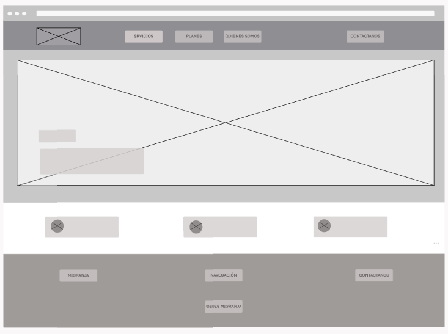
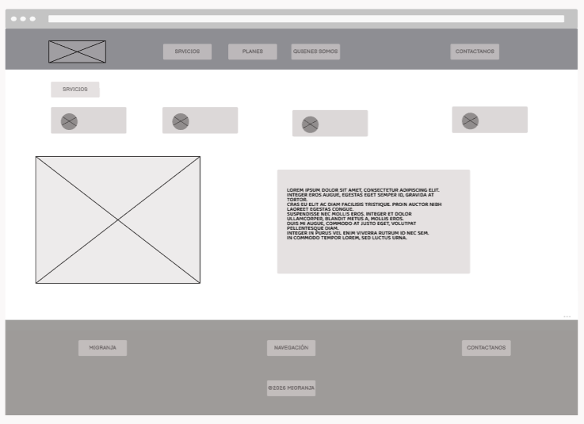
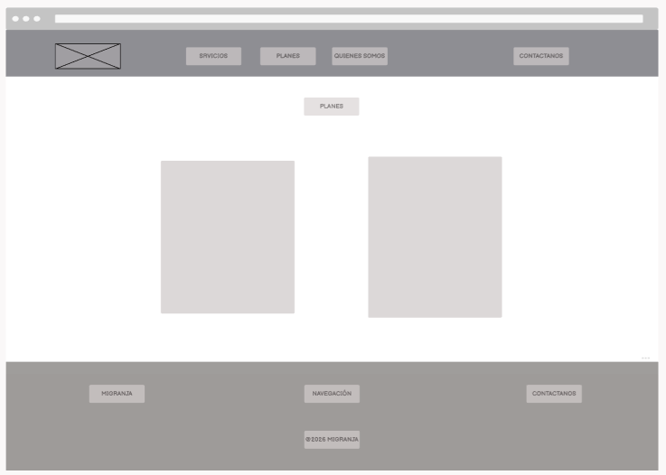
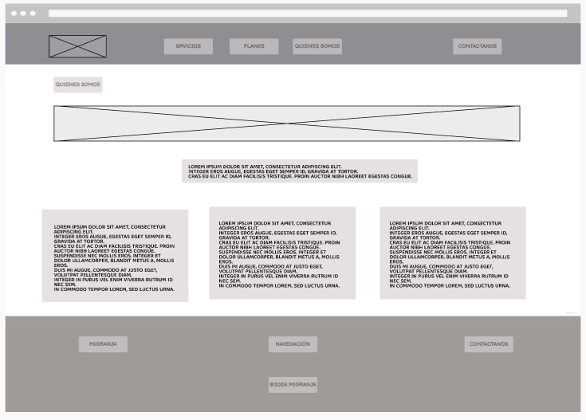

**Mobile Web Browser**
Los wireframes para dispositivos móviles adaptan la estructura de la Landing Page a las dimensiones reducidas de la pantalla, reorganizando los contenidos en una disposición vertical. La navegación se concentra en la parte superior, mientras que los bloques informativos, las imágenes y las acciones se distribuyen de manera secuencial. Esta organización permite conservar la relación entre las secciones de escritorio y móvil, priorizando la legibilidad y el acceso a los contenidos sin sobrecargar el espacio disponible.

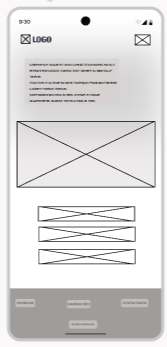
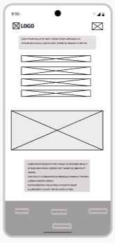
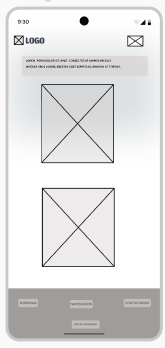
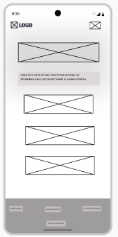

### 4.3.2. Landing Page Mock-up
Los mockups de la Landing Page de Relient presentan la propuesta visual de las interfaces mediante la aplicación de las tipografías, los colores, las imágenes y los componentes definidos en las General Style Guidelines. Estas representaciones permiten evaluar la jerarquía visual, la distribución de los contenidos y la consistencia de los elementos de navegación antes de la implementación de la interfaz.

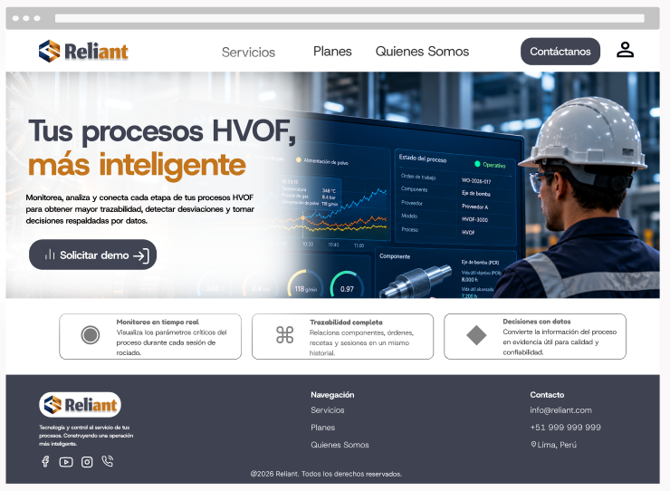
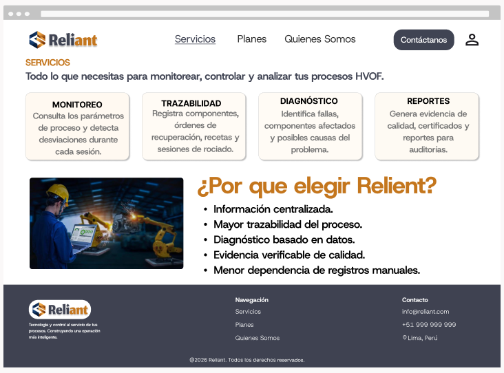
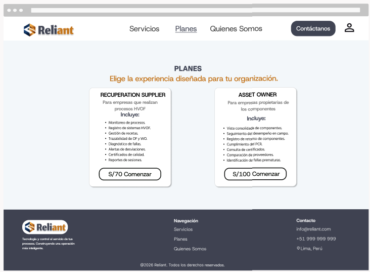
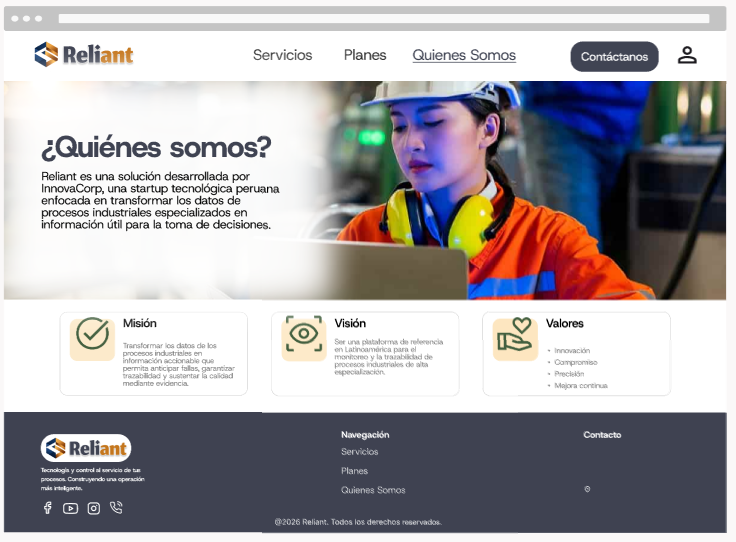

**Mobile Web Browser**
Los mockups para dispositivos m├│viles mantienen la identidad visual de Relient y adaptan la presentaci├│n de los contenidos a una estructura vertical. La parte superior incorpora el logotipo y un men├║ desplegable que permite acceder a las diferentes secciones. En la pantalla de Inicio se presenta el mensaje principal, una descripci├│n breve de la propuesta de valor, un bot├│n de acci├│n y una imagen representativa del monitoreo industrial.
La secci├│n Servicios distribuye las funcionalidades en bloques informativos y complementa la descripci├│n con una imagen relacionada con los procesos industriales. En la secci├│n Planes, las alternativas se presentan mediante tarjetas verticales que facilitan la consulta de sus caracter├¡sticas y precios. Finalmente, la pantalla Qui├®nes somos incorpora una imagen principal y tarjetas diferenciadas para presentar la misi├│n, la visi├│n y los valores de InnovaCorp. El pie de p├ígina conserva la informaci├│n institucional y los enlaces complementarios, adapt├índose al espacio disponible en dispositivos m├│viles.

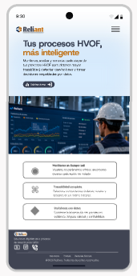

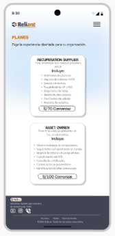
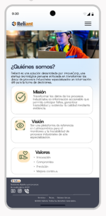

## 4.4. Web Applications UX/UI Design
El dise├▒o UX/UI de la Web Application de Relient, desarrollada por InnovaCorp, se basa en los resultados obtenidos durante el proceso de investigaci├│n de usuarios, los User Stories definidos en el Product Backlog y los lineamientos visuales establecidos previamente. Su prop├│sito es representar la estructura de las interfaces y facilitar la comprensi├│n de las funcionalidades relacionadas con la gesti├│n y el monitoreo de procesos industriales.
La propuesta contempla la organizaci├│n de las pantallas, los componentes de interacci├│n y los recorridos que permiten acceder a las diferentes funcionalidades de la plataforma. Para ello, se utilizan wireframes, wireflow diagrams, mockups y user flow diagrams, que permiten analizar la distribuci├│n de los elementos y la secuencia de las acciones. Estos recursos consideran los m├│dulos de Usuarios, Equipos, Componentes, Se├▒ales, Alertas, Reportes e Inventario, manteniendo una estructura visual coherente con la identidad de Relient.

### 4.4.1. Web Applications Wireframes
Los wireframes de la Web Application de Relient presentan la estructura preliminar de las pantallas de la plataforma antes de incorporar los estilos visuales definitivos. Estas representaciones permiten identificar la ubicación de los elementos de navegación, los formularios, los botones, las tablas y las áreas de contenido, facilitando la revisión de la organización de las interfaces.
Para facilitar su análisis, las pantallas se presentan en el orden establecido en el diseño original y se agrupan de acuerdo con su secuencia. Esta organización permite observar la evolución de la estructura desde las pantallas iniciales hasta las vistas relacionadas con la gestión de información y las operaciones de la plataforma.

**Desktop Web Browser**

**Pantallas iniciales y acceso a la plataforma**
Las primeras pantallas permiten examinar la distribuci├│n de los elementos de acceso y los componentes iniciales de la interfaz. En esta etapa se considera la ubicaci├│n de los campos de entrada, las etiquetas y los botones, procurando que los elementos necesarios para interactuar con la plataforma sean reconocibles y mantengan una disposici├│n ordenada.

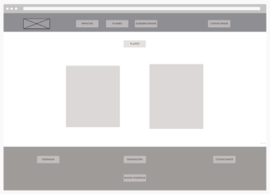
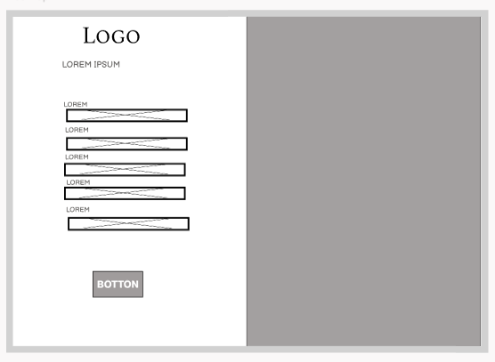

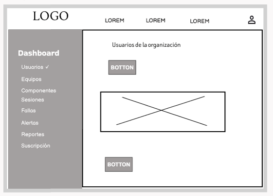
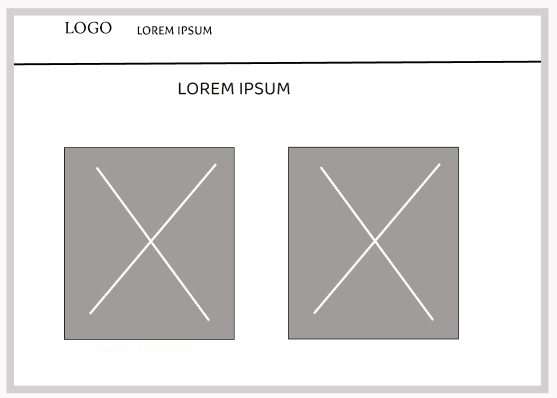

**Pantallas de consulta y gesti├│n de informaci├│n**
Las siguientes pantallas permiten observar la distribución de los contenidos y los componentes destinados a la consulta y gestión de información. La organización de los campos, las áreas de contenido y los controles busca facilitar la identificación de los datos y las acciones disponibles en cada vista.

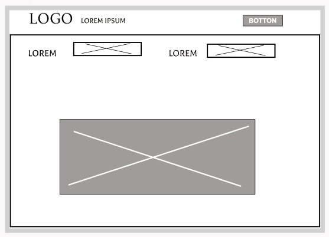
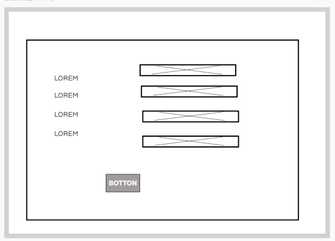
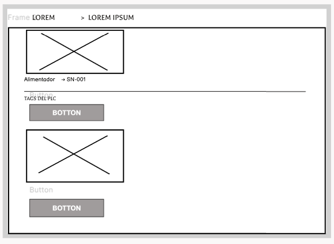
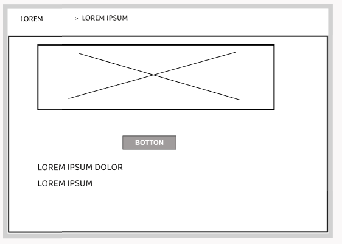
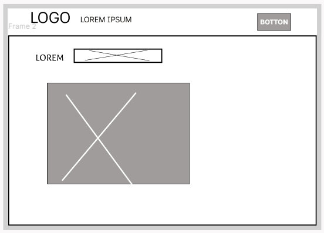

**Pantallas de registro y operaciones**
En este grupo se presentan las estructuras correspondientes a las pantallas siguientes del dise├▒o. Los wireframes permiten revisar la ubicaci├│n de los campos, las etiquetas y los botones asociados con las operaciones, manteniendo una distribuci├│n uniforme entre los diferentes elementos de la interfaz.

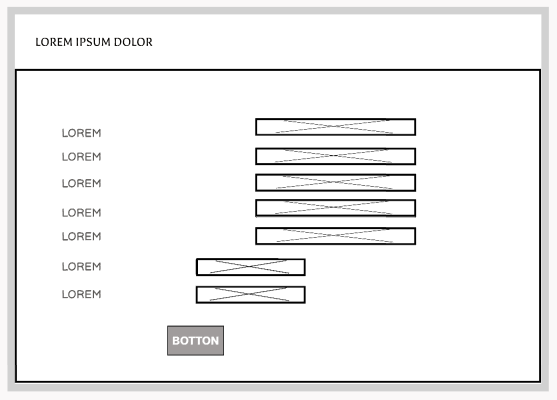


**Pantallas complementarias de la plataforma**
Las ├║ltimas pantallas completan la representaci├│n estructural de la Web Application. Su revisi├│n permite observar la disposici├│n de los componentes restantes y comprobar la consistencia de la estructura visual a lo largo de las distintas vistas de Relient.


### 4.4.2. Web Applications Wireflow Diagrams
Los wireflow diagrams de Relient representan la conexi├│n entre las pantallas de la Web Application y las transiciones que permiten al usuario desplazarse entre ellas. Estos diagramas combinan la estructura de los wireframes con las conexiones que indican la secuencia de navegaci├│n, facilitando la comprensi├│n de c├│mo se relacionan las diferentes interfaces durante la interacci├│n con la plataforma.
La representaci├│n se basa en los wireframes definidos para Relient y conserva la distribuci├│n de las pantallas y las conexiones establecidas en el dise├▒o original. Para facilitar su lectura, se presenta primero el diagrama completo y, posteriormente, sus ampliaciones, que permiten examinar con mayor detalle las relaciones entre las interfaces.

**Diagrama general del recorrido**
La siguiente imagen presenta el wireflow completo de Relient, mostrando la distribuci├│n de las pantallas y las conexiones entre ellas. Esta vista permite comprender la estructura general de los recorridos de navegaci├│n definidos para la Web Application.


**Detalle 1: Pantallas iniciales y acceso**
Este primer detalle permite observar las pantallas iniciales del recorrido y las conexiones establecidas entre las interfaces correspondientes. Su prop├│sito es facilitar la revisi├│n de la secuencia de navegaci├│n representada en esta parte del diagrama.


**Detalle 2: Transiciones entre interfaces**
Este segundo detalle amplía otra sección del wireflow para facilitar la identificación de las pantallas conectadas y la dirección de las transiciones. Permite examinar cómo continúa el recorrido representado en el diseño original.


**Detalle 3: Continuidad de la navegaci├│n**
El tercer detalle permite revisar las conexiones entre las pantallas que forman parte de la siguiente secci├│n del recorrido. Esta ampliaci├│n facilita la lectura de las relaciones entre las interfaces sin perder de vista la secuencia establecida en el diagrama general.


**Detalle 4: Conexiones entre pantallas**
El cuarto detalle muestra otra parte de las conexiones definidas en el wireflow. Su revisi├│n permite identificar la continuidad de los recorridos y la relaci├│n entre las diferentes estructuras de interfaz representadas.


**Detalle 5: Pantallas finales del recorrido**
El ├║ltimo detalle complementa la visualizaci├│n del diagrama y permite examinar la parte final de las conexiones representadas. En conjunto con las ampliaciones anteriores, facilita la revisi├│n integral de la navegaci├│n planteada para Relient.


### 4.4.3. Web Applications Mock-ups
Los mockups de la Web Application de Relient presentan las pantallas con los estilos visuales aplicados, incorporando la paleta cromática, las tipografías, los botones, los formularios y los demás componentes definidos en las General Style Guidelines. Estas representaciones permiten evaluar la jerarquía visual, la distribución de los contenidos y la consistencia de las interfaces antes de su implementación.
Las pantallas se presentan en el mismo orden que los wireframes para facilitar la comparaci├│n entre la estructura preliminar y la propuesta visual. Esta correspondencia permite observar c├│mo se aplican los lineamientos de dise├▒o a las diferentes vistas de la plataforma.

**Desktop Web Browser**

**Pantallas iniciales y acceso a la plataforma**
Las primeras pantallas permiten examinar la distribuci├│n de los elementos de acceso y los componentes iniciales de la interfaz. En esta etapa se considera la ubicaci├│n de los campos de entrada, las etiquetas y los botones, procurando que los elementos necesarios para interactuar con la plataforma sean reconocibles y mantengan una disposici├│n ordenada.


**Pantallas de consulta y gesti├│n de informaci├│n**
Estas pantallas permiten observar la organizaci├│n de la informaci├│n y los componentes destinados a facilitar la consulta y gesti├│n de los datos dentro de la plataforma.


**Pantallas de registro y operaciones**
Estas pantallas muestran la disposici├│n de los formularios y componentes utilizados para registrar informaci├│n y realizar operaciones dentro de la plataforma. La distribuci├│n de los elementos busca facilitar la identificaci├│n de las acciones disponibles y mantener una estructura visual coherente.


**Pantallas complementarias de la plataforma**
Las últimas pantallas muestran la continuidad de los criterios visuales en las vistas restantes de Relient. La aplicación uniforme de los colores, la tipografía y los componentes permite mantener una identidad visual consistente en las distintas interfaces de gestión y consulta.


### 4.4.4. Web Applications User Flow Diagrams
Los User Flow Diagrams de Relient representan los recorridos que sigue el usuario para interactuar con las funcionalidades de la Web Application. Los diagramas se han organizado por procesos para facilitar la comprensi├│n de las relaciones entre las pantallas y las acciones involucradas en cada recorrido. Para su elaboraci├│n, se consideran los mockups de la plataforma, manteniendo correspondencia con los m├│dulos y las operaciones representadas en el dise├▒o UX/UI.

**Acceso a la plataforma y navegaci├│n inicial**
Este recorrido presenta las pantallas relacionadas con el acceso a la plataforma, la navegaci├│n inicial y la suscripci├│n, de acuerdo con la secuencia representada en los dise├▒os.


**Gesti├│n y configuraci├│n de equipos HVOF**
Este diagrama representa el recorrido relacionado con los equipos HVOF y las pantallas destinadas a su configuraci├│n y gesti├│n.


**Gesti├│n de componentes y ├│rdenes PCR**
Este recorrido muestra las relaciones entre las pantallas vinculadas con la gesti├│n de componentes y las ├│rdenes PCR, siguiendo la organizaci├│n establecida en los mockups.


**Sesiones, monitoreo, fallas y alertas**
Este diagrama presenta el recorrido asociado con las sesiones, el monitoreo y la consulta de informaci├│n relacionada con fallas y alertas.


**Reportes y cierre de procesos**
Este ├║ltimo recorrido representa las pantallas relacionadas con los reportes y las etapas finales contempladas en el flujo de la plataforma.


### 4.5. Web Applications Prototyping
Para desarrollar los prototipos de la interfaz de usuario de Relient para Desktop y Mobile Web Browser, se consideraron criterios de interacci├│n orientados a facilitar la navegaci├│n, organizar la informaci├│n y permitir que los usuarios realicen sus tareas de manera clara y eficiente. Las decisiones de dise├▒o se relacionan con la arquitectura de informaci├│n y el sistema de navegaci├│n definidos previamente, considerando los siguientes principios:

1. Simplicidad y usabilidad: Se busca que la navegación sea clara y consistente, facilitando el acceso a las principales funcionalidades de Relient, como la gestión de usuarios, equipos HVOF, componentes recuperados, órdenes de trabajo, sesiones de recubrimiento, monitoreo de parámetros, diagnóstico de fallas y consulta de reportes.
2. Dise├▒o adaptable: La propuesta considera la visualizaci├│n de la interfaz en diferentes tama├▒os de pantalla, tanto en Desktop como en Mobile Web Browser, procurando mantener la legibilidad de la informaci├│n y facilitar la interacci├│n seg├║n el dispositivo utilizado.
3. Enfoque en la información clave: Las interfaces priorizan los datos relevantes para las tareas de los usuarios, como el estado de los componentes, los parámetros de operación, el historial de sesiones y las alertas, facilitando el seguimiento de los procesos de recuperación.
4. Navegaci├│n e interacci├│n coherentes: Las conexiones entre las pantallas se definieron tomando como referencia los User Flow Diagrams y el sistema de navegaci├│n de Relient, permitiendo representar los recorridos principales entre las funcionalidades de la aplicaci├│n.

A continuaci├│n, se presenta una captura del prototipo interactivo de Relient en modo de presentaci├│n de Figma, correspondiente a la interfaz de gesti├│n de usuarios de la organizaci├│n.


**Enlace al prototipo interactivo:**

[Visualizar el prototipo de Relient en Figma](https://www.figma.com/proto/eJgrioPA9K4FTQD0pXAUI1/Mockup-Innovacor?node-id=205-460&t=SXgGHtrz1Kx1MBpN-1&scaling=scale-down&content-scaling=fixed&page-id=0%3A1&starting-point-node-id=205%3A301&show-proto-sidebar=1)

**Video de demostraci├│n:**

[Ver el video de demostraci├│n de Relient](https://drive.google.com/file/d/1zf1c5jWL4qMQMxFodapUbAed3S3XQiYO/view?usp=sharing)


## 4.6. Domain-Driven Software Architecture.
### 4.6.1. Design-Level Event Storming.

El Design-Level Event Storming parte del tablero ordenado del Big Picture Event Storming (secci├│n 2.4), tal como se acord├│ en su cierre: sobre cada grupo de eventos se identifican los Commands que los provocan, el Aggregate que decide, las Policies que reaccionan a otros eventos y los Read Models que consumen los usuarios. El resultado define los bounded contexts que se modelan en las secciones 4.6.2 a 4.8.

#### 4.6.1.1. Candidate Context Discovery.

Para descubrir los bounded contexts candidatos el equipo aplic├│ la t├®cnica *look-for-pivotal-events* sobre el tablero del Big Picture. Los eventos pivote marcan un cambio de responsabilidad en el negocio: *OrganizationRegistered* separa la configuraci├│n de la organizaci├│n de su operaci├│n; *SubscriptionActivated* separa la facturaci├│n del uso de la plataforma; *HvofSystemRegistered* y *RecipeApproved* cierran la configuraci├│n del equipamiento; *RecuperationCreated* abre la trazabilidad de la pieza; *SpraySessionStarted* y *SpraySessionCompleted* delimitan el monitoreo del proceso; *FaultCaseOpened* inicia el diagn├│stico; *OutOfRangeAlertRaised* inicia la notificaci├│n; y *QualityCertificateIssued* y *PcrComplianceReportGenerated* producen la evidencia y los reportes. Los eventos agrupados entre pivotes, junto con el lenguaje que usa cada actor, dieron lugar a ocho bounded contexts y un Shared Kernel transversal:

| Bounded Context | Responsabilidad | Eventos pivote | Épicas |
|---|---|---|---|
| IAM | Organizaciones, usuarios, roles y preferencias | OrganizationRegistered, UserAuthenticated | E01 |
| Billing | Planes y suscripciones | PlanSelected, SubscriptionActivated | E02 |
| Equipment | Sistemas HVOF, controladores, tags y recetas | HvofSystemRegistered, RecipeApproved | E03 |
| Traceability | Clientes, componentes, ├│rdenes de recuperaci├│n y PCR | RecuperationCreated, RecuperationClosed, ServiceLifeRecorded | E04, E09 |
| Process Monitoring | Sesiones de rociado, lecturas y bandas | SpraySessionStarted, ParameterOutOfRangeDetected, SpraySessionCompleted | E05 |
| Fault Diagnosis | Casos de falla, reglas y patrones | FaultCaseOpened, RootCauseConfirmed | E06 |
| Notifications | Alertas, preferencias y newsletter | OutOfRangeAlertRaised, AlertDelivered | E07, E11 |
| Reporting | Certificados, plantillas y reportes | QualityCertificateIssued, PcrComplianceReportGenerated | E08, E09 |

#### 4.6.1.2. Domain Message Flows Modeling.

El flujo principal del dominio es la recuperaci├│n de un componente desde su recepci├│n hasta la evidencia de calidad. El siguiente diagrama muestra los mensajes que intercambian los bounded contexts en ese escenario: los comandos llegan desde los usuarios o el cliente de telemetr├¡a, y los bounded contexts se comunican mediante eventos de integraci├│n y consultas a trav├®s de sus Context Facades.


#### 4.6.1.3. Bounded Context Canvases.

Cada canvas resume, por bounded context, los comandos que recibe, el Aggregate que los procesa, los eventos que emite, las Policies que reaccionan a eventos de otros contextos y los Read Models que alimenta. La leyenda de colores sigue la del Big Picture Event Storming:

| Elemento | Color |
|---|---|
| Actor | Amarillo claro |
| Command | Azul |
| Aggregate | Amarillo |
| Domain Event | Naranja |
| Policy | Lila |
| Read Model | Verde |
| Sistema externo u otro bounded context | Rosado |

**IAM**: Identidad, registro de organizaciones, autenticaci├│n, roles y preferencias de unidades.


**Billing**: Planes Operator y Asset Owner, selecci├│n de plan y vigencia de la suscripci├│n.


**Equipment**: Sistemas HVOF, subsistemas, partes, controladores, catálogo de tags, recetas y parámetros derivados.


**Traceability**: Clientes, componentes, ├│rdenes de recuperaci├│n con OF y WO, PCR objetivo y retorno de campo.


**Process Monitoring**: Sesiones de rociado, ingesta de telemetría, pasadas, clasificación por banda y verificación de receta.


**Fault Diagnosis**: Casos de falla, reglas causa-efecto, causa raíz y patrones recurrentes.


**Notifications**: Alertas en la plataforma y por correo, preferencias de notificaci├│n y newsletter.


**Reporting**: Certificados de calidad, reportes de sesi├│n, plantillas de reporte y cumplimiento de PCR.


### 4.6.2. Software Architecture Context Diagram.


### 4.6.3. Software Architecture Container Diagrams.


### 4.6.4. Software Architecture Components Diagrams.

Los diagramas de componentes descomponen los contenedores de la secci├│n 4.6.3 en sus componentes principales. El primero muestra la Single Page Application tal como se implement├│ en el Sprint 2, organizada por bounded context; los siguientes muestran el dise├▒o de la Web Application y de los Web Services para los ocho bounded contexts del dominio.

#### Single Page Application (Sprint 2)

La Single Page Application organiza su código en cinco bounded contexts y un contexto Shared. Cada bounded context extiende las clases base de Shared para sus entidades, assemblers, endpoints y formularios; IAM protege las rutas de los demás contextos con sus guards, agrega el token de sesión a todas las peticiones con `iamInterceptor` y entrega la organización del usuario autenticado a los stores; y Process Monitoring consulta los sistemas HVOF y las recetas de Equipment y las órdenes de recuperación de Traceability para iniciar y evaluar cada sesión de rociado.


#### Web Application


**IAM**


**Billing**


**Equipment**


**Traceability**


**Process Monitoring**


**Fault Diagnosis**


**Notifications**


**Reporting**


#### Web Services


**IAM**


**Billing**


**Equipment**


**Traceability**


**Process Monitoring**


**Fault Diagnosis**


**Notifications**


**Reporting**


## 4.7. Software Object-Oriented Design.
### 4.7.1. Class Diagrams.

El diagrama de clases traduce los agregados del Event Storming (4.6.1) al modelo de objetos que sustentará la implementación en el Capítulo V.
Debido a la complejidad del sistema, a la cantidad de Bounded Contexts definidos y a la cantidad de clases por capa de Domain-Driven Design, se muestra el diagrama de clases subdividido para una mejor visualizaci├│n.

#### Equipment


#### FaultDiagnosis


#### ProcessMonitoring


#### Traceability


#### Reporting

En el bounded context Reporting, el tipo de gráfico de cada elemento de una plantilla se modela con el atributo `viewType` del Value Object `ReportWidget`, cuyo enum `ViewTypeEnum` incluye los gráficos de línea (`LINE_CHART`), de barras (`BAR_CHART`) y de indicador (`GAUGE`), además de las vistas tabulares y de resumen (`TABLE`, `KPI_CARD`, `MIN_MAX_AVG`, `BAND_TIMELINE`).


#### Notifications


#### Billing


#### IAM


#### Shared


## 4.8. Database Design.
### 4.8.1. Database Diagrams.

El modelo relacional se despliega sobre PostgreSQL y refleja de forma directa el diagrama de clases de 4.7.1, con tablas puente derivadas de las relaciones muchos-a-muchos implícitas en el dominio.


En la tabla `report_widgets`, la columna `view_type` almacena el tipo de gráfico de cada elemento de la plantilla (`LINE_CHART`, `BAR_CHART`, `GAUGE`, `TABLE`, `KPI_CARD`, `MIN_MAX_AVG` o `BAND_TIMELINE`), como valor del enum `ViewTypeEnum` persistido en texto.


# Capítulo V: Product Implementation, Validation & Deployment
## 5.1. Software Configuration Management.

En esta sección se establecen las decisiones y convenciones que permiten mantener la consistencia del proyecto Reliant durante todo su ciclo de vida: las herramientas que utiliza el equipo de InnovaCorp, el esquema de control de versiones, las guías de estilo para cada lenguaje y la configuración de despliegue de cada producto. Todas las decisiones aplican por igual a los cuatro repositorios del proyecto: el informe, el Landing Page, la Frontend Web Application y los Web Services.

### 5.1.1. Software Development Environment Configuration.

A continuaci├│n se especifican los productos de software que utilizan los miembros del equipo, agrupados por tipo de actividad, con su prop├│sito en el proyecto y la ruta de referencia o descarga.

**Project Management**

| Producto | Prop├│sito en el proyecto | Ruta |
|---|---|---|
| Trello | Product Backlog priorizado, Sprint Backlogs con tasks por historia y tablero de estado (To Do / In Process / To Review / Done) | https://trello.com |
| Agile Tools by Corrello (Power-Up) | Story Points en las tarjetas y suma por lista para calcular la velocity | https://trello.com/power-ups |
| Microsoft Teams | Reuniones de Sprint Planning, Review y Retrospective; comunicaci├│n con el docente | https://www.microsoft.com/microsoft-teams |
| WhatsApp | Coordinaci├│n diaria del equipo | https://www.whatsapp.com |

**Requirements Management**

| Producto | Prop├│sito en el proyecto | Ruta |
|---|---|---|
| GitHub (repositorio del informe) | Redacci├│n colaborativa del informe en Markdown, con historial de versiones por commit | https://github.com |
| Trello | Registro de User Stories y Technical Stories con estimaci├│n y prioridad | https://trello.com |

**Product UX/UI Design**

| Producto | Prop├│sito en el proyecto | Ruta |
|---|---|---|
| UXPressia | User Personas, Empathy Maps, User Journey Maps e Impact Map | https://uxpressia.com |
| Figma | Wireframes, mock-ups y prototipos del Landing Page y la Web Application | https://www.figma.com |
| FigJam | Wireflows y User Flows | https://www.figma.com/figjam |
| Mermaid | Big Picture y Design-Level Event Storming, árbol de problemas | https://mermaid.js.org |
| PlantUML | Diagramas de clases y de base de datos (Diagram-as-Code) | https://plantuml.com |
| Structurizr | Diagramas C4 (Context, Container, Component) | https://structurizr.com |

**Software Development**

| Producto | Prop├│sito en el proyecto | Ruta |
|---|---|---|
| Java Development Kit 21 (LTS) | Lenguaje y runtime de los Web Services | https://adoptium.net |
| Spring Boot 3.x + Spring Data JPA | Framework del RESTful API, persistencia y seguridad | https://spring.io/projects/spring-boot |
| Apache Maven | Gesti├│n de dependencias y construcci├│n del backend | https://maven.apache.org |
| IntelliJ IDEA Community | IDE para el desarrollo del backend | https://www.jetbrains.com/idea |
| Node.js 24 LTS + npm | Runtime y gestor de paquetes de la Web Application y del fake API | https://nodejs.org |
| Angular CLI 22 | Framework de la Frontend Web Application (componentes standalone y signals) | https://angular.dev |
| ngx-translate | Internacionalizaci├│n de la Web Application (ingl├®s y espa├▒ol) | https://github.com/ngx-translate/core |
| json-server 0.17.4 | Fake API REST que sirve los datos de prueba de la Web Application durante el Sprint 2 | https://github.com/typicode/json-server |
| WebStorm | IDE para la Web Application y el fake API, con soporte para Git Flow | https://www.jetbrains.com/webstorm |
| Angular Material | Biblioteca de componentes UI basada en Material Design | https://material.angular.io |
| Visual Studio Code | Editor para el Landing Page (HTML5, CSS3, JavaScript) y la Web Application | https://code.visualstudio.com |
| PostgreSQL 16 | Base de datos relacional de los Web Services | https://www.postgresql.org |
| Docker Desktop | Contenedores para PostgreSQL en desarrollo y empaquetado del backend | https://www.docker.com |
| Postman | Pruebas manuales de los endpoints | https://www.postman.com |
| Python 3.12 | Simulador de telemetría del gateway PLC | https://www.python.org |

**Software Deployment**

| Producto | Prop├│sito en el proyecto | Ruta |
|---|---|---|
| GitHub Pages | Despliegue del Landing Page desde la rama `main` del repositorio `reliant-website` | https://pages.github.com |
| Microsoft Azure App Service (Linux) | Despliegue de la Frontend Web Application y del fake API como Web Apps independientes | https://azure.microsoft.com/products/app-service |
| PM2 | Servidor de archivos estáticos en modo SPA para la Web Application dentro de App Service | https://pm2.keymetrics.io |
| GitHub Actions | Integraci├│n y despliegue continuo: build, pruebas y publicaci├│n en Azure en cada push a `main` | https://github.com/features/actions |
| Render | Despliegue previsto de los Web Services (contenedor Docker) y de PostgreSQL gestionado | https://render.com |

**Software Documentation**

| Producto | Prop├│sito en el proyecto | Ruta |
|---|---|---|
| Markdown | Formato del informe y de los README de cada repositorio | https://www.markdownguide.org |
| OpenAPI / Swagger UI (springdoc) | Documentaci├│n interactiva de los endpoints del RESTful API | https://springdoc.org |
| Mailchimp | Servicio externo para newsletter y alertas por correo | https://mailchimp.com |
| OBS Studio y Clipchamp | Grabaci├│n y edici├│n de los videos de exposici├│n, entrevistas y About-the-Product | https://obsproject.com ┬À https://clipchamp.com |
| Microsoft Stream | Publicaci├│n de los videos del proyecto | https://www.microsoft.com/microsoft-stream |

### 5.1.2. Source Code Management.

El equipo utiliza GitHub como plataforma de control de versiones bajo la organizaci├│n [upc-pre-202620-1asi0729-7753-innovacorp](https://github.com/upc-pre-202620-1asi0729-7753-innovacorp). Cada producto tiene su propio repositorio:

| Repositorio | Contenido | URL |
|---|---|---|
| `reliant-report` | Informe del proyecto en Markdown (README.md principal y archivos por capítulo) | https://github.com/upc-pre-202620-1asi0729-7753-innovacorp/reliant-report |
| `reliant-website` | Sitio web estático (Landing Page) en HTML5, CSS3 y JavaScript | https://github.com/upc-pre-202620-1asi0729-7753-innovacorp/reliant-website |
| `reliant-webapp` | Frontend Web Application en Angular | https://github.com/upc-pre-202620-1asi0729-7753-innovacorp/reliant-webapp |
| `reliant-platform-mock` | Fake API en json-server que expone los datos de prueba bajo `/api/v1` mientras no existen los Web Services | https://github.com/upc-pre-202620-1asi0729-7753-innovacorp/reliant-platform-mock |
| `reliant-platform` | RESTful API en Spring Boot, con pruebas unitarias y de integraci├│n (se crea en el Sprint 3) | ÔÇö |

**GitFlow como workflow de control de versiones**

Se aplica el modelo de ramas propuesto por Vincent Driessen. Las ramas y sus convenciones de nombre son:

| Rama | Prop├│sito | Convenci├│n de nombre | Ejemplo |
|---|---|---|---|
| `main` | C├│digo en producci├│n. Solo recibe merges desde `release/*` y `hotfix/*`. Cada merge se etiqueta con una versi├│n | `main` | ÔÇö |
| `develop` | Rama de integraci├│n. Recibe los merges de las `feature/*` terminadas | `develop` | ÔÇö |
| `feature/*` | Una rama por User Story o Technical Story. Nace de `develop` y vuelve a `develop` por pull request | `feature/<story-id>-<descripcion-kebab>` | `feature/US07-register-hvof-system` |
| `release/*` | Preparaci├│n de una versi├│n: correcciones menores, versi├│n en `pom.xml` / `package.json`. Nace de `develop`, se fusiona en `main` y `develop` | `release/v<MAJOR>.<MINOR>.<PATCH>` | `release/v1.2.0` |
| `hotfix/*` | Correcci├│n urgente sobre producci├│n. Nace de `main`, se fusiona en `main` y `develop` | `hotfix/v<MAJOR>.<MINOR>.<PATCH>` | `hotfix/v1.2.1` |

Cada `feature/*` se integra mediante pull request con al menos una revisi├│n de otro integrante antes del merge. No se realizan commits directos sobre `main` ni `develop`.

**Semantic Versioning para los releases**

Los releases siguen Semantic Versioning 2.0.0 con el formato `vMAJOR.MINOR.PATCH`:

| Componente | Se incrementa cuando |
|---|---|
| MAJOR | Se introduce un cambio incompatible en el API (por ejemplo, cambio de contrato de un endpoint en uso) |
| MINOR | Se agrega funcionalidad compatible (una nueva User Story implementada) |
| PATCH | Se corrige un error sin cambiar funcionalidad |

Versiones publicadas a la fecha: `v0.1.0` del Landing Page (AV1) y `1.0.0` y `1.0.1` de la Frontend Web Application (TB1, Sprint 2). En la Web Application, la rama de release y la etiqueta usan el n├║mero de versi├│n sin prefijo (`release/1.0.1`, etiqueta `1.0.1`), que coincide con el campo `version` de `package.json`.

**Conventional Commits para los mensajes**

Todo mensaje de commit sigue la especificaci├│n Conventional Commits con la estructura `<tipo>(<alcance>): <descripci├│n>`, en ingl├®s, en imperativo y en min├║sculas. El alcance es opcional y, cuando se usa, corresponde al bounded context o al producto afectado.

| Tipo | Uso | Ejemplo |
|---|---|---|
| `feat` | Nueva funcionalidad | `feat(equipment): add recipe applicability by component model` |
| `fix` | Correcci├│n de un error | `fix(processmonitoring): evaluate band only on value change` |
| `docs` | Cambios en documentaci├│n o en el informe | `docs(report): add design-level event storming section` |
| `style` | Formato, sin cambio de l├│gica | `style(webapp): apply prettier to iam module` |
| `refactor` | Cambio de c├│digo que no agrega funcionalidad ni corrige errores | `refactor(traceability): extract WorkOrderNumber value object` |
| `test` | Pruebas nuevas o corregidas | `test(faultdiagnosis): cover rule priority resolution` |
| `chore` | Tareas de mantenimiento, dependencias | `chore: bump spring boot to 3.3.4` |
| `ci` | Cambios en la integraci├│n continua | `ci: add maven build workflow` |
| `build` | Cambios en el sistema de construcci├│n o despliegue | `build(platform): add multi-stage dockerfile` |

Los cambios incompatibles se se├▒alan con `!` despu├®s del tipo o con un pie `BREAKING CHANGE:`, y elevan la versi├│n MAJOR.

### 5.1.3. Source Code Style Guide & Conventions.

Toda la nomenclatura del c├│digo (identificadores, archivos, paquetes, rutas, tablas, mensajes de commit) se redacta en ingl├®s. Las convenciones adoptadas por lenguaje son:

**HTML5 y CSS3 (Landing Page y templates de Angular)**

Se sigue la HTML Style Guide de W3Schools y la Google HTML/CSS Style Guide.

| Regla | Aplicaci├│n |
|---|---|
| Declarar `<!DOCTYPE html>`, `lang` y `charset` | `<html lang="en">`, `<meta charset="utf-8">` |
| Elementos y atributos en min├║sculas; valores de atributo entre comillas dobles | `<section class="hero">` |
| Sem├íntica antes que `div` gen├®ricos | `header`, `nav`, `main`, `section`, `article`, `footer` |
| Atributo `alt` en toda imagen y atributos ARIA en controles interactivos | `aria-label`, `aria-expanded`, `role` |
| Clases en kebab-case con nomenclatura BEM cuando hay variantes | `.plan-card`, `.plan-card--featured`, `.plan-card__price` |
| Sin estilos inline; colores, tipografía y espaciado como variables CSS | `--color-primary`, `--font-heading`, `--space-md` |
| Indentaci├│n de dos espacios | ÔÇö |

**JavaScript y TypeScript**

Se sigue la Google TypeScript Style Guide.

| Regla | Aplicaci├│n |
|---|---|
| `camelCase` para variables, funciones y propiedades; `PascalCase` para clases, interfaces y tipos; `UPPER_SNAKE_CASE` para constantes | `sprayEnergy`, `SpraySession`, `MAX_READINGS_PER_BATCH` |
| `const` por defecto, `let` solo cuando hay reasignaci├│n; nunca `var` | ÔÇö |
| Tipado explícito en firmas públicas; sin `any` | `handle(command: StartSpraySessionCommand): Observable<SpraySession>` |
| Comillas simples, punto y coma obligatorio, dos espacios de indentaci├│n | ÔÇö |
| Un m├│dulo por concepto; importaciones ordenadas (Angular, terceros, propias) | ÔÇö |

**Angular**

Se sigue la Angular Coding Style Guide oficial.

| Regla | Aplicaci├│n |
|---|---|
| Nombres de archivo en kebab-case con sufijo por tipo | `spray-session-card.component.ts`, `iam.facade.ts`, `process-monitoring-api.service.ts` |
| Selectores de componente con prefijo de la aplicaci├│n | `app-spray-session-card` |
| Estructura por bounded context con capas | `src/app/<bc>/presentation`, `application`, `domain`, `infrastructure` |
| Un componente nunca hace HTTP directo: delega en la facade, que usa el servicio de infraestructura | `component  facade  api service` |
| Componentes standalone, `OnPush` y signals para el estado | ÔÇö |
| Solo Angular Material como biblioteca de componentes | ÔÇö |

**Java y Spring Boot**

Se sigue la Google Java Style Guide y las convenciones de Spring Boot.

| Regla | Aplicaci├│n |
|---|---|
| Paquetes en min├║sculas, sin guiones bajos; `PascalCase` para clases, `camelCase` para m├®todos y atributos, `UPPER_SNAKE_CASE` para constantes y valores de enum | `com.innovacorp.reliant.equipment.domain.model.aggregates.HVOFSystem` |
| Siglas tratadas como palabras en nombres compuestos | `HvofSystemController`, `JwtTokenService` |
| Estructura por bounded context con cuatro capas | `<bc>/domain`, `application`, `infrastructure`, `interfaces` |
| Sufijos por rol DDD | `*Command`, `*Query`, `*Event`, `*CommandServiceImpl`, `*QueryServiceImpl`, `*Repository`, `*Resource`, `*Assembler`, `*ContextFacade`, `External*Service` |
| Value Objects como `record`; enums con `EnumType.STRING` | `record IpAddressV4(String value)` |
| Indentaci├│n de dos espacios, l├¡mite de 100 columnas, llaves en la misma l├¡nea | ÔÇö |
| Inyecci├│n por constructor; sin `@Autowired` en campos | ÔÇö |
| Endpoints REST: `/api/v1`, sustantivos en plural, kebab-case, verbos HTTP sem├ínticos y c├│digos de estado est├índar | `POST /api/v1/spray-sessions/{sessionId}/readings` ÔåÆ `202 Accepted` |
| Base de datos: tablas y columnas en snake_case, tablas en plural, generadas con `SnakeCasePhysicalNamingStrategy` | `spray_sessions`, `hvof_system_id` |

**Gherkin (criterios de aceptaci├│n y pruebas de aceptaci├│n)**

Se siguen las Gherkin Conventions for Readable Specifications: un escenario por comportamiento, pasos `Given / When / Then / And` en tercera persona y tiempo presente, sin detalles de interfaz de usuario, y `Feature` nombrada igual que la User Story que cubre.

**Python (simulador de telemetría)**

Se sigue PEP 8: `snake_case` para funciones y variables, `PascalCase` para clases, cuatro espacios de indentaci├│n, y tipado con anotaciones en las funciones p├║blicas.

### 5.1.4. Software Deployment Configuration.

El Landing Page se publica en **GitHub Pages** directamente desde la rama `main` de su repositorio. En el Sprint 2 la Frontend Web Application y su fake API se despliegan en **Microsoft Azure App Service** sobre Linux, cada una como un Web App independiente dentro del grupo de recursos `reliant-rg`. Cada Web App se conecta a su repositorio de GitHub desde el **Deployment Center**, que genera un workflow de **GitHub Actions** en la rama `main`: cada push a `main` construye el proyecto y lo publica en Azure. Se descartó **Azure Static Web Apps** porque la política de regiones de la suscripción de estudiante rechazó la creación del recurso (`RequestDisallowedByAzure`); por esa razón el archivo `public/staticwebapp.config.json` que se agregó en la versión 1.0.1 de la Web Application quedó sin uso.

| Recurso de Azure | Producto | Repositorio | Workflow de GitHub Actions | URL p├║blica |
|---|---|---|---|---|
| Web App `reliant-mockapi` | Fake API (json-server) | [`reliant-platform-mock`](https://github.com/upc-pre-202620-1asi0729-7753-innovacorp/reliant-platform-mock) | `.github/workflows/main_reliant-mockapi.yml` | https://reliant-mockapi-ajh4eqgkf7hxg2fx.eastus-01.azurewebsites.net/api/v1 |
| Web App `reliant-web-application` | Frontend Web Application (Angular) | [`reliant-webapp`](https://github.com/upc-pre-202620-1asi0729-7753-innovacorp/reliant-webapp) | `.github/workflows/main_reliant-web-application.yml` | https://reliant-web-application-hsa3asb7axaph6hf.chilecentral-01.azurewebsites.net |
| GitHub Pages `reliant-website` | Landing Page (sitio estático) | [`reliant-website`](https://github.com/upc-pre-202620-1asi0729-7753-innovacorp/reliant-website) | No requiere: GitHub Pages publica cada push a `main` | https://upc-pre-202620-1asi0729-7753-innovacorp.github.io/reliant-website/ |

**Landing Page  GitHub Pages**

| Paso | Descripci├│n |
|---|---|
| 1 | El repositorio `reliant-website` contiene el sitio estático en la raíz (`index.html`, `assets/`, `legal/`), sin proceso de construcción |
| 2 | En Settings  Pages se selecciona **Deploy from a branch**, la rama `main` y la carpeta `/ (root)` |
| 3 | Cada merge a `main` (por ejemplo, el cierre de un release con Git Flow) publica automáticamente el sitio en https://upc-pre-202620-1asi0729-7753-innovacorp.github.io/reliant-website/ |
| 4 | Los call-to-action de cada segmento dirigen a la vista de registro de la Web Application con el segmento como parámetro (`?segment=recuperation-supplier`, `?segment=asset-owner`) |

<!-- TODO: los call-to-action del Landing Page a├║n apuntan a https://app.reliant.example.com/onboarding; actualizarlos a la URL de la Web Application desplegada -->

**Fake API  Azure App Service (`reliant-mockapi`)**

| Paso | Descripci├│n |
|---|---|
| 1 | El repositorio `reliant-platform-mock` contiene el fake API como proyecto Node.js independiente. La clase `MockApiServer` crea el servidor de json-server 0.17.4, expone `GET /api/v1/health` y reescribe `/api/v1/*` hacia las colecciones de `db.json`; la clase `MockApiServerConfig` toma el puerto de la variable `PORT` que inyecta App Service y la ruta del archivo de datos de `JSON_SERVER_DB_PATH` |
| 2 | `package.json` define `"start": "node server.js"` y `"engines": { "node": ">=24" }`, por lo que App Service inicia el servidor con `npm start` sin Startup Command adicional |
| 3 | En Azure Portal se crea el Web App `reliant-mockapi`: publicaci├│n **Code**, runtime **Node 24 LTS**, sistema operativo **Linux**, grupo de recursos `reliant-rg`, regi├│n **East US**, plan **Basic B1** (el plan gratuito F1 no habilita el despliegue continuo desde GitHub Actions) |
| 4 | En Deployment Center se elige GitHub como origen, la organizaci├│n del equipo, el repositorio `reliant-platform-mock` y la rama `main`. Azure agrega el workflow `main_reliant-mockapi.yml` al repositorio y ejecuta el primer despliegue |
| 5 | Se verifica el servicio en `https://reliant-mockapi-ajh4eqgkf7hxg2fx.eastus-01.azurewebsites.net/api/v1/health` y en las colecciones, por ejemplo `/api/v1/components` |

**Frontend Web Application  Azure App Service (`reliant-web-application`)**

| Paso | Descripci├│n |
|---|---|
| 1 | En `src/environments/environment.ts` (configuraci├│n de producci├│n) se define `platformProviderApiBaseUrl` con la URL del fake API desplegado y se mantiene `useFakeIam: true`, de modo que el registro y el inicio de sesi├│n usan los adapters `FakeSignUpApiEndpoint` y `FakeSignInApiEndpoint` contra las colecciones `/users` y `/organizations`. Los adapters reales (`SignUpApiEndpoint`, `SignInApiEndpoint`) quedan listos para los Web Services en Spring Boot |
| 2 | Se publica el release `1.0.1` con Git Flow; `main` queda con la versi├│n desplegable y las etiquetas `1.0.0` y `1.0.1` |
| 3 | En Azure Portal se crea el Web App `reliant-web-application`: publicaci├│n **Code**, runtime **Node 24 LTS**, sistema operativo **Linux**, grupo de recursos `reliant-rg`, regi├│n **Chile Central** |
| 4 | En Deployment Center se conecta el repositorio `reliant-webapp` y la rama `main`. El workflow generado, `main_reliant-web-application.yml`, instala dependencias, ejecuta `npm run build` (que produce `dist/reliant-webapp/browser`) y publica el resultado con `azure/webapps-deploy` |
| 5 | En Configuration  General settings se define el Startup Command, para que PM2 sirva el build de Angular como Single Page Application y redirija cualquier ruta a `index.html`: |

```bash
pm2 serve /home/site/wwwroot/dist/reliant-webapp/browser --no-daemon --spa
```

| Paso | Descripci├│n |
|---|---|
| 6 | Se verifica la aplicaci├│n en `https://reliant-web-application-hsa3asb7axaph6hf.chilecentral-01.azurewebsites.net`, incluida la recarga directa de una ruta interna como `/equipment/hvof-systems` |

**Configuraci├│n prevista para los Web Services (Sprint 3)**

La configuración siguiente describe cómo se desplegará el RESTful API en Spring Boot cuando reemplace al fake API; en ese momento la Web Application cambiará `useFakeIam` a `false` y `platformProviderApiBaseUrl` a la URL de los Web Services.

**Web Services  Render (contenedor Docker)**

| Paso | Descripci├│n |
|---|---|
| 1 | El repositorio `reliant-platform` incluye un `Dockerfile` multi-stage: la primera etapa compila con Maven sobre `eclipse-temurin:21-jdk`; la segunda ejecuta el `jar` sobre `eclipse-temurin:21-jre` |
| 2 | Se crea en Render un Web Service de tipo Docker conectado a la rama `main` |
| 3 | Se definen las variables de entorno: `SPRING_PROFILES_ACTIVE=prod`, `DATABASE_URL`, `DATABASE_USERNAME`, `DATABASE_PASSWORD`, `JWT_SECRET`, `JWT_EXPIRATION_DAYS`, `MAILCHIMP_API_KEY`, `MAILCHIMP_AUDIENCE_ID`, `CORS_ALLOWED_ORIGINS` |
| 4 | Render ejecuta el health check sobre `GET /api/v1/health` (`HealthController`) |
| 5 | La documentaci├│n OpenAPI queda publicada en `https://[servicio].onrender.com/swagger-ui.html` |

```dockerfile
FROM eclipse-temurin:21-jdk AS build
WORKDIR /app
COPY pom.xml .
COPY src ./src
RUN ./mvnw -q -DskipTests package

FROM eclipse-temurin:21-jre
WORKDIR /app
COPY --from=build /app/target/*.jar app.jar
EXPOSE 8080
ENTRYPOINT ["java", "-jar", "app.jar"]
```

**Base de datos  PostgreSQL gestionado en Render**

| Paso | Descripci├│n |
|---|---|
| 1 | Se crea una instancia PostgreSQL 16 en Render en la misma regi├│n que el Web Service |
| 2 | La URL interna se inyecta como `DATABASE_URL` en el Web Service |
| 3 | El perfil `prod` usa `spring.jpa.hibernate.ddl-auto=validate`; el esquema se crea desde los scripts versionados en `src/main/resources/db/migration`. El perfil `dev` usa `update` sobre un contenedor local `postgres:16` |

**Perfiles de Spring Boot**

| Archivo | Uso |
|---|---|
| `application.properties` | Configuraci├│n base: zona horaria `America/Lima`, `SnakeCasePhysicalNamingStrategy`, springdoc |
| `application-dev.properties` | Base de datos local en Docker, CORS a `http://localhost:4200`, logging detallado |
| `application-prod.properties` | Variables de entorno de Render, CORS al dominio de la Web Application en Azure App Service, logging mínimo |

**Simulador de telemetría (gateway)**

El script `telemetry_simulator.py` se ejecuta localmente durante las demostraciones y envía lotes de lecturas por `POST /api/v1/spray-sessions/{sessionId}/readings` a la URL del API desplegado, autenticándose con las credenciales de la organización. No se despliega en la nube: representa al gateway que en producción se conecta al PLC.
## 5.2. Landing Page, Services & Applications Implementation.
### 5.2.1. Sprint 1

#### 5.2.1.1. Sprint Planning 1.

El Sprint 1 tuvo como propósito presentar Reliant a sus dos segmentos objetivo mediante un Landing Page estático, mientras el equipo completaba los capítulos de investigación, especificación y diseño del informe para la entrega AV1. El Landing Page se publicó como release `v0.1.0` en el repositorio `reliant-website` el 13 de setiembre de 2026, y el informe se publicó como release `1.0.1` el 18 de setiembre de 2026.

| Sprint # | Sprint 1 |
|---|---|
| **Sprint Planning Background** | |
| Date | 2026-08-28 |
| Time | 08:00 PM ÔÇô 09:30 PM (GMT-5) |
| Location | Reuni├│n virtual en Microsoft Teams |
| Prepared By | Navarro Aldoradin, Carolina Celeste |
| Attendees (to planning meeting) | Navarro Aldoradin, Carolina Celeste / Rivera Aguilar, Scarlet Josefina / Fernandez Seer, Mario Alonso |
| Sprint 0 Review Summary | No aplica: el Sprint 1 es el primer sprint del proyecto. |
| Sprint 0 Retrospective Summary | No aplica: el Sprint 1 es el primer sprint del proyecto. |
| **Sprint Goal & User Stories** | |
| Sprint 1 Goal | Our focus is on presenting Reliant to recuperation suppliers and asset owners through a landing page. We believe it delivers a clear value proposition and a segmented entry point to the platform for both segments. This will be confirmed when visitors of each segment reach the information for their profile and the registration call-to-action. |
| Sprint 1 Velocity | 19 |
| Sum of Story Points | 19 (US44ÔÇôUS50 y TS18, seg├║n el Product Backlog en Trello) |

#### 5.2.1.2. Aspect Leaders and Collaborators.

| Team Member (Last Name, First Name) | GitHub Username | Landing Page UX/UI Design Leader (L) / Collaborator (C) | Landing Page Development Leader (L) / Collaborator (C) | Project Report Leader (L) / Collaborator (C) |
|---|---|:-:|:-:|:-:|
| Navarro Aldoradin, Carolina Celeste | genixmvp | ÔÇô | ÔÇô | L |
| Rivera Aguilar, Scarlet Josefina | scarletriveraaguilar-spec | L | ÔÇô | C |
| Fernandez Seer, Mario Alonso | MrBaru | C | ÔÇô | C |

El desarrollo del Landing Page del Sprint 1 estuvo a cargo de integrantes que luego se retiraron del equipo, por lo que ningún integrante actual figura como líder o colaborador de ese aspecto.

#### 5.2.1.3. Sprint Backlog 1.

El Sprint Backlog 1 corresponde a la lista "Sprint 1" del Product Backlog en Trello ([https://trello.com/b/aDFKmtGp/reliant-product-backlog](https://trello.com/b/aDFKmtGp/reliant-product-backlog)). Las tareas se derivan del contenido del release `v0.1.0` registrado en el `CHANGELOG.md` del repositorio.

| User Story Id | User Story Title | Task | Status |
|---|---|---|---|
| US44 | Conocer la propuesta de valor | Maquetar el hero, la propuesta de valor y la secci├│n "How it works" | Done |
| US45 | Informaci├│n para Recuperation Supplier | Maquetar la tarjeta del segmento Recuperation Supplier | Done |
| US46 | Informaci├│n para Asset Owner | Maquetar la tarjeta del segmento Asset Owner | Done |
| US47 | Registro desde call-to-action segmentado | Implementar la navegación móvil y los call-to-action con el segmento como parámetro | Done |
| US50 | Acceso a T├®rminos y Condiciones | Publicar las p├íginas de T├®rminos y Condiciones y de Pol├¡tica de Privacidad | Done |
| US44 ┬À US45 ┬À US46 | Estilos responsive | Aplicar estilos mobile-first con variables CSS | Done |
| US48 | Cambio de idioma | Internacionalizar el Landing Page en ingl├®s y espa├▒ol | Trasladada al Sprint 2 (Done) |
| US49 ┬À TS18 | Suscripci├│n al newsletter | Formulario de newsletter conectado a Mailchimp | To-do: requiere los Web Services |

#### 5.2.1.4. Development Evidence for Sprint Review.

**Landing Page ÔÇö `reliant-website`**

| Repository | Branch | Commit Id | Commit Message | Commit Message Body | Committed on (Date) |
|---|---|---|---|---|---|
| upc-pre-202620-1asi0729-7753-innovacorp/reliant-website | feature/landing-page-initial-version | 4a05639 | chore: initialize Reliant landing page repository |  | 2026-09-13 |
| upc-pre-202620-1asi0729-7753-innovacorp/reliant-website | feature/landing-page-initial-version | ccec211 | docs(landing): add changelog for v0.1.0 |  | 2026-09-13 |

**Informe ÔÇö `reliant-report`** (commits de integraci├│n en `develop` hasta el release `1.0.1`)

| Repository | Branch | Commit Id | Commit Message | Commit Message Body | Committed on (Date) |
|---|---|---|---|---|---|
| upc-pre-202620-1asi0729-7753-innovacorp/reliant-report | develop | 547e685 | chore: initial commit. |  | 2026-08-29 |
| upc-pre-202620-1asi0729-7753-innovacorp/reliant-report | develop | 01777e8 | docs: add report cover page |  | 2026-08-30 |
| upc-pre-202620-1asi0729-7753-innovacorp/reliant-report | develop | 9ce0127 | Merge branch 'feature/document-structure' into develop |  | 2026-09-01 |
| upc-pre-202620-1asi0729-7753-innovacorp/reliant-report | develop | 5474b15 | Merge branch 'feature/chapteri/add-startup-description' into develop |  | 2026-09-01 |
| upc-pre-202620-1asi0729-7753-innovacorp/reliant-report | develop | 89d3b8b | Merge branch 'feature/chapteri/Carolina_team_member_profile' into develop |  | 2026-09-01 |
| upc-pre-202620-1asi0729-7753-innovacorp/reliant-report | develop | f129d9a | Merge branch 'feature/chapter-i/solution-profile' into develop |  | 2026-09-01 |
| upc-pre-202620-1asi0729-7753-innovacorp/reliant-report | develop | d1a11c5 | Merge branch 'feature/student-outcome' into develop |  | 2026-09-10 |
| upc-pre-202620-1asi0729-7753-innovacorp/reliant-report | develop | e31dbf8 | Merge branch 'feature/chapter-i/lean-ux-process' into develop |  | 2026-09-10 |
| upc-pre-202620-1asi0729-7753-innovacorp/reliant-report | develop | bf6314c | Merge branch 'feature/chapter-ii/requirements-elicitation' into develop |  | 2026-09-10 |
| upc-pre-202620-1asi0729-7753-innovacorp/reliant-report | develop | 32c8a3b | Merge branch 'feature/chapter-i/update-background-problem-statement' into develop |  | 2026-09-13 |
| upc-pre-202620-1asi0729-7753-innovacorp/reliant-report | develop | 3443217 | Merge branch 'feature/chapter-i/lean-ux-process' into develop |  | 2026-09-13 |
| upc-pre-202620-1asi0729-7753-innovacorp/reliant-report | develop | 8df4689 | Update README with new student entry | Added new entry for Scarlet Josefina in the table. | 2026-09-14 |
| upc-pre-202620-1asi0729-7753-innovacorp/reliant-report | develop | bffefe1 | Update team member profiles in README | Added team member profile for Scarlet Josefina Rivera Aguilar. | 2026-09-14 |
| upc-pre-202620-1asi0729-7753-innovacorp/reliant-report | develop | ec85a3a | Add files via upload |  | 2026-09-14 |
| upc-pre-202620-1asi0729-7753-innovacorp/reliant-report | develop | 7124cd8 | Update README.md |  | 2026-09-14 |
| upc-pre-202620-1asi0729-7753-innovacorp/reliant-report | develop | 2d3c212 | Merge pull request #1 from upc-pre-202620-1asi0729-7753-innovacorp/feature/chapter-i/big-picture-event-storming | Feature/chapter i/big picture event storming | 2026-09-14 |
| upc-pre-202620-1asi0729-7753-innovacorp/reliant-report | develop | 9ac9f88 | Merge branch 'feature/team-members-basic-info' into develop |  | 2026-09-15 |
| upc-pre-202620-1asi0729-7753-innovacorp/reliant-report | develop | 6d4f383 | Merge branch 'feature/cover-new-format' into develop |  | 2026-09-15 |
| upc-pre-202620-1asi0729-7753-innovacorp/reliant-report | develop | f072e00 | add member profile and Asset Owner interview |  | 2026-09-17 |
| upc-pre-202620-1asi0729-7753-innovacorp/reliant-report | develop | d842adc | Merge pull request #2 from upc-pre-202620-1asi0729-7753-innovacorp/feature/chapter-iv/class-diagram | Feature/chapter iv/class diagram | 2026-09-18 |
| upc-pre-202620-1asi0729-7753-innovacorp/reliant-report | develop | 8ba7d65 | Merge pull request #3 from upc-pre-202620-1asi0729-7753-innovacorp/feature/startup-profile-yopla | Feature/startup profile yopla | 2026-09-18 |
| upc-pre-202620-1asi0729-7753-innovacorp/reliant-report | develop | c01fa84 | Merge pull request #4 from upc-pre-202620-1asi0729-7753-innovacorp/feature/chapter-iv/class-diagram | Feature/chapter iv/class diagram | 2026-09-18 |
| upc-pre-202620-1asi0729-7753-innovacorp/reliant-report | develop | 3ea6490 | Merge branch 'feature/chapter-iv/database-diagram' into develop |  | 2026-09-18 |
| upc-pre-202620-1asi0729-7753-innovacorp/reliant-report | develop | f575766 | Merge pull request #5 from upc-pre-202620-1asi0729-7753-innovacorp/feature/startup-profile-yopla | Feature/startup profile yopla | 2026-09-18 |
| upc-pre-202620-1asi0729-7753-innovacorp/reliant-report | develop | cd55b01 | dding student outcomes |  | 2026-09-18 |
| upc-pre-202620-1asi0729-7753-innovacorp/reliant-report | develop | fd39773 | git push origin developMerge branch 'develop' of https://github.com/upc-pre-202620-1asi0729-7753-innovacorp/reliant-report into develop |  | 2026-09-18 |
| upc-pre-202620-1asi0729-7753-innovacorp/reliant-report | develop | 32cf70d | Merge pull request #7 from upc-pre-202620-1asi0729-7753-innovacorp/feature/chapter-i/big-picture-event-storming | Feature/chapter i/big picture event storming | 2026-09-18 |
| upc-pre-202620-1asi0729-7753-innovacorp/reliant-report | develop | c97adc2 | Merge pull request #8 from upc-pre-202620-1asi0729-7753-innovacorp/feature/chapter-iv/domain-driven-software-architecture | feat(chapter-iv): add c4 diagrams. | 2026-09-18 |

#### 5.2.1.5. Execution Evidence for Sprint Review.

Al cierre del Sprint 1 el Landing Page presenta la propuesta de valor de Reliant, la informaci├│n espec├¡fica de cada segmento con su call-to-action de registro, los pasos de uso de la plataforma y los enlaces a T├®rminos y Condiciones y Pol├¡tica de Privacidad, con un dise├▒o responsive. Las capturas corresponden al release `v0.1.0`.

| User Story | Evidencia | Descripci├│n |
|---|---|---|
| US44 ┬À US47 |  | Secci├│n principal con la propuesta de valor y los call-to-action para cada segmento. |
| US44 |  | Beneficios de Reliant ("Why teams choose Reliant"). |
| US45 ┬À US46 ┬À US47 |  | Informaci├│n espec├¡fica para Recuperation Supplier y Asset Owner, con un call-to-action por segmento. |
| US44 ┬À US47 |  | Pasos de uso de la plataforma y llamado final al registro. |
| US50 |  | T├®rminos y Condiciones enlazados desde el pie de p├ígina. |
| US44 |  | Vista m├│vil del Landing Page (dise├▒o mobile-first). |

#### 5.2.1.6. Services Documentation Evidence for Sprint Review.

En el Sprint 1 no se desarrollaron ni consumieron Web Services: el Landing Page es un sitio estático en HTML5, CSS3 y JavaScript, y sus call-to-action dirigen a la URL de registro de la Web Application.

#### 5.2.1.7. Software Deployment Evidence for Sprint Review.

El Landing Page se versionó con Git Flow: la rama `feature/landing-page-initial-version` se integró en `develop`, se preparó el release en `release/0.1.0` y se publicó en `main` con la etiqueta `v0.1.0`. Al ser un sitio estático, no requiere proceso de construcción.

El sitio se publica en GitHub Pages desde la rama `main`, con la configuración descrita en la sección 5.1.4, y está disponible en https://upc-pre-202620-1asi0729-7753-innovacorp.github.io/reliant-website/. La captura muestra la versión desplegada actualmente, que incluye el selector de idioma incorporado en el Sprint 2.


#### 5.2.1.8. Team Collaboration Insights during Sprint.

Durante el Sprint 1 la colaboraci├│n de los integrantes actuales se concentr├│ en el informe: hasta el release `1.0.1` del 18 de setiembre de 2026, el repositorio `reliant-report` registra 115 commits de genixmvp, 57 de scarletriveraaguilar-spec y 1 de MrBaru, sin contar merges. Los commits del Landing Page de ese sprint corresponden a integrantes que se retiraron del equipo.

<!-- TODO: captura de Insights  Contributors de reliant-report con el rango de fechas del Sprint 1 -->

### 5.2.2. Sprint 2

#### 5.2.2.1. Sprint Planning 2.

El Sprint 2 tuvo como objetivo construir la primera versión de la Frontend Web Application de Reliant sobre los bounded contexts que sostienen el flujo principal del segmento Recuperation Supplier: IAM, Billing, Equipment, Traceability y Process Monitoring. Al no existir aún los Web Services, la aplicación consume un fake API en json-server cuyos datos reproducen un caso real de recuperación con un sistema HVOF, una receta con bandas de umbral y sesiones de rociado con sus lecturas de proceso. Además, el equipo continuó el trabajo sobre el Landing Page en los aspectos de diseño e internacionalización. Según el historial de commits de `reliant-webapp`, el desarrollo se realizó entre el 29 de setiembre y el 4 de octubre de 2026, y cerró con el release 1.0.1 desplegado en Azure App Service.

| Sprint # | Sprint 2 |
|---|---|
| **Sprint Planning Background** | |
| Date | 2026-09-28 |
| Time | 08:00 PM ÔÇô 09:30 PM (GMT-5) |
| Location | Reuni├│n virtual en Microsoft Teams |
| Prepared By | Navarro Aldoradin, Carolina Celeste |
| Attendees (to planning meeting) | Navarro Aldoradin, Carolina Celeste / Rivera Aguilar, Scarlet Josefina / Fernandez Seer, Mario Alonso |
| Sprint 1 Review Summary | En el Sprint 1 se public├│ la primera versi├│n del Landing Page (`v0.1.0`, repositorio `reliant-website`), con las secciones de propuesta de valor, informaci├│n por segmento y T├®rminos y Condiciones. Quedaron pendientes el cambio de idioma (US48), que se complet├│ en el Sprint 2, y la suscripci├│n al newsletter (US49 y TS18), que requiere los Web Services. En la revisi├│n se valid├│ que los call-to-action de cada segmento dirigen a la vista de registro y se acord├│ que el Landing Page deb├¡a estar disponible en ingl├®s y espa├▒ol. |
| Sprint 1 Retrospective Summary | Lo que funcionó: la investigación con usuarios, el Big Picture Event Storming y el diseño se integraron en el informe con Git Flow, y se cumplió la entrega de AV1. Lo que se debe mejorar: varios cambios se hicieron directamente en `main` desde la interfaz de GitHub, la reorganización de `assets/` rompió rutas de imágenes y el trabajo del Landing Page dependió de integrantes que luego se retiraron. Acuerdos: integrar todo cambio mediante ramas `feature/*` hacia `develop`, asignar un líder por aspecto en la matriz LACX y revisar las rutas de imágenes antes de cada release. |
| **Sprint Goal & User Stories** | |
| Sprint 2 Goal | Our focus is on letting a recuperation supplier register its equipment, recipes and recuperations, and run and monitor a spray session end to end. We believe it delivers process control and traceability to recuperation suppliers and visibility to asset owners. This will be confirmed when a supervisor completes a spray session in the deployed web application and an asset owner can review it. |
| Sprint 2 Velocity | 69 |
| Sum of Story Points | 69 (21 User Stories de la Web Application, seg├║n los Story Points de la secci├│n 3.3) |

#### 5.2.2.2. Aspect Leaders and Collaborators.

La siguiente matriz LACX (Leadership-and-Collaboration Matrix) identifica, para cada aspecto trabajado en el Sprint 2, al integrante que lo lider├│ (L) y a quienes colaboraron (C). Los seis primeros aspectos corresponden a la Frontend Web Application, organizada por bounded context; los dos ├║ltimos corresponden al Landing Page.

| Team Member (Last Name, First Name) | GitHub Username | Shared & Navigation Leader (L) / Collaborator (C) | IAM Leader (L) / Collaborator (C) | Equipment Leader (L) / Collaborator (C) | Traceability Leader (L) / Collaborator (C) | Process Monitoring Leader (L) / Collaborator (C) | Billing Leader (L) / Collaborator (C) | Landing Page Design Leader (L) / Collaborator (C) | Landing Page i18n Leader (L) / Collaborator (C) |
|---|---|:-:|:-:|:-:|:-:|:-:|:-:|:-:|:-:|
| Navarro Aldoradin, Carolina Celeste | genixmvp | L | L | L | L | L | L | C | C |
| Rivera Aguilar, Scarlet Josefina | scarletriveraaguilar-spec | ÔÇô | ÔÇô | ÔÇô | ÔÇô | ÔÇô | ÔÇô | L | C |
| Fernandez Seer, Mario Alonso | MrBaru | ÔÇô | ÔÇô | ÔÇô | ÔÇô | ÔÇô | ÔÇô | C | L |

#### 5.2.2.3. Sprint Backlog 2.

El Sprint Backlog 2 descompone las User Stories del Sprint 2 en tareas de implementaci├│n. Las tareas de la Frontend Web Application siguen la estructura por bounded context y por capa con la que se construy├│ cada feature en su rama `feature/*`: entidad del dominio, contrato de respuesta, assembler y endpoint en infraestructura, store en la capa de aplicaci├│n, vistas y rutas en presentaci├│n, y traducciones en ingl├®s y espa├▒ol. Las 72 tareas de la Web Application, con 171 horas estimadas, quedaron en estado Done al cierre del Sprint. Las tareas del Landing Page corresponden a los aspectos de dise├▒o e internacionalizaci├│n de la matriz LACX.

El tablero del Sprint 2 se gestiona en Trello con las listas To-do, In Progress, To Review y Done: [https://trello.com/b/ccOu9yk5/reliant-sprint-2](https://trello.com/b/ccOu9yk5/reliant-sprint-2). El archivo [`docs/trello-sprint-2.csv`](docs/trello-sprint-2.csv) contiene las mismas tareas en formato tabular.


| Sprint # | Sprint 2 | | | | | | |
|---|---|---|---|---|---|---|---|
| **User Story Id** | **User Story Title** | **Work-Item / Task Id** | **Title** | **Description** | **Estimation (Hours)** | **Assigned To** | **Status (To-do / In-Process / To-Review / Done)** |
| US65 | Navegaci├│n por la aplicaci├│n | T01 | Set up the Angular project | Create the Angular project and add Angular Material, ngx-translate and json-server, with the environment files and endpoint paths. | 2 | Navarro Aldoradin, Carolina Celeste | Done |
| US65 | Navegaci├│n por la aplicaci├│n | T02 | Prepare the fake API data | Load db.json with the Fesa recuperation case, the /api/v1 routes and the fake API launcher script. | 3 | Navarro Aldoradin, Carolina Celeste | Done |
| US65 | Navegaci├│n por la aplicaci├│n | T03 | Customize the Material theme | Apply the Azure/Blue Material theme and the shared spacing class. | 1 | Navarro Aldoradin, Carolina Celeste | Done |
| US65 | Navegaci├│n por la aplicaci├│n | T04 | Add Home, About and PageNotFound views | Create the shared views, including the way back home from an unknown route. | 2 | Navarro Aldoradin, Carolina Celeste | Done |
| US65 | Navegaci├│n por la aplicaci├│n | T05 | Add bounded context list views and routes | Create the list views for traceability, equipment and process monitoring and register their lazy-loaded routes with page titles. | 3 | Navarro Aldoradin, Carolina Celeste | Done |
| US65 | Navegaci├│n por la aplicaci├│n | T06 | Add the Layout component | Build the toolbar with the navigation options and show the Layout in the App shell; update the App test with the router. | 2 | Navarro Aldoradin, Carolina Celeste | Done |
| US66 | Cambio de idioma de la aplicaci├│n | T07 | Add English and Spanish translations | Create en.json and es.json with the shared keys. | 2 | Navarro Aldoradin, Carolina Celeste | Done |
| US66 | Cambio de idioma de la aplicaci├│n | T08 | Provide TranslateService | Register the supported languages, Spanish as default and English as fallback. | 1 | Navarro Aldoradin, Carolina Celeste | Done |
| US66 | Cambio de idioma de la aplicaci├│n | T09 | Add LanguageSwitcher and FooterContent | Create both components and wire them into the Layout. | 2 | Navarro Aldoradin, Carolina Celeste | Done |
| US66 | Cambio de idioma de la aplicaci├│n | T10 | Translate the existing views | Translate Home, About, PageNotFound and the bounded context list views; update the App test. | 2 | Navarro Aldoradin, Carolina Celeste | Done |
| US13 | Registro de cliente | T11 | Add the shared base classes | Create BaseEntity, BaseResponse, BaseAssembler, ErrorHandlingEnabledBaseType, BaseApiEndpoint, BaseApi and BaseForm. | 4 | Navarro Aldoradin, Carolina Celeste | Done |
| US13 | Registro de cliente | T12 | Add the Customer entity and infrastructure | Create the Customer entity, the customers response, CustomerAssembler, CustomersApiEndpoint and TraceabilityApi. | 3 | Navarro Aldoradin, Carolina Celeste | Done |
| US13 | Registro de cliente | T13 | Add TraceabilityStore for customers | Keep the customers state with signals and expose create, update and delete. | 2 | Navarro Aldoradin, Carolina Celeste | Done |
| US13 | Registro de cliente | T14 | Add customer translations | Add the English and Spanish keys for customers. | 1 | Navarro Aldoradin, Carolina Celeste | Done |
| US13 | Registro de cliente | T15 | Add CustomerList and CustomerForm views | List customers with edit and delete actions and add the form with create and edit modes and its routes. | 3 | Navarro Aldoradin, Carolina Celeste | Done |
| US14 | Registro de componente recibido | T16 | Add the RecoveredComponent entity and infrastructure | Create the entity, the components response, ComponentAssembler and ComponentsApiEndpoint, and add them to TraceabilityApi. | 3 | Navarro Aldoradin, Carolina Celeste | Done |
| US14 | Registro de componente recibido | T17 | Add components to TraceabilityStore | Keep the components state and its operations. | 2 | Navarro Aldoradin, Carolina Celeste | Done |
| US14 | Registro de componente recibido | T18 | Add component translations | Add the English and Spanish keys for components. | 1 | Navarro Aldoradin, Carolina Celeste | Done |
| US14 | Registro de componente recibido | T19 | Add ComponentList and ComponentForm views | List components and add the form with create and edit modes and its routes. | 3 | Navarro Aldoradin, Carolina Celeste | Done |
| US15 | Registro de orden de recuperaci├│n | T20 | Add the Recuperation entity and infrastructure | Create the entity, the recuperations response, RecuperationAssembler and RecuperationsApiEndpoint, and add them to TraceabilityApi. | 3 | Navarro Aldoradin, Carolina Celeste | Done |
| US15 | Registro de orden de recuperaci├│n | T21 | Add recuperations to TraceabilityStore | Keep the recuperation orders state and its operations. | 2 | Navarro Aldoradin, Carolina Celeste | Done |
| US15 | Registro de orden de recuperaci├│n | T22 | Add recuperation translations | Add the English and Spanish keys for recuperation orders. | 1 | Navarro Aldoradin, Carolina Celeste | Done |
| US15 | Registro de orden de recuperaci├│n | T23 | Add RecuperationList and RecuperationForm views | List recuperation orders with OF and WO and add the form with create and edit modes and its routes. | 3 | Navarro Aldoradin, Carolina Celeste | Done |
| US07 | Registro de sistema HVOF y sus controladores | T24 | Add the HvofSystem and Controller entities | Create both entities. | 2 | Navarro Aldoradin, Carolina Celeste | Done |
| US07 | Registro de sistema HVOF y sus controladores | T25 | Add HVOF system and controller infrastructure | Create the responses, assemblers, endpoints and EquipmentApi. | 3 | Navarro Aldoradin, Carolina Celeste | Done |
| US07 | Registro de sistema HVOF y sus controladores | T26 | Add EquipmentStore for systems and controllers | Keep the HVOF systems and controllers state. | 2 | Navarro Aldoradin, Carolina Celeste | Done |
| US07 | Registro de sistema HVOF y sus controladores | T27 | Add HVOF system and controller translations | Add the English and Spanish keys. | 1 | Navarro Aldoradin, Carolina Celeste | Done |
| US07 | Registro de sistema HVOF y sus controladores | T28 | Add HvofSystemList, HvofSystemForm and ControllerForm views | List systems with their status and add the system form and the controller form. | 4 | Navarro Aldoradin, Carolina Celeste | Done |
| US07 | Registro de sistema HVOF y sus controladores | T29 | Add HvofSystemDetail with the controllers tab | Show the system detail with its controllers and register the routes. | 2 | Navarro Aldoradin, Carolina Celeste | Done |
| US08 ┬À US53 | Registro de subsistemas del sistema HVOF ┬À Registro de partes de un subsistema | T30 | Add the HvofSubsystem and HvofPart entities and infrastructure | Create the entities, responses, assemblers and endpoints and add them to EquipmentApi. | 3 | Navarro Aldoradin, Carolina Celeste | Done |
| US08 ┬À US53 | Registro de subsistemas del sistema HVOF ┬À Registro de partes de un subsistema | T31 | Add subsystems and parts to EquipmentStore | Keep the subsystems and parts state. | 2 | Navarro Aldoradin, Carolina Celeste | Done |
| US08 ┬À US53 | Registro de subsistemas del sistema HVOF ┬À Registro de partes de un subsistema | T32 | Add subsystem and part translations | Add the English and Spanish keys. | 1 | Navarro Aldoradin, Carolina Celeste | Done |
| US08 ┬À US53 | Registro de subsistemas del sistema HVOF ┬À Registro de partes de un subsistema | T33 | Add HvofSubsystemForm and HvofPartForm views | Create both forms and their routes. | 3 | Navarro Aldoradin, Carolina Celeste | Done |
| US08 ┬À US53 | Registro de subsistemas del sistema HVOF ┬À Registro de partes de un subsistema | T34 | Add the subsystems tab to HvofSystemDetail | Show the subsystems and their parts in the system detail. | 2 | Navarro Aldoradin, Carolina Celeste | Done |
| US54 | Definici├│n de recetas con bandas de umbral y componentes aplicables | T35 | Add the Recipe entity and infrastructure | Create the entity with parameter bands and applicabilities, its response, assembler, endpoint and API methods. | 3 | Navarro Aldoradin, Carolina Celeste | Done |
| US54 | Definici├│n de recetas con bandas de umbral y componentes aplicables | T36 | Add recipes to EquipmentStore and translations | Keep the recipes state and add the English and Spanish keys. | 2 | Navarro Aldoradin, Carolina Celeste | Done |
| US54 | Definici├│n de recetas con bandas de umbral y componentes aplicables | T37 | Add the threshold order validator | Validate that shutdown, warning and nominal limits are ordered. | 2 | Navarro Aldoradin, Carolina Celeste | Done |
| US54 | Definici├│n de recetas con bandas de umbral y componentes aplicables | T38 | Add the RecipeForm view | Edit applicabilities and parameter bands, with its routes. | 4 | Navarro Aldoradin, Carolina Celeste | Done |
| US54 | Definici├│n de recetas con bandas de umbral y componentes aplicables | T39 | Add the recipes tab to HvofSystemDetail | Show the recipes of the system. | 1 | Navarro Aldoradin, Carolina Celeste | Done |
| US19 | Inicio de sesi├│n de rociado | T40 | Add the SpraySession entity and infrastructure | Create the entity, the response, assembler, endpoint and ProcessMonitoringApi. | 3 | Navarro Aldoradin, Carolina Celeste | Done |
| US19 | Inicio de sesi├│n de rociado | T41 | Add ProcessMonitoringStore for sessions | Keep the spray sessions state. | 2 | Navarro Aldoradin, Carolina Celeste | Done |
| US19 | Inicio de sesi├│n de rociado | T42 | Add spray session translations | Add the English and Spanish keys. | 1 | Navarro Aldoradin, Carolina Celeste | Done |
| US19 | Inicio de sesi├│n de rociado | T43 | Add SpraySessionList and SpraySessionStart views | List sessions and start a session selecting the HVOF system, the recuperation order and the recipe, with its routes. | 4 | Navarro Aldoradin, Carolina Celeste | Done |
| US22 ┬À US21 | Visualizaci├│n de lecturas en vivo ┬À Clasificaci├│n de lecturas por banda de umbral | T44 | Add the ProcessReading entity and band classifier | Classify each reading as nominal, out of nominal, warning or shutdown against the recipe. | 3 | Navarro Aldoradin, Carolina Celeste | Done |
| US22 ┬À US21 | Visualizaci├│n de lecturas en vivo ┬À Clasificaci├│n de lecturas por banda de umbral | T45 | Add process readings infrastructure | Create the response, assembler, endpoint and API methods. | 2 | Navarro Aldoradin, Carolina Celeste | Done |
| US22 ┬À US21 | Visualizaci├│n de lecturas en vivo ┬À Clasificaci├│n de lecturas por banda de umbral | T46 | Add readings polling and band counts to the store | Refresh the readings periodically and count them by band. | 3 | Navarro Aldoradin, Carolina Celeste | Done |
| US22 ┬À US21 | Visualizaci├│n de lecturas en vivo ┬À Clasificaci├│n de lecturas por banda de umbral | T47 | Add ParameterCard and SpraySessionDetail | Show the live parameter cards, the band summary and the last update, with the session detail route and translations. | 4 | Navarro Aldoradin, Carolina Celeste | Done |
| US23 | Finalizaci├│n o aborto de sesi├│n | T48 | Add completeSession and abortSession to the store | Close the session as completed or aborted with its end time. | 2 | Navarro Aldoradin, Carolina Celeste | Done |
| US23 | Finalizaci├│n o aborto de sesi├│n | T49 | Add the AbortSessionDialog component | Ask for the abort reason before closing the session. | 2 | Navarro Aldoradin, Carolina Celeste | Done |
| US23 | Finalizaci├│n o aborto de sesi├│n | T50 | Add complete and abort actions to SpraySessionDetail | Add the actions and the finish session translations. | 2 | Navarro Aldoradin, Carolina Celeste | Done |
| US23 | Finalizaci├│n o aborto de sesi├│n | T51 | Test the session flow against db.json | Run the start, monitor and finish flow on the fake API data. | 1 | Navarro Aldoradin, Carolina Celeste | Done |
| US24 | Historial de sesiones por sistema HVOF | T52 | Add the per-session deviation count | Count the readings outside the nominal band for each session. | 2 | Navarro Aldoradin, Carolina Celeste | Done |
| US24 | Historial de sesiones por sistema HVOF | T53 | Add filters to SpraySessionList | Filter sessions by HVOF system, recuperation order and date range and show the deviation count. | 3 | Navarro Aldoradin, Carolina Celeste | Done |
| US01 | Registro de organizaci├│n | T54 | Add the Organization, User and Role entities | Create the IAM entities and the SignUpCommand. | 2 | Navarro Aldoradin, Carolina Celeste | Done |
| US01 | Registro de organizaci├│n | T55 | Add the sign-up port with real and fake adapters | Create the request, response, assembler, SignUpApiEndpoint and FakeSignUpApiEndpoint, and provide the port in IamApi. | 4 | Navarro Aldoradin, Carolina Celeste | Done |
| US01 | Registro de organizaci├│n | T56 | Add IamStore for sign-up and IAM translations | Keep the sign-up state and add the English and Spanish keys. | 2 | Navarro Aldoradin, Carolina Celeste | Done |
| US01 | Registro de organizaci├│n | T57 | Add the SignUpForm view and IAM routes | Register the organization with its type and administrator. | 3 | Navarro Aldoradin, Carolina Celeste | Done |
| US02 ┬À US67 | Inicio de sesi├│n ┬À Gesti├│n de la sesi├│n del usuario | T58 | Add the sign-in port with real and fake adapters | Create the SignInCommand, request, response, assembler, SignInApiEndpoint and FakeSignInApiEndpoint. | 3 | Navarro Aldoradin, Carolina Celeste | Done |
| US02 ┬À US67 | Inicio de sesi├│n ┬À Gesti├│n de la sesi├│n del usuario | T59 | Add session state, signIn and signOut to IamStore | Persist the session and token and clear them on sign-out. | 3 | Navarro Aldoradin, Carolina Celeste | Done |
| US02 ┬À US67 | Inicio de sesi├│n ┬À Gesti├│n de la sesi├│n del usuario | T60 | Add the SignInForm view and protect the routes | Add the sign-in route, the guards and the iamInterceptor. | 3 | Navarro Aldoradin, Carolina Celeste | Done |
| US02 ┬À US67 | Inicio de sesi├│n ┬À Gesti├│n de la sesi├│n del usuario | T61 | Add the AuthenticationSection component | Show the user menu with the sign-out option and filter the toolbar by session and organization type. | 2 | Navarro Aldoradin, Carolina Celeste | Done |
| US02 ┬À US67 | Inicio de sesi├│n ┬À Gesti├│n de la sesi├│n del usuario | T62 | Filter data by organization | Inject IamStore in the other stores, filter by organization id and fix the circular dependency. | 3 | Navarro Aldoradin, Carolina Celeste | Done |
| US03 ┬À US04 | Asignaci├│n de roles ┬À Restricci├│n de acceso por rol | T63 | Add users and roles to IamApi and IamStore | Add the endpoints, state and translations; add the operations supervisor and procurement analyst roles to the fake API. | 3 | Navarro Aldoradin, Carolina Celeste | Done |
| US03 ┬À US04 | Asignaci├│n de roles ┬À Restricci├│n de acceso por rol | T64 | Add UserList and UserRoleForm views | List the organization users and edit their roles. | 3 | Navarro Aldoradin, Carolina Celeste | Done |
| US03 ┬À US04 | Asignaci├│n de roles ┬À Restricci├│n de acceso por rol | T65 | Add role guards | Guard the user routes and restrict equipment and session actions by role. | 2 | Navarro Aldoradin, Carolina Celeste | Done |
| US05 ┬À US06 | Selecci├│n de plan ┬À Consulta y vigencia de suscripci├│n | T66 | Add the Plan and Subscription entities and BillingApi | Create the entities, responses, assemblers and endpoints. | 3 | Navarro Aldoradin, Carolina Celeste | Done |
| US05 ┬À US06 | Selecci├│n de plan ┬À Consulta y vigencia de suscripci├│n | T67 | Add BillingStore and billing translations | Keep plans and subscription state and add the English and Spanish keys. | 2 | Navarro Aldoradin, Carolina Celeste | Done |
| US05 ┬À US06 | Selecci├│n de plan ┬À Consulta y vigencia de suscripci├│n | T68 | Add PlanSelection and SubscriptionDetail views | Select the plan for the organization type and show the subscription status, with routes and toolbar option. | 3 | Navarro Aldoradin, Carolina Celeste | Done |
| ÔÇö | Release y despliegue (1.0.0 ┬À 1.0.1) | T69 | Release 1.0.0 | Close the release branch, update CHANGELOG and tag 1.0.0. | 1 | Navarro Aldoradin, Carolina Celeste | Done |
| ÔÇö | Release y despliegue (1.0.0 ┬À 1.0.1) | T70 | Create and deploy the mock API project | Create reliant-platform-mock and deploy it to Azure App Service with GitHub Actions. | 3 | Navarro Aldoradin, Carolina Celeste | Done |
| ÔÇö | Release y despliegue (1.0.0 ┬À 1.0.1) | T71 | Point production at the deployed mock API | Update the production environment and keep the fake IAM adapters; release 1.0.1. | 1 | Navarro Aldoradin, Carolina Celeste | Done |
| ÔÇö | Release y despliegue (1.0.0 ┬À 1.0.1) | T72 | Deploy the web application to Azure App Service | Create the Web App, connect GitHub Actions and set the pm2 startup command. | 3 | Navarro Aldoradin, Carolina Celeste | Done |
| US44 ┬À US45 ┬À US46 | Propuesta de valor e informaci├│n por segmento (Landing Page) | T73 | Design the Landing Page wireframes | Update the desktop and mobile wireframes of the Landing Page. | 3 | Rivera Aguilar, Scarlet Josefina | To-do <!-- TODO: actualizar el estado; no hay commits de Landing Page Design en reliant-website --> |
| US44 ┬À US45 ┬À US46 | Propuesta de valor e informaci├│n por segmento (Landing Page) | T74 | Design the Landing Page mock-ups | Update the desktop and mobile mock-ups following the style guidelines. | 4 | Rivera Aguilar, Scarlet Josefina | To-do <!-- TODO: actualizar el estado; no hay commits de Landing Page Design en reliant-website --> |
| US48 | Cambio de idioma (Landing Page) | T75 | Externalize the Landing Page texts | Move the Landing Page texts to English and Spanish resources. | 3 | Fernandez Seer, Mario Alonso | Done |
| US48 | Cambio de idioma (Landing Page) | T76 | Add the Landing Page language switcher | Switch the content between English and Spanish. | 2 | Fernandez Seer, Mario Alonso | Done |

#### 5.2.2.4. Development Evidence for Sprint Review.

En esta secci├│n se presentan los commits realizados durante el Sprint 2 en los repositorios de la organizaci├│n. La Frontend Web Application se construy├│ en el repositorio `reliant-webapp` con una rama `feature/*` por cada una de las 16 features del Sprint, integradas en `develop` y publicadas en `main` mediante los releases `1.0.0` y `1.0.1`. El fake API se separ├│ en su propio repositorio, `reliant-platform-mock`, para desplegarlo como servicio independiente. Los mensajes siguen Conventional Commits; los dos commits titulados "Add or update the Azure App Service build and deployment workflow config" fueron generados por el Deployment Center de Azure al conectar cada repositorio con GitHub Actions.

**Frontend Web Application ÔÇö `reliant-webapp`**

| Repository | Branch | Commit Id | Commit Message | Commit Message Body | Committed on (Date) |
|---|---|---|---|---|---|
| upc-pre-202620-1asi0729-7753-innovacorp/reliant-webapp | develop | e65cfed | chore: initial commit. |  | 2026-09-29 |
| upc-pre-202620-1asi0729-7753-innovacorp/reliant-webapp | develop | 516c590 | chore: update project metadata. |  | 2026-09-29 |
| upc-pre-202620-1asi0729-7753-innovacorp/reliant-webapp | develop | f8da5d1 | chore: add angular material dependency. |  | 2026-09-29 |
| upc-pre-202620-1asi0729-7753-innovacorp/reliant-webapp | develop | 96e9076 | chore: add ngx-translate dependency. |  | 2026-09-29 |
| upc-pre-202620-1asi0729-7753-innovacorp/reliant-webapp | develop | 10e919a | chore: add environment files. |  | 2026-09-29 |
| upc-pre-202620-1asi0729-7753-innovacorp/reliant-webapp | develop | b590473 | chore: add json-server dependency. |  | 2026-09-29 |
| upc-pre-202620-1asi0729-7753-innovacorp/reliant-webapp | develop | 210c083 | chore: update environment files with endpoints. |  | 2026-09-29 |
| upc-pre-202620-1asi0729-7753-innovacorp/reliant-webapp | develop | 834fbcb | chore: add fake API data. |  | 2026-09-29 |
| upc-pre-202620-1asi0729-7753-innovacorp/reliant-webapp | develop | 7c1a8ed | chore: add reliant logo. |  | 2026-09-29 |
| upc-pre-202620-1asi0729-7753-innovacorp/reliant-webapp | develop | a301ad4 | chore: update fake API data. |  | 2026-09-29 |
| upc-pre-202620-1asi0729-7753-innovacorp/reliant-webapp | develop | ef5a81c | chore: add fake API routes. |  | 2026-09-29 |
| upc-pre-202620-1asi0729-7753-innovacorp/reliant-webapp | develop | 4ae3ac1 | chore: add fake API launcher script. |  | 2026-09-29 |
| upc-pre-202620-1asi0729-7753-innovacorp/reliant-webapp | feature/navigate-the-application | 1a802f1 | style: customize the Material theme. |  | 2026-09-29 |
| upc-pre-202620-1asi0729-7753-innovacorp/reliant-webapp | feature/navigate-the-application | 58fb93a | style: add the shared spacing class. |  | 2026-09-29 |
| upc-pre-202620-1asi0729-7753-innovacorp/reliant-webapp | feature/navigate-the-application | 2f8141b | feat(shared): add Home view. |  | 2026-09-29 |
| upc-pre-202620-1asi0729-7753-innovacorp/reliant-webapp | feature/navigate-the-application | 43fc4a0 | feat(shared): add About view. |  | 2026-09-29 |
| upc-pre-202620-1asi0729-7753-innovacorp/reliant-webapp | feature/navigate-the-application | 87f1767 | feat(traceability): add CustomerList, ComponentList and RecuperationList views. |  | 2026-09-29 |
| upc-pre-202620-1asi0729-7753-innovacorp/reliant-webapp | feature/navigate-the-application | 98928d2 | feat(equipment): add HvofSystemList view. |  | 2026-09-29 |
| upc-pre-202620-1asi0729-7753-innovacorp/reliant-webapp | feature/navigate-the-application | c99018a | feat(process-monitoring): add SpraySessionList view. |  | 2026-09-29 |
| upc-pre-202620-1asi0729-7753-innovacorp/reliant-webapp | feature/navigate-the-application | 42a5468 | feat(shared): add PageNotFound view with the way back home. |  | 2026-09-29 |
| upc-pre-202620-1asi0729-7753-innovacorp/reliant-webapp | feature/navigate-the-application | b9e2aab | feat: add traceability, equipment and process-monitoring routes. |  | 2026-09-29 |
| upc-pre-202620-1asi0729-7753-innovacorp/reliant-webapp | feature/navigate-the-application | e221f81 | feat(shared): add application routes. |  | 2026-09-29 |
| upc-pre-202620-1asi0729-7753-innovacorp/reliant-webapp | feature/navigate-the-application | 0834151 | feat(shared): add Layout component. |  | 2026-09-29 |
| upc-pre-202620-1asi0729-7753-innovacorp/reliant-webapp | feature/navigate-the-application | 6065d5d | feat(app): show Layout in the App shell. |  | 2026-09-29 |
| upc-pre-202620-1asi0729-7753-innovacorp/reliant-webapp | feature/navigate-the-application | 4af5040 | test(app): provide the router in the App test. |  | 2026-09-29 |
| upc-pre-202620-1asi0729-7753-innovacorp/reliant-webapp | feature/switch-application-language | e66dd03 | feat(shared): add English translations. |  | 2026-09-29 |
| upc-pre-202620-1asi0729-7753-innovacorp/reliant-webapp | feature/switch-application-language | 707c953 | feat(shared): add Spanish translations. |  | 2026-09-29 |
| upc-pre-202620-1asi0729-7753-innovacorp/reliant-webapp | feature/switch-application-language | af4889f | feat(app): provide TranslateService and register the supported languages. |  | 2026-09-29 |
| upc-pre-202620-1asi0729-7753-innovacorp/reliant-webapp | feature/switch-application-language | 77114a7 | feat(shared): add LanguageSwitcher component. |  | 2026-09-29 |
| upc-pre-202620-1asi0729-7753-innovacorp/reliant-webapp | feature/switch-application-language | 5cf51f4 | feat(shared): add FooterContent component. |  | 2026-09-29 |
| upc-pre-202620-1asi0729-7753-innovacorp/reliant-webapp | feature/switch-application-language | fc6d059 | feat(shared): wire LanguageSwitcher and FooterContent into Layout. |  | 2026-09-29 |
| upc-pre-202620-1asi0729-7753-innovacorp/reliant-webapp | feature/switch-application-language | a05f7a1 | feat(shared): translate Home, About and PageNotFound views. |  | 2026-09-29 |
| upc-pre-202620-1asi0729-7753-innovacorp/reliant-webapp | feature/switch-application-language | 37e0be6 | feat: translate the bounded-context list views. |  | 2026-09-29 |
| upc-pre-202620-1asi0729-7753-innovacorp/reliant-webapp | feature/switch-application-language | 5b4c68a | test(app): provide TranslateService in the App test. |  | 2026-09-29 |
| upc-pre-202620-1asi0729-7753-innovacorp/reliant-webapp | feature/switch-application-language | aca7ee6 | test(app): provide TranslateService in the App test. |  | 2026-09-29 |
| upc-pre-202620-1asi0729-7753-innovacorp/reliant-webapp | feature/manage-customers | 7e999af | feat(shared): add BaseEntity interface. |  | 2026-09-29 |
| upc-pre-202620-1asi0729-7753-innovacorp/reliant-webapp | feature/manage-customers | c83f028 | feat(traceability): add Customer entity. |  | 2026-09-29 |
| upc-pre-202620-1asi0729-7753-innovacorp/reliant-webapp | feature/manage-customers | b4fd2fd | feat(shared): add BaseResponse and BaseResource. |  | 2026-09-29 |
| upc-pre-202620-1asi0729-7753-innovacorp/reliant-webapp | feature/manage-customers | 129a769 | feat(traceability): add customers API contract. |  | 2026-09-29 |
| upc-pre-202620-1asi0729-7753-innovacorp/reliant-webapp | feature/manage-customers | 3cc6020 | feat(shared): add BaseAssembler interface. |  | 2026-09-29 |
| upc-pre-202620-1asi0729-7753-innovacorp/reliant-webapp | feature/manage-customers | 351d7bb | feat(traceability): add CustomerAssembler. |  | 2026-09-29 |
| upc-pre-202620-1asi0729-7753-innovacorp/reliant-webapp | feature/manage-customers | 208dfad | feat(shared): add ErrorHandlingEnabledBaseType. |  | 2026-09-29 |
| upc-pre-202620-1asi0729-7753-innovacorp/reliant-webapp | feature/manage-customers | e6f815e | feat(shared): add BaseApiEndpoint. |  | 2026-09-29 |
| upc-pre-202620-1asi0729-7753-innovacorp/reliant-webapp | feature/manage-customers | a736236 | feat(traceability): add CustomersApiEndpoint. |  | 2026-09-29 |
| upc-pre-202620-1asi0729-7753-innovacorp/reliant-webapp | feature/manage-customers | 699ee5f | feat(shared): add BaseApi. |  | 2026-09-29 |
| upc-pre-202620-1asi0729-7753-innovacorp/reliant-webapp | feature/manage-customers | fef8e68 | feat(traceability): add TraceabilityApi and provide HttpClient. |  | 2026-09-29 |
| upc-pre-202620-1asi0729-7753-innovacorp/reliant-webapp | feature/manage-customers | bd86ba4 | feat(traceability): add customer translations in English. |  | 2026-09-29 |
| upc-pre-202620-1asi0729-7753-innovacorp/reliant-webapp | feature/manage-customers | 1cba4f8 | feat(traceability): add customer translations in Spanish. |  | 2026-09-29 |
| upc-pre-202620-1asi0729-7753-innovacorp/reliant-webapp | feature/manage-customers | 0316d0f | feat(traceability): add TraceabilityStore, customers only. |  | 2026-09-29 |
| upc-pre-202620-1asi0729-7753-innovacorp/reliant-webapp | feature/manage-customers | 2572edc | feat(shared): add BaseForm. |  | 2026-09-29 |
| upc-pre-202620-1asi0729-7753-innovacorp/reliant-webapp | feature/manage-customers | 7911cad | feat(traceability): fill in the CustomerList view with edit and delete actions. |  | 2026-09-29 |
| upc-pre-202620-1asi0729-7753-innovacorp/reliant-webapp | feature/manage-customers | b721033 | feat(traceability): add CustomerForm view with create and edit modes. |  | 2026-09-30 |
| upc-pre-202620-1asi0729-7753-innovacorp/reliant-webapp | feature/manage-customers | 1a08bd9 | feat(traceability): add the create and edit customer routes. |  | 2026-09-30 |
| upc-pre-202620-1asi0729-7753-innovacorp/reliant-webapp | feature/manage-components | cccc695 | feat(traceability): add RecoveredComponent entity. |  | 2026-09-30 |
| upc-pre-202620-1asi0729-7753-innovacorp/reliant-webapp | feature/manage-components | a916606 | feat(traceability): add components API contract. |  | 2026-09-30 |
| upc-pre-202620-1asi0729-7753-innovacorp/reliant-webapp | feature/manage-components | 0894bb2 | feat(traceability): add ComponentAssembler. |  | 2026-09-30 |
| upc-pre-202620-1asi0729-7753-innovacorp/reliant-webapp | feature/manage-components | c9904d2 | feat(traceability): add ComponentsApiEndpoint. |  | 2026-09-30 |
| upc-pre-202620-1asi0729-7753-innovacorp/reliant-webapp | feature/manage-components | 4d22e8f | feat(traceability): add components to TraceabilityApi. |  | 2026-09-30 |
| upc-pre-202620-1asi0729-7753-innovacorp/reliant-webapp | feature/manage-components | fb0fb67 | feat(traceability): add component translations in English. |  | 2026-09-30 |
| upc-pre-202620-1asi0729-7753-innovacorp/reliant-webapp | feature/manage-components | dcf7d93 | feat(traceability): add component translations in Spanish. |  | 2026-09-30 |
| upc-pre-202620-1asi0729-7753-innovacorp/reliant-webapp | feature/manage-components | dee7cfc | feat(traceability): add components to TraceabilityStore. |  | 2026-09-30 |
| upc-pre-202620-1asi0729-7753-innovacorp/reliant-webapp | feature/manage-components | 5569505 | feat(traceability): full in the ComponentList view. |  | 2026-09-30 |
| upc-pre-202620-1asi0729-7753-innovacorp/reliant-webapp | feature/manage-components | 61e7959 | feat(traceability): add ComponentForm view with create and edit modes. |  | 2026-09-30 |
| upc-pre-202620-1asi0729-7753-innovacorp/reliant-webapp | feature/manage-components | 4d75eab | feat(traceability): add the create and edit component routes. |  | 2026-09-30 |
| upc-pre-202620-1asi0729-7753-innovacorp/reliant-webapp | feature/manage-components | c97f1d8 | feat(traceability): add the create and edit component routes. |  | 2026-09-30 |
| upc-pre-202620-1asi0729-7753-innovacorp/reliant-webapp | feature/manage-recuperations | 68284e7 | feat(traceability): add Recuperation entity. |  | 2026-09-30 |
| upc-pre-202620-1asi0729-7753-innovacorp/reliant-webapp | feature/manage-recuperations | 4740c08 | feat(traceability): add recuperations API contract. |  | 2026-09-30 |
| upc-pre-202620-1asi0729-7753-innovacorp/reliant-webapp | feature/manage-recuperations | 036b2b3 | feat(traceability): add RecuperationAssembler. |  | 2026-09-30 |
| upc-pre-202620-1asi0729-7753-innovacorp/reliant-webapp | feature/manage-recuperations | 41fdba4 | feat(traceability): add RecuperationsApiEndpoint. |  | 2026-09-30 |
| upc-pre-202620-1asi0729-7753-innovacorp/reliant-webapp | feature/manage-recuperations | 9a28f3a | feat(traceability): add recuperations to TraceabilityApi. |  | 2026-09-30 |
| upc-pre-202620-1asi0729-7753-innovacorp/reliant-webapp | feature/manage-recuperations | a391d64 | feat(traceability): add recuperation translations in English. |  | 2026-09-30 |
| upc-pre-202620-1asi0729-7753-innovacorp/reliant-webapp | feature/manage-recuperations | 1e7c614 | feat(traceability): add recuperation translations in Spanish. |  | 2026-09-30 |
| upc-pre-202620-1asi0729-7753-innovacorp/reliant-webapp | feature/manage-recuperations | 24c30e9 | feat(traceability): add recuperations to TraceabilityStore. |  | 2026-09-30 |
| upc-pre-202620-1asi0729-7753-innovacorp/reliant-webapp | feature/manage-recuperations | 8563ba3 | feat(traceability): fill in the RecuperationList view. |  | 2026-09-30 |
| upc-pre-202620-1asi0729-7753-innovacorp/reliant-webapp | feature/manage-recuperations | 3b1914b | feat(traceability): add RecuperationForm view with create and edit modes. |  | 2026-09-30 |
| upc-pre-202620-1asi0729-7753-innovacorp/reliant-webapp | feature/manage-recuperations | c66401c | feat(traceability): add the create and edit recuperation routes. |  | 2026-09-30 |
| upc-pre-202620-1asi0729-7753-innovacorp/reliant-webapp | feature/manage-hvof-systems | b97f777 | feat(equipment): add HvofSystem entity. |  | 2026-09-30 |
| upc-pre-202620-1asi0729-7753-innovacorp/reliant-webapp | feature/manage-hvof-systems | d22e8e1 | feat(equipment): add Controller entity. |  | 2026-09-30 |
| upc-pre-202620-1asi0729-7753-innovacorp/reliant-webapp | feature/manage-hvof-systems | 7299aa4 | feat(equipment): add hvof systems and controllers API contracts. |  | 2026-09-30 |
| upc-pre-202620-1asi0729-7753-innovacorp/reliant-webapp | feature/manage-hvof-systems | 3b56f45 | feat(equipment): add HvofSystemAssembler and ControllerAssembler. |  | 2026-09-30 |
| upc-pre-202620-1asi0729-7753-innovacorp/reliant-webapp | feature/manage-hvof-systems | 7b8c5f8 | feat(equipment): add HvofSystemsApiEndpoint and ControllersApiEndpoint. |  | 2026-09-30 |
| upc-pre-202620-1asi0729-7753-innovacorp/reliant-webapp | feature/manage-hvof-systems | faef005 | feat(equipment): add EquipmentApi. |  | 2026-09-30 |
| upc-pre-202620-1asi0729-7753-innovacorp/reliant-webapp | feature/manage-hvof-systems | f813662 | feat(equipment): add HVOF system and controller translations in English. |  | 2026-09-30 |
| upc-pre-202620-1asi0729-7753-innovacorp/reliant-webapp | feature/manage-hvof-systems | 20d65d7 | feat(equipment): add HVOF system and controller translations in Spanish. |  | 2026-09-30 |
| upc-pre-202620-1asi0729-7753-innovacorp/reliant-webapp | feature/manage-hvof-systems | 2f2aa67 | feat(equipment): add EquipmentStore, systems and controllers. |  | 2026-09-30 |
| upc-pre-202620-1asi0729-7753-innovacorp/reliant-webapp | feature/manage-hvof-systems | 30e90b9 | feat(equipment): fill in the HvofSystemList view. |  | 2026-09-30 |
| upc-pre-202620-1asi0729-7753-innovacorp/reliant-webapp | feature/manage-hvof-systems | ea0be7a | feat(equipment): add HvofSystemForm view with create and edit modes. |  | 2026-09-30 |
| upc-pre-202620-1asi0729-7753-innovacorp/reliant-webapp | feature/manage-hvof-systems | a6c04b0 | feat(equipment): add ControllerForm view. |  | 2026-09-30 |
| upc-pre-202620-1asi0729-7753-innovacorp/reliant-webapp | feature/manage-hvof-systems | f443178 | feat(equipment): add HvofSystemDetail view with the controllers tab. |  | 2026-09-30 |
| upc-pre-202620-1asi0729-7753-innovacorp/reliant-webapp | feature/manage-hvof-systems | 81c8632 | feat(equipment): add HVOF system and controller routes. |  | 2026-09-30 |
| upc-pre-202620-1asi0729-7753-innovacorp/reliant-webapp | feature/manage-hvof-subsystems | 8030450 | feat(equipment): add HvofSubsystem and HvofPart entities. |  | 2026-09-30 |
| upc-pre-202620-1asi0729-7753-innovacorp/reliant-webapp | feature/manage-hvof-subsystems | dc9d992 | feat(equipment): add subsystem and part contracts, assemblers and endpoints. |  | 2026-09-30 |
| upc-pre-202620-1asi0729-7753-innovacorp/reliant-webapp | feature/manage-hvof-subsystems | 4fe3e40 | feat(equipment): add subsystems and parts to EquipmentApi. |  | 2026-09-30 |
| upc-pre-202620-1asi0729-7753-innovacorp/reliant-webapp | feature/manage-hvof-subsystems | e2ac6e2 | feat(equipment): add subsystem and part translations. |  | 2026-09-30 |
| upc-pre-202620-1asi0729-7753-innovacorp/reliant-webapp | feature/manage-hvof-subsystems | 8cd941a | feat(equipment): add subsystems and parts to EquipmentStore. |  | 2026-09-30 |
| upc-pre-202620-1asi0729-7753-innovacorp/reliant-webapp | feature/manage-hvof-subsystems | 61ec034 | feat(equipment): add HvofSubsystemForm view. |  | 2026-09-30 |
| upc-pre-202620-1asi0729-7753-innovacorp/reliant-webapp | feature/manage-hvof-subsystems | 057fe7a | feat(equipment): add HvofPartForm view. |  | 2026-09-30 |
| upc-pre-202620-1asi0729-7753-innovacorp/reliant-webapp | feature/manage-hvof-subsystems | 3907ee0 | feat(equipment): add the subsystems tab to HvofSystemDetail. |  | 2026-09-30 |
| upc-pre-202620-1asi0729-7753-innovacorp/reliant-webapp | feature/manage-hvof-subsystems | 8cb2045 | feat(equipment): add subsystem and part routes. |  | 2026-09-30 |
| upc-pre-202620-1asi0729-7753-innovacorp/reliant-webapp | feature/manage-recipes | 00c3cb6 | feat(equipment): add Recipe entity. |  | 2026-09-30 |
| upc-pre-202620-1asi0729-7753-innovacorp/reliant-webapp | feature/manage-recipes | 87822fb | feat(equipment): add recipes contract, assembler, endpoint and API methods. |  | 2026-09-30 |
| upc-pre-202620-1asi0729-7753-innovacorp/reliant-webapp | feature/manage-recipes | ca5c10e | feat(equipment): add recipe translations. |  | 2026-09-30 |
| upc-pre-202620-1asi0729-7753-innovacorp/reliant-webapp | feature/manage-recipes | f6a801a | feat(equipment): add recipes to EquipmentStore. |  | 2026-09-30 |
| upc-pre-202620-1asi0729-7753-innovacorp/reliant-webapp | feature/manage-recipes | 58b245a | feat(equipment): add threshold order validator. |  | 2026-09-30 |
| upc-pre-202620-1asi0729-7753-innovacorp/reliant-webapp | feature/manage-recipes | 8df17a6 | feat(equipment): add RecipeForm view with applicabilities and parameter bands. |  | 2026-09-30 |
| upc-pre-202620-1asi0729-7753-innovacorp/reliant-webapp | feature/manage-recipes | b8ef137 | feat(equipment): add the recipes tab to HvofSystemDetail. |  | 2026-09-30 |
| upc-pre-202620-1asi0729-7753-innovacorp/reliant-webapp | feature/manage-recipes | acd58f3 | feat(equipment): add recipe routes. |  | 2026-09-30 |
| upc-pre-202620-1asi0729-7753-innovacorp/reliant-webapp | feature/start-spray-session | 5dbe789 | feat(process-monitoring): add SpraySession entity. |  | 2026-10-01 |
| upc-pre-202620-1asi0729-7753-innovacorp/reliant-webapp | feature/start-spray-session | 83d7ffa | feat(process-monitoring): add spray sessions contract, assembler and endpoint. |  | 2026-10-01 |
| upc-pre-202620-1asi0729-7753-innovacorp/reliant-webapp | feature/start-spray-session | 8f0777e | feat(process-monitoring): add ProcessMonitoringApi, sessions only. |  | 2026-10-01 |
| upc-pre-202620-1asi0729-7753-innovacorp/reliant-webapp | feature/start-spray-session | 9519793 | feat(process-monitoring): add spray session translations. |  | 2026-10-01 |
| upc-pre-202620-1asi0729-7753-innovacorp/reliant-webapp | feature/start-spray-session | 4ff39c3 | feat(process-monitoring): add ProcessMonitoringStore, sessions only. |  | 2026-10-01 |
| upc-pre-202620-1asi0729-7753-innovacorp/reliant-webapp | feature/start-spray-session | 22570df | feat(process-monitoring): fill in the SpraySessionList view. |  | 2026-10-01 |
| upc-pre-202620-1asi0729-7753-innovacorp/reliant-webapp | feature/start-spray-session | 0f71889 | feat(process-monitoring): add SpraySessionStart view. |  | 2026-10-01 |
| upc-pre-202620-1asi0729-7753-innovacorp/reliant-webapp | feature/start-spray-session | 61e294e | feat(process-monitoring): add spray session routes. |  | 2026-10-01 |
| upc-pre-202620-1asi0729-7753-innovacorp/reliant-webapp | feature/start-spray-session | dcc40e8 | feat(process-monitoring): add spray session routes. |  | 2026-10-01 |
| upc-pre-202620-1asi0729-7753-innovacorp/reliant-webapp | feature/monitor-live-readings | 9ef2f78 | feat(process-monitoring): add ProcessReading entity and band classifier. |  | 2026-10-01 |
| upc-pre-202620-1asi0729-7753-innovacorp/reliant-webapp | feature/monitor-live-readings | a59bfc5 | feat(process-monitoring): add process readings contract, assembler, endpoint and API methods. |  | 2026-10-01 |
| upc-pre-202620-1asi0729-7753-innovacorp/reliant-webapp | feature/monitor-live-readings | dcaa8c4 | feat(process-monitoring): add session detail translations. |  | 2026-10-01 |
| upc-pre-202620-1asi0729-7753-innovacorp/reliant-webapp | feature/monitor-live-readings | 7f07f3c | feat(process-monitoring): add readings, polling and band counts to ProcessMonitoringStore. |  | 2026-10-01 |
| upc-pre-202620-1asi0729-7753-innovacorp/reliant-webapp | feature/monitor-live-readings | 3d554d7 | feat(process-monitoring): add ParameterCard component. |  | 2026-10-02 |
| upc-pre-202620-1asi0729-7753-innovacorp/reliant-webapp | feature/monitor-live-readings | 4f8195b | feat(process-monitoring): add SpraySessionDetail view with live parameter cards. |  | 2026-10-02 |
| upc-pre-202620-1asi0729-7753-innovacorp/reliant-webapp | feature/monitor-live-readings | b3b072f | feat(process-monitoring): add the session detail route. |  | 2026-10-02 |
| upc-pre-202620-1asi0729-7753-innovacorp/reliant-webapp | feature/finish-spray-session | 2c3b6fc | feat(process-monitoring): add finish session translations. |  | 2026-10-02 |
| upc-pre-202620-1asi0729-7753-innovacorp/reliant-webapp | feature/finish-spray-session | e81ed06 | feat(process-monitoring): add completeSession and abortSession to ProcessMonitoringStore. |  | 2026-10-02 |
| upc-pre-202620-1asi0729-7753-innovacorp/reliant-webapp | feature/finish-spray-session | 029b312 | feat(process-monitoring): add AbortSessionDialog component. |  | 2026-10-02 |
| upc-pre-202620-1asi0729-7753-innovacorp/reliant-webapp | feature/finish-spray-session | 6928be6 | feat(process-monitoring): add complete and abort actions to SpraySessionDetail. |  | 2026-10-02 |
| upc-pre-202620-1asi0729-7753-innovacorp/reliant-webapp | feature/finish-spray-session | 351d8eb | chore: run changes and try db.json for spray sessions. |  | 2026-10-02 |
| upc-pre-202620-1asi0729-7753-innovacorp/reliant-webapp | feature/browse-session-history | 073c388 | feat(process-monitoring): add per-session deviation count. |  | 2026-10-02 |
| upc-pre-202620-1asi0729-7753-innovacorp/reliant-webapp | feature/browse-session-history | 049bf13 | feat(process-monitoring): add filters and deviation count to SpraySessionList. |  | 2026-10-02 |
| upc-pre-202620-1asi0729-7753-innovacorp/reliant-webapp | feature/browse-session-history | 51cd208 | fix: fix mat input module import. |  | 2026-10-02 |
| upc-pre-202620-1asi0729-7753-innovacorp/reliant-webapp | feature/register-a-new-organization | a28fde6 | feat(iam): add Organization, User and Role entities. |  | 2026-10-02 |
| upc-pre-202620-1asi0729-7753-innovacorp/reliant-webapp | feature/register-a-new-organization | 10d0abe | feat(iam): add SignUpCommand. |  | 2026-10-02 |
| upc-pre-202620-1asi0729-7753-innovacorp/reliant-webapp | feature/register-a-new-organization | db87e15 | feat(iam): add sign-up request, response and assembler. |  | 2026-10-02 |
| upc-pre-202620-1asi0729-7753-innovacorp/reliant-webapp | feature/register-a-new-organization | bcf51e1 | feat(iam): add sign up port with real and fake adapters. |  | 2026-10-02 |
| upc-pre-202620-1asi0729-7753-innovacorp/reliant-webapp | feature/register-a-new-organization | 7381a21 | feat(iam): add IamApi and provide the sign-up port. |  | 2026-10-02 |
| upc-pre-202620-1asi0729-7753-innovacorp/reliant-webapp | feature/register-a-new-organization | 5b212ab | feat(iam): add IAM translations. |  | 2026-10-02 |
| upc-pre-202620-1asi0729-7753-innovacorp/reliant-webapp | feature/register-a-new-organization | 11fa018 | feat(iam): add IamStore, sign-up only. |  | 2026-10-02 |
| upc-pre-202620-1asi0729-7753-innovacorp/reliant-webapp | feature/register-a-new-organization | 36841d1 | feat(iam): add SignUpForm view. |  | 2026-10-02 |
| upc-pre-202620-1asi0729-7753-innovacorp/reliant-webapp | feature/register-a-new-organization | a23d578 | feat(iam): add IAM routes and mount them in the application. |  | 2026-10-02 |
| upc-pre-202620-1asi0729-7753-innovacorp/reliant-webapp | feature/sign-in-and-manage-the-session | 82b9b04 | feat(iam): add SignInCommand. |  | 2026-10-02 |
| upc-pre-202620-1asi0729-7753-innovacorp/reliant-webapp | feature/sign-in-and-manage-the-session | 699f003 | feat(iam): add sign-in request, response, assembler and port. |  | 2026-10-02 |
| upc-pre-202620-1asi0729-7753-innovacorp/reliant-webapp | feature/sign-in-and-manage-the-session | 29e789b | feat(iam): add SignInApiEndpoint and FakeSignInApiEndpoint. |  | 2026-10-02 |
| upc-pre-202620-1asi0729-7753-innovacorp/reliant-webapp | feature/sign-in-and-manage-the-session | 935e83b | feat(iam): add sign-in to IamApi and provide the sign-in port. |  | 2026-10-02 |
| upc-pre-202620-1asi0729-7753-innovacorp/reliant-webapp | feature/sign-in-and-manage-the-session | 27e62fa | feat(iam): add session state, signIn and signOut to IamStore. |  | 2026-10-02 |
| upc-pre-202620-1asi0729-7753-innovacorp/reliant-webapp | feature/sign-in-and-manage-the-session | d0eda9f | feat(iam): add SignInForm view and route. |  | 2026-10-02 |
| upc-pre-202620-1asi0729-7753-innovacorp/reliant-webapp | feature/sign-in-and-manage-the-session | 7d6b4fa | feat(iam): protect the application routes. |  | 2026-10-02 |
| upc-pre-202620-1asi0729-7753-innovacorp/reliant-webapp | feature/sign-in-and-manage-the-session | 382d978 | feat(iam): add and register the iamInterceptor. |  | 2026-10-02 |
| upc-pre-202620-1asi0729-7753-innovacorp/reliant-webapp | feature/sign-in-and-manage-the-session | 0dd3078 | feat(iam): add AuthenticationSection component. |  | 2026-10-02 |
| upc-pre-202620-1asi0729-7753-innovacorp/reliant-webapp | feature/sign-in-and-manage-the-session | 4c71ee3 | feat(shared): filter the toolbar options by session and organization type. |  | 2026-10-02 |
| upc-pre-202620-1asi0729-7753-innovacorp/reliant-webapp | feature/sign-in-and-manage-the-session | 196e641 | feat(iam): inject iam store in stores and filter by organization id. |  | 2026-10-04 |
| upc-pre-202620-1asi0729-7753-innovacorp/reliant-webapp | feature/sign-in-and-manage-the-session | 515710c | refactor: take organization and operator from IamStore. |  | 2026-10-04 |
| upc-pre-202620-1asi0729-7753-innovacorp/reliant-webapp | feature/sign-in-and-manage-the-session | ce666f2 | test(app): provide HttpClient and the IAM ports in the App test. |  | 2026-10-04 |
| upc-pre-202620-1asi0729-7753-innovacorp/reliant-webapp | feature/sign-in-and-manage-the-session | 5be78dd | fix(iam): fix circular dependecy in iam store. |  | 2026-10-04 |
| upc-pre-202620-1asi0729-7753-innovacorp/reliant-webapp | feature/manage-user-roles | 81df0fc | chore: add operations supervisor and procurement analyst roles to the fake API. |  | 2026-10-04 |
| upc-pre-202620-1asi0729-7753-innovacorp/reliant-webapp | feature/manage-user-roles | c60b98d | feat(iam): add users and roles endpoints to IamApi. |  | 2026-10-04 |
| upc-pre-202620-1asi0729-7753-innovacorp/reliant-webapp | feature/manage-user-roles | 6b376dc | feat(iam): add user and role translations. |  | 2026-10-04 |
| upc-pre-202620-1asi0729-7753-innovacorp/reliant-webapp | feature/manage-user-roles | ec648ce | feat(iam): add users and roles to IamStore. |  | 2026-10-04 |
| upc-pre-202620-1asi0729-7753-innovacorp/reliant-webapp | feature/manage-user-roles | 58e690f | feat(iam): add UserList and UserRoleForm views. |  | 2026-10-04 |
| upc-pre-202620-1asi0729-7753-innovacorp/reliant-webapp | feature/manage-user-roles | 6d02b3b | feat(iam): add user routes guarded by role and role-based access to equipment and sessions. |  | 2026-10-04 |
| upc-pre-202620-1asi0729-7753-innovacorp/reliant-webapp | feature/select-subscription-plan | bbdfd3a | feat(billing): add Plan and Subscription entities. |  | 2026-10-04 |
| upc-pre-202620-1asi0729-7753-innovacorp/reliant-webapp | feature/select-subscription-plan | 78d69d3 | feat(billing): add plans and subscriptions infrastructure and BillingApi. |  | 2026-10-04 |
| upc-pre-202620-1asi0729-7753-innovacorp/reliant-webapp | feature/select-subscription-plan | 2414b07 | feat(billing): add billing translations. |  | 2026-10-04 |
| upc-pre-202620-1asi0729-7753-innovacorp/reliant-webapp | feature/select-subscription-plan | 648e1e7 | feat(billing): add BillingStore. |  | 2026-10-04 |
| upc-pre-202620-1asi0729-7753-innovacorp/reliant-webapp | feature/select-subscription-plan | ba35ec0 | feat(billing): add PlanSelection and SubscriptionDetail views. |  | 2026-10-04 |
| upc-pre-202620-1asi0729-7753-innovacorp/reliant-webapp | feature/select-subscription-plan | 10f69f8 | feat(billing): add billing routes and the subscription toolbar option. |  | 2026-10-04 |
| upc-pre-202620-1asi0729-7753-innovacorp/reliant-webapp | release/1.0.0 | d87b56b | chore(release): 1.0.0. |  | 2026-10-04 |
| upc-pre-202620-1asi0729-7753-innovacorp/reliant-webapp | release/1.0.1 | 1abc987 | feat(environment): point production at the deployed mock API and keep fake IAM adapters. |  | 2026-10-04 |
| upc-pre-202620-1asi0729-7753-innovacorp/reliant-webapp | release/1.0.1 | a5b244f | chore: add Azure Static Web Apps SPA fallback rule. |  | 2026-10-04 |
| upc-pre-202620-1asi0729-7753-innovacorp/reliant-webapp | release/1.0.1 | b72dafd | chore(release): 1.0.1. |  | 2026-10-04 |
| upc-pre-202620-1asi0729-7753-innovacorp/reliant-webapp | main | b7b1539 | Add or update the Azure App Service build and deployment workflow config |  | 2026-10-04 |

**Fake API ÔÇö `reliant-platform-mock`**

| Repository | Branch | Commit Id | Commit Message | Commit Message Body | Committed on (Date) |
|---|---|---|---|---|---|
| upc-pre-202620-1asi0729-7753-innovacorp/reliant-platform-mock | main | 71e588f | chore: add the mock API as its  own deployable project. |  | 2026-10-04 |
| upc-pre-202620-1asi0729-7753-innovacorp/reliant-platform-mock | main | 0c2f6cb | Add or update the Azure App Service build and deployment workflow config |  | 2026-10-04 |

**Landing Page ÔÇö `reliant-website`**

En el repositorio `reliant-website` se integr├│ la internacionalizaci├│n del Landing Page en la rama `feature/landing-i18n`: el texto de cada secci├│n se carga en ingl├®s o espa├▒ol seg├║n el selector de idioma, que recuerda la elecci├│n del visitante.

| Repository | Branch | Commit Id | Commit Message | Commit Message Body | Committed on (Date) |
|---|---|---|---|---|---|
| upc-pre-202620-1asi0729-7753-innovacorp/reliant-website | feature/landing-i18n | 9edfcb8 | feat(i18n): add English and Spanish internationalization |  | 2026-10-05 |
| upc-pre-202620-1asi0729-7753-innovacorp/reliant-website | feature/landing-i18n | e5b9c15 | fix(i18n): align language switcher in legal page headers |  | 2026-10-05 |
| upc-pre-202620-1asi0729-7753-innovacorp/reliant-website | feature/landing-i18n | 247c677 | docs(i18n): document internationalization support |  | 2026-10-05 |
| upc-pre-202620-1asi0729-7753-innovacorp/reliant-website | develop | 303d033 | chore(merge): integrate feature/landing-i18n into develop |  | 2026-10-05 |
| upc-pre-202620-1asi0729-7753-innovacorp/reliant-website | main | c3ece13 | chore(merge): integrate develop into main |  | 2026-10-05 |

<!-- TODO: agregar los commits de Landing Page Design cuando se suban a reliant-website -->

**Informe ÔÇö `reliant-report`**

| Repository | Branch | Commit Id | Commit Message | Commit Message Body | Committed on (Date) |
|---|---|---|---|---|---|
| upc-pre-202620-1asi0729-7753-innovacorp/reliant-report | main | ab75064 | Fix duplicate participant entry in README | Removed duplicate entry for Scarlet Josefina Rivera Aguilar. | 2026-10-02 |
| upc-pre-202620-1asi0729-7753-innovacorp/reliant-report | main | d2cb360 | Remove Yopla's profile from README | Removed Jonathan Alberto Yopla Romero's profile from the README. | 2026-10-02 |
| upc-pre-202620-1asi0729-7753-innovacorp/reliant-report | main | 8a95d2d | Fix participant details for Mario Alonso Fernández |  | 2026-10-02 |
| upc-pre-202620-1asi0729-7753-innovacorp/reliant-report | main | 153954d | Update README to remove student entries | Removed two student entries from the list. | 2026-10-02 |
| upc-pre-202620-1asi0729-7753-innovacorp/reliant-report | develop | 9c4d280 | chore: add evidence images of basic forms and lists. |  | 2026-10-04 |
| upc-pre-202620-1asi0729-7753-innovacorp/reliant-report | feature/tb1-cover | ec5492c | docs(cover): remove withdrawn members from cover and team profiles and fix asset paths. |  | 2026-10-05 |
| upc-pre-202620-1asi0729-7753-innovacorp/reliant-report | feature/tb1-student-outcome | f0b5b6e | docs(student-outcome): remove withdrawn members and add tb1 actions. |  | 2026-10-05 |
| upc-pre-202620-1asi0729-7753-innovacorp/reliant-report | feature/tb1-user-stories | 1cbddfc | docs(requirements): add us65 to us67, us22 scenario 3 and the product backlog. |  | 2026-10-05 |
| upc-pre-202620-1asi0729-7753-innovacorp/reliant-report | feature/tb1-class-diagrams | 569d437 | docs(design): document the report widget chart type in class and database diagrams. |  | 2026-10-05 |
| upc-pre-202620-1asi0729-7753-innovacorp/reliant-report | feature/tb1-deployment-configuration | 5263457 | docs(deployment): describe the azure app service deployment configuration. |  | 2026-10-05 |
| upc-pre-202620-1asi0729-7753-innovacorp/reliant-report | feature/tb1-sprint-planning | e2762f3 | docs(sprint-2): add sprint planning 2 and aspect leaders and collaborators. |  | 2026-10-05 |
| upc-pre-202620-1asi0729-7753-innovacorp/reliant-report | feature/tb1-sprint-backlog | 685bdd4 | docs(sprint-2): add sprint backlog 2 and the trello board tasks. |  | 2026-10-05 |
<!-- TODO: completar con los commits de las secciones 5.2.2.4 a 5.2.2.8 y del cierre de TB1 -->

#### 5.2.2.5. Execution Evidence for Sprint Review.

Al cierre del Sprint 2, la Frontend Web Application de Reliant permite a un Recuperation Supplier registrar su organizaci├│n e iniciar sesi├│n, gestionar sus clientes, componentes y ├│rdenes de recuperaci├│n, registrar su sistema HVOF con controladores, subsistemas, partes y recetas con bandas de umbral, y ejecutar una sesi├│n de rociado de extremo a extremo: iniciarla, seguir sus lecturas clasificadas por banda, completarla o abortarla y consultarla luego en el historial. El administrador de la organizaci├│n gestiona adem├ís los roles de sus usuarios y su plan de suscripci├│n, y toda la interfaz est├í disponible en espa├▒ol e ingl├®s.

Las capturas siguientes se tomaron ejecutando la versión 1.0.1 en el entorno local de desarrollo (`ng serve` contra el fake API en json-server con los mismos datos de `db.json`), con el usuario administrador de la organización de prueba. En el entorno local la vista de una sesión activa muestra además el botón "Simular lectura", que solo existe en desarrollo para generar lecturas sin el gateway del PLC. La sección 5.2.2.7 muestra la misma aplicación desplegada en Azure App Service.

URL de la aplicaci├│n desplegada: https://reliant-web-application-hsa3asb7axaph6hf.chilecentral-01.azurewebsites.net

Video de navegaci├│n del producto (Sprint 2): <!-- TODO: URL de Microsoft Stream del video upc-pre-202620-1asi0729-7753-innovacorp-productnavigation-sprint-2 -->

| Feature ┬À User Story | Evidencia | Descripci├│n |
|---|---|---|
| F13 register-a-new-organization ┬À US01 |  | Registro de una nueva organizaci├│n: el administrador indica el tipo de organizaci├│n (Recuperation Supplier o Asset Owner) y sus datos de acceso. |
| F14 sign-in-and-manage-the-session ┬À US02 |  | Inicio de sesi├│n con correo y contrase├▒a. En el Sprint 2 la autenticaci├│n se resuelve con los adapters fake contra las colecciones `/users` y `/organizations` del fake API. |
| F1 navigate-the-application ┬À F14 ┬À US65 ┬À US67 |  | Vista de inicio despu├®s de iniciar sesi├│n: la barra de navegaci├│n muestra solo las opciones de un Recuperation Supplier con rol administrador, y el men├║ de la cuenta presenta el correo, el tipo de organizaci├│n y la opci├│n de salir. |
| F3 manage-customers ┬À US13 |  | Clientes de la organizaci├│n con sus acciones de edici├│n y eliminaci├│n. |
| F4 manage-components ┬À US14 |  | Componentes recibidos con su n├║mero de serie, part number, tipo, modelo de m├íquina, cliente y PCR objetivo. |
| F5 manage-recuperations ┬À US15 |  | ├ôrdenes de recuperaci├│n con su WO y OF, componente, cliente y estado. |
| F6 manage-hvof-systems ┬À US07 |  | Sistemas HVOF de la organizaci├│n (HVOF-01, Oerlikon Metco MultiCoat / Diamond Jet 2700). |
| F6 manage-hvof-systems ┬À US07 |  | Detalle del sistema HVOF con la pesta├▒a de controladores. |
| F7 manage-hvof-subsystems ┬À US08 ┬À US53 |  | Subsistemas del sistema HVOF y sus partes. |
| F8 manage-recipes ┬À US54 |  | Recetas del sistema HVOF: receta 12, WC-10Co-4Cr sobre v├ístago hidr├íulico, con nueve par├ímetros. |
| F8 manage-recipes ┬À US54 |  | Edici├│n de la receta con sus componentes aplicables y las bandas de umbral de cada par├ímetro (parada, advertencia, nominal y setpoint). |
| F9 start-spray-session ┬À US19 |  | Inicio de una sesi├│n de rociado: se elige el sistema HVOF, la orden de recuperaci├│n y una receta activa del sistema. |
| F10 monitor-live-readings ┬À US21 ┬À US22 |  | Lecturas de la sesi├│n 3: ├║ltimo valor de cada par├ímetro con su banda respecto a la receta, conteo de lecturas por banda y hora de la ├║ltima actualizaci├│n. |
| F10 monitor-live-readings ┬À F11 finish-spray-session ┬À US22 ┬À US23 |  | Sesi├│n activa: la vista se actualiza peri├│dicamente y ofrece las acciones de completar y abortar la sesi├│n. |
| F11 finish-spray-session ┬À US23 |  | Di├ílogo para abortar una sesi├│n indicando el motivo. |
| F12 browse-session-history ┬À US24 |  | Historial de sesiones con filtros por sistema HVOF, orden y rango de fechas, estado de cada sesi├│n y n├║mero de desviaciones. |
| F15 manage-user-roles ┬À US03 |  | Usuarios de la organizaci├│n con sus roles. |
| F15 manage-user-roles ┬À US03 ┬À US04 |  | Asignaci├│n de roles a un usuario de la organizaci├│n. |
| F16 select-subscription-plan ┬À US05 |  | Selecci├│n de plan: solo se habilita el plan que corresponde al tipo de organizaci├│n. |
| F16 select-subscription-plan ┬À US06 |  | Estado y vigencia de la suscripci├│n de la organizaci├│n. |
| F2 switch-application-language ┬À US66 |  | La misma vista de sistemas HVOF despu├®s de cambiar el idioma a ingl├®s con el selector EN / ES. |
| F1 navigate-the-application ┬À US65 |  | Vista de recurso no encontrado con la opci├│n de volver al inicio. |

#### 5.2.2.6. Services Documentation Evidence for Sprint Review.

En el Sprint 2 el equipo no desarrolló Web Services propios: el RESTful API en Spring Boot se construirá en el Sprint 3. Para que la Frontend Web Application trabaje contra un API real desde el primer día, se publicó un fake API con json-server 0.17.4 en el repositorio `reliant-platform-mock`, desplegado en Azure App Service. El fake API expone cada colección de `db.json` como recurso REST bajo el prefijo `/api/v1`, con soporte para los verbos GET, POST, PUT, PATCH y DELETE, filtros por cualquier atributo (`?organizationId=1`) y ordenamiento (`_sort`, `_order`). Además expone `GET /api/v1/health` para verificar el servicio.

URL base: `https://reliant-mockapi-ajh4eqgkf7hxg2fx.eastus-01.azurewebsites.net/api/v1`

El archivo `db.json` contiene 34 colecciones que reproducen un caso de recuperación de un proveedor de recubrimiento HVOF y su cliente minero: el sistema HVOF-01 con su controlador CompactLogix, subsistemas, partes y mapeo de tags; la receta 12 (WC-10Co-4Cr sobre vástago hidráulico) con nueve parámetros; tres órdenes de recuperación; sesiones de rociado de setiembre de 2026 terminadas como abortada, completada e interrumpida, con sus pasadas de rociado y lecturas de proceso; y usuarios con los roles de administrador, ingeniero de calidad, supervisor de mantenimiento, operador HVOF e ingeniero de confiabilidad. Las colecciones de Fault Diagnosis, Notifications y Reporting ya están cargadas, pero la Web Application del Sprint 2 aún no las consume.

La tabla siguiente lista los endpoints que consume la Web Application, agrupados por bounded context. Los nombres de colección conservan el formato camelCase de json-server; en los Web Services se publicarán en kebab-case según la convención de 5.1.3 (por ejemplo, `/api/v1/hvof-systems`).

| Bounded Context | Verbo HTTP | Endpoint (`/api/v1` + ruta) | Uso en la Web Application | Parámetros de consulta |
|---|---|---|---|---|
| IAM | POST | `/organizations` | Registro de la organizaci├│n (adapter `FakeSignUpApiEndpoint`) | ÔÇö |
| IAM | POST | `/users` | Registro del administrador de la organizaci├│n reci├®n creada (adapter `FakeSignUpApiEndpoint`) | ÔÇö |
| IAM | GET | `/users` | Inicio de sesi├│n (adapter `FakeSignInApiEndpoint`) y lista de usuarios de la organizaci├│n | `email`, `password` ┬À `organizationId` |
| IAM | GET | `/organizations/{id}` | Tipo de la organizaci├│n del usuario que inicia sesi├│n | ÔÇö |
| IAM | PATCH | `/users/{id}` | Asignaci├│n de roles a un usuario (`roleIds`) | ÔÇö |
| IAM | GET | `/roles` | Cat├ílogo de roles | ÔÇö |
| Billing | GET | `/plans` | Planes disponibles (Operator y Asset Owner) | ÔÇö |
| Billing | GET | `/subscriptions` | Suscripci├│n de la organizaci├│n | `organizationId` |
| Billing | POST | `/subscriptions` | Selecci├│n de plan | ÔÇö |
| Traceability | GET | `/customers` | Clientes del Recuperation Supplier | `supplierOrganizationId` |
| Traceability | GET ┬À POST ┬À PUT ┬À DELETE | `/customers ┬À /customers/{id}` | Consulta, registro, edici├│n y eliminaci├│n de clientes | ÔÇö |
| Traceability | GET ┬À POST ┬À PUT | `/components ┬À /components/{id}` | Consulta, registro y edici├│n de componentes | ÔÇö |
| Traceability | GET ┬À POST ┬À PUT | `/recuperations ┬À /recuperations/{id}` | Consulta, registro y edici├│n de ├│rdenes de recuperaci├│n | `supplierOrganizationId` |
| Equipment | GET ┬À POST ┬À PUT | `/hvofSystems ┬À /hvofSystems/{id}` | Consulta, registro y edici├│n de sistemas HVOF | `organizationId` |
| Equipment | GET ┬À POST ┬À PUT | `/controllers ┬À /controllers/{id}` | Controladores de un sistema HVOF | `hvofSystemId` |
| Equipment | GET ┬À POST ┬À PUT | `/hvofSubsystems ┬À /hvofSubsystems/{id}` | Subsistemas de un sistema HVOF | ÔÇö |
| Equipment | GET ┬À POST ┬À DELETE | `/hvofParts ┬À /hvofParts/{id}` | Partes de un subsistema | ÔÇö |
| Equipment | GET ┬À POST ┬À PUT | `/recipes ┬À /recipes/{id}` | Recetas con componentes aplicables y bandas de umbral | ÔÇö |
| Process Monitoring | GET ┬À POST | `/spraySessions ┬À /spraySessions/{id}` | Historial, detalle e inicio de sesiones de rociado | ÔÇö |
| Process Monitoring | PATCH | `/spraySessions/{id}` | Completar o abortar una sesi├│n (`status`, `endedAt`, `abortReason`) | ÔÇö |
| Process Monitoring | GET | `/processReadings` | Lecturas de una sesi├│n, ordenadas en el tiempo, y conteo de desviaciones | `spraySessionId`, `_sort=epochMillis`, `_order=asc` ┬À `band` |
| Process Monitoring | POST | `/processReadings` | Lectura simulada (solo en el entorno de desarrollo) | ÔÇö |

**Ejemplo 1 ÔÇö Consulta de los clientes de un Recuperation Supplier**

```http
GET /api/v1/customers?supplierOrganizationId=1
```

Respuesta `200 OK` (primer elemento):

```json
[
  {
    "id": 1,
    "supplierOrganizationId": 1,
    "linkedAssetOwnerOrganizationId": 2,
    "legalName": "Sociedad Minera Cerro Verde S.A.A.",
    "ruc": "20170072465",
    "mineSite": "Cerro Verde - Arequipa"
  }
]
```

**Ejemplo 2 ÔÇö Inicio de una sesi├│n de rociado**

```http
POST /api/v1/spraySessions
Content-Type: application/json
```

```json
{
  "hvofSystemId": 1,
  "recuperationId": 3,
  "operatorId": 4,
  "recipeNumber": 12,
  "startedAt": "2026-10-02T23:49:41.144Z",
  "endedAt": null,
  "timeZone": "America/Lima",
  "status": "active",
  "abortReason": null
}
```

Respuesta `201 Created`: el mismo recurso con el identificador asignado (`"id": 5`).

**Ejemplo 3 ÔÇö Lecturas de proceso de una sesi├│n**

```http
GET /api/v1/processReadings?spraySessionId=1&_sort=epochMillis&_order=asc
```

Respuesta `200 OK` (primer elemento):

```json
[
  {
    "id": 1,
    "spraySessionId": 1,
    "epochMillis": 1788918823000,
    "plcClockOffsetMillis": 0,
    "tagPath": "FuelGas.Flow.Actual",
    "parameter": "fuel_gas_flow",
    "subsystemId": 1,
    "partId": 1,
    "value": 14.1,
    "unitSymbol": "SCFH",
    "unitCategory": "flow",
    "band": "shutdown",
    "derived": false,
    "mappingPending": false
  }
]
```

**Ejemplo 4 ÔÇö Aborto de una sesi├│n de rociado**

```http
PATCH /api/v1/spraySessions/{id}
Content-Type: application/json
```

```json
{
  "status": "aborted",
  "endedAt": "<fecha y hora de cierre>",
  "abortReason": "<motivo seleccionado>"
}
```

Respuesta `200 OK`: la sesi├│n con los atributos actualizados.

La documentación OpenAPI con Swagger UI (springdoc) se publicará en el Sprint 3, junto con los Web Services en Spring Boot que reemplazarán al fake API. En ese momento la Web Application cambiará `useFakeIam` a `false` para usar los endpoints `POST /api/v1/authentication/sign-up` y `POST /api/v1/authentication/sign-in` descritos en las Technical Stories TS01 y TS02.

#### 5.2.2.7. Software Deployment Evidence for Sprint Review.

En el Sprint 2 se desplegaron en Microsoft Azure App Service el fake API y la Frontend Web Application, ambos con despliegue continuo desde GitHub Actions. La configuraci├│n resultante se describe en la secci├│n 5.1.4; a continuaci├│n se narran los pasos tal como se ejecutaron el 4 de octubre de 2026, incluidos los problemas encontrados y c├│mo se resolvieron.

| Producto | URL p├║blica |
|---|---|
| Fake API (`reliant-platform-mock`) | https://reliant-mockapi-ajh4eqgkf7hxg2fx.eastus-01.azurewebsites.net/api/v1 |
| Frontend Web Application (`reliant-webapp`, versi├│n 1.0.1) | https://reliant-web-application-hsa3asb7axaph6hf.chilecentral-01.azurewebsites.net |
| Landing Page (`reliant-website`) | https://upc-pre-202620-1asi0729-7753-innovacorp.github.io/reliant-website/ |

**Paso 1. Separar el fake API en su propio repositorio.** Durante el desarrollo, el fake API vivía dentro de `reliant-webapp` (carpeta `server/`, ejecutada con `json-server --watch db.json --routes routes.json`). Para desplegarlo como servicio independiente se creó el repositorio `reliant-platform-mock` (commit `71e588f`, "chore: add the mock API as its own deployable project."), con las clases `MockApiServer` y `MockApiServerConfig`, el punto de entrada `server.js` y el script `npm start`.

**Paso 2. Crear el Web App del fake API.** En Azure Portal se creó el Web App `reliant-mockapi` (Linux, Node 24 LTS) en el grupo de recursos `reliant-rg`. El primer intento falló porque la suscripción de estudiante solo permite crear recursos en un conjunto de regiones, por lo que se eligió una región permitida. Se usó el plan Basic B1, porque el plan gratuito F1 no permitía habilitar el despliegue continuo con GitHub Actions.

<!-- TODO: captura del error de regi├│n al crear el Web App (assets/img/5.chapter-v/5.2.2.7-region-error.png) -->
<!-- TODO: captura de la configuraci├│n del Web App reliant-mockapi en Azure Portal (assets/img/5.chapter-v/5.2.2.7-mockapi-web-app.png) -->

**Paso 3. Conectar GitHub Actions al fake API.** Desde Deployment Center se conect├│ el repositorio `reliant-platform-mock` y la rama `main`. Azure agreg├│ el workflow `main_reliant-mockapi.yml` (commit `0c2f6cb`) y su primera ejecuci├│n, "Build and deploy Node.js app to Azure Web App - reliant-mockapi #1", termin├│ correctamente en 1 min 44 s.


El fake API desplegado responde con las colecciones de `db.json`; por ejemplo, `GET /api/v1/components`:


**Paso 4. Preparar el release de la Web Application.** Se cerr├│ el release `1.0.0` con Git Flow y, en el release `1.0.1`, se apunt├│ el entorno de producci├│n al fake API desplegado manteniendo los adapters fake de IAM (commit `1abc987`). Las ramas `main` y `develop` y la etiqueta `1.0.0` quedaron publicadas en GitHub:


**Paso 5. Intento con Azure Static Web Apps.** Como la Web Application es una SPA estática, primero se intentó publicarla con Azure Static Web Apps; para ello el release `1.0.1` incluyó el archivo `public/staticwebapp.config.json` con la regla de fallback a `index.html` (commit `a5b244f`). La creación del recurso fue rechazada por la política de la suscripción de estudiante (`RequestDisallowedByAzure`), por lo que se optó por un segundo Web App de App Service y el archivo quedó sin uso.

<!-- TODO: captura del error RequestDisallowedByAzure al crear el Static Web App (assets/img/5.chapter-v/5.2.2.7-static-web-apps-error.png) -->

**Paso 6. Crear el Web App de la Frontend Web Application y conectar GitHub Actions.** Se cre├│ el Web App `reliant-web-application` (Linux, Node 24 LTS) en `reliant-rg` y se conect├│ desde Deployment Center al repositorio `reliant-webapp`, rama `main`. Azure agreg├│ el workflow `main_reliant-web-application.yml` (commit `b7b1539`), que construye la aplicaci├│n con `npm run build` y publica el resultado; su primera ejecuci├│n termin├│ correctamente.


**Paso 7. Configurar el Startup Command.** Con el despliegue terminado, el sitio respondía `503 Service Unavailable`: App Service no tenía un proceso que sirviera los archivos estáticos generados por Angular.


Se configur├│ en Configuration ÔåÆ General settings el Startup Command siguiente, para que PM2 sirva el build como Single Page Application y redirija cualquier ruta a `index.html`:

```bash
pm2 serve /home/site/wwwroot/dist/reliant-webapp/browser --no-daemon --spa
```

<!-- TODO: captura del Startup Command en Azure Portal (assets/img/5.chapter-v/5.2.2.7-startup-command.png) -->

**Paso 8. Verificar la aplicaci├│n desplegada.** Tras reiniciar el Web App, la aplicaci├│n respondi├│ en su URL p├║blica, incluida la carga directa de la ruta `/equipment/hvof-systems`, en ingl├®s y en espa├▒ol:


Las herramientas de desarrollo del navegador muestran que la aplicaci├│n desplegada consume las colecciones del fake API en Azure (`hvofSystems`, `controllers`, `hvofSubsystems`, `hvofParts`, `recipes`):


#### 5.2.2.8. Team Collaboration Insights during Sprint.

Durante el Sprint 2 el trabajo se distribuy├│ seg├║n la matriz LACX de la secci├│n 5.2.2.2. Navarro Aldoradin, Carolina Celeste lider├│ los seis aspectos de la Frontend Web Application y desarroll├│ la totalidad del repositorio `reliant-webapp`: los 171 commits sin merge de las 16 ramas `feature/*` y de los releases `1.0.0` y `1.0.1`. Tambi├®n cre├│ y despleg├│ el repositorio `reliant-platform-mock`. Fernandez Seer, Mario Alonso lider├│ el aspecto Landing Page i18n e implement├│ la internacionalizaci├│n del Landing Page en la rama `feature/landing-i18n` de `reliant-website`, que Navarro Aldoradin, Carolina Celeste revis├│, ajust├│ e integr├│ en `develop` y `main`. Rivera Aguilar, Scarlet Josefina lider├│ el aspecto Landing Page Design; a la fecha de este informe, el repositorio `reliant-website` no registra commits de ese aspecto. En el repositorio del informe, adem├ís de las secciones del Sprint 2, Rivera Aguilar, Scarlet Josefina registr├│ el 2 de octubre de 2026 las correcciones de los perfiles de integrantes en la rama `main`.

La tabla resume las contribuciones de los integrantes actuales del equipo registradas por GitHub en cada repositorio de la organizaci├│n (Insights ÔåÆ Contributors, contribuciones acumuladas a la fecha de redacci├│n):

| Repositorio | Contribuidor (usuario de GitHub) | Commits |
|---|---|---|
| `reliant-webapp` | genixmvp | 192 |
| `reliant-platform-mock` | genixmvp | 2 |
| `reliant-report` | genixmvp | 137 |
| `reliant-report` | scarletriveraaguilar-spec | 60 |
| `reliant-report` | MrBaru | 1 |
| `reliant-website` | genixmvp | 4 |
| `reliant-website` | MrBaru | 1 |

La concentraci├│n del desarrollo de la Web Application en una sola integrante es el principal riesgo de colaboraci├│n identificado en este Sprint. Para el Sprint 3 se recomienda distribuir los bounded contexts de los Web Services entre los tres integrantes y mantener el flujo de Git Flow con una rama `feature/*` por historia, de modo que la contribuci├│n de cada integrante quede registrada en los repositorios.

<!-- TODO: capturas de Insights  Contributors de reliant-webapp, reliant-platform-mock, reliant-website y reliant-report (assets/img/5.chapter-v/5.2.2.8-<repositorio>-contributors.png) -->
<!-- TODO: capturas de Insights  Network o Commits de reliant-webapp para mostrar las ramas feature/* del Sprint 2 -->

## 5.3. Validation Interviews.

Las entrevistas de validaci├│n verifican, con usuarios de los dos segmentos objetivo, que las funcionalidades implementadas en la Web Application resuelven las tareas que motivaron las User Stories del sprint, y recogen observaciones de usabilidad para el siguiente sprint.

### 5.3.1. Dise├▒o de Entrevistas.

**Objetivo.** Validar que un Recuperation Supplier puede registrar su equipamiento, recetas y ├│rdenes de recuperaci├│n y ejecutar y revisar una sesi├│n de rociado de extremo a extremo en la Web Application desplegada, y recoger la percepci├│n de un Asset Owner sobre la informaci├│n que necesita revisar de esas sesiones.

**Participantes.** Tres entrevistados por segmento, con el mismo perfil de las entrevistas de needfinding (secci├│n 2.2.1): ingenieros de calidad, supervisores de operaci├│n o de mantenimiento y operadores de recubrimiento HVOF para el segmento Recuperation Supplier, e ingenieros de confiabilidad o analistas de compras de una empresa minera para el segmento Asset Owner.

**Modalidad.** Sesiones remotas por Microsoft Teams de 20 a 25 minutos, grabadas con consentimiento del entrevistado. El entrevistado comparte pantalla y usa la Web Application desplegada (https://reliant-web-application-hsa3asb7axaph6hf.chilecentral-01.azurewebsites.net) con una cuenta de prueba de su segmento, mientras un integrante modera y otro registra observaciones.

**Estructura.**

| Bloque | Duraci├│n | Contenido |
|---|---|---|
| Introducci├│n | 3 min | Presentaci├│n del equipo, prop├│sito de la sesi├│n y consentimiento de grabaci├│n |
| Perfil | 2 min | Rol, empresa, experiencia y herramientas que usa hoy |
| Tareas guiadas | 12 a 15 min | El entrevistado resuelve los escenarios de su segmento pensando en voz alta |
| Valoraci├│n | 3 min | Calificaci├│n de cada escenario en una escala de 1 a 5 (facilidad y utilidad) |
| Cierre | 2 min | Lo que m├ís y lo que menos valor├│, y qu├® agregar├¡a |

**Escenarios por segmento.**

| Segmento | Escenario | User Stories validadas | Pregunta de seguimiento |
|---|---|---|---|
| Recuperation Supplier | Iniciar sesi├│n, cambiar el idioma y recorrer el men├║ de la aplicaci├│n | US02, US65, US66, US67 | ┬┐Encontr├│ cada secci├│n donde esperaba? |
| Recuperation Supplier | Registrar un cliente, un componente y su orden de recuperaci├│n con OF y WO | US13, US14, US15 | ┬┐Falt├│ alg├║n dato que hoy registra en su proceso? |
| Recuperation Supplier | Revisar el sistema HVOF, sus subsistemas y partes, y editar una receta con sus bandas de umbral | US07, US08, US53, US54 | ┬┐Las bandas reflejan c├│mo define hoy las tolerancias de una receta? |
| Recuperation Supplier | Iniciar una sesión de rociado, seguir sus lecturas por banda y completarla o abortarla | US19, US21, US22, US23 | ¿La vista le permitiría reaccionar a tiempo ante una desviación? |
| Recuperation Supplier | Buscar una sesión anterior en el historial por sistema, orden y fechas | US24 | ¿Esta información le ayudaría a responder un reclamo del cliente? |
| Recuperation Supplier | Revisar los usuarios y roles, el plan y la suscripci├│n de la organizaci├│n | US03, US04, US05, US06 | ┬┐Los roles corresponden a c├│mo se organiza su equipo? |
| Asset Owner | Registrar la organizaci├│n e iniciar sesi├│n | US01, US02 | ┬┐El registro fue claro para su tipo de organizaci├│n? |
| Asset Owner | Revisar con el moderador el historial de sesiones y las lecturas de un componente recuperado | US22, US24 | ┬┐Qu├® informaci├│n adicional necesitar├¡a para evaluar a su proveedor? |

**M├®tricas.** Tasa de escenarios completados sin ayuda, tiempo por escenario, calificaci├│n promedio de facilidad y utilidad (1 a 5) y observaciones de usabilidad clasificadas seg├║n las heur├¡sticas de Nielsen.

### 5.3.2. Registro de Entrevistas.

| Segmento: Recuperation Supplier | Entrevista de validaci├│n #1 |
|:--:|:--:|
| Nombres y Apellidos | <!-- TODO --> |
| Edad | <!-- TODO --> |
| Distrito | <!-- TODO --> |
| Ocupaci├│n | <!-- TODO --> |
| Duraci├│n | <!-- TODO --> |
| URL | <!-- TODO: URL de Microsoft Stream --> |
| Screenshot | <!-- TODO: captura de la entrevista --> |
| Resumen | <!-- TODO: aspectos más valorados, menos valorados y comentarios sobre la experiencia --> |

| Segmento: Recuperation Supplier | Entrevista de validaci├│n #2 |
|:--:|:--:|
| Nombres y Apellidos | <!-- TODO --> |
| Edad | <!-- TODO --> |
| Distrito | <!-- TODO --> |
| Ocupaci├│n | <!-- TODO --> |
| Duraci├│n | <!-- TODO --> |
| URL | <!-- TODO: URL de Microsoft Stream --> |
| Screenshot | <!-- TODO: captura de la entrevista --> |
| Resumen | <!-- TODO: aspectos más valorados, menos valorados y comentarios sobre la experiencia --> |

| Segmento: Asset Owner | Entrevista de validaci├│n #1 |
|:--:|:--:|
| Nombres y Apellidos | <!-- TODO --> |
| Edad | <!-- TODO --> |
| Distrito | <!-- TODO --> |
| Ocupaci├│n | <!-- TODO --> |
| Duraci├│n | <!-- TODO --> |
| URL | <!-- TODO: URL de Microsoft Stream --> |
| Screenshot | <!-- TODO: captura de la entrevista --> |
| Resumen | <!-- TODO: aspectos más valorados, menos valorados y comentarios sobre la experiencia --> |

| Segmento: Asset Owner | Entrevista de validaci├│n #2 |
|:--:|:--:|
| Nombres y Apellidos | <!-- TODO --> |
| Edad | <!-- TODO --> |
| Distrito | <!-- TODO --> |
| Ocupaci├│n | <!-- TODO --> |
| Duraci├│n | <!-- TODO --> |
| URL | <!-- TODO: URL de Microsoft Stream --> |
| Screenshot | <!-- TODO: captura de la entrevista --> |
| Resumen | <!-- TODO: aspectos más valorados, menos valorados y comentarios sobre la experiencia --> |

### 5.3.3. Evaluaciones según heurísticas.

La evaluaci├│n heur├¡stica de la Web Application se realiza con las diez heur├¡sticas de usabilidad de Nielsen sobre las tareas de la secci├│n 5.3.1. Cada problema encontrado se registra con su escala de severidad (0: no es un problema; 1: cosm├®tico; 2: menor; 3: mayor; 4: catastr├│fico).

| Carrera | Ingeniería de Software |
|---|---|
| Curso | Desarrollo de Aplicaciones Open Source |
| Auditor | <!-- TODO: equipo auditor --> |
| Cliente(s) | InnovaCorp |
| Site o App a evaluar | Reliant ÔÇö https://reliant-web-application-hsa3asb7axaph6hf.chilecentral-01.azurewebsites.net |
| Tareas a evaluar | Registro e inicio de sesi├│n; gesti├│n de clientes, componentes y ├│rdenes de recuperaci├│n; gesti├│n de sistemas HVOF y recetas; inicio, monitoreo y cierre de una sesi├│n de rociado; historial de sesiones; usuarios, roles y suscripci├│n; cambio de idioma |
| Escala de severidad | 0 a 4 |

| # | Problema | Escala de severidad | Heurística violada |
|---|---|---|---|
| 1 | <!-- TODO: problema encontrado por el auditor --> | <!-- TODO --> | <!-- TODO --> |

<!-- TODO: completar la evaluación heurística con los resultados del equipo auditor -->

## 5.4. Video About-the-Product.

El video About-the-Product presenta Reliant desde la perspectiva de sus usuarios: el problema de trazabilidad del proceso de recubrimiento HVOF, la propuesta de valor para los segmentos Recuperation Supplier y Asset Owner, y un recorrido por el Landing Page y la Web Application desplegada.

<!-- TODO: URL de Microsoft Stream del video About-the-Product y captura de portada -->

# Conclusiones
## Conclusiones y recomendaciones.

**Conclusiones del Sprint 2 (TB1)**

1. La primera versi├│n de la Frontend Web Application cubre el flujo principal del segmento Recuperation Supplier: registrar la organizaci├│n y su equipamiento, definir recetas con bandas de umbral, registrar ├│rdenes de recuperaci├│n y ejecutar una sesi├│n de rociado de extremo a extremo, con sus lecturas clasificadas por banda. Con ello se pone a prueba, con datos de un caso real, la hip├│tesis de que vincular cada sesi├│n con su orden y su receta permite reconstruir la historia de un componente (Hypothesis Statements 02 y 03).
2. Organizar el c├│digo por bounded context y por capas (dominio, infraestructura, aplicaci├│n y presentaci├│n), con un puerto y adapters intercambiables para IAM, permite reemplazar el fake API por los Web Services del Sprint 3 cambiando solo la configuraci├│n de entorno y los adapters, sin modificar las vistas.
3. Publicar un fake API desplegado desde el inicio permiti├│ validar la integraci├│n y el despliegue continuo antes de contar con el backend, y adelant├│ problemas de infraestructura propios del entorno de nube de la suscripci├│n de estudiante, como las restricciones de regiones y de tipos de recurso.
4. El trabajo de la Web Application se concentr├│ en una sola integrante, y en el Landing Page solo el aspecto de internacionalizaci├│n registr├│ commits; la distribuci├│n desigual del trabajo constituye el principal riesgo para los siguientes entregables.

**Recomendaciones**

1. Repartir los bounded contexts de los Web Services entre los tres integrantes desde el Sprint Planning 3, con una rama `feature/*` por historia, para equilibrar la carga y dejar evidencia de la contribuci├│n de cada uno.
2. Completar en el Sprint 3 las historias que el Sprint 2 dej├│ fuera, como el cambio de estado de un sistema HVOF (US12), y las historias del segmento Asset Owner, de modo que el Sprint Goal pueda verificarse tambi├®n desde la cuenta de un Asset Owner.
3. Reemplazar los adapters fake de IAM por la autenticaci├│n de los Web Services antes de exponer datos reales, ya que el fake API publica sus colecciones, incluidos los usuarios de prueba, sin control de acceso.
## Video About-the-Team.

El video About-the-Team presenta al equipo de InnovaCorp, su forma de trabajo y el avance de cada sprint, con la participaci├│n de los tres integrantes.

<!-- TODO: URL de Microsoft Stream del video About-the-Team y captura de portada -->

# Bibliografía

- Angular. (s.f.). *Angular documentation*. https://angular.dev

- Automation World. (2025). *How to solve the hidden risks of paper manufacturing on the factory floor*. https://www.automationworld.com/control/article/55378030/how-to-solve-the-hidden-risks-of-paper-manufacturing-on-the-factory-floor

- Driessen, V. (2010). *A successful Git branching model*. https://nvie.com/posts/a-successful-git-branching-model/

- Innovapptive. (2024, 26 de febrero). *Overcoming equipment maintenance challenges in mining industry*. https://www.innovapptive.com/blog/overcoming-equipment-maintenance-challenges-in-mining-industry

- Khan, M. N., Shah, S., & Shamim, T. (2019). *Investigation of operating parameters on high-velocity oxyfuel thermal spray coating quality for aerospace applications. The International Journal of Advanced Manufacturing Technology*, 103, 2677ÔÇô2690. https://doi.org/10.1007/s00170-019-03696-0

- Malamousi, K., Delibasis, K., & Kamnis, S. (2024). Real-time thermal spray process monitoring using convolution neural network deep learning architectures. *Journal of Thermal Spray Technology*, 33(1), 17ÔÇô32. https://doi.org/10.1007/s11666-024-01713-7

- Mauer, G. (2022). Process diagnostics and control in thermal spray. *Journal of Thermal Spray Technology*, 31(4), 818ÔÇô828.

- Microsoft. (s.f.). *Azure App Service documentation*. https://learn.microsoft.com/azure/app-service/

- Microsoft. (s.f.). *Deploy to App Service using GitHub Actions*. https://learn.microsoft.com/azure/app-service/deploy-github-actions

- Ministerio de Energía y Minas. (2026). *Boletín Estadístico Minero: Balance anual 2025*. [Citado en Revista Tecnología Minera]. https://tecnologiaminera.com/noticia/minem-peru-alcanza-us-62848-millones-en-exportaciones-en-2025-1774388279

- ngx-translate. (s.f.). *ngx-translate: The internationalization (i18n) library for Angular*. https://github.com/ngx-translate/core

- Oerlikon Metco. (2025). *Thermal spray process parameters*. https://www.oerlikon.com/metco/en/solutions-technologies/what-is-thermal-spray/thermal-spray-process-parameters/

- Preston-Werner, T. (s.f.). *Semantic Versioning 2.0.0*. https://semver.org

- Siemens. (2022). *The true cost of downtime 2022*. https://assets.new.siemens.com/siemens/assets/api/uuid:3d606495-dbe0-43e4-80b1-d04e27ada920/dics-b10153-00-7600truecostofdowntime2022-144.pdf

- Springer Nature. (2025). Outlook of Industry 4.0 integrated technologies in thermal spray processes and applications. *Journal of Thermal Spray Technology*. https://doi.org/10.1007/s11666-025-02096-z

- typicode. (s.f.). *json-server*. https://github.com/typicode/json-server

# Anexos

## Anexo: Links importantes

| Recurso | URL |
|---|---|
| Organizaci├│n de GitHub | https://github.com/upc-pre-202620-1asi0729-7753-innovacorp |
| Repositorio del informe (`reliant-report`) | https://github.com/upc-pre-202620-1asi0729-7753-innovacorp/reliant-report |
| Repositorio del Landing Page (`reliant-website`) | https://github.com/upc-pre-202620-1asi0729-7753-innovacorp/reliant-website |
| Repositorio de la Frontend Web Application (`reliant-webapp`) | https://github.com/upc-pre-202620-1asi0729-7753-innovacorp/reliant-webapp |
| Repositorio del fake API (`reliant-platform-mock`) | https://github.com/upc-pre-202620-1asi0729-7753-innovacorp/reliant-platform-mock |
| Landing Page desplegado | https://upc-pre-202620-1asi0729-7753-innovacorp.github.io/reliant-website/ |
| Frontend Web Application desplegada | https://reliant-web-application-hsa3asb7axaph6hf.chilecentral-01.azurewebsites.net |
| Fake API desplegado | https://reliant-mockapi-ajh4eqgkf7hxg2fx.eastus-01.azurewebsites.net/api/v1 |
| Product Backlog en Trello | https://trello.com/b/aDFKmtGp/reliant-product-backlog |
| Sprint Backlog 2 en Trello | https://trello.com/b/ccOu9yk5/reliant-sprint-2 |

## Anexo: Videos de Exposiciones

| Entrega | Video | URL |
|---|---|---|
| TB1 | Exposici├│n de TB1 ÔÇô Stage Review (Sprint 2) | <!-- TODO: URL de Microsoft Stream de la exposici├│n de TB1 --> |
| TB1 | Navegaci├│n del producto, Sprint 2 (`upc-pre-202620-1asi0729-7753-innovacorp-productnavigation-sprint-2`) | <!-- TODO: URL de Microsoft Stream --> |

